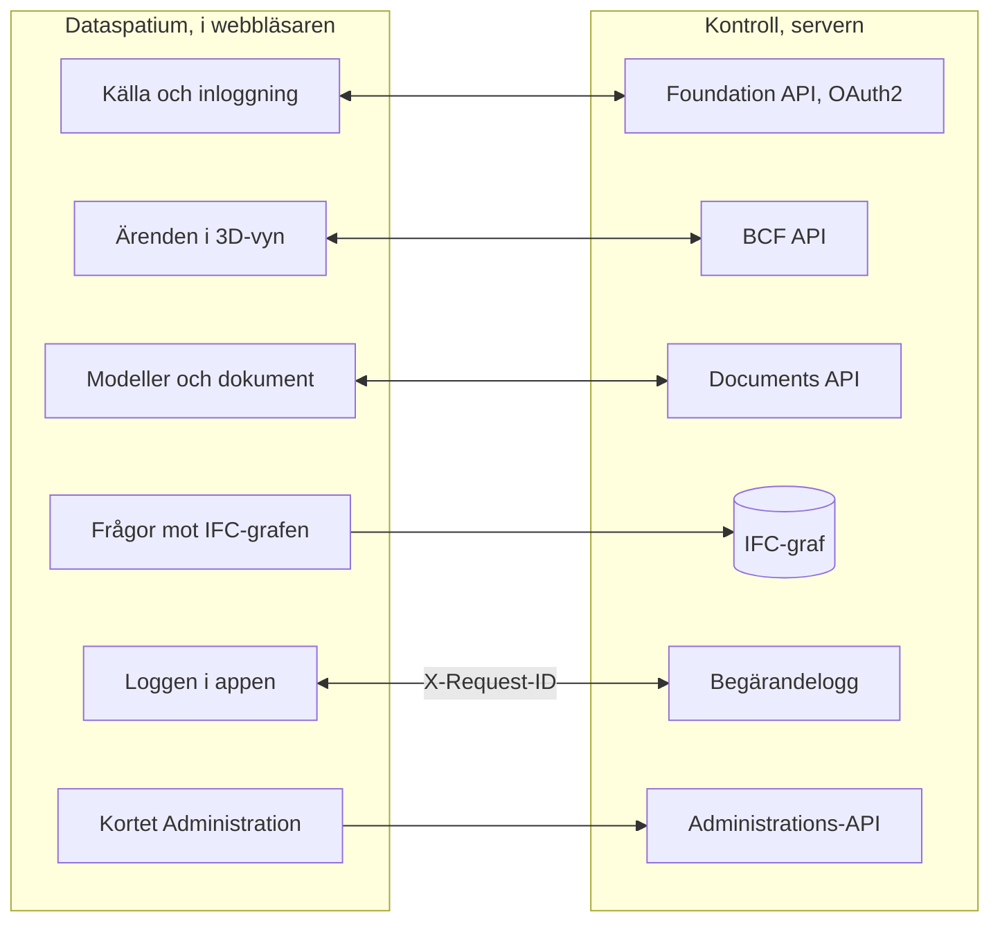

**Svenska** · [Dansk](docs/da/README.md) · [Norsk bokmål](docs/nb/README.md) · [Norsk nynorsk](docs/nn/README.md) · [Suomi](docs/fi/README.md) · [Íslenska](docs/is/README.md) · [English](docs/en/README.md)


# Kontroll OpenCDE-server

Kontroll är en server för buildingSMARTs **OpenCDE-API:er** (Foundation API
1.0, BCF API 3.0 och 2.1 samt Documents API 1.0), byggd på en grafdatabas, med
webbadministration och en valfri IFC-grafmodul som kopplar BCF-komponenter
till de byggdelar de pekar på. Den växte fram ur en forskningsprototyp från
2023 för digitala kontrollplaner i svenska bygglov och skrevs om från grunden
med säkerhet som första krav.
Klienter som följer specifikationerna ska kunna ansluta, så servern är
inte bunden till något enskilt program.


**Innehåll**

- [Ladda ned och kom igång](#ladda-ned-och-kom-igång)
- [Vad som krävs](#vad-som-krävs)
- [Vad du kan göra](#vad-du-kan-göra)
- [OpenCDE-API:erna och deras klienter](#opencde-apierna-och-deras-klienter)
- [Kontroll och Dataspatium](#kontroll-och-dataspatium)
- [Lär dig mer](#lär-dig-mer)
- [Begränsningar i korthet](#begränsningar-i-korthet)
- [Fel och förslag](#fel-och-förslag)
- [Utveckling](#utveckling)
- [Licens](#licens)

## Ladda ned och kom igång

### Snabbstart (lokalt, Docker)

1. **Ladda ned.** Klona repot, eller hämta den publicerade imagen
   `ghcr.io/marwiss/opencdeserver` (flera arkitekturer, skannad och med SBOM
   vid varje utgåva):

   ```sh
   git clone https://github.com/marwiss/Kontroll.git
   cd Kontroll
   ```

2. **Konfigurera.** Kopiera `.env.example` till `.env` och sätt
   `OPENCDE_GRAPH_PASSWORD` (minst 16 tecken). Varje inställning förklaras i
   [.env.example](.env.example).
3. **Starta.** `docker compose -f compose.yaml -f compose.dev.yaml up -d --build`
   startar servern på <http://127.0.0.1:8000> och en Neo4j-databas.
   `docker compose logs -f api` visar serverloggen.
4. **Se dig omkring.** <http://127.0.0.1:8000/docs> är den interaktiva
   API-dokumentationen, <http://127.0.0.1:8000/readyz> beredskapskontrollen
   och <http://127.0.0.1:7484> Neo4j Browser (Bolt på `127.0.0.1:7697`;
   utvecklingsöverlagringen undviker Neo4j:s standardportar, som ofta upptas
   av en annan Neo4j på samma dator).
5. **Lägg in demodata och logga in.**
   `docker compose -f compose.yaml -f compose.dev.yaml exec api opencde seed`
   skapar demoanvändare och projekt och skriver ut deras lösenord en gång.
   Logga in på <http://127.0.0.1:8000/signin> som `admin` och öppna `/admin`.
6. **Anslut en klient.** Registrera din app under *Klienter* (eller låt den
   registrera sig själv när `OPENCDE_DYNAMIC_CLIENT_REGISTRATION=true`) och
   peka den mot `http://127.0.0.1:8000`; [Dataspatium](#kontroll-och-dataspatium)
   och Python-biblioteket i [client/](client/) är färdiga klienter.
   Ska du logga in från Dataspatium, följ [snabbstarten](docs/sv/quickstart.md): den
   tar upp alla inställningar som krävs och vad du gör om något går fel.

Utan Docker för själva servern (en databas behövs fortfarande):

```sh
uv sync                          # installerar Python 3.13 och alla beroenden
uv run opencde doctor            # kontrollerar konfiguration och databas
uv run opencde serve             # http://127.0.0.1:8000
```

### Driftsättning

En compose-fil plus en överlagring per scenario:

| Scenario | Guide |
|---|---|
| Lokalt test på din dator | [docs/sv/deploy/local.md](docs/sv/deploy/local.md) |
| Publik https-adress för klienttester utan egen server (tunnel) | [docs/sv/deploy/tunnel.md](docs/sv/deploy/tunnel.md) |
| Produktion på egen server med Caddy (automatisk TLS) och nattliga säkerhetskopior | [docs/sv/deploy/vps-caddy.md](docs/sv/deploy/vps-caddy.md) |
| Coolify, Dokploy, Portainer | [docs/sv/deploy/paas.md](docs/sv/deploy/paas.md) |
| Containertjänst plus hanterad Neo4j AuraDB eller Memgraph Cloud | [docs/sv/deploy/cloud-aura.md](docs/sv/deploy/cloud-aura.md) |
| Säkerhetskopiering och återställning (flyttbar mellan Neo4j och Memgraph) | [docs/sv/deploy/backup.md](docs/sv/deploy/backup.md) |

`uv run opencde init --public-url https://cde.example.org` skriver en
produktions-`.env` med nya hemligheter; `opencde doctor` kontrollerar
resultatet.

### Konfiguration

Allt läses från miljövariabler med prefixet `OPENCDE_`, från `.env` eller
från Docker-hemligheter i `/run/secrets/opencde_<namn>`. Den kommenterade
listan finns i [.env.example](.env.example). Standardvärdena är säkra:
produktion vägrar starta utan en publik `https`-adress och ett
databaslösenord, och inget är öppet förrän det har konfigurerats.

## Vad som krävs

- Windows, macOS eller Linux med Docker (Desktop på Windows/macOS, Engine på
  Linux), eller Python 3.11 eller senare med [uv](https://docs.astral.sh/uv/)
  och en egen Neo4j 5.26- eller Memgraph 3.14-databas.
- Ungefär 1 GB minne för databascontainern (`NEO4J_HEAP` och
  `NEO4J_PAGECACHE` i `.env`), mer med IFC-grafmodulen.
- Lokalt: port 8000 för servern och 7484/7697 för databasen, alla bundna till
  `127.0.0.1`. I produktion: portarna 80 och 443 nåbara från internet och ett
  DNS-namn för servern.
- Klienter behöver en `https`-adress i produktion; lokalt accepteras
  `http://127.0.0.1` som redirect-URI, och `http://localhost` med `OPENCDE_ALLOW_LOCALHOST_REDIRECTS=true`.

## Vad du kan göra

- **Foundation API 1.0**: tjänsteupptäckt, OAuth2 authorization code med PKCE,
  aktuell användare, återkallelse av tokens och dynamisk
  klientregistrering med publika klienter (avstängd som standard).
- **BCF API 3.0 och 2.1**: projekt, extensions, ärenden med OData-frågor, kommentarer,
  viewpoints med snapshots, bitmaps och komponenter, filer,
  dokumentreferenser, dokument och händelseloggarna, allt validerat mot
  buildingSMARTs scheman.
- **Documents API 1.0**: val och nedladdning av dokument, uppladdning i delar
  med serverns webbsidor för metadata och urval, versionsfrågor med ETag.
- **Administration** i webbläsaren: logga in på `/signin` med ett
  administratörskonto och öppna `/admin` för att hantera användare och deras
  projektroller, projekt och deras BCF-extensionsvärden, OAuth2-klienter,
  sessioner, revisionsloggen, den valfria begärandeloggen och serverns
  hälsokontroller. Varje användare har `/account` för sitt eget lösenord,
  sina appar och sina sessioner. Kommandoraden (`uv run opencde --help`) gör
  samma sak från en terminal.
- **Tillägg utanför specifikationerna**, vart och ett markerat som sådant: ett
  kapabilitetsdokument på `/.well-known/kontroll` som berättar för klienten
  vilka tillägg som är påslagna, ett stabilt `code` i varje felkropp, en
  begärandelogg för felsökning av klienter (`/admin/requests`,
  `GET /admin/api/requests` med scopet `admin`), och IFC-grafmodulen som gör
  uppladdade IFC-modeller till grafdata kopplade till BCF-komponenter.
- **Ett klientbibliotek** i Python ([client/](client/), LGPL) med
  körbara exempel, samt Dockerfile, compose-överlagringar och en publicerad
  image för varje driftsättningsscenario.
- **Status**: alla elva etapper i planen är genomförda (de tre API:erna,
  administrationen, klientbiblioteket, driftsättning, IFC-graf,
  acceptanschecklistan och säkerhetshärdningen); bidraget till IfcOpenShell
  är ännu inte föreslaget (utkast i [docs/upstream/](docs/upstream/)).
  [docs/inventory.md](docs/inventory.md) visar vad prototypen från 2023 gjorde
  och var varje funktion står i den nya koden.


## OpenCDE-API:erna och deras klienter

OpenCDE är buildingSMART Internationals familj av öppna webb-API:er för en gemensam
datamiljö, den plats där ett projekt delar sina modeller, dokument och ärenden. En
klient och en server som följer samma specifikationer kan arbeta tillsammans, vem som
än har byggt dem. Kontroll implementerar alla tre:

| API | Vad det är till för | Specifikation |
|---|---|---|
| Foundation API 1.0 | Säger vilka API:er en server erbjuder, hur man loggar in och vem användaren är | [foundation-API](https://github.com/buildingSMART/foundation-API) |
| BCF API 3.0 och 2.1 | Ärenden om en modell, med kommentarer och viewpoints med kamera, komponenter och bilder | [BCF-API](https://github.com/buildingSMART/BCF-API) |
| Documents API 1.0 | Att välja, hämta och ladda upp dokument och deras versioner, via sidor på servern | [documents-API](https://github.com/buildingSMART/documents-API) |

**Dataspatium är en klient, inte den enda.** Varje klient som följer de här
specifikationerna ska kunna ansluta: inget på servern är beroende av Dataspatium, och
tilläggen utanför specifikationerna är valfria, så en klient som inte känner till dem
märker dem inte. En klient behöver tre saker:

- en registrering på servern, gjord av en administratör under *Klienter* eller av klienten
  själv när `OPENCDE_DYNAMIC_CLIENT_REGISTRATION=true`;
- OAuth2 authorization code med PKCE `S256`, som servern kräver av varje klient utom en konfidentiell som en administratör har märkt;
- BCF API 3.0, eller 2.1 för en klient som bara kan den versionen. `GET /foundation/versions` listar båda, och
  [klientguiden](docs/sv/client-guide.md) säger vad som skiljer dem åt.

Så långt är det visat: serverns svar provas mot buildingSMARTs scheman vid varje push,
och Dataspatium och Python-biblioteket i [client/](client/) körs mot servern. Oberoende
klienter som Bonsai och ifc-lite har en färdig checklista i
[docs/acceptance.md](docs/acceptance.md) som ännu inte är körd. Om du provar en klient, berätta
hur det gick under [Fel och förslag](#fel-och-förslag). När en klient och en specifikation inte
stämmer överens avgör specifikationen. [docs/sv/client-guide.md](docs/sv/client-guide.md) är till för den som bygger
en klient.

## Kontroll och Dataspatium

Kontroll (servern) och [Dataspatium](https://github.com/marwiss/Dataspatium)
(en dataapp som körs helt i webbläsaren) är utvecklade för att fungera
tillsammans som server och klient, och samma utgåvenummer på båda betyder
att de fungerar ihop: Dataspatium 2.0.0 fungerar med Kontroll 2.0.0
([snabbstart](docs/sv/quickstart.md)).
Dataspatium lägger till en Kontroll-server som källa: appen upptäcker
API:erna genom `/foundation/versions`, loggar in med OAuth2 authorization
code och PKCE och registrerar sig själv som publik klient när dynamisk
registrering är påslagen, listar projektets modeller och dokument, läser och
skriver BCF-ärenden med kommentarer och viewpoints tagna ur sin 3D-vy, laddar
upp datamängder, filer och arbetsytepaket genom Documents API, frågar
IFC-grafen med Cypher över Bolt när operatören exponerar den, och skickar
`X-Request-ID` på varje anrop så att begärandeloggen här och loggen i appen
visar samma samtal. Appen läser serverns kapabilitetsdokument för att se
vilka tillägg som är påslagna och reagerar på de felkoder servern lägger i
sina felkroppar.

Så här hänger de ihop:



Bortsett från de markerade tilläggen går allt Dataspatium gör mot servern
genom de tre OpenCDE-API:erna, så appen använder inget som en annan klient
inte kan använda, se [OpenCDE-API:erna och deras klienter](#opencde-apierna-och-deras-klienter). De två produkterna
installeras var för sig: det här repot buntar inte Dataspatium (licenserna
skiljer sig, AGPL här och PolyForm Strict där), och Dataspatiums README
beskriver hur appen hämtas. Klientsidan beskrivs i Dataspatiums README och
dess dokumentation; parets acceptanskörningar står i
[docs/acceptance.md](docs/acceptance.md) här, och vad de två projekten samordnar
står i [docs/dataspatium-coordination.md](docs/dataspatium-coordination.md).

## Lär dig mer

- [docs/sv/quickstart.md](docs/sv/quickstart.md): Kontroll och Dataspatium tillsammans på
  tjugo minuter, från tom dator till ett ärende skapat i 3D-vyn.
- [docs/sv/client-guide.md](docs/sv/client-guide.md) och [docs/examples/](docs/examples/):
  hur man bygger en klient, kapabilitetsdokumentet, felkoderna och körbara
  exempel med Python-biblioteket i [client/](client/).
- [docs/sv/architecture.md](docs/sv/architecture.md): hur delarna hänger ihop, vad som händer med ett anrop och var allt finns i koden.
- [docs/sv/glossary.md](docs/sv/glossary.md): orden som dokumentationen använder.
- [docs/sv/flows/](docs/sv/flows/): sekvensdiagram för OAuth2-, Documents API- och BCF-viewpoint-flödena.
- [docs/sv/graph-schema.md](docs/sv/graph-schema.md): grafmodellen.
- [docs/sv/ifcgraph.md](docs/sv/ifcgraph.md): den valfria IFC-grafmodulen och exempel på Cypher-frågor.
- [docs/sv/ui-styleguide.md](docs/sv/ui-styleguide.md): regler för serverns sidor och märket.
- [docs/acceptance.md](docs/acceptance.md): checklista för visuell acceptans med
  oberoende klienter (Bonsai, ifc-lite, Dataspatium).
- [docs/dataspatium-coordination.md](docs/dataspatium-coordination.md): vad
  Kontroll och Dataspatium delar och ägarens beslut.
- [docs/inventory.md](docs/inventory.md): funktionsinventering av prototypen
  från 2023 och status i omskrivningen, med noteringar om specifikationernas
  egenheter.
- [docs/adr/](docs/adr/): arkitekturbeslut (grafdatabas, opaka tokens, portabel
  Cypher, webbgränssnitt utan ramverk, repostrategi).
- [docs/sv/security/](docs/sv/security/): hotmodell, kontroller kopplade till tester,
  OWASP ASVS nivå 2-checklistan, personuppgifter och lagringstid, och hur
  skannrarna körs.
- [docs/upstream/](docs/upstream/): utkast till ärende och pull request för
  IfcOpenShell (inte skickade).
- [spec/SOURCES.md](spec/SOURCES.md): de exakta specifikationsversioner
  som servern testas mot.

Dokumentationen finns på den här README-filens sju språk: engelska under
`docs/`, de andra under `docs/<språk>/`. Projektloggarna (acceptans, inventering,
samordning), arkitekturbesluten, utkasten till IfcOpenShell och CONTRIBUTING
hålls på engelska.

### Vidare läsning

- [BCF API](https://github.com/buildingSMART/BCF-API), [Foundation API](https://github.com/buildingSMART/foundation-API) och [Documents API](https://github.com/buildingSMART/documents-API):
  specifikationerna som servern följer.
- [IFC](https://github.com/buildingSMART/IFC4.x-development): filformatet för byggnadsmodeller.
- [RFC 9700](https://www.rfc-editor.org/rfc/rfc9700): dagens bästa praxis för säkerhet i OAuth 2.0, och
  [OAuth 2.1](https://datatracker.ietf.org/doc/draft-ietf-oauth-v2-1/), utkastet som samlar den.
- [RFC 7636](https://www.rfc-editor.org/rfc/rfc7636) (PKCE), [RFC 8252](https://www.rfc-editor.org/rfc/rfc8252) (appar i datorn eller telefonen) och
  [RFC 7591](https://www.rfc-editor.org/rfc/rfc7591) (registrering av klienter).
- [OWASP ASVS](https://owasp.org/www-project-application-security-verification-standard/): checklistan för säkerhetsarbetet.

## Begränsningar i korthet

- Servern implementerar BCF API 3.0 och 2.1, inte 1.0, vars resurser ser annorlunda ut.
- Export av ett projekt som BCFzip överlåts åt klienterna; servern lagrar
  ärenden, kommentarer och viewpoints så som API:t definierar dem.
- Gemenskapsutgåvorna av Neo4j och Memgraph saknar läsbegränsade
  databasanvändare, så en exponerad Bolt-port ger full åtkomst åt den som
  har lösenordet. Porten förblir stängd om inte administratören avsiktligt
  publicerar den; administrations-API:ts läsande graffråga
  (`OPENCDE_GRAPH_QUERY_ENABLED`) ger Cypher utan porten.
- IFC-grafimporten körs i en separat process med minnes- och tidsgränser
  (`OPENCDE_IFCGRAPH_*`); mycket stora modeller avvisas i stället för att
  lämnas halvimporterade.
- Webbsidorna är till för administratörer och för OAuth2- och Documents
  API-flödena; slutanvändare arbetar i en klient som Dataspatium eller Bonsai.
- Sidorna finns på den här README-filens sju språk (byt längst ned på varje
  sida); kommandoraden och API:ernas felmeddelanden är på engelska.
- Ingen extern granskning ännu. OAuch- och testssl-körningarna i
  [docs/sv/security/pentest-howto.md](docs/sv/security/pentest-howto.md) är
  operatörens steg före en produktionsdriftsättning.

## Fel och förslag

Rapportera fel och önskemål som *Issues* här på GitHub. Ange vilken
serverversion du kör (`version` i `/.well-known/kontroll` eller `/healthz`),
vilken klient du använde och `X-Request-ID` för ett misslyckat anrop;
begärandeloggen och klientens logg delar det. Bifoga inga personuppgifter och
inga hemligheter. Hur ändringar tas emot står i
[CONTRIBUTING.md](CONTRIBUTING.md). För en säkerhetssårbarhet, följ
[SECURITY.md](SECURITY.md) i stället för att öppna ett ärende.

## Utveckling

```sh
uv run pytest                    # enhets-, konformans- och säkerhetstester
uv run pytest -m integration     # startar Neo4j/Memgraph med testcontainers (kräver Docker)
uv run pytest -m e2e             # klientbiblioteket mot en körande server (kräver Docker)
uv run pytest -m ui              # Playwright + axe-core (uv sync --group ui; playwright install chromium)
uv run ruff format . && uv run ruff check .
uv run ty check opencde client/opencde_client
```

Kod och kommentarer är på engelska eftersom servern och klientbiblioteket
ska bidras till IfcOpenShell, vars konventioner (ruff, 120 kolumner) följs.
README finns på engelska, svenska, danska, norska (bokmål och nynorsk),
finska och isländska (`docs/<språk>/README.md`, samma upplägg som
Dataspatium); dokumentationen och webbgränssnittet finns på samma språk,
med engelska alltid som ett val, och gemensamma termer följer Dataspatiums
ordlista. Varje push kör lint, typkontroll, testsviterna på tre
Python-versioner, webbläsartester med axe-core och statiska
säkerhetskontroller; nattliga jobb kör OWASP ZAP, Schemathesis och Trivy. Se
[CONTRIBUTING.md](CONTRIBUTING.md).

## Licens

Servern är licensierad under GNU Affero General Public License v3.0 eller
senare ([LICENSE](LICENSE)): den är servermjukvara, och AGPL:s
nätverksklausul håller förbättringar av driftsatta instanser öppna.
Klientbiblioteket i [client/](client/) är LGPL-3.0-or-later.
Specifikationsfilerna under [spec/](spec/) är © buildingSMART
International och vidaredistribueras oförändrade för testning. Se
[SECURITY.md](SECURITY.md) för hur en sårbarhet rapporteras och vad
projektet gör för att förbli säkert.
