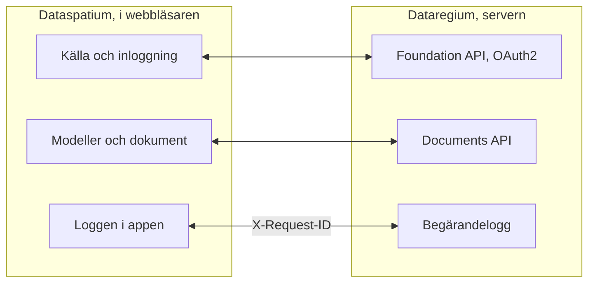

**Svenska** · [Dansk](docs/da/README.md) · [Norsk bokmål](docs/nb/README.md) · [Norsk nynorsk](docs/nn/README.md) · [Suomi](docs/fi/README.md) · [Íslenska](docs/is/README.md) · [English](docs/en/README.md)


# Dataregium OpenCDE-server

*Dataregium hette Kontroll fram till den 8 november 2026.*

*Det här är README för Dataregium 1.0.0. Den senaste utgåvan, 3.0.0, beskrivs i [README på main](https://github.com/marwiss/Dataregium#readme).*

Dataregium är en server där ett byggprojekt samlar sina modeller, dokument och
ärenden, så att alla i projektet arbetar mot samma underlag och ser samma
historik. Du arbetar mot den genom en app, till exempel
[Dataspatium](https://github.com/marwiss/Dataspatium) i webbläsaren; servern
har själv bara sidor för inloggning, uppladdning och administration. Den som
driver servern bestämmer vem som får logga in och vad var och en får göra i
varje projekt.

Tekniskt är Dataregium en server för buildingSMARTs öppna **OpenCDE-API:er**
(Foundation API 1.0, BCF API 3.0 och 2.1 samt Documents API 1.0), byggd på
grafdatabasen Neo4j eller Memgraph. 1.0.0 är en dokumentserver med Foundation API och Documents API; ärenden och modeller som graf kommer i
2.0.0. Servern skrevs om från grunden ur
en forskningsprototyp från 2023, med säkerhet som första krav, och varje klient
som följer specifikationerna kan ansluta.


**Innehåll**

- [Ladda ned och kom igång](#ladda-ned-och-kom-igång)
- [Vad som krävs](#vad-som-krävs)
- [Ord att känna till](#ord-att-känna-till)
- [Vad du kan göra](#vad-du-kan-göra)
- [OpenCDE-API:erna och deras klienter](#opencde-apierna-och-deras-klienter)
- [Dataregium och Dataspatium](#dataregium-och-dataspatium)
- [Lär dig mer](#lär-dig-mer)
- [Begränsningar i korthet](#begränsningar-i-korthet)
- [Personuppgifter](#personuppgifter)
- [Nyare utgåvor](#nyare-utgåvor)
- [Fel och förslag](#fel-och-förslag)
- [Utveckling](#utveckling)
- [Licens](#licens)

## Ladda ned och kom igång

Ska du bara använda Dataregium behöver du inte installera något: be den som
driver servern om adressen och ett konto, och logga in från Dataspatium eller en
annan OpenCDE-app. Vill du prova servern på din egen dator följer du
snabbstarten nedan. Den tar ungefär tjugo minuter och kräver Docker Desktop
eller Podman. Är du van vid containrar och Python står det korta sättet under
[För den tekniskt kunnige](#för-den-tekniskt-kunnige).

### Snabbstart (lokalt, Docker eller Podman)

En container är ett färdigpackat program som körs avskilt på datorn, och Docker
och Podman är program som startar containrar. Snabbstarten startar två: servern
och dess databas.

1. **Ladda ned.** Hämta koden med git, eller som ZIP-fil under *Code > Download
   ZIP* på GitHub. Kommandot nedan hämtar grenen `release-1`, som är 1.0.0; `release-2` är 2.0.0 och
   `main` är 3.0.0.

   ```sh
   git clone --branch release-1 https://github.com/marwiss/Dataregium.git
   cd Dataregium
   ```

2. **Ställ in.** Kopiera `.env.example` till `.env`, filen med serverns
   inställningar, och sätt `OPENCDE_GRAPH_PASSWORD` till ett eget lösenord på
   minst 16 tecken. Ska du prova med Dataspatium, sätt också
   `OPENCDE_DYNAMIC_CLIENT_REGISTRATION=true` och `OPENCDE_REQUEST_LOG_ENABLED=true`; [snabbstarten med Dataspatium](docs/sv/quickstart.md)
   förklarar varför. Varje inställning förklaras i [.env.example](.env.example).
3. **Starta.** Samma compose-filer fungerar med Docker och med Podman; välj den du har:

   <details open>
   <summary><b>Docker</b></summary>

   ```sh
   docker compose up -d --build
   ```

   startar servern på <http://127.0.0.1:8000> och en Neo4j-databas; första gången tar några minuter. `docker compose logs -f api` visar serverloggen.

   </details>

   <details>
   <summary><b>Podman</b></summary>

   ```sh
   podman compose up -d --build
   ```

   gör samma sak med Podman 5 (rootless, utan daemon); `podman compose logs -f api` visar serverloggen. Se [docs/sv/deploy/local.md](docs/sv/deploy/local.md) för Podmans särdrag.

   </details>

   <details>
   <summary><b>Utan container</b></summary>

   ```sh
   uv sync                          # installerar Python 3.13 och alla beroenden
   uv run opencde doctor            # kontrollerar konfiguration och databas
   uv run opencde serve             # http://127.0.0.1:8000
   ```

   kör servern från utcheckningen med [uv](https://docs.astral.sh/uv/); en databas behövs fortfarande (Neo4j Desktop, Memgraph Lab eller databasen ur compose-filerna).

   </details>

4. **Se dig omkring.** <http://127.0.0.1:8000/docs> visar varje anrop servern
   tar emot och låter dig prova dem, <http://127.0.0.1:8000/readyz> säger om
   servern och databasen är redo, och <http://127.0.0.1:7484> är Neo4j Browser,
   där du ser databasen (Bolt på `127.0.0.1:7697`; utvecklingsöverlagringen
   undviker Neo4j:s standardportar, som ofta upptas av en annan Neo4j på samma
   dator).
5. **Lägg in demodata och logga in.**

   <details open>
   <summary><b>Docker</b></summary>

   ```sh
   docker compose exec api opencde seed
   ```

   </details>

   <details>
   <summary><b>Podman</b></summary>

   ```sh
   podman compose exec api opencde seed
   ```

   </details>

   <details>
   <summary><b>Utan container</b></summary>

   ```sh
   uv run opencde seed
   ```

   </details>

   Kommandot skapar demoanvändare, projekt, klienter och en exempelmodell som dokument. Lösenorden skrivs ut en
   gång. Logga in på <http://127.0.0.1:8000/signin> som `admin` och öppna `/admin`.
6. **Anslut en klient.** Registrera din app under *Klienter* (eller låt den
   registrera sig själv när `OPENCDE_DYNAMIC_CLIENT_REGISTRATION=true`) och
   peka den mot `http://127.0.0.1:8000`; [Dataspatium](#dataregium-och-dataspatium)
   och Python-biblioteket i [client/](client/) är färdiga klienter.
   Ska du logga in från Dataspatium, följ [snabbstarten](docs/sv/quickstart.md): den
   tar upp alla inställningar som krävs och vad du gör om något går fel.

### Driftsättning

Ska andra använda servern behöver den ligga på en dator som alltid är på och
nås från internet, med en egen adress och https. Tabellen visar sätten att
göra det; den som inte själv driver servrar lämnar det åt någon som gör det.
Varje sätt är en compose-fil plus en överlagring:

| Scenario | Guide |
|---|---|
| Lokalt test på din dator | [docs/sv/deploy/local.md](docs/sv/deploy/local.md) |
| Publik https-adress för klienttester utan egen server (tunnel) | [docs/sv/deploy/tunnel.md](docs/sv/deploy/tunnel.md) |
| Produktion på egen server med Caddy (automatisk TLS) och nattliga säkerhetskopior | [docs/sv/deploy/vps-caddy.md](docs/sv/deploy/vps-caddy.md) |
| Coolify, Dokploy, Portainer | [docs/sv/deploy/paas.md](docs/sv/deploy/paas.md) |
| Containertjänst plus hanterad Neo4j AuraDB eller Memgraph Cloud | [docs/sv/deploy/cloud-aura.md](docs/sv/deploy/cloud-aura.md) |
| Säkerhetskopiering och återställning (flyttbar mellan Neo4j och Memgraph) | [docs/sv/deploy/backup.md](docs/sv/deploy/backup.md) |

`uv run opencde init --public-url https://cde.example.org` skriver en
produktions-`.env` med nya hemligheter; `opencde doctor` kontrollerar
resultatet.

### Konfiguration

Allt läses från miljövariabler med prefixet `OPENCDE_`, från `.env` eller
från Docker-hemligheter i `/run/secrets/opencde_<namn>`. Den kommenterade
listan finns i [.env.example](.env.example). Standardvärdena är säkra:
produktion vägrar starta utan en publik `https`-adress och ett
databaslösenord, och inget är öppet förrän det har konfigurerats.

### För den tekniskt kunnige

- **Image**: `ghcr.io/marwiss/opencdeserver:1.0.0` för amd64 och arm64, skannad med Trivy och med
  SBOM; `OPENCDE_IMAGE_TAG` väljer i compose-filerna, och 3-serien har taggen `3.0.0`.
- **Compose**: `docker/compose.yaml` plus överlagringar för utveckling, produktion med Caddy, Memgraph,
  extern databas, Bolt med TLS och tunnel. `COMPOSE_FILE` i `.env` väljer dem, så kommandona är utan `-f`.
- **Utan container**: Python 3.11 eller senare med uv (provad på 3.11, 3.13 och 3.14), `uv sync`, och
  Neo4j 5.26 eller Memgraph 3.14 på `OPENCDE_GRAPH_URI`.
- **De viktigaste inställningarna**: `OPENCDE_APIS` väljer API:erna och är `["documents"]` i 1.0.0, så
  BCF API är avstängt; `OPENCDE_ENVIRONMENT` är `development` eller `production`.
- **Ändpunkter**: `/.well-known/dataregium` (version och påslagna tillägg), `/foundation/versions`,
  `/openapi.json` och `/docs`, `/healthz` och `/readyz`, `/admin/api` (administration) och `/manage/1.0`
  (projektadministration).
- **Kommandoraden**: `opencde serve`, `init`, `doctor`, `seed`, `backup`,
  `restore`, `revoke`, `cleanup` och grupperna `user`, `project`, `client` och
  `ifcgraph`; `uv run opencde --help`.
- **Att bygga en klient**: [klientguiden](docs/sv/client-guide.md) har flödena,
  kapabilitetsdokumentet, felkoderna och tilläggen, och [docs/examples/](docs/examples/)
  körbara exempel.

## Vad som krävs

Den som bara använder Dataregium genom en app behöver en webbläsare och ett
konto. För att köra servern själv:

- Windows, macOS eller Linux med Docker (Desktop på Windows/macOS, Engine på
  Linux) eller Podman 5, eller Python 3.11 eller senare med
  [uv](https://docs.astral.sh/uv/) och en egen Neo4j 5.26- eller Memgraph 3.14-databas.
- Ungefär 1 GB minne för databascontainern (`NEO4J_HEAP` och
  `NEO4J_PAGECACHE` i `.env`), och mer för stora modeller med IFC-LPG.
- Lokalt: port 8000 för servern och 7484/7697 för databasen, alla bundna till
  `127.0.0.1`. I produktion: portarna 80 och 443 nåbara från internet och ett
  DNS-namn för servern.
- Klienter behöver en `https`-adress i produktion; lokalt accepteras
  `http://127.0.0.1` som redirect-URI, och `http://localhost` med `OPENCDE_ALLOW_LOCALHOST_REDIRECTS=true`.

## Ord att känna till

Orden README använder, i vardagligt språk; hela ordlistan finns i
[docs/sv/glossary.md](docs/sv/glossary.md).

- **BIM**: att bygga och förvalta med en digital modell av byggnaden, där varje
  vägg, dörr och rum är ett objekt med egenskaper och inte bara linjer på en ritning.
- **CAD**: program för ritningar och modeller; en BIM-modell görs i ett CAD-program.
- **IFC**: det öppna filformatet för BIM-modeller, som de stora programmen kan läsa och skriva.
- **BCF och ärenden**: ett öppet format för frågor och anmärkningar om en modell,
  med kommentarer och en vy (viewpoint) som visar var i modellen det gäller.
- **IDS**: ett krav på vad en modell ska innehålla, till exempel att varje dörr har
  en brandklass; servern kontrollerar modellerna mot projektets krav.
- **OpenCDE**: buildingSMARTs öppna regler för hur appar och servrar i ett
  byggprojekt talar med varandra. CDE betyder gemensam datamiljö.
- **API**: det sätt en app talar med servern på, med bestämda frågor och svar.
- **Server och klient**: servern lagrar och delar projektets underlag; klienten är
  appen du arbetar i, till exempel Dataspatium.
- **Databas och graf**: databasen är där servern sparar allt. En grafdatabas
  sparar saker och sambanden mellan dem, som en vägg som sitter på en våning, och
  kan därför svara på frågor om hur delarna hänger ihop.
- **Container**: ett färdigpackat program som körs avskilt på datorn; Docker och
  Podman startar dem.
- **OAuth2**: det säkra sättet att logga in från en app utan att appen får ditt lösenord.
- **Version**: varje gång ett dokument laddas upp på nytt blir det en ny version, och de tidigare finns kvar.

## Vad du kan göra

Det som går i en version går också i nästa. Varje version hör ihop med samma
version av Dataspatium.

### Version 1 (med Dataspatium 1)

- **Dokument på ett ställe** (Documents API 1.0): välja, ladda upp och hämta
  dokument och deras versioner genom serverns sidor, från en app som Dataspatium.
- **Inloggning och appar** (Foundation API 1.0): ett konto per person, inloggning
  med OAuth2 och PKCE, och appar som en administratör registrerar eller som
  registrerar sig själva när operatören tillåter det (se [klientguiden](docs/sv/client-guide.md)).
- **Administration** i webbläsaren (`/admin`) och på kommandoraden: användare
  och projektroller, projekt, klienter, sessioner, revisionsloggen och
  hälsokontrollerna; varje användare har `/account` för sitt lösenord och sina appar.
- **Hjälp för den som bygger en app**, markerad som tillägg: ett
  kapabilitetsdokument (`/.well-known/dataregium`), en stabil felkod i varje
  felsvar och en begärandelogg.
- **Ett klientbibliotek** i Python ([client/](client/)) med körbara exempel, och
  en publicerad image för varje driftsättning.
- **Projektansvariga administrerar sitt projekt**: en `manager` lägger till och
  tar bort medlemmar, byter deras roller och byter namn på projektet, utan att
  vara serveradministratör.

Det som också finns i version 2 och 3 står i
[README på main](https://github.com/marwiss/Dataregium#vad-du-kan-göra).


## OpenCDE-API:erna och deras klienter

OpenCDE är buildingSMART Internationals familj av öppna webb-API:er för en gemensam
datamiljö, den plats där ett projekt delar sina modeller, dokument och ärenden. En
klient och en server som följer samma specifikationer kan arbeta tillsammans, vem som
än har byggt dem. Dataregium implementerar alla tre:

| API | Vad det är till för | Specifikation |
|---|---|---|
| Foundation API 1.0 | Säger vilka API:er en server erbjuder, hur man loggar in och vem användaren är | [foundation-API](https://github.com/buildingSMART/foundation-API) |
| BCF API 3.0 och 2.1 | Ärenden om en modell, med kommentarer och viewpoints med kamera, komponenter och bilder | [BCF-API](https://github.com/buildingSMART/BCF-API) |
| Documents API 1.0 | Att välja, hämta och ladda upp dokument och deras versioner, via sidor på servern | [documents-API](https://github.com/buildingSMART/documents-API) |

**Dataspatium är en klient, inte den enda.** Varje klient som följer de här
specifikationerna ska kunna ansluta: inget på servern är beroende av Dataspatium, och
tilläggen utanför specifikationerna är valfria, så en klient som inte känner till dem
märker dem inte. En klient behöver tre saker:

- en registrering på servern, gjord av en administratör under *Klienter* eller av klienten
  själv när `OPENCDE_DYNAMIC_CLIENT_REGISTRATION=true`;
- OAuth2 authorization code med PKCE `S256`, som servern kräver av varje klient utom en konfidentiell som en administratör har märkt;
- BCF API 3.0, eller 2.1 för en klient som bara kan den versionen. `GET /foundation/versions` listar båda, och
  [klientguiden](docs/sv/client-guide.md) säger vad som skiljer dem åt.

Så långt är det visat: serverns svar provas mot buildingSMARTs scheman vid varje push,
och Dataspatium och Python-biblioteket i [client/](client/) körs mot servern. Oberoende
klienter som Bonsai och ifc-lite har en färdig checklista som ännu inte är körd. Om du provar en klient, berätta
hur det gick under [Fel och förslag](#fel-och-förslag). När en klient och en specifikation inte
stämmer överens avgör specifikationen. [docs/sv/client-guide.md](docs/sv/client-guide.md) är till för den som bygger
en klient.

## Dataregium och Dataspatium

Dataspatium är appen du arbetar i, och Dataregium är servern där projektets
gemensamma underlag ligger. [Dataspatium](https://github.com/marwiss/Dataspatium)
körs helt i webbläsaren, och de två är utvecklade för att fungera tillsammans.
Samma utgåvenummer betyder att de fungerar ihop: Dataspatium 1.0.0 fungerar med
Dataregium 1.0.0 ([snabbstart](docs/sv/quickstart.md)).

Dataspatium lägger till en Dataregium-server som källa: appen upptäcker API:erna genom
`/foundation/versions`, loggar in med OAuth2 authorization code och PKCE och registrerar sig själv som publik
klient när dynamisk registrering är påslagen. Den väljer dokument på serverns sidor, får dem som datamängder och
laddar upp datamängder, filer och arbetsytepaket genom Documents API. Appen skickar `X-Request-ID` på varje
anrop, så att begärandeloggen här och loggen i appen visar samma samtal, och reagerar på de felkoder servern
lägger i sina felkroppar.

Så här hänger de ihop:



Bortsett från de markerade tilläggen går allt Dataspatium gör mot servern
genom de tre OpenCDE-API:erna, så appen använder inget som en annan klient
inte kan använda, se [OpenCDE-API:erna och deras klienter](#opencde-apierna-och-deras-klienter). De två produkterna
installeras var för sig: det här repot buntar inte Dataspatium (licenserna
skiljer sig, AGPL här och PolyForm Strict där), och Dataspatiums README
beskriver hur appen hämtas och används.

### Utgåvorna 1, 2 och 3

Det finns en utgåva per huvudnummer, och den ges ut igen när den växer; bara den
senaste i varje serie rättas. Dataregium och Dataspatium med samma nummer hör ihop:

| Dataregium | Vad den har | Image | Hör ihop med |
|---|---|---|---|
| 1.0.0 | En dokumentserver: Foundation API och Documents API, webbadministrationen på sju språk, projektadministrationen för den projektansvarige och begärandeloggen. Den är 2.0.0-koden med bara Documents API påslaget (`OPENCDE_APIS`) | `1.0.0` | Dataspatium 1.0.0 |
| 2.0.0 | Också BCF API 3.0 och 2.1 på samma data och IFC-LPG-modulen som gör en graf av varje uppladdad IFC-fil | `2.0.0` | Dataspatium 2.0.0 |
| 3.0.0 | Också den förlustfria grafen ur biblioteket IFC-LPG, kontrollen av varje uppladdning, frågorna, jämförelserna och krocktestet, versioner med ändringsförslag som prövas, godkänns och sammanfogas, geometrin som glTF, den lokala motorn och recepten för molnet och nginx | `3.0.0`, `latest`, `3.0.0-gherkin` | Dataspatium 3.0.0 |

## Lär dig mer

- [docs/sv/quickstart.md](docs/sv/quickstart.md): Dataregium och Dataspatium tillsammans på
  tjugo minuter, från tom dator till ett ärende skapat i 3D-vyn.
- [docs/sv/client-guide.md](docs/sv/client-guide.md) och [docs/examples/](docs/examples/):
  hur man bygger en klient, kapabilitetsdokumentet, felkoderna och körbara exempel med Python-biblioteket i [client/](client/).
- [docs/sv/architecture.md](docs/sv/architecture.md): hur delarna hänger ihop, vad som händer med ett anrop och var allt finns i koden.
- [docs/sv/glossary.md](docs/sv/glossary.md): orden som dokumentationen använder.
- [docs/sv/flows/](docs/sv/flows/): sekvensdiagram för OAuth2-, Documents API- och BCF-viewpoint-flödena.
- [docs/sv/graph-schema.md](docs/sv/graph-schema.md): grafmodellen.
- [docs/sv/ifc-lpg.md](docs/sv/ifc-lpg.md): den valfria IFC-LPG-modulen och exempel på Cypher-frågor.
- Arkitekturbeslut som ligger fast: grafdatabas som enda lager, opaka token i stället för JWT, portabel
  Cypher för Neo4j och Memgraph, webbgränssnitt utan ramverk, säkerhetskopia på applikationsnivå, ett delat lager
  för begränsningar och BCF API 2.1 bredvid 3.0.
- [spec/SOURCES.md](spec/SOURCES.md): de exakta specifikationsversioner
  som servern testas mot.

Dokumentationen finns på den här README-filens sju språk, varje språk under
`docs/<språk>/`; engelskan under `docs/en/` är källan. CONTRIBUTING är på engelska.

### Vidare läsning

- [BCF API](https://github.com/buildingSMART/BCF-API), [Foundation API](https://github.com/buildingSMART/foundation-API) och [Documents API](https://github.com/buildingSMART/documents-API):
  specifikationerna som servern följer.
- [IFC](https://github.com/buildingSMART/IFC4.x-development): filformatet för byggnadsmodeller, och [IDS](https://github.com/buildingSMART/IDS): kravspecifikationer som modeller kontrolleras mot.
- [RFC 9700](https://www.rfc-editor.org/rfc/rfc9700): dagens bästa praxis för säkerhet i OAuth 2.0, och
  [OAuth 2.1](https://datatracker.ietf.org/doc/draft-ietf-oauth-v2-1/), utkastet som samlar den.
- [RFC 7636](https://www.rfc-editor.org/rfc/rfc7636) (PKCE), [RFC 8252](https://www.rfc-editor.org/rfc/rfc8252) (appar i datorn eller telefonen) och
  [RFC 7591](https://www.rfc-editor.org/rfc/rfc7591) (registrering av klienter).
- [OWASP ASVS](https://owasp.org/www-project-application-security-verification-standard/): checklistan för säkerhetsarbetet.

## Begränsningar i korthet

- 1.0.0 erbjuder Foundation API och Documents API; ärenden genom BCF API och modeller som graf hör till 2.0.0 och 3.0.0.
- Gemenskapsutgåvorna av Neo4j och Memgraph saknar läsbegränsade databasanvändare, så en exponerad Bolt-port ger
  full åtkomst åt den som har lösenordet. Porten förblir stängd om inte administratören avsiktligt publicerar den.
- Webbsidorna är till för inloggning, administration, uppladdning och val av dokument; slutanvändare arbetar i en
  klient som Dataspatium.
- Sidorna finns på den här README-filens sju språk (byt längst ned på varje sida); kommandoraden och API:ernas
  felmeddelanden är på engelska.
- Ingen extern granskning ännu. OAuch- och testssl-körningarna är operatörens steg före en produktionsdriftsättning.

## Personuppgifter

Den som driver Dataregium åt andra är personuppgiftsansvarig för det här. Servern lagrar användarkonton
(användarnamn, namn, valfri e-post, lösenordshash), projektmedlemskap, uppladdade filer med uppladdare och en
granskningslogg över vem som gjorde vad och från vilken adress. Lösenord, token och hemligheter lagras bara som
hashar. Token, sessioner, uppladdningssessioner och oanvända självregistrerade klienter går ut och städas av servern;
granskningsloggen gallras av operatören. En administratör tar bort ett konto under `/admin/users`, och dess sessioner
och token följer med. Granskningsloggen exporteras som CSV, dokumenten genom Documents API och hela databasen med
`opencde backup`. Vad Dataspatium sparar i webbläsaren står i appens egen dokumentation.

## Nyare utgåvor

Dataregium 2.0.0 lägger till BCF API 3.0 och 2.1 med ärenden och viewpoints och IFC-LPG-modulen, som gör en graf av
varje uppladdad modell. 3.0.0 gör dessutom grafen förlustfri, kontrollerar uppladdningarna och ger frågor,
jämförelser, versioner med ändringsförslag, geometrin som glTF och en lokal motor. 2.0.0 finns på grenen `release-2`
och 3.0.0 på `main`; båda beskrivs i [README på main](https://github.com/marwiss/Dataregium#readme).

## Fel och förslag

Rapportera fel och önskemål som *Issues* här på GitHub. Ange vilken
serverversion du kör (`version` i `/.well-known/dataregium` eller `/healthz`),
vilken klient du använde och `X-Request-ID` för ett misslyckat anrop;
begärandeloggen och klientens logg delar det. Bifoga inga personuppgifter och
inga hemligheter. Hur ändringar tas emot står i
[CONTRIBUTING.md](CONTRIBUTING.md). För en säkerhetssårbarhet, följ
[SECURITY.md](SECURITY.md) i stället för att öppna ett ärende.

## Utveckling

```sh
uv run pytest                    # enhets-, konformans- och säkerhetstester
uv run pytest -m integration     # startar Neo4j/Memgraph med testcontainers (kräver Docker)
uv run pytest -m e2e             # klientbiblioteket mot en körande server (kräver Docker)
uv run pytest -m ui              # Playwright + axe-core (uv sync --group ui; playwright install chromium)
uv run ruff format . && uv run ruff check .
uv run ty check opencde client/opencde_client
```

Kod och kommentarer är på engelska, och stilen följer IfcOpenShells
konventioner (ruff, 120 kolumner), så att det förblir möjligt att bidra med
servern till IfcOpenShell.
README finns på engelska, svenska, danska, norska (bokmål och nynorsk),
finska och isländska (`docs/<språk>/README.md`, samma upplägg som
Dataspatium); dokumentationen och webbgränssnittet finns på samma språk,
med engelska alltid som ett val, och gemensamma termer följer Dataspatiums
ordlista. Varje push kör lint, typkontroll, testsviterna på tre
Python-versioner, webbläsartester med axe-core och statiska
säkerhetskontroller; nattliga jobb kör OWASP ZAP, Schemathesis och Trivy. Se
[CONTRIBUTING.md](CONTRIBUTING.md).

## Licens

Servern är licensierad under GNU Affero General Public License v3.0 eller
senare ([LICENSE](LICENSE)): den är servermjukvara, och AGPL:s
nätverksklausul håller förbättringar av driftsatta instanser öppna.
Klientbiblioteket i [client/](client/) är LGPL-3.0-or-later.
Specifikationsfilerna under [spec/](spec/) är © buildingSMART
International och vidaredistribueras oförändrade för testning. Se
[SECURITY.md](SECURITY.md) för hur en sårbarhet rapporteras och vad
projektet gör för att förbli säkert.
