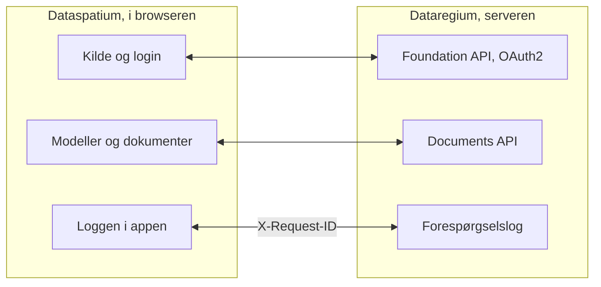

[Svenska](../../README.md) · **Dansk** · [Norsk bokmål](../nb/README.md) · [Norsk nynorsk](../nn/README.md) · [Suomi](../fi/README.md) · [Íslenska](../is/README.md) · [English](../en/README.md)


# Dataregium OpenCDE-server

*Dataregium hed Kontroll indtil 8. november 2026.*

*Dette er README for Dataregium 1.0.0. Den seneste udgivelse, 3.0.0, beskrives i [README på main](https://github.com/marwiss/Dataregium/blob/main/docs/da/README.md).*

Dataregium er en server, hvor et byggeprojekt samler sine modeller, dokumenter og
sager, så alle i projektet arbejder ud fra det samme grundlag og ser den samme
historik. Du arbejder med den gennem en app, for eksempel
[Dataspatium](https://github.com/marwiss/Dataspatium) i browseren; serveren har
selv kun sider til login, upload og administration. Den, der driver serveren,
bestemmer, hvem der må logge ind, og hvad hver enkelt må gøre i hvert projekt.

Teknisk er Dataregium en server for buildingSMARTs åbne **OpenCDE-API'er**
(Foundation API 1.0, BCF API 3.0 og 2.1 samt Documents API 1.0), bygget på
grafdatabasen Neo4j eller Memgraph. 1.0.0 er en dokumentserver med Foundation API og Documents API; sager og modeller som graf kommer i 2.0.0. Serveren blev skrevet om fra bunden ud fra
en forskningsprototype fra 2023, med sikkerhed som det første krav, og enhver klient,
der følger specifikationerne, kan forbinde sig.


**Indhold**

- [Download og kom i gang](#download-og-kom-i-gang)
- [Hvad der kræves](#hvad-der-kræves)
- [Ord du bør kende](#ord-du-bør-kende)
- [Hvad du kan](#hvad-du-kan)
- [OpenCDE-API'erne og deres klienter](#opencde-apierne-og-deres-klienter)
- [Dataregium og Dataspatium](#dataregium-og-dataspatium)
- [Lær mere](#lær-mere)
- [Begrænsninger i korte træk](#begrænsninger-i-korte-træk)
- [Personoplysninger](#personoplysninger)
- [Nyere udgivelser](#nyere-udgivelser)
- [Fejl og forslag](#fejl-og-forslag)
- [Udvikling](#udvikling)
- [Licens](#licens)

## Download og kom i gang

Skal du kun bruge Dataregium, behøver du ikke installere noget: bed den, der driver
serveren, om adressen og en konto, og log ind fra Dataspatium eller en anden
OpenCDE-app. Vil du prøve serveren på din egen computer, følger du den hurtige start
nedenfor. Den tager omkring tyve minutter og kræver Docker Desktop eller Podman. Er
du vant til containere og Python, står den korte vej under
[For den teknisk kyndige](#for-den-teknisk-kyndige).

### Hurtig start (lokalt, Docker eller Podman)

En container er et færdigpakket program, der kører afskærmet på computeren, og
Docker og Podman er programmer, der starter containere. Den hurtige start starter
to: serveren og dens database.

1. **Download.** Hent koden med git, eller som ZIP-fil under *Code > Download ZIP*
   på GitHub. Kommandoen nedenfor henter grenen `release-1`, som er 1.0.0; `release-2` er 2.0.0, og
   `main` er 3.0.0.

   ```sh
   git clone --branch release-1 https://github.com/marwiss/Dataregium.git
   cd Dataregium
   ```

2. **Indstil.** Kopiér `.env.example` til `.env`, filen med serverens
   indstillinger, og sæt `OPENCDE_GRAPH_PASSWORD` til din egen adgangskode på
   mindst 16 tegn. Skal du prøve med Dataspatium, så sæt også
   `OPENCDE_DYNAMIC_CLIENT_REGISTRATION=true` og `OPENCDE_REQUEST_LOG_ENABLED=true`; [den hurtige start med Dataspatium](quickstart.md)
   forklarer hvorfor. Hver indstilling er forklaret i [.env.example](../../.env.example).
3. **Start.** De samme compose-filer virker med Docker og med Podman; vælg den, du har:

   <details open>
   <summary><b>Docker</b></summary>

   ```sh
   docker compose up -d --build
   ```

   starter serveren på <http://127.0.0.1:8000> og en Neo4j-database; første gang tager et par minutter. `docker compose logs -f api` viser serverloggen.

   </details>

   <details>
   <summary><b>Podman</b></summary>

   ```sh
   podman compose up -d --build
   ```

   gør det samme med Podman 5 (rootless, uden daemon); `podman compose logs -f api` viser serverloggen. Se [deploy/local.md](deploy/local.md) for Podmans særpræg.

   </details>

   <details>
   <summary><b>Uden container</b></summary>

   ```sh
   uv sync                          # installerer Python 3.13 og alle afhængigheder
   uv run opencde doctor            # kontrollerer konfigurationen og databasen
   uv run opencde serve             # http://127.0.0.1:8000
   ```

   kører serveren fra udtjekningen med [uv](https://docs.astral.sh/uv/); der skal stadig være en database (Neo4j Desktop, Memgraph Lab eller databasen fra compose-filerne).

   </details>

4. **Se dig omkring.** <http://127.0.0.1:8000/docs> viser hvert kald, serveren
   tager imod, og lader dig prøve dem, <http://127.0.0.1:8000/readyz> siger, om
   serveren og databasen er klar, og <http://127.0.0.1:7484> er Neo4j Browser, hvor
   du ser databasen (Bolt på `127.0.0.1:7697`; udviklingsoverlejringen undgår
   Neo4js standardporte, som ofte er optaget af en anden Neo4j på samme computer).
5. **Indlæs demodata og log ind.**

   <details open>
   <summary><b>Docker</b></summary>

   ```sh
   docker compose exec api opencde seed
   ```

   </details>

   <details>
   <summary><b>Podman</b></summary>

   ```sh
   podman compose exec api opencde seed
   ```

   </details>

   <details>
   <summary><b>Uden container</b></summary>

   ```sh
   uv run opencde seed
   ```

   </details>

   Kommandoen opretter demobrugere, projekter, klienter og en eksempelmodel som dokument. Adgangskoderne udskrives én gang. Log
   ind på <http://127.0.0.1:8000/signin> som `admin` og åbn `/admin`.
6. **Forbind en klient.** Registrér din app under *Klienter* (eller lad den
   registrere sig selv, når `OPENCDE_DYNAMIC_CLIENT_REGISTRATION=true`) og peg den
   mod `http://127.0.0.1:8000`; [Dataspatium](#dataregium-og-dataspatium) og
   Python-biblioteket i [client/](../../client/) er færdige klienter. Skal du logge
   ind fra Dataspatium, så følg [den hurtige start](quickstart.md): den gennemgår
   alle de indstillinger, der kræves, og hvad du gør, hvis noget går galt.

### Udrulning

Skal andre bruge serveren, skal den ligge på en computer, der altid er tændt og kan
nås fra internettet, med sin egen adresse og https. Tabellen viser måderne at gøre
det på; den, der ikke selv driver servere, overlader det til en, der gør. Hver måde
er én compose-fil plus en overlejring:

| Scenarie | Vejledning |
|---|---|
| Lokal test på din computer | [deploy/local.md](deploy/local.md) |
| Offentlig https-adresse til klienttest uden egen server (tunnel) | [deploy/tunnel.md](deploy/tunnel.md) |
| Produktion på egen server med Caddy (automatisk TLS) og natlige sikkerhedskopier | [deploy/vps-caddy.md](deploy/vps-caddy.md) |
| Coolify, Dokploy, Portainer | [deploy/paas.md](deploy/paas.md) |
| En containertjeneste plus en administreret Neo4j AuraDB eller Memgraph Cloud | [deploy/cloud-aura.md](deploy/cloud-aura.md) |
| Sikkerhedskopiering og gendannelse (flytbar mellem Neo4j og Memgraph) | [deploy/backup.md](deploy/backup.md) |

`uv run opencde init --public-url https://cde.example.org` skriver en
produktions-`.env` med nye hemmeligheder; `opencde doctor` kontrollerer resultatet.

### Konfiguration

Alt læses fra miljøvariabler med præfikset `OPENCDE_`, fra `.env` eller fra
Docker-hemmeligheder i `/run/secrets/opencde_<navn>`. Den kommenterede liste findes
i [.env.example](../../.env.example). Standardværdierne er sikre: produktion nægter
at starte uden en offentlig `https`-adresse og en databaseadgangskode, og intet er
åbent, før det er konfigureret.

### For den teknisk kyndige

- **Image**: `ghcr.io/marwiss/opencdeserver:1.0.0` til amd64 og arm64, scannet med Trivy og med
  SBOM; `OPENCDE_IMAGE_TAG` vælger i compose-filerne, og 3-serien har tagget `3.0.0`.
- **Compose**: `docker/compose.yaml` plus overlejringer til udvikling, produktion med Caddy, Memgraph,
  en ekstern database, Bolt med TLS og en tunnel. `COMPOSE_FILE` i `.env` vælger dem, så kommandoerne er uden `-f`.
- **Uden container**: Python 3.11 eller nyere med uv (afprøvet på 3.11, 3.13 og 3.14), `uv sync`, og
  Neo4j 5.26 eller Memgraph 3.14 på `OPENCDE_GRAPH_URI`.
- **De vigtigste indstillinger**: `OPENCDE_APIS` vælger API'erne og er `["documents"]` i 1.0.0, så
  BCF API er slået fra; `OPENCDE_ENVIRONMENT` er `development` eller `production`.
- **Endepunkter**: `/.well-known/dataregium` (versionen og de udvidelser, der er slået til),
  `/foundation/versions`, `/openapi.json` og `/docs`, `/healthz` og `/readyz`, `/admin/api` (administration) og
  `/manage/1.0` (projektadministration).
- **Kommandolinjen**: `opencde serve`, `init`, `doctor`, `seed`, `backup`,
  `restore`, `revoke`, `cleanup` og grupperne `user`, `project`, `client` og
  `ifcgraph`; `uv run opencde --help`.
- **At bygge en klient**: [klientguiden](client-guide.md) har flowene,
  kapabilitetsdokumentet, fejlkoderne og udvidelserne, og [docs/examples/](../examples/)
  kørbare eksempler.

## Hvad der kræves

Den, der kun bruger Dataregium gennem en app, behøver en browser og en konto. For selv
at køre serveren:

- Windows, macOS eller Linux med Docker (Desktop på Windows/macOS, Engine på Linux)
  eller Podman 5, eller Python 3.11 eller nyere med [uv](https://docs.astral.sh/uv/)
  og en egen Neo4j 5.26- eller Memgraph 3.14-database.
- Omkring 1 GB hukommelse til databasecontaineren (`NEO4J_HEAP` og
  `NEO4J_PAGECACHE` i `.env`), og mere til store modeller med IFC-LPG.
- Lokalt: port 8000 til serveren og 7484/7697 til databasen, alle bundet til
  `127.0.0.1`. I produktion: portene 80 og 443 tilgængelige fra internettet og et
  DNS-navn til serveren.
- Klienter skal have en `https`-adresse i produktion; lokalt accepteres
  `http://127.0.0.1` som redirect-URI, og `http://localhost` med `OPENCDE_ALLOW_LOCALHOST_REDIRECTS=true`.

## Ord du bør kende

De ord, denne README bruger, på almindeligt dansk; hele ordlisten findes i
[glossary.md](glossary.md).

- **BIM**: at bygge og forvalte med en digital model af bygningen, hvor hver væg,
  dør og hvert rum er et objekt med egenskaber og ikke bare streger på en tegning.
- **CAD**: programmer til tegninger og modeller; en BIM-model laves i et CAD-program.
- **IFC**: det åbne filformat for BIM-modeller, som de store programmer kan læse og skrive.
- **BCF og sager**: et åbent format for spørgsmål og bemærkninger om en model, med
  kommentarer og en visning (viewpoint), der viser, hvor i modellen det gælder.
- **IDS**: et krav til, hvad en model skal indeholde, for eksempel at hver dør har en
  brandklasse; serveren kontrollerer modellerne mod projektets krav.
- **OpenCDE**: buildingSMARTs åbne regler for, hvordan apps og servere i et
  byggeprojekt taler sammen. CDE betyder fælles datamiljø.
- **API**: den måde, en app taler med serveren på, med faste spørgsmål og svar.
- **Server og klient**: serveren gemmer og deler projektets grundlag; klienten er den
  app, du arbejder i, for eksempel Dataspatium.
- **Database og graf**: databasen er der, hvor serveren gemmer alt. En grafdatabase
  gemmer ting og forbindelserne mellem dem, som en væg, der står på en etage, og kan
  derfor svare på spørgsmål om, hvordan delene hænger sammen.
- **Container**: et færdigpakket program, der kører afskærmet på computeren; Docker og
  Podman starter dem.
- **OAuth2**: den sikre måde at logge ind fra en app på, uden at appen får din adgangskode.
- **Version**: hver gang et dokument uploades igen, bliver det en ny version, og de tidligere bliver
  liggende.

## Hvad du kan

Det, der virker i én version, virker også i den næste. Hver version hører sammen
med den samme version af Dataspatium.

### Version 1 (med Dataspatium 1)

- **Dokumenter ét sted** (Documents API 1.0): vælge, uploade og hente dokumenter og
  deres versioner gennem serverens sider, fra en app som Dataspatium.
- **Login og apps** (Foundation API 1.0): én konto pr. person, login med OAuth2 og
  PKCE, og apps, som en administrator registrerer, eller som registrerer sig selv,
  når operatøren tillader det (se [klientguiden](client-guide.md)).
- **Administration** i browseren (`/admin`) og på kommandolinjen: brugere og deres
  projektroller, projekter, klienter, sessioner, revisionsloggen og
  helbredstjekkene; hver bruger har `/account` til sin adgangskode og sine apps.
- **Hjælp til den, der bygger en app**, markeret som udvidelser: et
  kapabilitetsdokument (`/.well-known/dataregium`), en stabil fejlkode i hvert
  fejlsvar og en forespørgselslog.
- **Et klientbibliotek** i Python ([client/](../../client/)) med kørbare eksempler,
  og et publiceret image til hver udrulning.
- **Projektansvarlige administrerer deres projekt**: en `manager` tilføjer og fjerner
  medlemmer, skifter deres roller og omdøber projektet, uden at være
  serveradministrator.

Det, der også findes i version 2 og 3, står i [README på main](https://github.com/marwiss/Dataregium/blob/main/docs/da/README.md#hvad-du-kan).


## OpenCDE-API'erne og deres klienter

OpenCDE er buildingSMART Internationals familie af åbne web-API'er til et fælles
datamiljø, det sted, hvor et projekt deler sine modeller, dokumenter og sager. En
klient og en server, der følger de samme specifikationer, kan arbejde sammen, uanset
hvem der har bygget dem. Dataregium implementerer alle tre:

| API | Hvad det er til | Specifikation |
|---|---|---|
| Foundation API 1.0 | Siger, hvilke API'er en server tilbyder, hvordan man logger ind, og hvem brugeren er | [foundation-API](https://github.com/buildingSMART/foundation-API) |
| BCF API 3.0 og 2.1 | Sager om en model, med kommentarer og viewpoints med kamera, komponenter og billeder | [BCF-API](https://github.com/buildingSMART/BCF-API) |
| Documents API 1.0 | At vælge, hente og uploade dokumenter og deres versioner via sider på serveren | [documents-API](https://github.com/buildingSMART/documents-API) |

**Dataspatium er en klient, ikke den eneste.** Enhver klient, der følger disse
specifikationer, skal kunne forbinde sig: intet på serveren afhænger af Dataspatium, og
udvidelserne uden for specifikationerne er valgfrie, så en klient, der ikke kender dem,
ikke mærker dem. En klient har brug for tre ting:

- en registrering på serveren, foretaget af en administrator under *Klienter* eller af
  klienten selv, når `OPENCDE_DYNAMIC_CLIENT_REGISTRATION=true`;
- OAuth2 authorization code med PKCE `S256`, som serveren kræver af hver klient undtagen en fortrolig, som en administrator har markeret;
- BCF API 3.0, eller 2.1 for en klient, der kun kan den version. `GET /foundation/versions` lister begge, og
  [klientguiden](client-guide.md) fortæller, hvad der adskiller dem.

Så langt er det vist: serverens svar testes mod buildingSMARTs skemaer ved hvert push,
og Dataspatium og Python-biblioteket i [client/](../../client/) kører mod serveren. Uafhængige
klienter som Bonsai og ifc-lite har en færdig tjekliste, som endnu ikke er kørt. Hvis du prøver en klient, så
fortæl, hvordan det gik, under [Fejl og forslag](#fejl-og-forslag). Når en klient og en specifikation
ikke stemmer overens, afgør specifikationen. [docs/da/client-guide.md](client-guide.md) er til dem, der
bygger en klient.

## Dataregium og Dataspatium

Dataspatium er den app, du arbejder i, og Dataregium er den server, hvor projektets
fælles grundlag ligger. [Dataspatium](https://github.com/marwiss/Dataspatium) kører
helt i browseren, og de to er udviklet til at arbejde sammen. Det samme
udgivelsesnummer betyder, at de virker sammen: Dataspatium 1.0.0 virker med
Dataregium 1.0.0 ([hurtig start](quickstart.md)).

Dataspatium tilføjer en Dataregium-server som kilde: appen opdager API'erne gennem
`/foundation/versions`, logger ind med OAuth2 authorization code og PKCE og registrerer sig selv som offentlig
klient, når dynamisk registrering er slået til. Den vælger dokumenter på serverens sider, får dem som datasæt og
uploader datasæt, filer og arbejdsområdepakker gennem Documents API. Appen sender `X-Request-ID` med hvert kald,
så forespørgselsloggen her og loggen i appen viser den samme samtale, og reagerer på de fejlkoder, serveren
lægger i sine fejlsvar.

Sådan hænger de sammen:



Bortset fra de markerede udvidelser går alt, hvad Dataspatium gør mod serveren,
gennem de tre OpenCDE-API'er, så appen bruger intet, som en anden klient ikke kan
bruge; se [OpenCDE-API'erne og deres klienter](#opencde-apierne-og-deres-klienter).
De to produkter installeres hver for sig: dette repository samler ikke Dataspatium
(licenserne er forskellige, AGPL her og PolyForm Strict der), og Dataspatiums README
beskriver, hvordan appen hentes og bruges.

### Udgivelserne 1, 2 og 3

Der er én udgivelse pr. hovednummer, og den udgives igen, når den vokser; kun den
seneste i hver serie rettes. Dataregium og Dataspatium med det samme nummer hører sammen:

| Dataregium | Hvad den har | Image | Hører sammen med |
|---|---|---|---|
| 1.0.0 | En dokumentserver: Foundation API og Documents API, webadministrationen på syv sprog, projektadministrationen for den projektansvarlige og forespørgselsloggen. Den er 2.0.0-koden med kun Documents API slået til (`OPENCDE_APIS`) | `1.0.0` | Dataspatium 1.0.0 |
| 2.0.0 | Også BCF API 3.0 og 2.1 på de samme data og IFC-LPG-modulet, der laver en graf af hver uploadet IFC-fil | `2.0.0` | Dataspatium 2.0.0 |
| 3.0.0 | Også den tabsfri graf fra biblioteket IFC-LPG, kontrollen af hver upload, forespørgslerne, sammenligningerne og kollisionskontrollen, versioner med ændringsforslag, der prøves, godkendes og flettes, geometrien som glTF, den lokale motor og opskrifterne til skyen og nginx | `3.0.0`, `latest`, `3.0.0-gherkin` | Dataspatium 3.0.0 |

## Lær mere

- [quickstart.md](quickstart.md): Dataregium og Dataspatium sammen på tyve minutter,
  fra en tom computer til en sag oprettet i 3D-visningen.
- [client-guide.md](client-guide.md) og [docs/examples/](../examples/): hvordan man bygger en klient, kapabilitetsdokumentet, fejlkoderne og kørbare eksempler med Python-biblioteket i [client/](../../client/).
- [architecture.md](architecture.md): hvordan delene hænger sammen, hvad der sker med et kald, og hvor alt findes i koden.
- [glossary.md](glossary.md): de ord, dokumentationen bruger.
- [flows/](flows/): sekvensdiagrammer for OAuth2-, Documents API- og BCF-viewpoint-flowene.
- [graph-schema.md](graph-schema.md): grafmodellen.
- [ifc-lpg.md](ifc-lpg.md): det valgfri IFC-LPG-modul og eksempler på Cypher-forespørgsler.
- Arkitekturbeslutninger, der ligger fast: en grafdatabase som eneste lager, opake tokens i stedet for
  JWT, portabel Cypher til Neo4j og Memgraph, en webgrænseflade uden framework, sikkerhedskopi på
  applikationsniveau, et fælles lager for begrænsninger og BCF API 2.1 ved siden af 3.0.
- [spec/SOURCES.md](../../spec/SOURCES.md): de præcise specifikationsversioner, som
  serveren testes mod.

Dokumentationen findes på denne README's syv sprog, hvert sprog under
`docs/<sprog>/`; engelsk under `docs/en/` er kilden. CONTRIBUTING er på engelsk.

### Videre læsning

- [BCF API](https://github.com/buildingSMART/BCF-API), [Foundation API](https://github.com/buildingSMART/foundation-API) og [Documents API](https://github.com/buildingSMART/documents-API):
  de specifikationer, serveren følger.
- [IFC](https://github.com/buildingSMART/IFC4.x-development): filformatet for bygningsmodeller, og [IDS](https://github.com/buildingSMART/IDS): kravspecifikationer, som modeller kontrolleres mod.
- [RFC 9700](https://www.rfc-editor.org/rfc/rfc9700): nutidens bedste praksis for sikkerhed i OAuth 2.0, og
  [OAuth 2.1](https://datatracker.ietf.org/doc/draft-ietf-oauth-v2-1/), udkastet, der samler den.
- [RFC 7636](https://www.rfc-editor.org/rfc/rfc7636) (PKCE), [RFC 8252](https://www.rfc-editor.org/rfc/rfc8252) (apps på computeren eller telefonen) og
  [RFC 7591](https://www.rfc-editor.org/rfc/rfc7591) (registrering af klienter).
- [OWASP ASVS](https://owasp.org/www-project-application-security-verification-standard/): tjeklisten for sikkerhedsarbejdet.

## Begrænsninger i korte træk

- 1.0.0 tilbyder Foundation API og Documents API; sager gennem BCF API og modeller som graf hører til 2.0.0 og 3.0.0.
- Community-udgaverne af Neo4j og Memgraph mangler databasebrugere med kun læseadgang, så en eksponeret Bolt-port
  giver fuld adgang til den, der har adgangskoden. Porten forbliver lukket, medmindre administratoren bevidst
  publicerer den.
- Websiderne er til login, administration, upload og valg af dokumenter; slutbrugere arbejder i en klient som
  Dataspatium.
- Siderne findes på denne README's syv sprog (skift nederst på hver side); kommandolinjen og API'ernes
  fejlmeddelelser er på engelsk.
- Ingen ekstern gennemgang endnu. OAuch- og testssl-kørslerne er operatørens trin før en produktionsudrulning.

## Personoplysninger

Den, der driver Dataregium for andre, er dataansvarlig for dette. Serveren gemmer brugerkonti (brugernavn, navn,
valgfri e-mail, adgangskodehash), projektmedlemskaber, uploadede filer med uploaderen og en revisionslog over, hvem
der gjorde hvad og fra hvilken adresse. Adgangskoder, tokens og hemmeligheder gemmes kun som hashes. Tokens,
sessioner, upload-sessioner og ubrugte selvregistrerede klienter udløber og ryddes op af serveren; revisionsloggen
beskæres af operatøren. En administrator sletter en konto under `/admin/users`, og dens sessioner og tokens følger
med. Revisionsloggen eksporteres som CSV, dokumenterne gennem Documents API og hele databasen med `opencde backup`.
Hvad Dataspatium gemmer i browseren, står i appens egen dokumentation.

## Nyere udgivelser

Dataregium 2.0.0 tilføjer BCF API 3.0 og 2.1 med sager og viewpoints og IFC-LPG-modulet, der laver en graf af hver
uploadet model. 3.0.0 gør desuden grafen tabsfri, kontrollerer uploadene og giver forespørgsler, sammenligninger,
versioner med ændringsforslag, geometrien som glTF og en lokal motor. 2.0.0 ligger på grenen `release-2` og 3.0.0
på `main`; begge beskrives i [README på main](https://github.com/marwiss/Dataregium/blob/main/docs/da/README.md).

## Fejl og forslag

Rapportér fejl og ønsker som *Issues* her på GitHub. Angiv, hvilken
serverversion du kører (`version` i `/.well-known/dataregium` eller `/healthz`),
hvilken klient du brugte, og `X-Request-ID` for et mislykket kald;
forespørgselsloggen og klientens log deler det. Vedhæft ingen personoplysninger
og ingen hemmeligheder. Hvordan ændringer modtages, står i
[CONTRIBUTING.md](../../CONTRIBUTING.md). Ved en sikkerhedssårbarhed, følg
[SECURITY.md](../../SECURITY.md) i stedet for at åbne et issue.

## Udvikling

```sh
uv run pytest                    # enheds-, konformans- og sikkerhedstests
uv run pytest -m integration     # starter Neo4j/Memgraph med testcontainers (kræver Docker)
uv run pytest -m e2e             # klientbiblioteket mod en kørende server (kræver Docker)
uv run pytest -m ui              # Playwright + axe-core (uv sync --group ui; playwright install chromium)
uv run ruff format . && uv run ruff check .
uv run ty check opencde client/opencde_client
```

Kode og kommentarer er på engelsk, og stilen følger IfcOpenShells
konventioner (ruff, 120 kolonner), så det forbliver muligt at bidrage med
serveren til IfcOpenShell.
README findes på engelsk, svensk, dansk, norsk (bokmål og nynorsk), finsk og
islandsk (`docs/<sprog>/README.md`, samme opbygning som Dataspatium);
dokumentationen og webgrænsefladen findes på de samme sprog, med engelsk
altid som en mulighed, og fælles termer følger Dataspatiums ordliste. Hvert
push kører lint, typekontrol, testsuiterne på tre Python-versioner,
browsertests med axe-core og statiske sikkerhedstjek; natlige job kører OWASP
ZAP, Schemathesis og Trivy. Se [CONTRIBUTING.md](../../CONTRIBUTING.md).

## Licens

Serveren er licenseret under GNU Affero General Public License v3.0 eller
senere ([LICENSE](../../LICENSE)): den er serversoftware, og AGPL's
netværksklausul holder forbedringer af hostede instanser åbne.
Klientbiblioteket i [client/](../../client/) er LGPL-3.0-or-later.
Specifikationsfilerne under [spec/](../../spec/) er © buildingSMART
International og videredistribueres uændret til test. Se
[SECURITY.md](../../SECURITY.md) for, hvordan en sårbarhed rapporteres, og
hvad projektet gør for at forblive sikkert.
