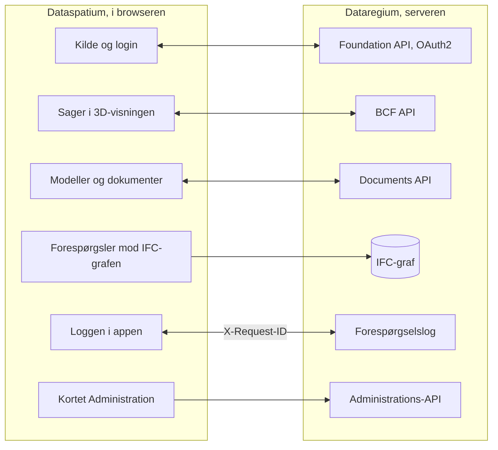

[Svenska](../../README.md) · **Dansk** · [Norsk bokmål](../nb/README.md) · [Norsk nynorsk](../nn/README.md) · [Suomi](../fi/README.md) · [Íslenska](../is/README.md) · [English](../en/README.md)


# Dataregium OpenCDE-server

*Dataregium hed Kontroll indtil 8. november 2026.*

Dataregium er en server til buildingSMARTs **OpenCDE-API'er** (Foundation API
1.0, BCF API 3.0 og 2.1 samt Documents API 1.0), bygget på en grafdatabase, med
webadministration og et valgfrit IFC-LPG-modul, der knytter BCF-komponenter
til de bygningsdele, de peger på. Den voksede ud af en forskningsprototype
fra 2023 til digitale kontrolplaner i svenske byggetilladelser og blev
skrevet om fra bunden med sikkerhed som første krav.
Klienter, der følger specifikationerne, skal kunne forbinde sig, så serveren
ikke er bundet til et bestemt program.


**Indhold**

- [Download og kom i gang](#download-og-kom-i-gang)
- [Hvad der kræves](#hvad-der-kræves)
- [Hvad du kan](#hvad-du-kan)
- [OpenCDE-API'erne og deres klienter](#opencde-apierne-og-deres-klienter)
- [Dataregium og Dataspatium](#dataregium-og-dataspatium)
- [Lær mere](#lær-mere)
- [Begrænsninger i korte træk](#begrænsninger-i-korte-træk)
- [Det næste i 3-serien](#det-næste-i-3-serien)
- [Fejl og forslag](#fejl-og-forslag)
- [Udvikling](#udvikling)
- [Licens](#licens)

## Download og kom i gang

### Hurtig start (lokalt, Docker)

1. **Download.** Klon repoet, eller hent det udgivne image
   `ghcr.io/marwiss/opencdeserver` (flere arkitekturer, scannet og med SBOM
   ved hver udgivelse):

   ```sh
   git clone https://github.com/marwiss/Dataregium.git
   cd Dataregium
   ```

2. **Konfigurer.** Kopiér `.env.example` til `.env`, og sæt
   `OPENCDE_GRAPH_PASSWORD` (mindst 16 tegn). Hver indstilling forklares i
   [.env.example](../../.env.example).
3. **Start.** `docker compose up -d --build`
   starter serveren på <http://127.0.0.1:8000> og en Neo4j-database.
   `docker compose logs -f api` viser serverloggen.
4. **Se dig omkring.** <http://127.0.0.1:8000/docs> er den interaktive
   API-dokumentation, <http://127.0.0.1:8000/readyz> beredskabskontrollen og
   <http://127.0.0.1:7484> Neo4j Browser (Bolt på `127.0.0.1:7697`;
   udviklingsoverlejringen undgår Neo4js standardporte, som ofte er optaget af
   en anden Neo4j på samme maskine).
5. **Tilføj demodata, og log ind.**
   `docker compose exec api opencde seed`
   opretter demobrugere og projekter og udskriver deres kodeord én gang. Log
   ind på <http://127.0.0.1:8000/signin> som `admin`, og åbn `/admin`.
6. **Tilslut en klient.** Registrér din app under *Klienter* (eller lad den
   registrere sig selv, når `OPENCDE_DYNAMIC_CLIENT_REGISTRATION=true`), og
   peg den mod `http://127.0.0.1:8000`; [Dataspatium](#dataregium-og-dataspatium)
   og Python-biblioteket i [client/](../../client/) er færdige klienter.
   Skal du logge ind fra Dataspatium, så følg [den hurtige start](quickstart.md):
   den dækker alle de nødvendige indstillinger, og hvad du gør, hvis noget går galt.

Uden Docker til selve serveren (en database er stadig nødvendig):

```sh
uv sync                          # installerer Python 3.13 og alle afhængigheder
uv run opencde doctor            # kontrollerer konfiguration og database
uv run opencde serve             # http://127.0.0.1:8000
```

### Udrulning

Én compose-fil plus én overlejring pr. scenarie:

| Scenarie | Vejledning |
|---|---|
| Lokal test på din egen maskine | [docs/da/deploy/local.md](deploy/local.md) |
| Offentlig https-adresse til klienttest uden egen server (tunnel) | [docs/da/deploy/tunnel.md](deploy/tunnel.md) |
| Produktion på egen server med Caddy (automatisk TLS) og natlige sikkerhedskopier | [docs/da/deploy/vps-caddy.md](deploy/vps-caddy.md) |
| Coolify, Dokploy, Portainer | [docs/da/deploy/paas.md](deploy/paas.md) |
| Containertjeneste plus administreret Neo4j AuraDB eller Memgraph Cloud | [docs/da/deploy/cloud-aura.md](deploy/cloud-aura.md) |
| Sikkerhedskopiering og gendannelse (flytbar mellem Neo4j og Memgraph) | [docs/da/deploy/backup.md](deploy/backup.md) |

`uv run opencde init --public-url https://cde.example.org` skriver en
produktions-`.env` med nye hemmeligheder; `opencde doctor` kontrollerer
resultatet.

### Konfiguration

Alt læses fra miljøvariabler med præfikset `OPENCDE_`, fra `.env` eller fra
Docker-hemmeligheder i `/run/secrets/opencde_<navn>`. Den kommenterede liste
findes i [.env.example](../../.env.example). Standardværdierne er sikre:
produktion nægter at starte uden en offentlig `https`-adresse og et
databasekodeord, og intet er åbent, før det er konfigureret.

## Hvad der kræves

- Windows, macOS eller Linux med Docker (Desktop på Windows/macOS, Engine på
  Linux), eller Python 3.11 eller nyere med [uv](https://docs.astral.sh/uv/)
  og en egen Neo4j 5.26- eller Memgraph 3.14-database.
- Omkring 1 GB hukommelse til databasecontaineren (`NEO4J_HEAP` og
  `NEO4J_PAGECACHE` i `.env`), mere med IFC-LPG-modulet.
- Lokalt: port 8000 til serveren og 7484/7697 til databasen, alle bundet til
  `127.0.0.1`. I produktion: portene 80 og 443 tilgængelige fra internettet og
  et DNS-navn til serveren.
- Klienter har brug for en `https`-adresse i produktion; lokalt accepteres
  `http://127.0.0.1` som redirect-URI, og `http://localhost` med `OPENCDE_ALLOW_LOCALHOST_REDIRECTS=true`.

## Hvad du kan

- **Foundation API 1.0**: tjenesteopdagelse, OAuth2 authorization code med
  PKCE, aktuel bruger, tilbagekaldelse af tokens og dynamisk
  klientregistrering med offentlige klienter (slået fra som standard).
- **BCF API 3.0 og 2.1**: projekter, extensions, sager med OData-forespørgsler,
  kommentarer, viewpoints med snapshots, bitmaps og komponenter, filer,
  dokumentreferencer, dokumenter og hændelsesloggene, alt valideret mod
  buildingSMARTs skemaer.
- **Documents API 1.0**: valg og download af dokumenter, upload i dele med
  serverens websider til metadata og valg, versionsforespørgsler med ETag.
- **Administration** i browseren: log ind på `/signin` med en
  administratorkonto, og åbn `/admin` for at administrere brugere og deres
  projektroller, projekter og deres BCF-extension-værdier, OAuth2-klienter,
  sessioner, revisionsloggen, den valgfrie forespørgselslog og serverens
  sundhedstjek. Hver bruger har `/account` til sit eget kodeord, sine apps og
  sine sessioner. Kommandolinjen (`uv run opencde --help`) gør det samme fra
  en terminal.
- **Udvidelser uden for specifikationerne**, hver markeret som sådan: et
  kapabilitetsdokument på `/.well-known/dataregium`, der fortæller klienten,
  hvilke udvidelser der er slået til, en stabil `code` i hvert fejlsvar, en
  forespørgselslog til fejlsøgning af klienter (`/admin/requests`,
  `GET /admin/api/requests` med scopet `admin`), og IFC-LPG-modulet, der gør
  uploadede IFC-modeller til grafdata knyttet til BCF-komponenter. Siden
  3.0.0 er grafen tabsfri og kan skrives tilbage som fil, hver upload
  kontrolleres mod IFC-skemaet, buildingSMARTs regler og projektets IDS, og
  medlemmer stiller den navngivne forespørgsler.
- **Et klientbibliotek** i Python ([client/](../../client/), LGPL) med
  kørbare eksempler, samt Dockerfile, compose-overlejringer og et udgivet
  image til hvert udrulningsscenarie.
- **Status**: alle elleve etaper i planen er gennemført (de tre API'er,
  administrationen, klientbiblioteket, udrulning, IFC-LPG, accepttjeklisten
  og sikkerhedshærdningen); et bidrag af serveren til IfcOpenShell er
  endnu ikke foreslået.


## OpenCDE-API'erne og deres klienter

OpenCDE er buildingSMART Internationals familie af åbne web-API'er til et fælles
datamiljø, det sted, hvor et projekt deler sine modeller, dokumenter og sager. En
klient og en server, der følger de samme specifikationer, kan arbejde sammen, uanset
hvem der har bygget dem. Dataregium implementerer alle tre:

| API | Hvad det er til | Specifikation |
|---|---|---|
| Foundation API 1.0 | Siger, hvilke API'er en server tilbyder, hvordan man logger ind, og hvem brugeren er | [foundation-API](https://github.com/buildingSMART/foundation-API) |
| BCF API 3.0 og 2.1 | Sager om en model, med kommentarer og viewpoints med kamera, komponenter og billeder | [BCF-API](https://github.com/buildingSMART/BCF-API) |
| Documents API 1.0 | At vælge, hente og uploade dokumenter og deres versioner via sider på serveren | [documents-API](https://github.com/buildingSMART/documents-API) |

**Dataspatium er en klient, ikke den eneste.** Enhver klient, der følger disse
specifikationer, skal kunne forbinde sig: intet på serveren afhænger af Dataspatium, og
udvidelserne uden for specifikationerne er valgfrie, så en klient, der ikke kender dem,
ikke mærker dem. En klient har brug for tre ting:

- en registrering på serveren, foretaget af en administrator under *Klienter* eller af
  klienten selv, når `OPENCDE_DYNAMIC_CLIENT_REGISTRATION=true`;
- OAuth2 authorization code med PKCE `S256`, som serveren kræver af hver klient undtagen en fortrolig, som en administrator har markeret;
- BCF API 3.0, eller 2.1 for en klient, der kun kan den version. `GET /foundation/versions` lister begge, og
  [klientguiden](client-guide.md) fortæller, hvad der adskiller dem.

Så langt er det vist: serverens svar testes mod buildingSMARTs skemaer ved hvert push,
og Dataspatium og Python-biblioteket i [client/](../../client/) kører mod serveren. Uafhængige
klienter som Bonsai og ifc-lite har en færdig tjekliste, som endnu ikke er kørt. Hvis du prøver en klient, så
fortæl, hvordan det gik, under [Fejl og forslag](#fejl-og-forslag). Når en klient og en specifikation
ikke stemmer overens, afgør specifikationen. [docs/da/client-guide.md](client-guide.md) er til dem, der
bygger en klient.

## Dataregium og Dataspatium

Dataregium (serveren) og [Dataspatium](https://github.com/marwiss/Dataspatium)
(en data-app, der kører helt i browseren) er udviklet til at arbejde sammen
som server og klient, og samme udgivelsesnummer på begge betyder, at de
fungerer sammen: Dataspatium 3.0.0 fungerer med Dataregium 3.0.0
([hurtig start](quickstart.md)). Dataspatium
tilføjer en Dataregium-server som kilde: appen opdager API'erne gennem
`/foundation/versions`, logger ind med OAuth2 authorization code og PKCE og
registrerer sig selv som offentlig klient, når dynamisk registrering er slået
til, lister projektets modeller og dokumenter, læser og skriver BCF-sager med
kommentarer og viewpoints taget fra sin 3D-visning, uploader datasæt, filer og
arbejdsområdepakker gennem Documents API, forespørger IFC-grafen med Cypher
over Bolt, når operatøren eksponerer den, og sender `X-Request-ID` på hvert
kald, så forespørgselsloggen her og loggen i appen viser den samme samtale.
Appen læser serverens kapabilitetsdokument for at se, hvilke udvidelser der
er slået til, og reagerer på de fejlkoder, serveren lægger i sine fejlsvar.

Sådan hænger de sammen:



Bortset fra de markerede udvidelser går alt, hvad Dataspatium gør mod
serveren, gennem de tre OpenCDE-API'er, så appen bruger intet, som en anden klient
ikke kan bruge, se [OpenCDE-API'erne og deres klienter](#opencde-apierne-og-deres-klienter). De to produkter installeres hver
for sig: dette repo bundter ikke Dataspatium (licenserne er forskellige, AGPL
her og PolyForm Strict der), og Dataspatiums README beskriver, hvordan appen
hentes. Klientsiden beskrives i Dataspatiums README og dens dokumentation.

## Lær mere

- [docs/da/quickstart.md](quickstart.md): Dataregium og Dataspatium sammen på tyve
  minutter, fra en tom maskine til en sag oprettet i 3D-visningen.
- [docs/da/client-guide.md](client-guide.md) og [docs/examples/](../examples/):
  hvordan man bygger en klient, kapabilitetsdokumentet, fejlkoderne og kørbare
  eksempler med Python-biblioteket i [client/](../../client/).
- [docs/da/architecture.md](architecture.md): hvordan delene hænger sammen, hvad der sker med en forespørgsel, og hvor alt findes i koden.
- [docs/da/glossary.md](glossary.md): de ord, dokumentationen bruger.
- [docs/da/flows/](flows/): sekvensdiagrammer for OAuth2-, Documents API- og BCF-viewpoint-forløbene.
- [docs/da/graph-schema.md](graph-schema.md): grafmodellen.
- [docs/da/ifc-lpg.md](ifc-lpg.md): det valgfrie IFC-LPG-modul og eksempler på Cypher-forespørgsler.
- Arkitekturbeslutninger, der ligger fast: grafdatabase som eneste lager, opake
  tokens i stedet for JWT, portabel Cypher til Neo4j og Memgraph, webgrænseflade
  uden frameworks, sikkerhedskopi på applikationsniveau, BCF API 2.1 ved siden af
  3.0, en tabsfri IFC-graf, der selv læser og skriver STEP og valideres, når den
  skrives, buildingSMARTs regler i deres eget miljø, IFC-LPG som bibliotek,
  kontrol mod projektets IDS og navngivne forespørgsler til medlemmer.
- [spec/SOURCES.md](../../spec/SOURCES.md): de præcise specifikationsversioner,
  serveren testes mod.

Dokumentationen findes på denne READMEs syv sprog, hvert sprog under
`docs/<sprog>/`; engelsk under `docs/en/` er kilden. CONTRIBUTING er på engelsk.

### Videre læsning

- [BCF API](https://github.com/buildingSMART/BCF-API), [Foundation API](https://github.com/buildingSMART/foundation-API) og [Documents API](https://github.com/buildingSMART/documents-API):
  specifikationerne, serveren følger.
- [IFC](https://github.com/buildingSMART/IFC4.x-development): filformatet til bygningsmodeller.
- [RFC 9700](https://www.rfc-editor.org/rfc/rfc9700): dagens bedste praksis for sikkerhed i OAuth 2.0, og
  [OAuth 2.1](https://datatracker.ietf.org/doc/draft-ietf-oauth-v2-1/), udkastet, der samler den.
- [RFC 7636](https://www.rfc-editor.org/rfc/rfc7636) (PKCE), [RFC 8252](https://www.rfc-editor.org/rfc/rfc8252) (apps på computer eller telefon) og
  [RFC 7591](https://www.rfc-editor.org/rfc/rfc7591) (registrering af klienter).
- [OWASP ASVS](https://owasp.org/www-project-application-security-verification-standard/): tjeklisten for sikkerhedsarbejdet.

## Begrænsninger i korte træk

- Serveren implementerer BCF API 3.0 og 2.1, ikke 1.0, hvis ressourcer ser anderledes ud.
- Eksport af et projekt som BCFzip overlades til klienterne; serveren gemmer
  sager, kommentarer og viewpoints, som API'et definerer dem.
- Community-udgaverne af Neo4j og Memgraph har ingen skrivebeskyttede
  databasebrugere, så en eksponeret Bolt-port giver fuld adgang til den, der
  har kodeordet. Porten forbliver lukket, medmindre administratoren bevidst
  offentliggør den; administrations-API'ets læsende grafforespørgsel
  (`OPENCDE_GRAPH_QUERY_ENABLED`) giver Cypher uden porten.
- IFC-LPG-importen kører i en separat proces med hukommelses- og tidsgrænser
  (`OPENCDE_IFC_LPG_*`); meget store modeller afvises i stedet for at blive
  efterladt halvt importeret.
- Websiderne er til administratorer og til OAuth2- og Documents API-forløbene;
  slutbrugere arbejder i en klient som Dataspatium eller Bonsai.
- Siderne findes på denne READMEs syv sprog (skift nederst på hver side);
  kommandolinjen og API'ernes fejlbeskeder er på engelsk.
- Ingen ekstern revision endnu. OAuch- og testssl-kørslerne er
  operatørens skridt før en produktionsudrulning.

## Personoplysninger

Den, der driver Dataregium for andre, er dataansvarlig for disse data. Serveren
gemmer brugerkonti (brugernavn, navn, valgfri e-mail, kodeordshash),
projektmedlemskaber, sager og kommentarer med forfatternes navne, uploadede
filer med uploader, IFC-grafen med filens ejerhistorik og en revisionslog over,
hvem der gjorde hvad og fra hvilken adresse. Kodeord, tokens og hemmeligheder
gemmes kun som hashes. Tokens, sessioner, uploadsessioner og ubrugte
selvregistrerede klienter udløber og ryddes af serveren; revisionsloggen
beskæres af operatøren. En administrator sletter en konto under `/admin/users`,
og dens sessioner og tokens følger med; navnet bliver stående på de sager,
personen skrev, indtil de slettes. Revisionsloggen eksporteres som CSV, BCF- og
dokumentdata gennem API'erne og hele databasen med `opencde backup`. Hvad
Dataspatium gemmer i browseren, står i appens egen dokumentation.

## Det næste i 3-serien

3.0.0 er 3-seriens første udgivelse, lavet sammen med Dataspatium 3.0.0:
IFC-grafen som en tabsfri model, kontrollen af hver upload og de navngivne
forespørgsler, som [Hvad du kan](#hvad-du-kan) beskriver. Siden 2026-11-10
rummer den også kollisionskontrollen mellem to versioner, basisversionen ved
upload, afvisningen af uploads med valideringsfejl og forhåndskontrollen af en
fil. Som hvert hovednummer har serien én udgivelse, der udgives igen,
efterhånden som den vokser. Det, der følger, gør grafen til en model, der kan
redigeres og versionsstyres i databasen, med Dataspatium som den klient, der
redigerer den og viser dens versioner. De officielle OpenCDE-API'er forbliver,
som buildingSMART definerer dem; det, serien lægger til, er udvidelser af dem
under egne navne. Dette afsnit siger, hvad der er besluttet, og hvad der kun er
foreslået, for den, menneske eller AI-agent, der fører en del af det videre.
Beslutningerne står i korte træk under [Lær mere](#lær-mere), arbejdsgangene i
[CONTRIBUTING.md](../../CONTRIBUTING.md) og IFC-grafen i
[docs/da/ifc-lpg.md](ifc-lpg.md).

### Besluttet

- **Redigering af modeller i Native IFC.** Create er uploaden og Read de
  navngivne forespørgsler, begge i 3.0.0. Update er en ændring, som en klient
  foreslår gennem API'et, og som prøves, før den føres ind. Delete fjerner
  valgte dele af grafen: en entitet, en bygning eller et projekt. Export
  skriver STEP tilbage som nu.
- **Versionshistorik i databasen, ikke i git**, i samme ånd som Bruno Postles
  [ifcmerge](https://github.com/brunopostle/ifcmerge): hvad der blev ændret,
  hvem der foreslog det, og hvem der godkendte det. Dataene skal holde sig til
  IFC, ifc-gherkin-rules og projektets IDS ved import og efter hver ændring.
- **BIM-snippets som en fungerende demonstration.** En foreslået ændring rejser
  som `bim_snippet` i en BCF 3.0-sag med et offentliggjort skema bag dens
  `reference_schema`, så ændringen, diskussionen og beslutningen er samlet ét
  sted. Intet program anvender en snippet i dag, og buildingSMARTs uudgivne
  udviklingsgrene har fjernet dem; Dataregium bygger dem for at vise, hvordan de
  kunne virke. En snippet udpeger det, den ændrer, med STEP-id eller med
  GlobalId og en sti derfra. STEP-id'et når altid en instans; GlobalId og sti
  nåede 98 til 100 procent af instanserne i 28 prøvefiler med skridt tilbage
  gennem inverse attributter.
- **Udvidelser, ikke nye versioner af API'erne.** BCF-sager med `bim_snippet`,
  Documents API'ets metadata og versioner og kapabilitetsdokumentet bærer det,
  serien lægger til, beskrevet af deres egen OpenAPI.
- **Kollisionskontrol begge steder**: på serveren med IfcOpenShells IfcClash
  og i Dataspatium med dets egen kerne i JavaScript.
- **Administration af et projekt af dets projektleder**, som ikke behøver at
  være serveradministrator, og teams med ansvar ud over projektrollerne.
- **Hvordan en version gemmes** (besluttet 2026-11-10). Hver godkendt version
  er en knude med sin forælder, forfatter, godkender og ændringer pr. STEP-id og
  attribut; grafen holder hovedversionen; en version gemmes som sin ændring,
  med en hel fil, som `.ifczip`, kun når den offentliggøres, og enhver version
  skrives på forespørgsel; to ændringer flettes attribut for attribut, som
  ifcmerge gør, og en ændring føres ind, når filen, der skrives fra den, ikke
  har nogen anmærkning, som versionen før den ikke havde. I 3.0.0:
  basisversionen ved upload (`412` ved konflikt), afvisningen af uploads med
  valideringsfejl og forhåndskontrollen af en fil. Versionsknuderne og
  fletningen kommer dernæst.
- **Hvem der må ændre hvad** (besluttet). Projektrollerne først: `editor`
  foreslår, `manager` godkender, og en AI foreslår kun. Ansvarsregler, der
  udpeger en del af modellen med IDS-udvalg som klasse, egenskab,
  klassifikation eller etage, sådan som ISO 19650's ansvarlige teams gør,
  kommer senere.
- **Snippettens detaljer** (besluttet). En sti skrives med IFC's attributnavne
  med indeks, fra et GlobalId, med STEP-id som genvej; en ændring af en
  instans, som flere deler, ændrer den for dem alle, og en egen kopi skal bedes
  om; hver ændring bærer, hvem der foreslog den, og hvilken AI-model og hvilket
  værktøjskald, hvor en AI gjorde det.

### Foreslået, ikke besluttet

Intet lige nu: versionsmodellen, rettighederne og snippettens detaljer blev
besluttet 2026-11-10, som listen ovenfor siger. Nye forslag samles her, før de
besluttes.

## Fejl og forslag

Rapportér fejl og ønsker som *Issues* her på GitHub. Angiv, hvilken
serverversion du kører (`version` i `/.well-known/dataregium` eller `/healthz`),
hvilken klient du brugte, og `X-Request-ID` for et mislykket kald;
forespørgselsloggen og klientens log deler det. Vedhæft ingen personoplysninger
og ingen hemmeligheder. Hvordan ændringer modtages, står i
[CONTRIBUTING.md](../../CONTRIBUTING.md). Ved en sikkerhedssårbarhed, følg
[SECURITY.md](../../SECURITY.md) i stedet for at åbne et issue.

## Udvikling

```sh
uv run pytest                    # enheds-, konformans- og sikkerhedstests
uv run pytest -m integration     # starter Neo4j/Memgraph med testcontainers (kræver Docker)
uv run pytest -m e2e             # klientbiblioteket mod en kørende server (kræver Docker)
uv run pytest -m ui              # Playwright + axe-core (uv sync --group ui; playwright install chromium)
uv run ruff format . && uv run ruff check .
uv run ty check opencde client/opencde_client
```

Kode og kommentarer er på engelsk, og stilen følger IfcOpenShells
konventioner (ruff, 120 kolonner), så det forbliver muligt at bidrage med
serveren til IfcOpenShell.
README findes på engelsk, svensk, dansk, norsk (bokmål og nynorsk), finsk og
islandsk (`docs/<sprog>/README.md`, samme opbygning som Dataspatium);
dokumentationen og webgrænsefladen findes på de samme sprog, med engelsk
altid som en mulighed, og fælles termer følger Dataspatiums ordliste. Hvert
push kører lint, typekontrol, testsuiterne på tre Python-versioner,
browsertests med axe-core og statiske sikkerhedstjek; natlige job kører OWASP
ZAP, Schemathesis og Trivy. Se [CONTRIBUTING.md](../../CONTRIBUTING.md).

## Licens

Serveren er licenseret under GNU Affero General Public License v3.0 eller
senere ([LICENSE](../../LICENSE)): den er serversoftware, og AGPL's
netværksklausul holder forbedringer af hostede instanser åbne.
Klientbiblioteket i [client/](../../client/) er LGPL-3.0-or-later.
Specifikationsfilerne under [spec/](../../spec/) er © buildingSMART
International og videredistribueres uændret til test. Se
[SECURITY.md](../../SECURITY.md) for, hvordan en sårbarhed rapporteres, og
hvad projektet gør for at forblive sikkert.
