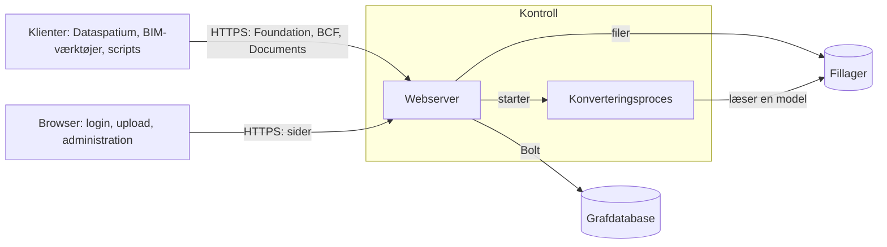

# Arkitektur

Kontroll er en webserver foran en grafdatabase. Denne side viser, hvordan delene
hænger sammen, hvad der sker med en forespørgsel, og hvor alt findes i koden. Læs
den, hvis du vil drive serveren med ro i maven, ændre den eller bygge videre på
den. Ordene forklares i [ordlisten](glossary.md).

## Delene

| Del | Hvad den gør | Kode |
|---|---|---|
| Foundation API | Siger, hvilke API'er serveren tilbyder, hvordan man logger ind, og hvem du er | `opencde/foundation/` |
| Login | OAuth2 med PKCE, tokens, klienter, login-siderne og ventetiden efter mislykkede forsøg | `opencde/auth/`, `opencde/web/` |
| BCF API | Sager, kommentarer, viewpoints, hændelser, relaterede sager og projektdokumenter | `opencde/bcf/` |
| Documents API | Upload og valg via sider i browseren, versioner og metadata | `opencde/documents/` |
| Konti | Brugere, projekter, medlemskaber og roller | `opencde/accounts/` |
| Administration | Sider og et API for administratorer, sundhedstjek og forespørgselsloggen | `opencde/admin/`, `opencde/requestlog.py` |
| IFC-LPG | Gør uploadede modeller til noder og linker viewpoint-komponenter til dem | `opencde/ifcgraph/` |
| Graflaget | Driveren, de to databasedialekter, skemaet og det, der udløber | `opencde/graph/` |
| Sider | Skabeloner, typografier, scripts og sprogkatalogerne | `opencde/ui/` |

## En forespørgsels vej

1. uvicorn modtager forespørgslen. Den tror kun på `X-Forwarded-For` fra proxyerne
   i `OPENCDE_TRUSTED_PROXIES`, så klientens adresse er den rigtige.
2. Middleware i `opencde/main.py` giver forespørgslen et id, logger den uden
   indhold og tokens, begrænser størrelsen, svarer på CORS og betingede
   forespørgsler, tilføjer sikkerhedsheadere og anvender grænsen for antal
   forespørgsler.
3. Routens afhængigheder finder ud af, hvem der spørger: en bearer-token for
   API'erne (`opencde/auth/dependencies.py`), en sessionscookie for siderne
   (`opencde/web/dependencies.py`).
4. Et repository spørger grafen, kun med parametre. Hver forespørgsel efter
   projektdata begynder i brugerens node og går gennem `MEMBER_OF`, så det, en
   bruger ikke er medlem af, ikke findes for vedkommende og svarer 404.
5. Svaret følger skemaerne i `spec/`, og alle fejl har samme form
   (`opencde/errors.py`).

## Hvor data findes

| Hvad | Hvor | Læs mere |
|---|---|---|
| Brugere, projekter, sager, kommentarer, viewpoints, dokumentmetadata, klienter og revisionsloggen | Grafdatabasen | [Grafskema](graph-schema.md) |
| Tokens, koder og klienthemmeligheder som SHA-256-hashes; kodeord som Argon2id-hashes | Grafdatabasen | [Sikkerhedskontroller](security/controls.md) |
| Uploadede filer og viewpoint-billeder under navne, serveren vælger | Fillageret i `OPENCDE_DATA_DIR` | [Documents API-forløb](flows/documents.md) |
| Modeller som noder og relationer | Grafdatabasen | [IFC-LPG](ifc-lpg.md) |
| Serverens egne indstillinger og hemmeligheder | `.env` eller `/run/secrets` | [Lokal test](deploy/local.md) |

## Arbejde uden for forespørgslerne

- Hvert minut (`OPENCDE_CLEANUP_INTERVAL_SECONDS`) sletter serveren det, der er
  udløbet, såsom koder, tokens, sessioner og uafsluttede uploads, og tager
  konverteringer op, som en stoppet server har efterladt.
- IFC-konverteringer kører en ad gangen i deres egen proces med grænser for tid og
  hukommelse, så en defekt model ikke kan vælte serveren.
- Når forespørgselsloggen er slået til (`OPENCDE_REQUEST_LOG_ENABLED`), gemmer en
  skriver forespørgslerne i grafen i portioner og sletter de gamle.

## Sikker fra start

- Intet er åbent, før nogen åbner det: selvregistrering af klienter, IFC-grafen,
  forespørgselsloggen og grafforespørgsler er slået fra fra start.
- I produktion nægter serveren at starte uden https og databasekodeord.
- Siderne har ingen indlejrede scripts eller typografier, hver formular har en
  signeret token, og hver side virker uden JavaScript.

[Trusselsmodellen](security/threat-model.md) siger, hvad dette beskytter imod, og
[kontrollerne](security/controls.md) nævner testen bag hver foranstaltning.

## To databaser

Serveren kører på Neo4j eller Memgraph med den samme Cypher. Kun skemasætningerne
er forskellige, og de findes i `opencde/graph/dialect.py` sammen med listen over
funktioner, koden ikke må bruge. Grundene står i
[ADR 0003](../adr/0003-dialect-neutral-cypher.md).

## Sådan testes den

| Mappe | Hvad den viser | Hvornår den kører |
|---|---|---|
| `tests/unit` | Funktioner og dokumenter uden database | Ved hvert push |
| `tests/conformance` | Routes og svar mod skemaerne i `spec/` | Ved hvert push |
| `tests/security` | Headere, tokens, grænser, og at hver operation kræver token | Ved hvert push |
| `tests/integration` | Alt mod en rigtig database i Docker | Ved hvert push; også på Memgraph hver nat |
| `tests/ui` | Siderne i en rigtig browser med tilgængelighedstjek | Ved hvert push |
| `tests/e2e` | Klientbiblioteket mod en kørende server, genererede forespørgsler og en genstart af hele stakken | Ved hvert push; de lange kørsler hver nat |

## Læs videre

- [Hurtig start](quickstart.md): serveren og Dataspatium på din egen computer.
- [At bygge en klient](client-guide.md): det, en klient har brug for.
- [Forløb](flows/oauth2.md): login, [dokumenter](flows/documents.md) og
  [BCF-viewpoints](flows/bcf-viewpoint.md) som sekvensdiagrammer.
- [Arkitekturbeslutninger](../adr/): hvorfor det er bygget sådan.
