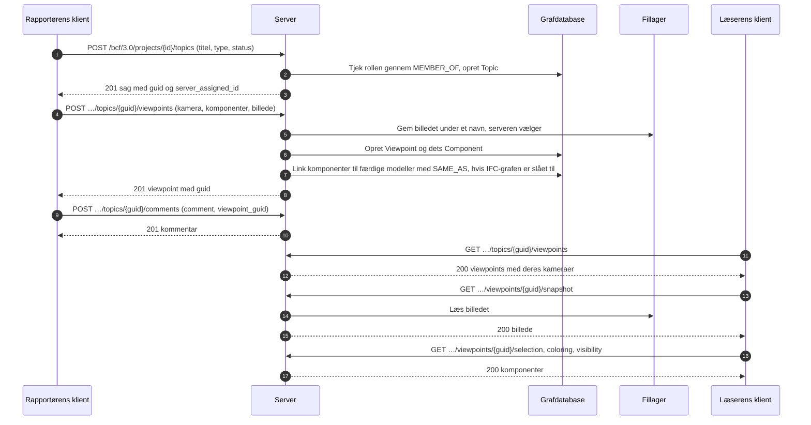

# BCF-viewpoint-forløbet

Hvordan en klient opretter en sag med en visning af modellen, og hvordan en anden åbner
den samme visning. Dette er BCF API 3.0, afsnit 3.2 (sager) og 3.5 (viewpoints).
Eksemplet [create_topic.py](../../examples/create_topic.py) gør første halvdel med
klientbiblioteket.



Et viewpoint kan ikke ændres. Det oprettes helt og slettes helt, så en kommentar, der
peger på det, fortsat peger på det samme.

## Hvad et viewpoint indeholder

| Del | Hvad den siger | Hvor en klient læser den |
|---|---|---|
| Kamera | Position, retning og opadvektor, perspektiv eller ortogonal | I viewpointet |
| Linjer og snitplaner | Hvad der tegnes i visningen, og hvad der skæres væk | I viewpointet |
| Markering | Komponenterne, der er markeret | `/selection` |
| Farvelægning | Komponenterne, der har en farve | `/coloring` |
| Synlighed | Hvad der er synligt fra start, og undtagelserne | `/visibility` |
| Øjebliksbillede | Et billede af visningen, PNG eller JPEG | `/snapshot` |
| Bitmaps | Billeder placeret i visningen | `/bitmaps/{id}` |

## Hvem må hvad

| Handling | Kræver |
|---|---|
| Læse sager, kommentarer og viewpoints | Medlemskab af projektet, i en hvilken som helst rolle |
| Oprette en sag | Handlingen `createTopic`: contributor, editor eller manager |
| Tilføje et viewpoint eller en kommentar | Handlingen `createViewpoint` eller `createComment`: contributor, editor eller manager |
| Slette et viewpoint | Dets forfatter som contributor; editor og manager sletter et hvilket som helst |

Et projekt, brugeren ikke er medlem af, findes ikke for vedkommende (404).

## Fra et viewpoint til modellen

Når [IFC-LPG](../ifc-lpg.md) er slået til, får hver komponent, der nævner et
`GlobalId`, en `SAME_AS`-relation til det element i projektets færdige modeller, også
når modellen uploades bagefter.

```cypher
MATCH (:Viewpoint {guid: $viewpoint})-[:HAS_COMPONENT]->(c:Component)-[:SAME_AS]->(e:IfcProduct)
RETURN c.ifc_guid, e.Name, c.gtin
```
