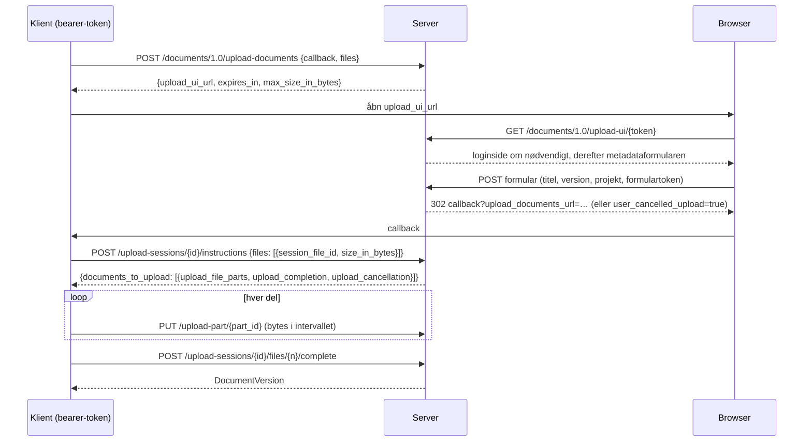
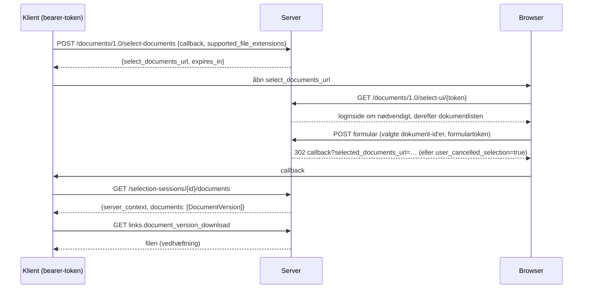

# Documents API-forløb

Documents API 1.0 er en samtale mellem tre parter: klientapplikationen, denne
server og brugerens browser. Klienten taler med API'et med en bearer-token;
browseren viser serverens egne sider (login, indtastning af metadata,
dokumentvalg); serveren kalder aldrig klienten, den omdirigerer kun browseren
til klientens callback-URL.

## Upload

* UI-linket er gyldigt i `OPENCDE_DOCUMENTS_SESSION_TTL_SECONDS` (10
  minutter); når instruktioner er udstedt, lever sessionen
  `OPENCDE_UPLOAD_SESSION_TTL_SECONDS` (24 timer), så store filer kan
  uploades.
* Delene er `OPENCDE_UPLOAD_PART_BYTES` (50 MiB) hver, uploades i vilkårlig
  rækkefølge, parallelt hvis klienten ønsker det. En del skal være præcis det
  annoncerede interval.
* Afslutningen samler delene, verificerer den samlede størrelse, beregner
  SHA-256 og opretter versionen. Tager det mere end 15 sekunder, begynder
  svaret med blanktegn for at holde forbindelsen åben.
* `document_id` i en filpost gør uploaden til en ny version af det dokument;
  titlen beholdes, versionsindekset øges.
* `base_version_index` i en filpost (en udvidelse) siger, hvilken version
  uploaden bygger på: afslutningen svarer `412 version_conflict`, når dokumentet
  allerede har en nyere, og versionens metadata angiver basen.
* Et projekt kan afvise filer med valideringsfejl: afslutningen svarer så
  `422 ifc_validation_failed` med rapportens adresse, og
  `POST …/projects/{id}/ifc-precheck` kontrollerer en fil uden at gemme den.

## Valg og download

* Listen viser den seneste version af hvert dokument i brugerens projekter,
  filtreret på klientens filtypenavne med et link "vis alle".
* Brugere med rollen editor eller manager kan uploade en fil fra siden; den
  vises i listen straks (dette er en tilføjelse til specifikationen).
* `POST /documents/1.0/document-versions` svarer med de seneste versioner af
  en liste dokument-id'er med en `ETag`; `If-None-Match` giver `304`.

[Dataspatium](https://github.com/marwiss/Dataspatium) implementerer begge
forløb fra browseren (`src/api/families/opencde.js`): den åbner serverens
udvælgelsesside i et pop op-vindue og importerer de valgte filer, og uploader
datasæt, filer og arbejdsområdepakker i dele med serverens uploadside til
metadata; dets live-suiter kører disse forløb mod udviklingsstakken.

## Hvem må hvad

| Handling | Kræver |
|---|---|
| Starte en upload eller et valg | en bearer-token med scopet `documents` |
| Bruge browsersiderne | en browsersession som samme bruger (`/signin`) |
| Gemme metadata, afslutte en upload, uploade fra siden | projekthandlingen `createDocument` (editor, manager) |
| Se, vælge og downloade dokumenter | medlemskab af projektet (enhver rolle) |

Dokumenter i andre projekter findes ikke for kalderen (404), så hverken deres
id'er eller deres eksistens lækker.
