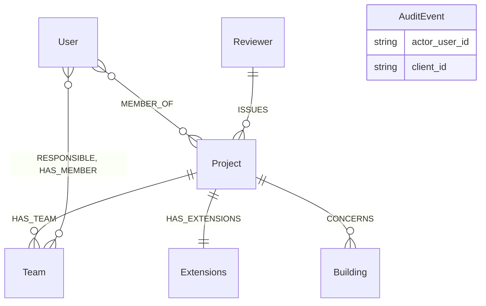
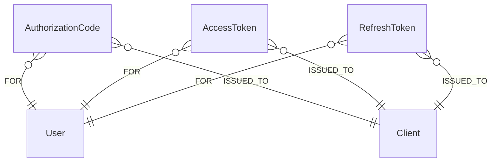
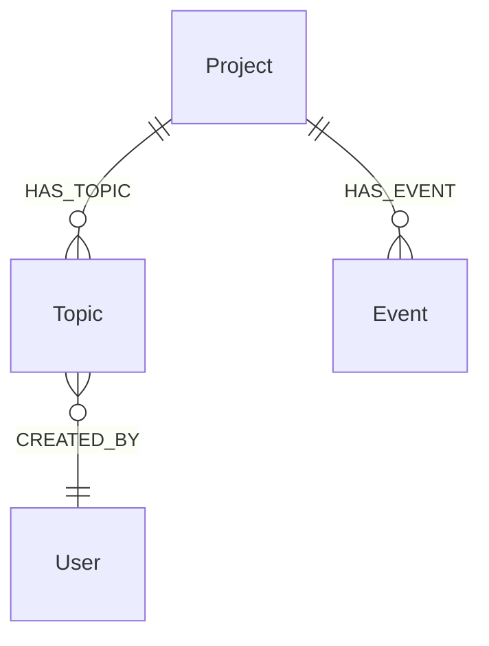
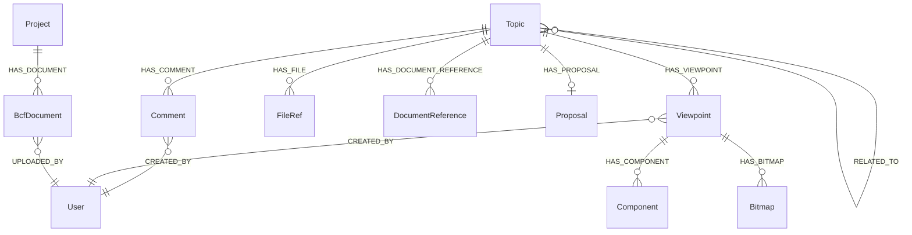
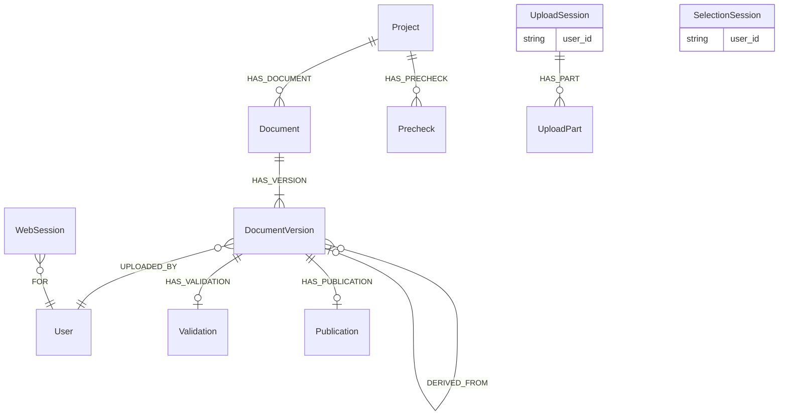
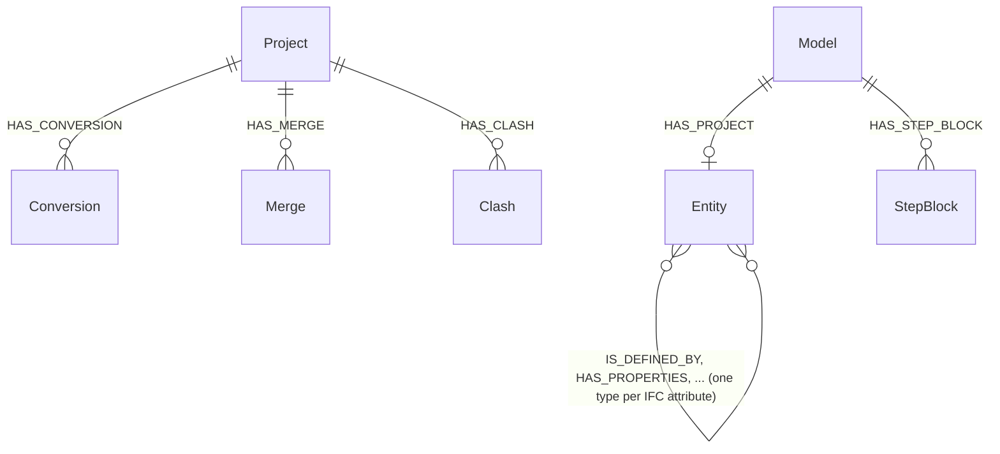

# Grafskema

Databasen er skemaløs; `opencde/graph/schema.py` er skemaet. Denne side
forklarer konventionerne og labels, afsnit for afsnit i den rækkefølge,
planens etaper tilføjede dem.

## Konventioner

- Hver node har et servergenereret UUID i `id` (eller specifikationens navn
  for det: `project_id`, `guid`, `client_id`, `document_id`) med en unik
  constraint. Intet, en klient sender, ender ukontrolleret i en filsti eller
  en databasenøgle.
- Tidsstempler er ISO 8601-strenge i UTC med millisekunder og et `Z`
  (`2026-11-05T12:34:56.789Z`). Strengorden er lig med tidsorden.
- Koordinater og vektorer er almindelige flydende tal (`x`, `y`, `z`), aldrig
  `point()`.
- Alt, der udløber, bærer `expires_at` (samme format); serveren sletter
  udløbne noder på en timer (`opencde/graph/cleanup.py`).
- Hemmeligheder (koder, tokens, klienthemmeligheder) gemmes kun som
  SHA-256-hashes.
- Cypher er dialektneutral, så Neo4j og Memgraph opfører sig ens (ADR 0003).
  Skema-DDL er den eneste produktspecifikke tekst og ligger i `graph/dialect.py`.
- Navne: labels skrives i PascalCase (`DocumentVersion`, `Model`),
  relationstyper med store bogstaver og understregninger (`HAS_TOPIC`,
  `CREATED_BY`, og `IS_DEFINED_BY` for IFC-attributrelationerne). Diagrammerne
  nedenfor tegner kun rigtige noder og relationer; en reference, der holdes
  som egenskab (`AuditEvent.actor_user_id`, `UploadSession.user_id`), listes
  i boksen i stedet for at tegnes som en linje.
- En label, der begynder med `Ifc`, er altid en af IFC's klasser, som IFC-DB
  skriver dem; serverens egne poster (`Validation`, `Precheck`, `Proposal`,
  `Clash`, `Merge`) begynder aldrig sådan, så en forespørgsel kan skelne
  IFC-data fra serverens egne.

## Konti og adgang (etape 1)

| Label | Nøgle | Egenskaber | Noter |
|---|---|---|---|
| `User` | `id`, unikt `username` | `email`, `full_name`, `password_hash` (Argon2id), `is_admin`, `disabled`, `created_at`, `must_change_password` | Brugernavnet er det bruger-id, API'erne eksponerer |
| `MEMBER_OF` (relation User → Project) | | `role` (viewer, contributor, editor, manager), `since` | Rollerne afbildes på BCF's `*_actions`, se `accounts/roles.py` |
| `Project` | `project_id` | `name`, `created_at`, `topic_counter`, `block_on_validation_errors`, `ai_policy` | `topic_counter` nummererer `server_assigned_id`; `block_on_validation_errors` afviser uploads med valideringsfejl (ADR 0021); `ai_policy` er `local` eller `cloud`, og `local` hvor den mangler (ADR 0028) |
| `Extensions` | `id` | `topic_type[]`, `topic_status[]`, `topic_label[]`, `snippet_type[]`, `priority[]`, `stage[]`, `custom_information[]` | `users[]` beregnes ud fra medlemmerne |
| `Team` | `id` | `name`, `ids_document_id`, `created_at`, `updated_at` | Et hold i et projekt (`HAS_TEAM`), med `RESPONSIBLE` og `HAS_MEMBER` til brugere; dets del af modellen er det, specifikationerne i dets IDS-dokument gælder for. Slettes med projektet |
| `Client` | `client_id` | `name`, `description`, `url`, `redirect_uris[]`, `is_public`, `secret_hash`, `disabled`, `pending_approval`, `created_at`, `created_by`, `dynamic`, `expires_at` (kun selvregistrerede) | OAuth2-klient; en selvregistreret slettes, når `expires_at` er passeret, uden at en token er udstedt |
| `AuditEvent` | `id` | `type`, `at`, `actor_user_id`, `client_id`, `ip`, `details` (JSON-streng) | Sikkerhedsrelevante hændelser |
| `Reviewer`, `Building` | `id` | `name`, `status` | Kontekst fra kontrolplan-anvendelsen (seed-data): den gennemgående organisation (en kommune i den oprindelige historie) og bygningen |

## OAuth2 (etape 2)

`AuthorizationCode`, `AccessToken` og `RefreshToken` (med `family_id`) nøgles
på en hash af hemmeligheden, bærer `expires_at` og er knyttet
`-[:FOR]->(:User)` og `-[:ISSUED_TO]->(:Client)`. `WebSession` (browserlogin,
etape 5) er kun knyttet `-[:FOR]->(:User)`.
En kode og dens tokens, der er bundet til MCP-endepunktet (RFC 8707), bærer også `resource`.

## BCF-sager og hændelser (etape 3)

| Label | Nøgle | Egenskaber | Noter |
|---|---|---|---|
| `Topic` | `guid` | `server_assigned_id`, `title`, `topic_type`, `topic_status`, `priority`, `stage`, `labels[]`, `reference_links[]`, `assigned_to`, `description`, `index`, `due_date`, `creation_date`, `creation_author`, `modified_date`, `modified_author`, `snippet_type`, `snippet_is_external`, `snippet_reference`, `snippet_reference_schema` | Feltnavnene følger `topic_GET.json`; BIM snippet-objektet flades ud til fire egenskaber. `server_assigned_id` er `<præfiks><tæller>` fra `Project.topic_counter` |
| `Proposal` | `id` | `state`, `created_at`, `checked_at`, `base_document_id`, `base_version_index`, `change_count`, `applied`, `issue_count`, `error_count`, `truncated`, `ruleset`, `checks`, `report`, `storage_key`, `snippet_key`, `author`, `error` | Prøven af en sags ændringssæt mod dens basisversion (ADR 0021); `report` rummer de anmærkninger, basen mangler, `storage_key` den anvendte fil, gemt til godkendelsen. Slettes med sagen |
| `Event` | `id` | `kind` (`topic` eller `comment`), `topic_guid`, `comment_guid`, `author`, `date`, `action_types[]`, `action_values[]` | Én node per forespørgsel, der ændrede noget; de to parallelle lister er `actions`-arrayet i BCF 3.9/3.10. Knyttet til projektet, så hændelser overlever deres sag |

Hver sagsforespørgsel starter i kalderens `User`-node og går via `MEMBER_OF`
til projektet, før den rører en sag, så en sag i et projekt, kalderen ikke er
medlem af, findes ikke, så vidt API'et angår (404).

## BCF-kommentarer, viewpoints og referencer (etape 4)

| Label | Nøgle | Egenskaber | Noter |
|---|---|---|---|
| `Comment` | `guid` | `topic_guid`, `date`, `author`, `comment`, `viewpoint_guid`, `modified_date`, `modified_author` | `viewpoint_guid` skal nævne et viewpoint i samme sag |
| `Viewpoint` | `guid` | `index`, `author`, `creation_date`, `camera_kind`, `camera` (JSON), `lines` (JSON), `clipping_planes` (JSON), `snapshot_type`, `storage_key`, `has_components`, `default_visibility`, `has_hints`, `spaces_visible`, `space_boundaries_visible`, `openings_visible` | Uforanderligt. Geometri er JSON-tekst: opak og identisk i begge databaser |
| `Component` | `id`, indekseret `ifc_guid` | `role` (`selection`, `coloring`, `exception`), `group_index`, `position`, `color`, `ifc_guid`, `originating_system`, `authoring_tool_id` | Én node per forekomst; IFC-grafen knytter `ifc_guid` til modelelementer (etape 9) |
| `Bitmap` | `guid` | `position`, `bitmap_type`, `storage_key`, `height`, `loc_*`, `nrm_*`, `up_*` | Billedbytes i lageret under `bitmaps/<guid>.<type>` |
| `FileRef` | `id` | `position`, `ifc_project`, `ifc_spatial_structure_element`, `filename`, `date`, `reference` | Filerne i sagens hoved (BCF 3.3) |
| `DocumentReference` | `guid` | `document_guid` eller `url`, `description`, `created_at` | Præcis ét af de to mål |
| `BcfDocument` | `guid` | `filename`, `storage_key`, `size`, `created_at`, `author` | En fil uploadet gennem BCF 3.8; bytes under `bcf-documents/<guid>` |
| `RELATED_TO` (relation Topic → Topic) | | | Rettet; PUT erstatter en sags udgående liste |

Sager holder deres snippet-fil i `snippet_storage_key` (bytes under
`snippets/<sags-guid>.bin`). Sletning af en sag sletter alt under den og de
lagernøgler, der er samlet fra noderne; hændelserne bliver.

## Dokumenter og browsersessioner (etape 5)

| Label | Nøgle | Egenskaber | Noter |
|---|---|---|---|
| `Document` | `document_id` | `title`, `created_at`, `latest_index` | `latest_index` nummererer versionerne |
| `DocumentVersion` | `id` | `version_index`, `version_number`, `creation_date`, `title`, `file_name`, `size_in_bytes`, `sha256`, `storage_key`, `author`, `metadata` (JSON), `parent_version_index`, `approved_by`, `change_set_id`, `change_set` | Bytes under `documents/<id>`; API-kroppen viser kun specifikationens felter; `parent_version_index`, `approved_by`, `change_set_id` og `change_set` (ændringerne, pakket) på en version bygget på en anden, linket til den med `DERIVED_FROM` (ADR 0021) |
| `Validation` | `id` | `state`, `checked_at`, `issue_count`, `truncated`, `ruleset`, `report`, `storage_key`, `file_name`, `error` | Kontrollen af en uploadet IFC-fil mod IFC-skemaet (ADR 0011); `report` er op til 10.000 anmærkninger som komprimeret JSON. Slettes med versionens projekt |
| `Publication` | `id` | `storage_key`, `file_name`, `size_in_bytes`, `sha256`, `published_at`, `published_by` | En publiceret versions arkiv, `.ifczip` eller `.zip`, under `published/<id>`; ét pr. version. Slettes med versionens projekt |
| `Precheck` | `id` | de samme som `Validation`, `project_id`, `author`, `expires_at` | En fil kontrolleret uden at blive en version, eller en upload, projektet afviste (ADR 0021); har også etiketten `Validation`. Oprydningsjobbet sletter den og dens fil efter et døgn |
| `UploadSession` | `id`, indekseret `token_hash` | `user_id`, `username`, `callback_url`, `callback_expires_at`, `expires_at`, `server_context`, `project_id`, `state`, `files_json` | `id` optræder i API-URL'er (bearer kræves); UI-URL'en bærer den token, hvis hash gemmes |
| `UploadPart` | `id` | `file_index`, `part_index`, `range_start`, `range_end`, `received`, `storage_key`, `size`, `expires_at` | Bytes under `parts/<id>`, indtil filen samles; oprydningsjobbet sletter udløbne dele og deres filer |
| `SelectionSession` | `id`, indekseret `token_hash` | `user_id`, `callback_url`, `callback_expires_at`, `expires_at`, `server_context`, `extensions[]`, `state`, `selected[]` | `selected` holder `document_id:version_index`-par valgt i browseren |
| `WebSession` | `id` (hash af cookien) | `created_at`, `expires_at`, `idle_expires_at`, `ip` | Browserlogin; `expires_at` er den absolutte levetid |
| `SignInThrottle` | `key` (hash af brugernavnet) | `failures`, `blocked_until`, `expires_at` | Mislykkede logins per brugernavn; udløber et døgn efter den seneste fejl, og et vellykket login fjerner den |

## IFC-graf (etape 9)

| Label | Nøgle | Egenskaber | Noter |
|---|---|---|---|
| `Conversion` | `id`, indekseret `project_id`, `document_id` | `model_id`, `document_id`, `version_index` eller `bcf_document_guid`, `file_name`, `storage_key`, `state`, `created_at`, `running_at`, `done_at`, `failed_at`, `error`, `geometry_key`, `spatial_pending`, `spatial_error`, `graph_report`, `graph_issue_count`, `graph_error_count`, `graph_ruleset`, `graph_checked_at`, og en kopi af importens `schema`, `ifc_project_guid`, `entities`, `relationships`, `skipped`, `lossless`, `geometry`, `ifc_header`, `form_version`, `format`, `spatial_at`, `spatial_products` og `spatial_failed` | Serverens post om en konvertering (`HAS_CONVERSION`): filen, den kom fra, dens livscyklus (`state` er `queued`, `running`, `done` eller `failed`), geometriposterne og grafkontrollen; `model_id` navngiver modellen, som bærer samme id, og intet andet forbinder de to. Slettes med projektet |
| `Model` | `id` | `schema`, `ifc_project_guid`, `entities`, `relationships`, `skipped`, `lossless`, `geometry`, `ifc_header`, `format`, `form_version`, `imported_at`, `spatial_at`, `spatial_products`, `spatial_failed`, `prepared_…` | IFC-DB's post om en importeret model, skrevet alene af biblioteket; `imported_at` siger, at den er hel i grafen (en model fra før 2026-11-11 beholder `state` `done` til det). Serveren skriver aldrig på den |
| `Entity` + klasselabels | `id` (`<model-id>:<step-id>`), indekseret `GlobalId`, `model_id` | `ifc_class`, `step_id`, `bbox_min`, `bbox_max`, `bbox_centre` (punkter i projektkoordinater, meter, på en bygningsdel med form), hver literal IFC-attribut ved navn | Relationer mellem entiteter navngives efter IFC-attributten (fremad og inverst), skrevet som enhver relationstype med store bogstaver og understregninger: `IsDefinedBy` bliver `IS_DEFINED_BY` |
| `StepBlock` | `id` (`<model-id>:<første step-id>`) | `first_step`, `instances`, `text` | Instanser i en model konverteret med `OPENCDE_IFC_DB_LOSSLESS`, som ikke er noder: skrevet ud som STEP i id-rækkefølge og komprimeret. Returnér ikke noden hel i en forespørgsel, på grund af `text` |
| `Merge` | `id` | `project_id`, `kind` (`merge` eller `prepare`), `state`, `request`, `author`, `created_at`, `running_at`, `finished_at`, `model_id`, `version_index`, `expires_at`, `report`, `error` | En bygning fra model B ført ind i en model i projektet (`HAS_MERGE`); `request` angiver begge versioner, og `version_index` er den version, den blev. Den sammenflettede model tages ud af grafen, når den er skrevet ud. Slettes med projektet |
| `Clash` | `id` | `project_id`, `state`, `request`, `author`, `created_at`, `running_at`, `done_at`, `failed_at`, `count`, `set_a`, `set_b`, `missing`, `seconds`, `truncated`, `report`, `error` | En kollisionskontrol mellem to dokumentversioner i projektet (`HAS_CLASH`; ADR 0019); `request` angiver begge versioner, tilstanden og tolerancen, og `report` rummer de fundne par som komprimeret JSON. Slettes med projektet |

Se [ifc-db.md](ifc-db.md) for konverteringsreglerne og
eksempelforespørgsler.
