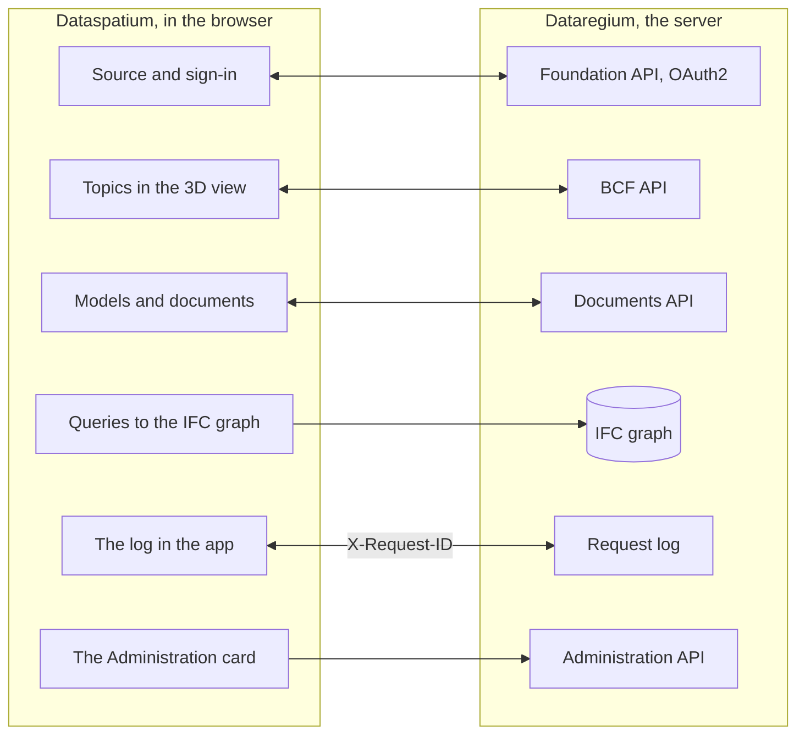

[Svenska](../../README.md) · [Dansk](../da/README.md) · [Norsk bokmål](../nb/README.md) · [Norsk nynorsk](../nn/README.md) · [Suomi](../fi/README.md) · [Íslenska](../is/README.md) · **English**


# Dataregium OpenCDE server

*Dataregium was called Kontroll until 8 November 2026.*

Dataregium is a server where a building project keeps its models, documents and
issues together, so that everyone in the project works from the same material
and sees the same history. You work with it through an app, such as
[Dataspatium](https://github.com/marwiss/Dataspatium) in the browser; the server
itself only has pages for signing in, uploading and administration. Whoever runs
the server decides who may sign in and what each person may do in each project.

Technically, Dataregium is a server for buildingSMART's open **OpenCDE APIs**
(Foundation API 1.0, BCF API 3.0 and 2.1, and Documents API 1.0), built on the
graph database Neo4j or Memgraph. In the 3 series every uploaded IFC model
becomes a lossless graph through the [IFC-LPG](https://github.com/marwiss/IFC-LPG)
library, with versions, checks and proposed changes. The server was rewritten from
scratch out of a research prototype from 2023, with security as the first
requirement, and any client that follows the specifications can connect.


**Contents**

- [Download and get started](#download-and-get-started)
- [Requirements](#requirements)
- [Words to know](#words-to-know)
- [What you can do](#what-you-can-do)
- [The OpenCDE APIs and their clients](#the-opencde-apis-and-their-clients)
- [Dataregium and Dataspatium](#dataregium-and-dataspatium)
- [Learn more](#learn-more)
- [Limitations in brief](#limitations-in-brief)
- [Personal data](#personal-data)
- [Next in the 3 series](#next-in-the-3-series)
- [Bugs and suggestions](#bugs-and-suggestions)
- [Development](#development)
- [Licence](#licence)

## Download and get started

If you only use Dataregium, you need not install anything: ask whoever runs the
server for its address and an account, and sign in from Dataspatium or another
OpenCDE app. To try the server on your own computer, follow the quick start
below. It takes about twenty minutes and needs Docker Desktop or Podman. If you
are at home with containers and Python, the short way is under
[For the technically skilled](#for-the-technically-skilled).

### Quick start (local, Docker or Podman)

A container is a ready-packed program that runs apart on the computer, and Docker
and Podman are programs that start containers. The quick start starts two: the
server and its database.

1. **Download.** Get the code with git, or as a ZIP file under *Code > Download
   ZIP* on GitHub. The `main` branch is the 3 series; `release-2` and `release-1`
   are the 2 and 1 series.

   ```sh
   git clone https://github.com/marwiss/Dataregium.git
   cd Dataregium
   ```

2. **Set up.** Copy `.env.example` to `.env`, the file with the server's
   settings, and set `OPENCDE_GRAPH_PASSWORD` to a password of your own of at
   least 16 characters. To try it with Dataspatium and models, also set
   `OPENCDE_DYNAMIC_CLIENT_REGISTRATION=true`, `OPENCDE_REQUEST_LOG_ENABLED=true`
   and `OPENCDE_IFC_LPG_ENABLED=true`; the [quick start with Dataspatium](quickstart.md)
   explains why. Every setting is explained in [.env.example](../../.env.example).
3. **Start.** The same compose files work with Docker and with Podman; pick the one you have:

   <details open>
   <summary><b>Docker</b></summary>

   ```sh
   docker compose up -d --build
   ```

   starts the server on <http://127.0.0.1:8000> and a Neo4j database; the first time takes a few minutes. `docker compose logs -f api` shows the server log.

   </details>

   <details>
   <summary><b>Podman</b></summary>

   ```sh
   podman compose up -d --build
   ```

   does the same with Podman 5 (rootless, no daemon); `podman compose logs -f api` shows the server log. See [deploy/local.md](deploy/local.md) for Podman's particulars.

   </details>

   <details>
   <summary><b>Without a container</b></summary>

   ```sh
   uv sync --extra ifc-lpg          # installs Python 3.13 and every dependency, with IFC-LPG
   uv run opencde doctor            # checks the configuration and the database
   uv run opencde serve             # http://127.0.0.1:8000
   ```

   runs the server from the checkout with [uv](https://docs.astral.sh/uv/); a database is still needed (Neo4j Desktop, Memgraph Lab or the database from the compose files).

   </details>

4. **Look around.** <http://127.0.0.1:8000/docs> shows every call the server
   takes and lets you try them, <http://127.0.0.1:8000/readyz> says whether the
   server and the database are ready, and <http://127.0.0.1:7484> is Neo4j
   Browser, where you see the database (Bolt on `127.0.0.1:7697`; the development
   overlay avoids Neo4j's default ports, which another Neo4j on the same computer
   often holds).
5. **Load demonstration data and sign in.**

   <details open>
   <summary><b>Docker</b></summary>

   ```sh
   docker compose exec api opencde seed
   ```

   </details>

   <details>
   <summary><b>Podman</b></summary>

   ```sh
   podman compose exec api opencde seed
   ```

   </details>

   <details>
   <summary><b>Without a container</b></summary>

   ```sh
   uv run opencde seed
   ```

   </details>

   The command makes demonstration users, projects, clients and a topic, and with
   IFC-LPG on also a sample model as a graph. The passwords are printed once. Sign
   in at <http://127.0.0.1:8000/signin> as `admin` and open `/admin`.
6. **Connect a client.** Register your app under *Clients* (or let it register
   itself when `OPENCDE_DYNAMIC_CLIENT_REGISTRATION=true`) and point it at
   `http://127.0.0.1:8000`; [Dataspatium](#dataregium-and-dataspatium) and the
   Python library in [client/](../../client/) are ready-made clients.
   To sign in from Dataspatium, follow the [quick start](quickstart.md): it covers
   every setting that is needed and what to do if something goes wrong.

### Deployment

For others to use the server, it has to run on a computer that is always on and
reachable from the internet, with an address of its own and https. The table shows
the ways to do that; whoever does not run servers leaves it to someone who does.
Each way is one compose file plus an overlay:

| Scenario | Guide |
|---|---|
| A local test on your computer | [deploy/local.md](deploy/local.md) |
| A public https address for client tests without a server of your own (tunnel) | [deploy/tunnel.md](deploy/tunnel.md) |
| Production on a server of your own with Caddy (automatic TLS) and nightly backups | [deploy/vps-caddy.md](deploy/vps-caddy.md) |
| Beside what already runs on a server, behind its nginx | [deploy/proxied.md](deploy/proxied.md) |
| Coolify, Dokploy, Portainer | [deploy/paas.md](deploy/paas.md) |
| Your own region at AWS, Azure or Google Cloud: one machine, set up by a cloud-init file | [deploy/cloud.md](deploy/cloud.md) |
| A container service plus a managed Neo4j AuraDB or Memgraph Cloud | [deploy/cloud-aura.md](deploy/cloud-aura.md) |
| Backup and restore (portable between Neo4j and Memgraph) | [deploy/backup.md](deploy/backup.md) |

`uv run opencde init --public-url https://cde.example.org` writes a production
`.env` with fresh secrets; `opencde doctor` checks the result.

### Configuration

Everything is read from environment variables with the prefix `OPENCDE_`, from
`.env` or from Docker secrets in `/run/secrets/opencde_<name>`. The commented list
is in [.env.example](../../.env.example). The defaults are safe: production
refuses to start without a public `https` address and a database password, and
nothing is open until it has been configured.

### For the technically skilled

- **Image**: `ghcr.io/marwiss/opencdeserver` for amd64 and arm64, scanned with
  Trivy and with an SBOM. The tags are `3.0.0` and `latest` for the 3 series,
  `3.0.0-gherkin` and `latest-gherkin` with buildingSMART's ifc-gherkin-rules,
  `2.0.0` and `1.0.0`; `OPENCDE_IMAGE_TAG` chooses in the compose files.
- **Compose**: `docker/compose.yaml` plus overlays for development, production
  with Caddy, behind an existing proxy, Memgraph, an external database, Bolt with
  TLS, a tunnel, the local engine and the working copy. `COMPOSE_FILE` in `.env`
  chooses them, so the commands go without `-f`.
- **Without a container**: Python 3.11 or later with uv (tested on 3.11, 3.13 and
  3.14), `uv sync --extra ifc-lpg`, and Neo4j 5.26 or Memgraph 3.14 at `OPENCDE_GRAPH_URI`.
- **The main settings**: `OPENCDE_APIS` chooses the APIs (all three by default,
  `["documents"]` in 1.0.0); `OPENCDE_IFC_LPG_ENABLED=true` turns on the graph and
  everything in the 2 and 3 series that concerns models; `OPENCDE_ENVIRONMENT` is
  `development`, `production` or `local` (the local engine, `opencde init --local`).
- **Endpoints**: `/.well-known/dataregium` (the version and the extensions that are
  on), `/foundation/versions`, `/openapi.json` and `/docs`, `/healthz` and `/readyz`,
  `/admin/api` (administration) and `/manage/1.0` (project administration). The 3 series' extensions are under `/documents/1.0/` (the versions'
  `ifc-queries`, `ifc-diff`, `ifc-changes` and `ifc-geometry`, the projects'
  `ifc-precheck` and `ifc-clash`) and under a BCF 3.0 topic (`snippet` and
  `ifc-proposal/approve`).
- **The command line**: `opencde serve`, `init`, `doctor`, `seed`, `backup`,
  `restore`, `revoke`, `cleanup` and the groups `user`, `project`, `client` and
  `ifcgraph`; `uv run opencde --help`.
- **Building a client**: the [client guide](client-guide.md) has the flows, the
  capabilities document, the error codes and the extensions, and
  [docs/examples/](../examples/) runnable examples.

## Requirements

Whoever only uses Dataregium through an app needs a browser and an account. To run
the server yourself:

- Windows, macOS or Linux with Docker (Desktop on Windows/macOS, Engine on Linux)
  or Podman 5, or Python 3.11 or later with [uv](https://docs.astral.sh/uv/) and a
  Neo4j 5.26 or Memgraph 3.14 database of your own.
- About 1 GB of memory for the database container (`NEO4J_HEAP` and
  `NEO4J_PAGECACHE` in `.env`), and more for large models with IFC-LPG.
- Locally: port 8000 for the server and 7484/7697 for the database, all bound to
  `127.0.0.1`. In production: ports 80 and 443 reachable from the internet and a
  DNS name for the server.
- Clients need an `https` address in production; locally `http://127.0.0.1` is
  accepted as a redirect URI, and `http://localhost` with `OPENCDE_ALLOW_LOCALHOST_REDIRECTS=true`.

## Words to know

The words this README uses, in everyday language; the whole glossary is in
[glossary.md](glossary.md).

- **BIM**: building and managing with a digital model of the building, where every
  wall, door and room is an object with properties and not just lines on a drawing.
- **CAD**: programs for drawings and models; a BIM model is made in a CAD program.
- **IFC**: the open file format for BIM models, which the major programs can read and write.
- **BCF and topics**: an open format for questions and remarks about a model, with
  comments and a view (viewpoint) that shows where in the model it applies.
- **IDS**: a requirement on what a model must contain, for example that every door
  has a fire rating; the server checks the models against the project's requirements.
- **OpenCDE**: buildingSMART's open rules for how the apps and servers in a building
  project talk to each other. CDE stands for common data environment.
- **API**: the way an app talks to the server, with set questions and answers.
- **Server and client**: the server stores and shares the project's material; the
  client is the app you work in, such as Dataspatium.
- **Database and graph**: the database is where the server keeps everything. A graph
  database keeps things and the connections between them, such as a wall that
  stands on a storey, and can therefore answer questions about how the parts fit together.
- **Container**: a ready-packed program that runs apart on the computer; Docker and
  Podman start them.
- **OAuth2**: the safe way to sign in from an app without the app getting your password.
- **Version and change set**: each time a model is saved on the server it becomes a
  new version. A change set is a proposal of changes that someone responsible
  approves before it becomes the next version.

## What you can do

What works in one version also works in the next. Each version goes with the same
version of Dataspatium.

### Version 1 (with Dataspatium 1)

- **Documents in one place** (Documents API 1.0): choosing, uploading and fetching
  documents and their versions through the server's pages, from an app such as Dataspatium.
- **Sign-in and apps** (Foundation API 1.0): one account per person, sign-in with
  OAuth2 and PKCE, and apps that an administrator registers or that register
  themselves when the operator allows it (see the [client guide](client-guide.md)).
- **Administration** in the browser (`/admin`) and on the command line: users and
  project roles, projects, clients, sessions, the audit log and the health checks;
  every user has `/account` for their password and their apps.
- **Help for whoever builds an app**, marked as extensions: a capabilities document
  (`/.well-known/dataregium`), a stable error code in every error response and a
  request log.
- **A client library** in Python ([client/](../../client/)) with runnable examples,
  and a published image for every deployment.
- **Project managers administer their project**: a `manager` adds and removes
  members, changes their roles and renames the project, without being a server
  administrator.

### Also in version 2 (with Dataspatium 2)

- **Topics about the model** (BCF API 3.0 and 2.1): questions and remarks with
  comments, pictures and views that point out building elements, with filters and an
  event log, validated against buildingSMART's schemas.
- **The model as a graph** (the IFC-LPG module, turned on with
  `OPENCDE_IFC_LPG_ENABLED`): an uploaded IFC model becomes a graph in the database,
  linked to the building elements in the topics' views (see [IFC-LPG](ifc-lpg.md)).

### Also in version 3 (with Dataspatium 3)

- **A lossless model**: the graph comes from the IFC-LPG library and holds
  everything in the file, so that it can be written back as it came.
- **A check of every upload** against the IFC schema, buildingSMART's rules and the
  project's IDS requirements; a project can refuse files with errors, and a file can
  be checked beforehand without being stored.
- **Queries and comparisons**: named queries for members, what changed since a
  version, a comparison of two versions (also on a page on the server) and a clash
  check whose clashes can become topics.
- **Changes as proposals**: every new version names its base, and a change set in a
  BCF topic is tested and approved by a `manager` into the next version, merged per
  instance with what came in between; a real clash shows the value of the base, of
  the latest version and of the proposal.
- **Publishing**: a `manager` publishes a version whose check found no errors, and the
  server keeps it as one whole `.ifczip` that everyone in the project can download.
- **A building into another model**: the building of one model comes into another
  project's model as its next version, with a report first of what comes along and
  a choice for each object both have in different forms; a `manager` makes it.
- **The geometry as glTF**: every version as binary glTF with shared meshes and one
  node per building element, and a box per building element in the graph for
  questions about what is near.
- **A local engine and a region of your own**: Dataregium on your own computer behind
  Dataspatium, with a working copy in memory for large models, and ready recipes for
  a machine of your own at AWS, Azure or Google Cloud or beside an existing nginx.


## The OpenCDE APIs and their clients

OpenCDE is buildingSMART International's family of open web APIs for a common data
environment, the place where a project shares its models, documents and issues. A
client and a server that follow the same specifications can work together, whoever
built them. Dataregium implements all three:

| API | What it is for | Specification |
|---|---|---|
| Foundation API 1.0 | Says which APIs a server offers, how to sign in and who the user is | [foundation-API](https://github.com/buildingSMART/foundation-API) |
| BCF API 3.0 and 2.1 | Issues about a model, with comments and viewpoints with camera, components and images | [BCF-API](https://github.com/buildingSMART/BCF-API) |
| Documents API 1.0 | Selecting, downloading and uploading documents and their versions, through pages on the server | [documents-API](https://github.com/buildingSMART/documents-API) |

**Dataspatium is one client, not the only one.** Any client that follows these
specifications should be able to connect: nothing on the server depends on Dataspatium,
and the extensions outside the specifications are optional, so a client that does not
know them does not notice them. A client needs three things:

- a registration on the server, made by an administrator under *Clients* or by the client
  itself when `OPENCDE_DYNAMIC_CLIENT_REGISTRATION=true`;
- OAuth2 authorization code with PKCE `S256`, which the server requires of every client but a confidential one an administrator has marked;
- BCF API 3.0, or 2.1 for a client that only speaks that version. `GET /foundation/versions` lists both, and
  [the client guide](client-guide.md) says what differs between them.

How far this has been shown: the server's answers are tested against buildingSMART's
schemas on every push, and Dataspatium and the Python library in [client/](../../client/) run
against the server. Independent clients such as Bonsai and ifc-lite have a prepared
checklist that has not been run yet. If you try a
client, tell us how it went under [Bugs and suggestions](#bugs-and-suggestions). When a client and a
specification disagree, the specification decides. [docs/en/client-guide.md](client-guide.md) is for those
who build a client.

## Dataregium and Dataspatium

Dataspatium is the app you work in, and Dataregium is the server where the
project's shared material is kept. [Dataspatium](https://github.com/marwiss/Dataspatium)
runs wholly in the browser, and the two are developed to work together. The same
release number means that they work together: Dataspatium 3.0.0 works with
Dataregium 3.0.0 ([quick start](quickstart.md)).

Dataspatium adds a Dataregium server as a source: the app discovers the APIs through
`/foundation/versions`, signs in with OAuth2 authorization code and PKCE and
registers itself as a public client when dynamic registration is on, lists the
project's models and documents, reads and writes BCF topics with comments and
viewpoints taken from its 3D view and uploads datasets, files and workspace packages
through the Documents API. In the 3 series the app publishes versions with a base
version and a check beforehand, sends change sets that the server tests, lets the
project manager approve them and settle clashes, compares versions in 3D and asks the
graph named queries; an administrator can also query the graph with Cypher through
the server's read-only endpoint. The app sends `X-Request-ID` on every call, so that
the request log here and the log in the app show the same conversation, reads the
server's capabilities document to see which extensions are on and acts on the error
codes the server puts in its error bodies.

This is how they hang together:



Apart from the marked extensions, everything Dataspatium does with the server goes
through the three OpenCDE APIs, so the app uses nothing that another client cannot
use; see [The OpenCDE APIs and their clients](#the-opencde-apis-and-their-clients).
The two products are installed separately: this repository does not bundle
Dataspatium (the licences differ, AGPL here and PolyForm Strict there), and
Dataspatium's README describes how to get and use the app.

### The releases 1, 2 and 3

There is one release per major number, and it is released again when it grows; only
the latest in each series is corrected. Dataregium and Dataspatium with the same
number go together:

| Dataregium | What it has | Image | Goes with |
|---|---|---|---|
| 1.0.0 | A document server: the Foundation API and the Documents API, the web administration in seven languages, the project administration for the project manager and the request log. It is the 2.0.0 code with only the Documents API on (`OPENCDE_APIS`) | `1.0.0` | Dataspatium 1.0.0 |
| 2.0.0 | Also BCF API 3.0 and 2.1 on the same data and the IFC-LPG module that makes a graph of every uploaded IFC file | `2.0.0` | Dataspatium 2.0.0 |
| 3.0.0 | Also the lossless graph from the IFC-LPG library, the check of every upload, the queries, the comparisons and the clash check, versions with change proposals that are tested, approved and merged, the publication of a version, a building of one model brought into another, the geometry as glTF, the local engine and the recipes for the cloud and nginx | `3.0.0`, `latest`, `3.0.0-gherkin` | Dataspatium 3.0.0 |

## Learn more

- [quickstart.md](quickstart.md): Dataregium and Dataspatium together in twenty
  minutes, from an empty computer to a topic made in the 3D view.
- [client-guide.md](client-guide.md) and [docs/examples/](../examples/): how to build
  a client, the capabilities document, the error codes, the 3 series' extensions and
  runnable examples with the Python library in [client/](../../client/).
- [architecture.md](architecture.md): how the parts hang together, what happens to a call and where everything is in the code.
- [glossary.md](glossary.md): the words the documentation uses.
- [flows/](flows/): sequence diagrams of the OAuth2, Documents API and BCF viewpoint flows.
- [graph-schema.md](graph-schema.md): the graph model.
- [ifc-lpg.md](ifc-lpg.md): the IFC-LPG module, the checks, the versions, the change sets, the geometry and examples of Cypher queries.
- Architecture decisions that stand: a graph database as the only store, opaque
  tokens instead of JWT, portable Cypher for Neo4j and Memgraph, a web interface
  without a framework, a backup at application level, BCF API 2.1 beside 3.0, a
  lossless IFC graph that reads and writes STEP itself and is validated when written,
  buildingSMART's rules in an environment of their own, IFC-LPG as a library, a check
  against the project's IDS, named queries for members, a clash check on the server
  with IfcClash, versions as nodes with changes and a base, a local engine that only
  answers on your own computer and a working copy in memory beside the archive.
- [spec/SOURCES.md](../../spec/SOURCES.md): the exact specification versions the
  server is tested against.

The documentation is in this README's seven languages, each language under
`docs/<language>/`; the English under `docs/en/` is the source. CONTRIBUTING is in English.

### Further reading

- [BCF API](https://github.com/buildingSMART/BCF-API), [Foundation API](https://github.com/buildingSMART/foundation-API) and [Documents API](https://github.com/buildingSMART/documents-API):
  the specifications the server follows.
- [IFC](https://github.com/buildingSMART/IFC4.x-development): the file format for building models, and [IDS](https://github.com/buildingSMART/IDS): requirement specifications that models are checked against.
- [RFC 9700](https://www.rfc-editor.org/rfc/rfc9700): today's best current practice for security in OAuth 2.0, and
  [OAuth 2.1](https://datatracker.ietf.org/doc/draft-ietf-oauth-v2-1/), the draft that gathers it.
- [RFC 7636](https://www.rfc-editor.org/rfc/rfc7636) (PKCE), [RFC 8252](https://www.rfc-editor.org/rfc/rfc8252) (apps on the computer or the phone) and
  [RFC 7591](https://www.rfc-editor.org/rfc/rfc7591) (registration of clients).
- [OWASP ASVS](https://owasp.org/www-project-application-security-verification-standard/): the checklist for the security work.

## Limitations in brief

- Everything that concerns models, in the 2 and 3 series, needs the IFC-LPG module,
  which is off until `OPENCDE_IFC_LPG_ENABLED=true`. buildingSMART's rules only run
  with the `-gherkin` image; without it the schema and IDS are checked.
- The server implements BCF API 3.0 and 2.1, not 1.0, whose resources look different.
- Exporting a project as BCFzip is left to the clients; the server stores topics,
  comments and viewpoints as the API defines them.
- The community editions of Neo4j and Memgraph lack read-only database users, so an
  exposed Bolt port gives full access to whoever has the password. The port stays
  closed unless the administrator publishes it on purpose; the administration API's
  read-only graph query (`OPENCDE_GRAPH_QUERY_ENABLED`) gives Cypher without the port.
- The IFC-LPG import, the checks and the testing of change sets run in separate
  processes with memory and time limits (`OPENCDE_IFC_LPG_*`); very large models are
  refused instead of being left half imported, or are handled by the local engine.
- The web pages are for signing in, administration, uploading and choosing documents
  and for a version's check and comparison; end users work in a client such as
  Dataspatium or Bonsai.
- The pages are in this README's seven languages (switch at the foot of every page);
  the command line and the APIs' error messages are in English.
- No external review yet. The OAuch and testssl runs are the operator's steps before
  a production deployment.

## Personal data

Whoever runs Dataregium for others is the controller of this. The server stores user
accounts (username, name, optional e-mail, password hash), project memberships, topics
and comments with their authors' names, uploaded files with their uploaders, the IFC
graph with the file's ownership history, the versions with their authors and
approvers, the change proposals with who proposed them and, where an AI did it, which
AI model and which tool call, and an audit log of who did what and from which address.
Passwords, tokens and secrets are stored only as hashes. Tokens, sessions, upload
sessions and unused self-registered clients expire and are cleaned up by the server;
the audit log is pruned by the operator. An administrator deletes an account under
`/admin/users`, and its sessions and tokens go with it; the name stays on the topics
and versions the person wrote until they are deleted. The audit log is exported as
CSV, BCF and document data through the APIs and the whole database with
`opencde backup`. What Dataspatium keeps in the browser is in the app's own documentation.

## Next in the 3 series

3.0.0 is the 3 series' only release and is released again when it grows; what it has
today is under [What you can do](#what-you-can-do). The official OpenCDE APIs stay as
buildingSMART defines them; what the series adds are extensions to them, under names
of their own and with an OpenAPI of their own. This section says what is decided, for
whoever, human or AI agent, carries a part of it further. The ways of working are in
[CONTRIBUTING.md](../../CONTRIBUTING.md) and the IFC graph in [ifc-lpg.md](ifc-lpg.md).

### Decided

- **Editing models in Native IFC.** Create is the upload, Read the named queries,
  Update and Delete a change set (setting, adding, removing and copying instances)
  that is tested and approved, and Export writing STEP back. The data keeps to IFC,
  ifc-gherkin-rules and the project's IDS, on import and after every change.
- **Version history in the database, not in git**, in the same spirit as Bruno
  Postle's [ifcmerge](https://github.com/brunopostle/ifcmerge). Every approved version
  is a node with its parent, author, approver and changes; the graph holds the latest
  version, and any version is written out on request. A change goes in when the file
  written from it has no remark that the version before it lacked.
- **BIM snippets as a working demonstration.** A proposed change travels as a
  `bim_snippet` in a BCF 3.0 topic, with a published schema behind its
  `reference_schema`, so that the change, the discussion and the decision are in one
  place. buildingSMART's unreleased development branches have removed them; Dataregium
  builds them to show how they could work. A snippet points out what it changes with
  a GlobalId and a path of IFC attribute names from there, with a STEP id only where
  no GlobalId reaches; GlobalId and path reached 98 to 100 per cent of the instances
  in 28 sample files.
- **Who may change what.** `editor` proposes, `manager` approves, and an AI only
  proposes; every change carries who proposed it, and which AI model and which tool
  call, where an AI did it. A team of the project, whose IDS document points out its
  part of the model as ISO 19650's task teams do, has its responsible approve the
  changes to that part; a change across several teams' parts goes to a `manager`.
- **A clash check in both places**: on the server with IfcOpenShell's IfcClash and in
  Dataspatium with its own core in JavaScript.
- **Next**: an endpoint for AI tools (MCP) on your own computer, where AI proposes
  and a human approves; a check of classifications and properties against bSDD; a new
  check of the versions when the project's IDS changes, with buildingSMART's findings
  linked to building elements; proprietary formats through the source programs' IFC
  export; and a test suite against prompt injection in snippets and MCP.

## Bugs and suggestions

Report bugs and wishes as *Issues* here on GitHub. Say which server version
you run (the `version` of `/.well-known/dataregium` or `/healthz`), which client
you used and the `X-Request-ID` of a failing call; the request log and your
client's log share it. Attach no personal data and no secrets. How changes are
taken in is in [CONTRIBUTING.md](../../CONTRIBUTING.md). For a security
vulnerability follow [SECURITY.md](../../SECURITY.md) instead of opening an issue.

## Development

```sh
uv run pytest                    # unit, conformance and security tests
uv run pytest -m integration     # starts Neo4j/Memgraph with testcontainers (Docker required)
uv run pytest -m e2e             # the client library against a live server (Docker required)
uv run pytest -m ui              # Playwright + axe-core (uv sync --group ui; playwright install chromium)
uv run ruff format . && uv run ruff check .
uv run ty check opencde client/opencde_client
```

Code and comments are in English, and the style follows IfcOpenShell's
conventions (ruff, 120 columns), so that contributing the server to
IfcOpenShell stays possible. The README exists in English, Swedish, Danish,
Norwegian (Bokmål and Nynorsk), Finnish and Icelandic (`docs/<lang>/README.md`,
the layout Dataspatium uses); the documentation and the web UI are
available in the same languages, with English always one of the choices, and
shared terms follow Dataspatium's glossary. Every push runs linting, type
checks, the test suites on three Python versions, browser tests with axe-core,
and static security checks; nightly jobs run OWASP ZAP, Schemathesis and
Trivy. See [CONTRIBUTING.md](../../CONTRIBUTING.md).

## Licence

The server is licensed under the GNU Affero General Public License v3.0 or
later ([LICENSE](../../LICENSE)): it is server software, and the AGPL's network
clause keeps improvements to hosted instances open. The client library in
[client/](../../client/) is LGPL-3.0-or-later. Specification files under
[spec/](../../spec/) are © buildingSMART International and redistributed unmodified
for testing. See [SECURITY.md](../../SECURITY.md) for how to report a vulnerability
and what the project does to stay secure.
