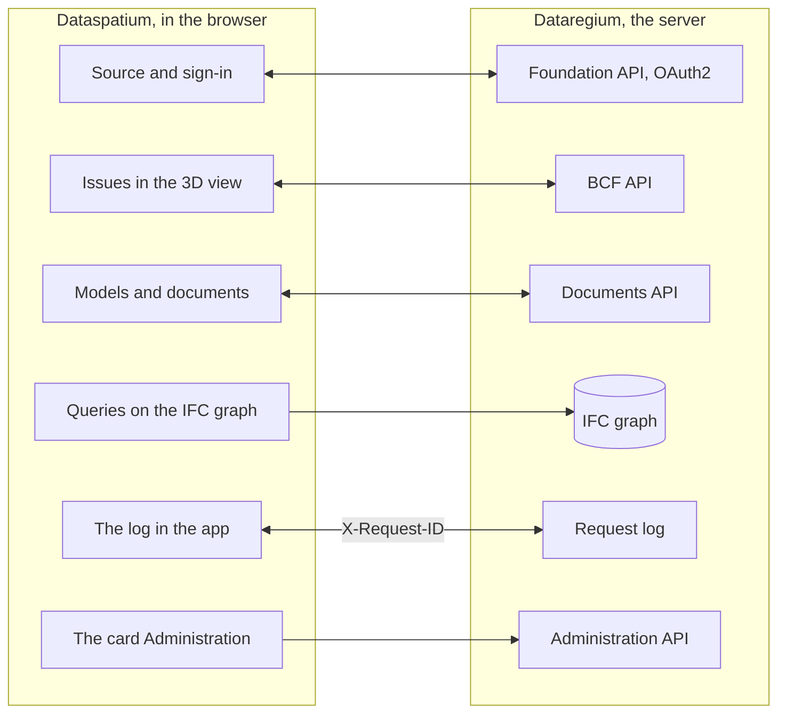

[Svenska](../../README.md) · [Dansk](../da/README.md) · [Norsk bokmål](../nb/README.md) · [Norsk nynorsk](../nn/README.md) · [Suomi](../fi/README.md) · [Íslenska](../is/README.md) · **English**


# Dataregium OpenCDE server

*Dataregium was called Kontroll until 8 November 2026.*

Dataregium is a server for the buildingSMART **OpenCDE APIs** (Foundation API 1.0,
BCF API 3.0 and 2.1, and Documents API 1.0), built on a graph database, with a web
administration and an optional IFC-LPG module that joins BCF components to
the building elements they point at. It grew out of a 2023 research prototype
for the digital inspection plans of Swedish building permits and was rewritten
from scratch with security as the first requirement.
Clients that follow the specifications should be able to connect, so the server
is not tied to any one application.


**Contents**

- [Download and get started](#download-and-get-started)
- [Requirements](#requirements)
- [What you can do](#what-you-can-do)
- [The OpenCDE APIs and their clients](#the-opencde-apis-and-their-clients)
- [Dataregium and Dataspatium](#dataregium-and-dataspatium)
- [Learn more](#learn-more)
- [Limitations in brief](#limitations-in-brief)
- [Next in the 3 series](#next-in-the-3-series)
- [Bugs and suggestions](#bugs-and-suggestions)
- [Development](#development)
- [Licence](#licence)

## Download and get started

### Quick start (local, Docker)

1. **Download.** Clone the repository, or pull the published image
   `ghcr.io/marwiss/opencdeserver` (multi-arch, scanned and with an SBOM on
   every release):

   ```sh
   git clone https://github.com/marwiss/Dataregium.git
   cd Dataregium
   ```

2. **Configure.** Copy `.env.example` to `.env` and set `OPENCDE_GRAPH_PASSWORD`
   (16 characters or more). Every setting is explained in
   [.env.example](../../.env.example).
3. **Start.** `docker compose -f compose.yaml -f compose.dev.yaml up -d --build`
   starts the server on <http://127.0.0.1:8000> and a Neo4j database.
   `docker compose logs -f api` shows the server log.
4. **Look around.** <http://127.0.0.1:8000/docs> is the interactive API
   documentation, <http://127.0.0.1:8000/readyz> the readiness check and
   <http://127.0.0.1:7484> Neo4j Browser (Bolt on `127.0.0.1:7697`; the
   development overlay avoids Neo4j's default ports, which another Neo4j on
   the same machine often occupies).
5. **Add demo data and sign in.**
   `docker compose -f compose.yaml -f compose.dev.yaml exec api opencde seed`
   creates demonstration users and projects and prints their passwords once.
   Sign in at <http://127.0.0.1:8000/signin> as `admin` and open `/admin`.
6. **Connect a client.** Register your application under *Clients* (or let it
   register itself when `OPENCDE_DYNAMIC_CLIENT_REGISTRATION=true`) and point
   it at `http://127.0.0.1:8000`; [Dataspatium](#dataregium-and-dataspatium) and
   the Python library in [client/](../../client/) are ready-made clients.
   To sign in from Dataspatium, follow the [quick start](../quickstart.md): it
   covers every setting needed and what to do if something goes wrong.

Without Docker for the server itself (a database is still needed):

```sh
uv sync                          # installs Python 3.13 and all dependencies
uv run opencde doctor            # checks configuration and the database
uv run opencde serve             # http://127.0.0.1:8000
```

### Deployment

One compose file plus an overlay per scenario:

| Scenario | Guide |
|---|---|
| Local test on your machine | [docs/deploy/local.md](../deploy/local.md) |
| Public https URL for client tests without a server (tunnel) | [docs/deploy/tunnel.md](../deploy/tunnel.md) |
| Production on your own server with Caddy (automatic TLS) and nightly backups | [docs/deploy/vps-caddy.md](../deploy/vps-caddy.md) |
| Coolify, Dokploy, Portainer | [docs/deploy/paas.md](../deploy/paas.md) |
| Container service plus managed Neo4j AuraDB or Memgraph Cloud | [docs/deploy/cloud-aura.md](../deploy/cloud-aura.md) |
| Backup and restore (portable between Neo4j and Memgraph) | [docs/deploy/backup.md](../deploy/backup.md) |

`uv run opencde init --public-url https://cde.example.org` writes a production
`.env` with fresh secrets; `opencde doctor` checks the result.

### Configuration

Everything is read from environment variables prefixed `OPENCDE_`, from
`.env`, or from Docker secrets in `/run/secrets/opencde_<name>`. The
annotated list is in [.env.example](../../.env.example). Defaults are safe:
production refuses to start without an `https` public URL and a database
password, and nothing is open until it is configured.

## Requirements

- Windows, macOS or Linux with Docker (Desktop on Windows/macOS, Engine on
  Linux), or Python 3.11 or later with [uv](https://docs.astral.sh/uv/) and a
  Neo4j 5.26 or Memgraph 3.14 database of your own.
- About 1 GB of memory for the database container (`NEO4J_HEAP` and
  `NEO4J_PAGECACHE` in `.env`), more with the IFC-LPG module.
- Locally: port 8000 for the server and 7484/7697 for the database, all bound
  to `127.0.0.1`. In production: ports 80 and 443 reachable from the internet
  and a DNS name for the server.
- Clients need an `https` address in production; locally `http://127.0.0.1` redirect URIs are accepted, and `http://localhost` ones with `OPENCDE_ALLOW_LOCALHOST_REDIRECTS=true`.

## What you can do

- **Foundation API 1.0**: service discovery, OAuth2 authorization code with
  PKCE, current user, token revocation, and dynamic client
  registration with public clients (off by default).
- **BCF API 3.0 and 2.1**: projects, extensions, topics with OData queries, comments,
  viewpoints with snapshots, bitmaps and components, files, document
  references, documents and the event logs, all validated against the
  buildingSMART schemas.
- **Documents API 1.0**: document selection and download, multipart upload
  with the server's web pages for metadata and selection, version queries with
  ETags.
- **Administration** in the browser: sign in at `/signin` with an
  administrator account and open `/admin` to manage users and their project
  roles, projects and their BCF extension values, OAuth2 clients, sessions, the
  audit log, the optional request log and the server's health checks. Every
  user has `/account` for their own password, applications and sessions. The
  CLI (`uv run opencde --help`) does the same from a terminal.
- **Extensions outside the specifications**, each marked as such: a
  capabilities document at `/.well-known/dataregium` that tells a client which
  extensions are on, a stable `code` in every error body, a request log for
  debugging clients (`/admin/requests`, `GET /admin/api/requests` with the
  `admin` scope), and the IFC-LPG module that turns uploaded IFC models into
  graph data linked to BCF components. Since 3.0.0 the graph is lossless and
  can be written back as a file, every upload is checked against the IFC
  schema, buildingSMART's rules and the project's IDS, and members ask it
  named queries.
- **A client library** in Python ([client/](../../client/), LGPL) with runnable
  examples, and a Dockerfile, compose overlays and a published image for every
  deployment scenario.
- **Status**: all eleven stages of the plan are implemented (the three APIs,
  the administration, the client library, deployment, IFC-LPG, the acceptance
  checklist and the security hardening); the contribution to IfcOpenShell has
  not been proposed yet (drafts in [docs/upstream/](../upstream/)).


## The OpenCDE APIs and their clients

OpenCDE is buildingSMART International's family of open web APIs for a common data
environment, the place where a project shares its models, documents and issues. A
client and a server that follow the same specifications can work together, whoever
built them. Dataregium implements all three:

| API | What it is for | Specification |
|---|---|---|
| Foundation API 1.0 | Says which APIs a server offers, how to sign in and who the user is | [foundation-API](https://github.com/buildingSMART/foundation-API) |
| BCF API 3.0 and 2.1 | Issues about a model, with comments and viewpoints with camera, components and images | [BCF-API](https://github.com/buildingSMART/BCF-API) |
| Documents API 1.0 | Selecting, downloading and uploading documents and their versions, through pages on the server | [documents-API](https://github.com/buildingSMART/documents-API) |

**Dataspatium is one client, not the only one.** Any client that follows these
specifications should be able to connect: nothing on the server depends on Dataspatium,
and the extensions outside the specifications are optional, so a client that does not
know them does not notice them. A client needs three things:

- a registration on the server, made by an administrator under *Clients* or by the client
  itself when `OPENCDE_DYNAMIC_CLIENT_REGISTRATION=true`;
- OAuth2 authorization code with PKCE `S256`, which the server requires of every client but a confidential one an administrator has marked;
- BCF API 3.0, or 2.1 for a client that only speaks that version. `GET /foundation/versions` lists both, and
  [the client guide](../client-guide.md) says what differs between them.

How far this has been shown: the server's answers are tested against buildingSMART's
schemas on every push, and Dataspatium and the Python library in [client/](../../client/) run
against the server. Independent clients such as Bonsai and ifc-lite have a prepared
checklist in [docs/acceptance.md](../acceptance.md) that has not been run yet. If you try a
client, tell us how it went under [Bugs and suggestions](#bugs-and-suggestions). When a client and a
specification disagree, the specification decides. [docs/client-guide.md](../client-guide.md) is for those
who build a client.

## Dataregium and Dataspatium

Dataregium (the server) and [Dataspatium](https://github.com/marwiss/Dataspatium)
(a data app that runs entirely in the browser) are developed to work together
as server and client, and the same release number on both means they work
together: Dataspatium 3.0.0 works with Dataregium 3.0.0 ([quick start](../quickstart.md)).
Dataspatium adds a
Dataregium server as a source: it discovers the APIs through
`/foundation/versions`, signs in with OAuth2 authorization code and PKCE and
registers itself as a public client when dynamic registration is on, lists the
project's models and documents, reads and writes BCF issues with comments and
viewpoints taken from its 3D view, uploads datasets, files and workspace
bundles through the Documents API, queries the IFC graph with Cypher over Bolt
when the operator exposes it, and sends `X-Request-ID` on every request so
that the request log here and the log in the app show the same conversation.
It reads the server's capabilities document to see which extensions are on
and acts on the error codes the server adds to its error bodies.

This is how they fit together:



Apart from the marked extensions, everything Dataspatium does against the
server goes through the three OpenCDE APIs, so the app uses nothing another client
cannot use, see [The OpenCDE APIs and their clients](#the-opencde-apis-and-their-clients). The two products are installed
separately: this repository does not bundle Dataspatium (the licences differ,
AGPL here and PolyForm Strict there), and Dataspatium's README says how to
download it. The client side is described in Dataspatium's README and its
documentation; the acceptance runs of the pair are in
[docs/acceptance.md](../acceptance.md) here, and what the two projects
coordinate is in
[docs/dataspatium-coordination.md](../dataspatium-coordination.md).

## Learn more

- [docs/quickstart.md](../quickstart.md): Dataregium and Dataspatium together
  in twenty minutes, from an empty machine to an issue created in the 3D view.
- [docs/client-guide.md](../client-guide.md) and [docs/examples/](../examples/):
  how to build a client, the capabilities document, the error codes, and
  runnable examples with the Python library in [client/](../../client/).
- [docs/architecture.md](../architecture.md): how the parts fit together, what happens to a request and where each thing lives in the code.
- [docs/glossary.md](../glossary.md): the words the documentation uses.
- [docs/flows/](../flows/): sequence diagrams of the OAuth2, Documents API and BCF viewpoint flows.
- [docs/graph-schema.md](../graph-schema.md): the graph model.
- [docs/ifc-lpg.md](../ifc-lpg.md): the optional IFC-LPG module and example Cypher queries.
- [docs/acceptance.md](../acceptance.md): visual acceptance checklist with
  independent clients (Bonsai, ifc-lite, Dataspatium).
- [docs/dataspatium-coordination.md](../dataspatium-coordination.md): what
  Dataregium and Dataspatium share, and the owner's decisions.
- Architecture decisions that stand: a graph database as the only store, opaque
  tokens instead of JWT, portable Cypher for Neo4j and Memgraph, a web UI without
  frameworks, application-level backup, BCF API 2.1 beside 3.0, a lossless IFC
  graph that reads and writes STEP itself and is validated when written,
  buildingSMART's rules in an environment of their own, IFC-LPG as a library,
  checks against the project's IDS and named queries for members.
- [docs/upstream/](../upstream/): drafts of the issue and pull request for
  IfcOpenShell (not sent).
- [spec/SOURCES.md](../../spec/SOURCES.md): the exact specification revisions the
  server is tested against.

The documentation exists in the seven languages of this README: English under
`docs/`, the others under `docs/<language>/`. The project logs (acceptance,
coordination), the upstream drafts and CONTRIBUTING are kept in English.

### Further reading

- [BCF API](https://github.com/buildingSMART/BCF-API), [Foundation API](https://github.com/buildingSMART/foundation-API) and [Documents API](https://github.com/buildingSMART/documents-API):
  the specifications the server follows.
- [IFC](https://github.com/buildingSMART/IFC4.x-development): the file format for building models.
- [RFC 9700](https://www.rfc-editor.org/rfc/rfc9700): today's best practice for security in OAuth 2.0, and
  [OAuth 2.1](https://datatracker.ietf.org/doc/draft-ietf-oauth-v2-1/), the draft that gathers it.
- [RFC 7636](https://www.rfc-editor.org/rfc/rfc7636) (PKCE), [RFC 8252](https://www.rfc-editor.org/rfc/rfc8252) (apps on a computer or phone) and
  [RFC 7591](https://www.rfc-editor.org/rfc/rfc7591) (registering clients).
- [OWASP ASVS](https://owasp.org/www-project-application-security-verification-standard/): the checklist for the security work.

## Limitations in brief

- The server implements BCF API 3.0 and 2.1, not 1.0, whose resources have another shape.
- Exporting a project as a BCFzip is left to clients; the server stores
  topics, comments and viewpoints as the API defines them.
- The community editions of Neo4j and Memgraph have no read-only database
  users, so an exposed Bolt port gives full access to whoever holds the
  password. The port stays closed unless the administrator publishes it on
  purpose; the administration API's read-only graph query
  (`OPENCDE_GRAPH_QUERY_ENABLED`) gives Cypher without the port.
- The IFC-LPG import runs in a separate process with memory and time limits
  (`OPENCDE_IFC_LPG_*`); very large models are refused rather than left half
  imported.
- The web pages serve administrators and the OAuth2 and Documents API flows;
  end users work in a client such as Dataspatium or Bonsai.
- The pages exist in the seven languages of this README (switch at the foot of
  every page); the command line and the APIs' error messages are in English.
- No external audit yet. The OAuch and testssl runs are the operator's
  steps before a production deployment.

## Personal data

Whoever runs Dataregium for others is the controller of this data. The server
stores user accounts (user name, full name, optional e-mail, password hash),
project memberships, topics and comments with their authors' names, uploaded
files with their uploader, the IFC graph with the file's owner history, and an
audit log of who did what and from which address. Passwords, tokens and secrets
are stored as hashes only. Tokens, sessions, upload sessions and unused
self-registered clients expire and are cleaned by the server; the audit log is
pruned by the operator. An administrator deletes an account under
`/admin/users`, and its sessions and tokens go with it; the name stays on the
topics the person wrote until they are deleted. The audit log exports as CSV,
BCF and document data through the APIs, and the whole database with
`opencde backup`. What Dataspatium keeps in the browser is in the app's own
documentation.

## Next in the 3 series

3.0.0 is the first release of the 3 series, made with Dataspatium 3.0.0: the
IFC graph as a lossless model, the checks of every upload and the named
queries, as [What you can do](#what-you-can-do) describes. Like every major
number, the series has one release, given out again as it grows. What follows
turns the graph into a model that can be edited and versioned in the database,
with Dataspatium as the client that edits it and shows its versions. The
official OpenCDE APIs stay as buildingSMART defines them; what the series adds
are extensions to them, under their own names. This section says what is
decided and what is only proposed, for anyone, person or AI agent, who takes a
part of it further. The decisions are summarised under [Learn more](#learn-more), the conventions in
[CONTRIBUTING.md](../../CONTRIBUTING.md), and the IFC graph in
[docs/ifc-lpg.md](../ifc-lpg.md).

### Decided

- **Editing models in Native IFC.** Create is the upload and Read the named
  queries, both in 3.0.0. Update is a change that a client proposes through the
  API, checked before it is taken in. Delete removes chosen parts of the graph:
  an entity, a building or a project. Export writes STEP back, as now.
- **Version history in the database, not in git**, in the spirit of Bruno
  Postle's [ifcmerge](https://github.com/brunopostle/ifcmerge): what changed,
  who proposed it and who approved it. The data must keep to IFC, the
  ifc-gherkin-rules and the project's IDS, at import and after every change.
- **BIM snippets as a working demonstration.** A proposed change travels as the
  `bim_snippet` of a BCF 3.0 topic, with a published schema behind its
  `reference_schema`, so that the change, its discussion and its decision are
  in one place. No software applies a snippet today, and buildingSMART's
  unreleased development branches have dropped them; Dataregium builds them to
  show how they could work. A snippet names what it changes by STEP id, or by
  GlobalId and a path from it. The STEP id always reaches an instance; GlobalId
  and path reached 98 to 100 per cent of the instances in 28 sample files, with
  steps back through inverse attributes.
- **Extensions, not new versions of the APIs.** BCF topics with `bim_snippet`,
  the Documents API's metadata and versions and the capabilities document carry
  what the series adds, described by their own OpenAPI.
- **Clash detection in both places**: on the server with IfcOpenShell's
  IfcClash, and in Dataspatium with its own JavaScript core.
- **Administration of a project by its manager**, who need not be a server
  administrator, and teams with responsibilities beyond the project roles.

### Proposed, not decided

- **How a version is kept.** Each approved version a node with its parent,
  author, approver and changes per STEP id and attribute; the graph holding the
  main version; a version stored as its change, with a whole file, as
  `.ifczip`, only when a version is published, and any version written on
  request; two changes merged attribute by attribute, as ifcmerge does; a
  change taken in when the file written from it has no issue that the version
  before it lacked.
- **Who may change what.** First the project roles, with `editor` proposing and
  `manager` approving, then responsibility rules that name a part of the model
  with IDS selectors, such as class, property, classification or storey, as
  ISO 19650's task teams do.
- **The snippet's details.** How a path is written, and whether a change to an
  instance that several share changes it for all of them or gives the changed
  one a copy of its own.

## Bugs and suggestions

Report bugs and wishes as *Issues* here on GitHub. Say which server version
you run (the `version` of `/.well-known/dataregium` or `/healthz`), which client
you used and the `X-Request-ID` of a failing call; the request log and your
client's log share it. Attach no personal data and no secrets. How changes are
taken in is in [CONTRIBUTING.md](../../CONTRIBUTING.md). For a security
vulnerability follow [SECURITY.md](../../SECURITY.md) instead of opening an issue.

## Development

```sh
uv run pytest                    # unit, conformance and security tests
uv run pytest -m integration     # starts Neo4j/Memgraph with testcontainers (Docker required)
uv run pytest -m e2e             # the client library against a live server (Docker required)
uv run pytest -m ui              # Playwright + axe-core (uv sync --group ui; playwright install chromium)
uv run ruff format . && uv run ruff check .
uv run ty check opencde client/opencde_client
```

Code and comments are in English because the server and the client library
are intended to be contributed to IfcOpenShell, whose conventions (ruff, 120
columns) the style follows. The README exists in English, Swedish, Danish,
Norwegian (Bokmål and Nynorsk), Finnish and Icelandic (`docs/<lang>/README.md`,
the layout Dataspatium uses); the documentation and the web UI are
available in the same languages, with English always one of the choices, and
shared terms follow Dataspatium's glossary. Every push runs linting, type
checks, the test suites on three Python versions, browser tests with axe-core,
and static security checks; nightly jobs run OWASP ZAP, Schemathesis and
Trivy. See [CONTRIBUTING.md](../../CONTRIBUTING.md).

## Licence

The server is licensed under the GNU Affero General Public License v3.0 or
later ([LICENSE](../../LICENSE)): it is server software, and the AGPL's network
clause keeps improvements to hosted instances open. The client library in
[client/](../../client/) is LGPL-3.0-or-later. Specification files under
[spec/](../../spec/) are © buildingSMART International and redistributed unmodified
for testing. See [SECURITY.md](../../SECURITY.md) for how to report a vulnerability
and what the project does to stay secure.
