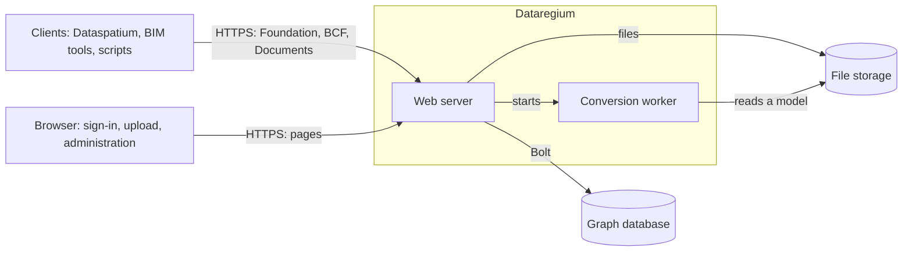

# Architecture

Dataregium is one web server in front of one graph database. This page shows how
the parts fit together, what happens to a request and where each thing lives in
the code. Read it if you want to run the server with confidence, change it or
build on it. The words are explained in the [glossary](glossary.md).

## The parts

| Part | What it does | Code |
|---|---|---|
| Foundation API | Says which APIs the server offers, how to sign in and who you are | `opencde/foundation/` |
| Sign-in | OAuth2 with PKCE, tokens, clients, the sign-in pages and the wait after failed attempts | `opencde/auth/`, `opencde/web/` |
| BCF API | Topics, comments, viewpoints, events, related topics and project documents | `opencde/bcf/` |
| Documents API | Upload and selection through pages in the browser, versions and metadata | `opencde/documents/` |
| Accounts | Users, projects, memberships and roles | `opencde/accounts/` |
| Storage | The server's own data by area: accounts, OAuth2, BCF, Documents and jobs, each a repository with its Cypher behind a protocol; apart from the IFC graph, which IFC-LPG keeps | `opencde/store/` |
| Administration | Pages and an API for administrators, health checks and the request log | `opencde/admin/`, `opencde/requestlog.py` |
| IFC-LPG | Turns uploaded models into nodes and links viewpoint components to them | `opencde/ifcgraph/` |
| Graph layer | The driver, the two database dialects, the schema and what expires | `opencde/graph/` |
| Pages | Templates, styles, scripts and the language catalogues | `opencde/ui/` |

## The way of a request

1. uvicorn takes the request. It believes `X-Forwarded-For` only from the
   proxies in `OPENCDE_TRUSTED_PROXIES`, so the client's address is the real one.
2. The middleware in `opencde/main.py` gives the request an id, logs it without
   bodies or tokens, limits its size, answers CORS and conditional requests, adds
   the security headers and applies the rate limit.
3. The route's dependencies find out who is asking: a bearer token for the APIs
   (`opencde/auth/dependencies.py`), a session cookie for the pages
   (`opencde/web/dependencies.py`).
4. A repository asks the graph, with parameters only. Every query for project
   data starts at the user's node and goes through `MEMBER_OF`, so what a user is
   not a member of does not exist for them and answers 404.
5. The answer follows the schemas in `spec/`, and every error has the same form
   (`opencde/errors.py`).

## Where the data lives

| What | Where | Read more |
|---|---|---|
| Users, projects, topics, comments, viewpoints, document metadata, clients and the audit log | Graph database | [Graph schema](graph-schema.md) |
| Tokens, codes and client secrets, as SHA-256 hashes; passwords, as Argon2id hashes | Graph database | `tests/security/` |
| Uploaded files and viewpoint images, under names the server chooses | File storage in `OPENCDE_DATA_DIR` | [Documents API flows](flows/documents.md) |
| Models as nodes and relationships | Graph database | [IFC-LPG](ifc-lpg.md) |
| The server's own settings and secrets | `.env` or `/run/secrets` | [Local test](deploy/local.md) |

## Work outside requests

- Every minute (`OPENCDE_CLEANUP_INTERVAL_SECONDS`) the server deletes what has
  expired, such as codes, tokens, sessions and unfinished uploads, and takes up
  conversions a stopped server left behind.
- IFC conversions run one at a time in a process of their own, with limits on
  time and memory, so a broken model cannot take the server down.
- When the request log is on (`OPENCDE_REQUEST_LOG_ENABLED`), a writer stores the
  requests in the graph in batches and deletes the old ones.

## Safe by default

- Nothing is open until someone opens it: self-registration of clients, the IFC
  graph, the request log and graph queries are off by default.
- In production the server refuses to start without https and a database password.
- The pages have no inline scripts or styles, every form has a signed token, and
  every page works without JavaScript.

Every measure here has a test behind it in `tests/security/`.

## Two databases

The server runs on Neo4j or Memgraph with the same Cypher. Only the schema
statements differ, and they live in `opencde/graph/dialect.py` together with the
list of functions the code must not use.

## How it is tested

| Folder | What it proves | When it runs |
|---|---|---|
| `tests/unit` | Functions and documents, without a database | Every push |
| `tests/conformance` | Routes and answers against the schemas in `spec/` | Every push |
| `tests/security` | Headers, tokens, limits, and that every operation asks for a token | Every push |
| `tests/integration` | Everything against a real database in Docker | Every push; on Memgraph too every night |
| `tests/ui` | The pages in a real browser, with an accessibility check | Every push |
| `tests/e2e` | The client library against a running server, generated requests, and a restart of the whole stack | Every push; the long runs every night |

## Read on

- [Quick start](quickstart.md): the server and Dataspatium on your own machine.
- [Client guide](client-guide.md): how to build a client.
- [Flows](flows/oauth2.md): sign-in, [documents](flows/documents.md) and
  [BCF viewpoints](flows/bcf-viewpoint.md) as sequence diagrams.
