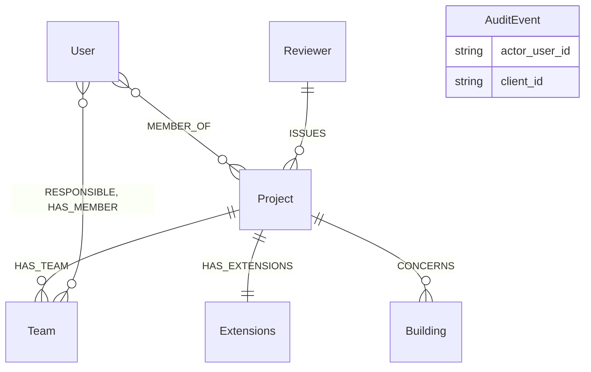
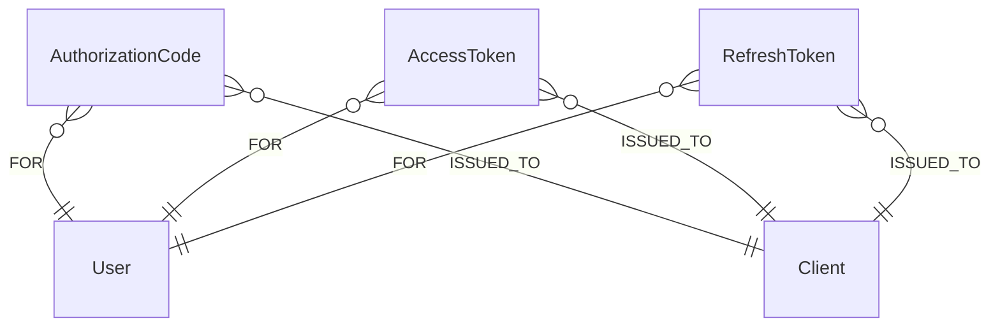
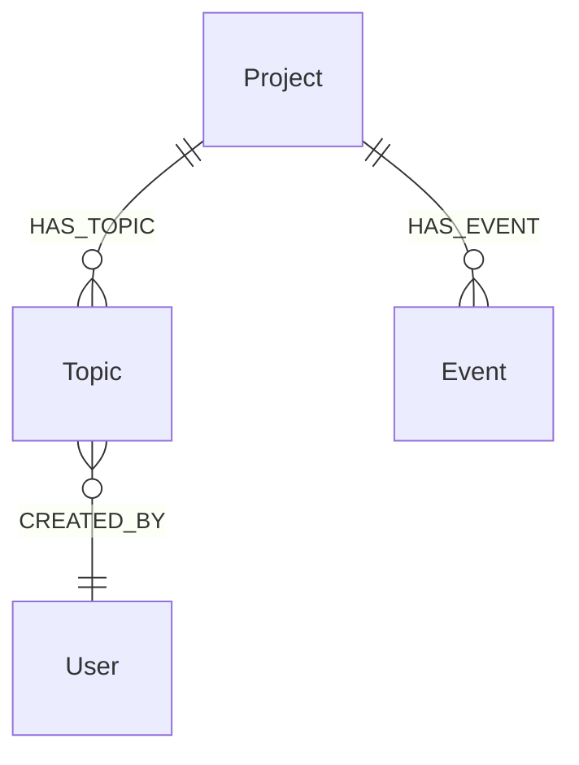
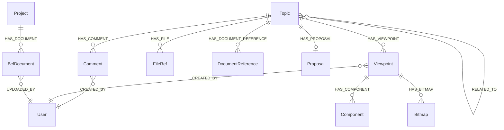
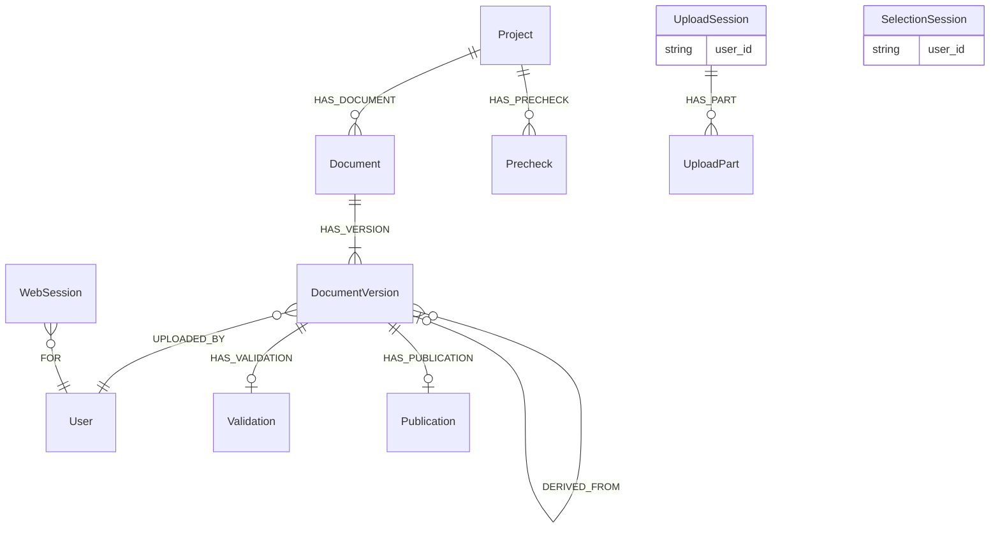
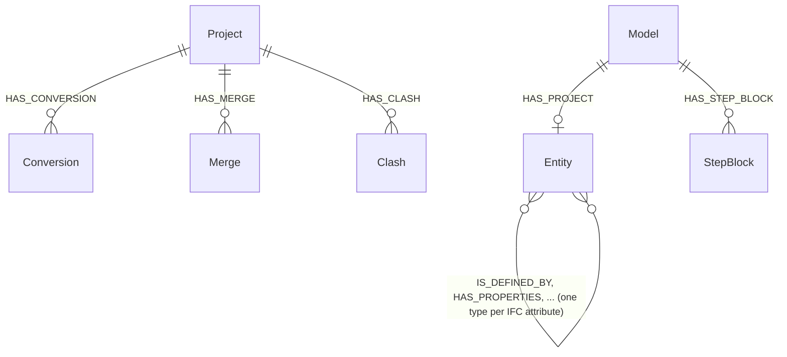

# Graph schema

The database is schemaless; `opencde/graph/schema.py` is the schema. This page
explains the conventions and the labels, section by section in the order the
stages of the plan added them.

## Conventions

- Every node has a server-generated UUID in `id` (or the spec's name for it:
  `project_id`, `guid`, `client_id`, `document_id`) with a unique constraint.
  Nothing a client sends ends up in a file path or a database key unchecked.
- Timestamps are ISO 8601 strings in UTC with milliseconds and a `Z`
  (`2026-11-05T12:34:56.789Z`). String order equals time order.
- Coordinates and vectors are plain floats (`x`, `y`, `z`), never `point()`.
- Anything that expires carries `expires_at` (same format); the server
  deletes expired nodes on a timer (`opencde/graph/cleanup.py`).
- Secrets (codes, tokens, client secrets) are stored only as SHA-256 hashes.
- Cypher is dialect-neutral so Neo4j and Memgraph behave the same (ADR 0003).
  Schema DDL is the only product-specific text and lives in `graph/dialect.py`.
- Names: labels are written in PascalCase (`DocumentVersion`, `Model`),
  relationship types in upper case with underscores (`HAS_TOPIC`,
  `CREATED_BY`, and `IS_DEFINED_BY` for the IFC attribute relationships).
  The diagrams below draw only real nodes and relationships; a reference kept
  as a property (`AuditEvent.actor_user_id`, `UploadSession.user_id`) is listed
  in the box instead of drawn as a line.
- A label that begins with `Ifc` is always one of IFC's classes, as IFC-LPG
  writes them; the server's own records (`Validation`, `Precheck`, `Proposal`,
  `Clash`, `Merge`) never begin with it, so that a query can tell IFC data
  from the server's own.

## Accounts and access (stage 1)

| Label | Key | Properties | Notes |
|---|---|---|---|
| `User` | `id`, unique `username` | `email`, `full_name`, `password_hash` (Argon2id), `is_admin`, `disabled`, `created_at`, `must_change_password` | The user name is the user id the APIs expose |
| `MEMBER_OF` (relationship User → Project) | | `role` (viewer, contributor, editor, manager), `since` | Roles map to BCF `*_actions`, see `accounts/roles.py` |
| `Project` | `project_id` | `name`, `created_at`, `topic_counter`, `block_on_validation_errors` | `topic_counter` numbers `server_assigned_id`; `block_on_validation_errors` refuses uploads with validation errors (ADR 0021) |
| `Extensions` | `id` | `topic_type[]`, `topic_status[]`, `topic_label[]`, `snippet_type[]`, `priority[]`, `stage[]`, `custom_information[]` | `users[]` is computed from members |
| `Team` | `id` | `name`, `ids_document_id`, `created_at`, `updated_at` | A team of a project (`HAS_TEAM`), with `RESPONSIBLE` and `HAS_MEMBER` to users; its part of the model is what the specifications of its IDS document apply to. Deleted with the project |
| `Client` | `client_id` | `name`, `description`, `url`, `redirect_uris[]`, `is_public`, `secret_hash`, `disabled`, `pending_approval`, `created_at`, `created_by`, `dynamic`, `expires_at` (self-registered only) | OAuth2 client; a self-registered one is deleted once `expires_at` passes without a token issuance |
| `AuditEvent` | `id` | `type`, `at`, `actor_user_id`, `client_id`, `ip`, `details` (JSON string) | Security-relevant events |
| `Reviewer`, `Building` | `id` | `name`, `status` | Context from the inspection-plan use case (seed data): the reviewing organisation (a municipality in the original story) and the building |

## OAuth2 (stage 2)

`AuthorizationCode`, `AccessToken` and `RefreshToken` (with `family_id`) are
keyed by a hash of the secret, carry `expires_at`, and are linked
`-[:FOR]->(:User)` and `-[:ISSUED_TO]->(:Client)`. `WebSession` (browser
sign-in, stage 5) is linked `-[:FOR]->(:User)` only.

## BCF topics and events (stage 3)

| Label | Key | Properties | Notes |
|---|---|---|---|
| `Topic` | `guid` | `server_assigned_id`, `title`, `topic_type`, `topic_status`, `priority`, `stage`, `labels[]`, `reference_links[]`, `assigned_to`, `description`, `index`, `due_date`, `creation_date`, `creation_author`, `modified_date`, `modified_author`, `snippet_type`, `snippet_is_external`, `snippet_reference`, `snippet_reference_schema` | Field names follow `topic_GET.json`; the BIM snippet object is flattened into four properties. `server_assigned_id` is `<prefix><counter>` from `Project.topic_counter` |
| `Proposal` | `id` | `state`, `created_at`, `checked_at`, `base_document_id`, `base_version_index`, `change_count`, `applied`, `issue_count`, `error_count`, `truncated`, `ruleset`, `checks`, `report`, `storage_key`, `snippet_key`, `author`, `error` | The trial of a topic's change set on its base version (ADR 0021); `report` holds the findings the base lacks, `storage_key` the applied file, kept for the approval. Deleted with the topic |
| `Event` | `id` | `kind` (`topic` or `comment`), `topic_guid`, `comment_guid`, `author`, `date`, `action_types[]`, `action_values[]` | One node per request that changed something; the two parallel lists are the `actions` array of BCF 3.9/3.10. Attached to the project so that events outlive their topic |

Every topic query starts at the caller's `User` node and walks `MEMBER_OF`
to the project before it touches a topic, so a topic in a project the caller
is not a member of does not exist as far as the API is concerned (404).

## BCF comments, viewpoints and references (stage 4)

| Label | Key | Properties | Notes |
|---|---|---|---|
| `Comment` | `guid` | `topic_guid`, `date`, `author`, `comment`, `viewpoint_guid`, `modified_date`, `modified_author` | `viewpoint_guid` must name a viewpoint of the same topic |
| `Viewpoint` | `guid` | `index`, `author`, `creation_date`, `camera_kind`, `camera` (JSON), `lines` (JSON), `clipping_planes` (JSON), `snapshot_type`, `storage_key`, `has_components`, `default_visibility`, `has_hints`, `spaces_visible`, `space_boundaries_visible`, `openings_visible` | Immutable. Geometry is JSON text: opaque, and identical on both databases |
| `Component` | `id`, indexed `ifc_guid` | `role` (`selection`, `coloring`, `exception`), `group_index`, `position`, `color`, `ifc_guid`, `originating_system`, `authoring_tool_id` | One node per occurrence; the IFC graph links `ifc_guid` to model elements (stage 9) |
| `Bitmap` | `guid` | `position`, `bitmap_type`, `storage_key`, `height`, `loc_*`, `nrm_*`, `up_*` | Image bytes in storage under `bitmaps/<guid>.<type>` |
| `FileRef` | `id` | `position`, `ifc_project`, `ifc_spatial_structure_element`, `filename`, `date`, `reference` | The topic header's files (BCF 3.3) |
| `DocumentReference` | `guid` | `document_guid` or `url`, `description`, `created_at` | Exactly one of the two targets |
| `BcfDocument` | `guid` | `filename`, `storage_key`, `size`, `created_at`, `author` | A file uploaded through BCF 3.8; bytes under `bcf-documents/<guid>` |
| `RELATED_TO` (relationship Topic → Topic) | | | Directed; PUT replaces a topic's outgoing list |

Topics keep their snippet file in `snippet_storage_key` (bytes under
`snippets/<topic guid>.bin`). Deleting a topic deletes everything below it
and the storage keys collected from the nodes; events stay.

## Documents and browser sessions (stage 5)

| Label | Key | Properties | Notes |
|---|---|---|---|
| `Document` | `document_id` | `title`, `created_at`, `latest_index` | `latest_index` numbers the versions |
| `DocumentVersion` | `id` | `version_index`, `version_number`, `creation_date`, `title`, `file_name`, `size_in_bytes`, `sha256`, `storage_key`, `author`, `metadata` (JSON), `parent_version_index`, `approved_by`, `change_set_id`, `change_set` | Bytes under `documents/<id>`; the API body shows only the spec's fields; `parent_version_index`, `approved_by`, `change_set_id` and `change_set` (the changes, packed) on a version built on another, linked to it by `DERIVED_FROM` (ADR 0021) |
| `Validation` | `id` | `state`, `checked_at`, `issue_count`, `truncated`, `ruleset`, `report`, `storage_key`, `file_name`, `error` | The check of an uploaded IFC file against the IFC schema (ADR 0011); `report` is up to 10,000 issues as compressed JSON. Deleted with the version's project |
| `Publication` | `id` | `storage_key`, `file_name`, `size_in_bytes`, `sha256`, `published_at`, `published_by` | A published version's archive, `.ifczip` or `.zip`, under `published/<id>`; one per version. Deleted with the version's project |
| `Precheck` | `id` | those of `Validation`, `project_id`, `author`, `expires_at` | A file checked without becoming a version, or an upload the project refused (ADR 0021); labelled `Validation` too. The cleanup job deletes it and its file after a day |
| `UploadSession` | `id`, indexed `token_hash` | `user_id`, `username`, `callback_url`, `callback_expires_at`, `expires_at`, `server_context`, `project_id`, `state`, `files_json` | `id` appears in API URLs (bearer required); the UI URL carries the token whose hash is stored |
| `UploadPart` | `id` | `file_index`, `part_index`, `range_start`, `range_end`, `received`, `storage_key`, `size`, `expires_at` | Bytes under `parts/<id>` until the file is assembled; the cleanup job deletes expired parts and their files |
| `SelectionSession` | `id`, indexed `token_hash` | `user_id`, `callback_url`, `callback_expires_at`, `expires_at`, `server_context`, `extensions[]`, `state`, `selected[]` | `selected` holds `document_id:version_index` pairs chosen in the browser |
| `WebSession` | `id` (hash of the cookie) | `created_at`, `expires_at`, `idle_expires_at`, `ip` | Browser sign-in; `expires_at` is the absolute lifetime |
| `SignInThrottle` | `key` (hash of the user name) | `failures`, `blocked_until`, `expires_at` | Failed sign-ins per user name; expires a day after the last failure, and a success removes it |

## IFC graph (stage 9)

| Label | Key | Properties | Notes |
|---|---|---|---|
| `Conversion` | `id`, indexed `project_id`, `document_id` | `model_id`, `document_id`, `version_index` or `bcf_document_guid`, `file_name`, `storage_key`, `state`, `created_at`, `running_at`, `done_at`, `failed_at`, `error`, `geometry_key`, `spatial_pending`, `spatial_error`, `graph_report`, `graph_issue_count`, `graph_error_count`, `graph_ruleset`, `graph_checked_at`, `merge_of`, and a copy of the import's `schema`, `ifc_project_guid`, `entities`, `relationships`, `skipped`, `lossless`, `geometry`, `ifc_header`, `form_version`, `format`, `spatial_at`, `spatial_products` and `spatial_failed` | The server's record of a conversion (`HAS_CONVERSION`): the file it came from, its lifecycle (`state` is `queued`, `running`, `done` or `failed`), the geometry records and the graph check; `model_id` names the model, which bears the same id, and nothing else joins the two. Deleted with the project |
| `Model` | `id` | `schema`, `ifc_project_guid`, `entities`, `relationships`, `skipped`, `lossless`, `geometry`, `ifc_header`, `format`, `form_version`, `imported_at`, `spatial_at`, `spatial_products`, `spatial_failed`, `prepared_…` | IFC-LPG's record of an imported model, written by the library alone; `imported_at` says that it is all in the graph (a model from before 2026-11-11 keeps `state` `done` for that). The server never writes it |
| `Entity` + class labels | `id` (`<model id>:<step id>`), indexed `GlobalId`, `model_id` | `ifc_class`, `step_id`, `bbox_min`, `bbox_max`, `bbox_centre` (points in project coordinates, metres, on a product with a shape), every literal IFC attribute by name | Relationships between entities are named after the IFC attribute (forward and inverse), written like every relationship type in upper case with underscores: `IsDefinedBy` becomes `IS_DEFINED_BY` |
| `StepBlock` | `id` (`<model id>:<first step id>`) | `first_step`, `instances`, `text` | Instances of a model converted with `OPENCDE_IFC_LPG_LOSSLESS` that are no nodes: written out as STEP in order of id and compressed. Do not return this node whole in a query, for the sake of `text` |
| `Merge` | `id` | `project_id`, `kind` (`merge` or `prepare`), `state`, `request`, `author`, `created_at`, `running_at`, `finished_at`, `model_id`, `version_index`, `expires_at`, `report`, `error` | A building of model B brought into a model of the project (`HAS_MERGE`); `request` names both versions, and `version_index` is the version it became. Its merged model is taken out of the graph once written out. Deleted with the project |
| `Clash` | `id` | `project_id`, `state`, `request`, `author`, `created_at`, `running_at`, `done_at`, `failed_at`, `count`, `set_a`, `set_b`, `missing`, `seconds`, `truncated`, `report`, `error` | A clash check between two document versions of the project (`HAS_CLASH`; ADR 0019); `request` names both versions, the mode and the tolerance, and `report` holds the pairs found as compressed JSON. Deleted with the project |

See [ifc-lpg.md](ifc-lpg.md) for the conversion rules and example queries.
