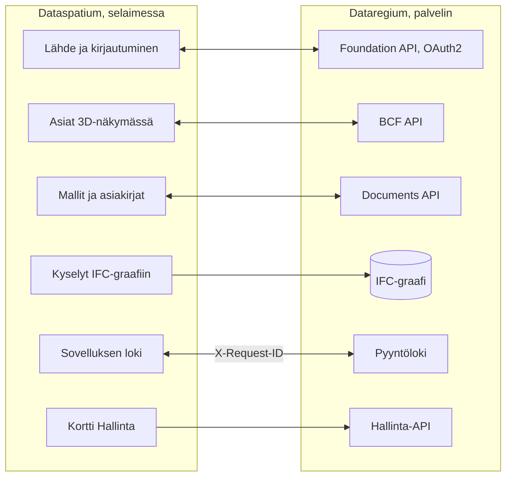

[Svenska](../../README.md) · [Dansk](../da/README.md) · [Norsk bokmål](../nb/README.md) · [Norsk nynorsk](../nn/README.md) · **Suomi** · [Íslenska](../is/README.md) · [English](../en/README.md)


# Dataregium OpenCDE-palvelin

*Dataregiumin nimi oli Kontroll 8. marraskuuta 2026 asti.*

Dataregium on palvelin buildingSMARTin **OpenCDE-rajapinnoille** (Foundation
API 1.0, BCF API 3.0 ja 2.1 sekä Documents API 1.0). Se on rakennettu
graafitietokannan päälle, siinä on selainpohjainen hallinta ja valinnainen
IFC-LPG-moduuli, joka yhdistää BCF-komponentit rakennusosiin, joihin ne
viittaavat. Se sai alkunsa vuoden 2023 tutkimusprototyypistä Ruotsin
rakennuslupien digitaalisia tarkastussuunnitelmia varten ja kirjoitettiin
uudelleen alusta alkaen tietoturva ensimmäisenä vaatimuksena.
Määrittelyjä noudattavien asiakkaiden pitäisi pystyä muodostamaan yhteys, joten
palvelin ei ole sidottu yhteen sovellukseen.


**Sisältö**

- [Lataa ja aloita](#lataa-ja-aloita)
- [Vaatimukset](#vaatimukset)
- [Mitä voit tehdä](#mitä-voit-tehdä)
- [OpenCDE-rajapinnat ja niiden asiakkaat](#opencde-rajapinnat-ja-niiden-asiakkaat)
- [Dataregium ja Dataspatium](#dataregium-ja-dataspatium)
- [Lue lisää](#lue-lisää)
- [Rajoitukset lyhyesti](#rajoitukset-lyhyesti)
- [Henkilötiedot](#henkilötiedot)
- [Seuraavaksi 3-sarjassa](#seuraavaksi-3-sarjassa)
- [Virheet ja ehdotukset](#virheet-ja-ehdotukset)
- [Kehitys](#kehitys)
- [Lisenssi](#lisenssi)

## Lataa ja aloita

### Pika-aloitus (paikallisesti, Docker tai Podman)

1. **Lataa.** Kloonaa repo tai hae julkaistu image
   `ghcr.io/marwiss/opencdeserver` (useita arkkitehtuureja, skannattu ja
   SBOM:n kanssa jokaisessa julkaisussa):

   ```sh
   git clone https://github.com/marwiss/Dataregium.git
   cd Dataregium
   ```

2. **Määritä.** Kopioi `.env.example` tiedostoksi `.env` ja aseta
   `OPENCDE_GRAPH_PASSWORD` (vähintään 16 merkkiä). Jokainen asetus selitetään
   tiedostossa [.env.example](../../.env.example).
3. **Käynnistä.** Samat compose-tiedostot toimivat Dockerilla ja Podmanilla; valitse se, joka sinulla on:

   <details open>
   <summary><b>Docker</b></summary>

   ```sh
   docker compose up -d --build
   ```

   käynnistää palvelimen osoitteessa <http://127.0.0.1:8000> ja Neo4j-tietokannan; `docker compose logs -f api` näyttää palvelimen lokin.

   </details>

   <details>
   <summary><b>Podman</b></summary>

   ```sh
   podman compose up -d --build
   ```

   tekee saman Podman 5:llä (rootless, ilman daemonia); `podman compose logs -f api` näyttää palvelimen lokin. Katso [docs/fi/deploy/local.md](deploy/local.md) Podmanin erityispiirteet.

   </details>

   <details>
   <summary><b>Ilman konttia</b></summary>

   ```sh
   uv sync                          # asentaa Python 3.13:n ja kaikki riippuvuudet
   uv run opencde doctor            # tarkistaa määritykset ja tietokannan
   uv run opencde serve             # http://127.0.0.1:8000
   ```

   ajaa palvelimen työkopiosta [uv](https://docs.astral.sh/uv/):lla; tietokanta tarvitaan edelleen (Neo4j Desktop, Memgraph Lab tai compose-tiedostojen tietokanta).

   </details>

4. **Katsele ympärillesi.** <http://127.0.0.1:8000/docs> on vuorovaikutteinen
   API-dokumentaatio, <http://127.0.0.1:8000/readyz> valmiustarkistus ja
   <http://127.0.0.1:7484> Neo4j Browser (Bolt osoitteessa `127.0.0.1:7697`;
   kehitysylikerros välttää Neo4j:n oletusportit, jotka toinen Neo4j samalla
   koneella usein varaa).
5. **Lisää demodata ja kirjaudu.**

   <details open>
   <summary><b>Docker</b></summary>

   ```sh
   docker compose exec api opencde seed
   ```

   </details>

   <details>
   <summary><b>Podman</b></summary>

   ```sh
   podman compose exec api opencde seed
   ```

   </details>

   <details>
   <summary><b>Ilman konttia</b></summary>

   ```sh
   uv run opencde seed
   ```

   </details>

   Komento luo demokäyttäjät ja -projektit ja tulostaa niiden salasanat kerran. Kirjaudu osoitteessa <http://127.0.0.1:8000/signin> käyttäjänä `admin` ja avaa `/admin`.
6. **Yhdistä asiakasohjelma.** Rekisteröi sovelluksesi kohdassa *Asiakkaat*
   (tai anna sen rekisteröityä itse, kun
   `OPENCDE_DYNAMIC_CLIENT_REGISTRATION=true`) ja osoita se osoitteeseen
   `http://127.0.0.1:8000`; [Dataspatium](#dataregium-ja-dataspatium) ja
   Python-kirjasto kansiossa [client/](../../client/) ovat valmiita
   asiakasohjelmia.
   Jos kirjaudut Dataspatiumista, seuraa [pika-aloitusta](quickstart.md): siinä on
   kaikki tarvittavat asetukset ja ohjeet siihen, mitä tehdä, jos jokin menee vikaan.

### Käyttöönotto

Yksi compose-tiedosto ja yksi ylikerros per skenaario:

| Skenaario | Ohje |
|---|---|
| Paikallinen testi omalla koneella | [docs/fi/deploy/local.md](deploy/local.md) |
| Julkinen https-osoite asiakastesteihin ilman omaa palvelinta (tunneli) | [docs/fi/deploy/tunnel.md](deploy/tunnel.md) |
| Tuotanto omalla palvelimella Caddyn (automaattinen TLS) ja öisten varmuuskopioiden kanssa | [docs/fi/deploy/vps-caddy.md](deploy/vps-caddy.md) |
| Coolify, Dokploy, Portainer | [docs/fi/deploy/paas.md](deploy/paas.md) |
| Konttipalvelu ja hallittu Neo4j AuraDB tai Memgraph Cloud | [docs/fi/deploy/cloud-aura.md](deploy/cloud-aura.md) |
| Varmuuskopiointi ja palautus (siirrettävä Neo4j:n ja Memgraphin välillä) | [docs/fi/deploy/backup.md](deploy/backup.md) |

`uv run opencde init --public-url https://cde.example.org` kirjoittaa
tuotannon `.env`-tiedoston uusilla salaisuuksilla; `opencde doctor`
tarkistaa tuloksen.

### Määritykset

Kaikki luetaan ympäristömuuttujista etuliitteellä `OPENCDE_`,
`.env`-tiedostosta tai Docker-salaisuuksista polusta
`/run/secrets/opencde_<nimi>`. Kommentoitu luettelo on tiedostossa
[.env.example](../../.env.example). Oletusarvot ovat turvallisia: tuotanto ei
käynnisty ilman julkista `https`-osoitetta ja tietokannan salasanaa, eikä
mikään ole auki ennen kuin se on määritetty.

## Vaatimukset

- Windows, macOS tai Linux ja Docker (Desktop Windowsissa/macOS:ssä, Engine
  Linuxissa), tai Python 3.11 tai uudempi, [uv](https://docs.astral.sh/uv/) ja
  oma Neo4j 5.26- tai Memgraph 3.14 -tietokanta.
- Noin 1 Gt muistia tietokantakontille (`NEO4J_HEAP` ja `NEO4J_PAGECACHE`
  tiedostossa `.env`), enemmän IFC-LPG-moduulin kanssa.
- Paikallisesti: portti 8000 palvelimelle ja 7484/7697 tietokannalle, kaikki
  sidottuina osoitteeseen `127.0.0.1`. Tuotannossa: portit 80 ja 443
  tavoitettavissa internetistä ja DNS-nimi palvelimelle.
- Asiakasohjelmat tarvitsevat tuotannossa `https`-osoitteen; paikallisesti
  `http://127.0.0.1` hyväksytään redirect-URI:ksi, ja `http://localhost` asetuksella `OPENCDE_ALLOW_LOCALHOST_REDIRECTS=true`.

## Mitä voit tehdä

Mikä toimii yhdessä versiossa, toimii myös seuraavassa. Jokainen versio kuuluu
yhteen saman Dataspatiumin version kanssa.

### Versio 1 (Dataspatium 1:n kanssa)

- **Foundation API 1.0**: palvelujen löytäminen, kirjautuminen OAuth2:lla ja
  PKCE:llä, nykyinen käyttäjä ja asiakkaiden rekisteröinti.
- **Documents API 1.0**: dokumenttien ja niiden versioiden valinta, lähetys ja
  lataus.
- **Hallinta** selaimessa (`/admin`) ja komentorivillä: käyttäjät, projektit,
  asiakkaat, istunnot, tarkastusloki ja terveystarkistukset.
- **Laajennukset**: kyvykkyysasiakirja (`/.well-known/dataregium`), virhekoodi
  jokaisessa virhevastauksessa ja pyyntöloki.
- **Asiakaskirjasto** Pythonille ([client/](../../client/)) ja julkaistu image
  jokaiseen käyttöönottoon.

### Lisäksi versiossa 2 (Dataspatium 2:n kanssa)

- **BCF API 3.0 ja 2.1**: asiat, kommentit ja näkymät, validoituina
  buildingSMARTin skeemoja vasten.
- **IFC-LPG-moduuli**: lähetetyistä IFC-malleista tulee graafi, joka on liitetty
  BCF-komponentteihin.

### Lisäksi versiossa 3 (Dataspatium 3:n kanssa)

- **Häviötön IFC-graafi**: tiedosto voidaan kirjoittaa takaisin sellaisena kuin
  se tuli.
- **Tarkistetut lähetykset** IFC-skeemaa, buildingSMARTin sääntöjä ja projektin
  IDS:ää vasten, ennakkotarkistuksen kanssa.
- **Kysymyksiä mallille**: nimetyt kyselyt, versioiden vertailu ja
  törmäystarkastus.
- **Muutokset ehdotuksina** BCF-asioissa, jotka `manager` hyväksyy seuraavaksi
  versioksi.
- **Paikallinen moottori** omalla tietokoneellasi, ja suurille malleille
  työkopio muistissa.

**Tila**: suunnitelman kaikki yksitoista vaihetta on toteutettu; osallistumista
IfcOpenShelliin ei ole vielä ehdotettu.


## OpenCDE-rajapinnat ja niiden asiakkaat

OpenCDE on buildingSMART Internationalin avoimien verkkorajapintojen perhe yhteiselle
tietoympäristölle, paikalle, jossa projekti jakaa mallinsa, asiakirjansa ja asiansa.
Asiakas ja palvelin, jotka noudattavat samoja määrittelyjä, voivat toimia yhdessä, olipa
ne rakentanut kuka tahansa. Dataregium toteuttaa ne kaikki kolme:

| API | Mihin se on tarkoitettu | Määrittely |
|---|---|---|
| Foundation API 1.0 | Kertoo, mitä rajapintoja palvelin tarjoaa, miten kirjaudutaan ja kuka käyttäjä on | [foundation-API](https://github.com/buildingSMART/foundation-API) |
| BCF API 3.0 ja 2.1 | Mallia koskevat asiat, kommentit ja näkymät kameroineen, komponentteineen ja kuvineen | [BCF-API](https://github.com/buildingSMART/BCF-API) |
| Documents API 1.0 | Asiakirjojen ja niiden versioiden valinta, nouto ja lataaminen palvelimen sivuilla | [documents-API](https://github.com/buildingSMART/documents-API) |

**Dataspatium on yksi asiakas, ei ainoa.** Jokaisen näitä määrittelyjä noudattavan
asiakkaan pitäisi pystyä muodostamaan yhteys: mikään palvelimella ei riipu Dataspatiumista,
ja määrittelyjen ulkopuoliset laajennukset ovat valinnaisia, joten asiakas, joka ei tunne
niitä, ei huomaa niitä. Asiakas tarvitsee kolme asiaa:

- rekisteröinnin palvelimelle, jonka tekee ylläpitäjä kohdassa *Asiakkaat* tai asiakas itse,
  kun `OPENCDE_DYNAMIC_CLIENT_REGISTRATION=true`;
- OAuth2 authorization code -kulun ja PKCE:n `S256`, jota palvelin vaatii jokaiselta
  asiakkaalta paitsi luottamukselliselta, jonka ylläpitäjä on merkinnyt;
- BCF API 3.0:n tai 2.1:n asiakkaalle, joka osaa vain sen version. `GET /foundation/versions` luettelee molemmat, ja
  [asiakasopas](client-guide.md) kertoo, mikä niitä erottaa.

Näin pitkälle tämä on osoitettu: palvelimen vastaukset testataan buildingSMARTin skeemoja
vasten jokaisella pushilla, ja Dataspatium ja Python-kirjasto kansiossa [client/](../../client/)
ajetaan palvelinta vasten. Riippumattomille asiakkaille, kuten Bonsaille ja ifc-litelle, on
valmis tarkistuslista, mutta sitä ei ole vielä
ajettu. Jos kokeilet jotakin asiakasta, kerro, miten kävi, kohdassa
[Virheet ja ehdotukset](#virheet-ja-ehdotukset). Kun asiakas ja määrittely ovat ristiriidassa, määrittely ratkaisee.
[docs/fi/client-guide.md](client-guide.md) on tarkoitettu asiakkaan rakentajille.

## Dataregium ja Dataspatium

Dataregium (palvelin) ja [Dataspatium](https://github.com/marwiss/Dataspatium)
(kokonaan selaimessa toimiva datasovellus) on kehitetty toimimaan yhdessä
palvelimena ja asiakkaana, ja sama julkaisunumero molemmissa tarkoittaa, että
ne toimivat yhdessä: Dataspatium 3.0.0 toimii Dataregium 3.0.0:n kanssa
([pika-aloitus](quickstart.md)).
Dataspatium lisää Dataregium-palvelimen lähteeksi: sovellus löytää rajapinnat
osoitteesta `/foundation/versions`, kirjautuu OAuth2 authorization code
-kululla ja PKCE:llä ja rekisteröi itsensä julkiseksi asiakkaaksi, kun
dynaaminen rekisteröinti on päällä, luettelee projektin mallit ja asiakirjat,
lukee ja kirjoittaa BCF-asioita kommentteineen ja 3D-näkymästään otettuine
viewpoint-näkymineen, lähettää datamäärät, tiedostot ja työtilapaketit
Documents API:n kautta, kyselee IFC-graafia Cypherillä Boltin yli, kun
ylläpitäjä julkaisee sen, ja lähettää jokaisessa kutsussa
`X-Request-ID`-otsakkeen, jotta pyyntöloki täällä ja sovelluksen loki
näyttävät saman keskustelun. Sovellus lukee palvelimen kyvykkyysasiakirjan
nähdäkseen, mitkä laajennukset ovat päällä, ja toimii palvelimen
virhevastauksiin lisäämien virhekoodien mukaan.

Näin ne liittyvät toisiinsa:



Merkittyjä laajennuksia lukuun ottamatta kaikki, mitä Dataspatium tekee
palvelinta vastaan, kulkee kolmen OpenCDE-rajapinnan kautta, joten sovellus ei käytä mitään, mitä toinen
asiakas ei voisi käyttää, katso [OpenCDE-rajapinnat ja niiden asiakkaat](#opencde-rajapinnat-ja-niiden-asiakkaat). Kaksi tuotetta asennetaan erikseen: tämä repo ei niputa
Dataspatiumia mukaansa (lisenssit eroavat, AGPL täällä ja PolyForm Strict
siellä), ja Dataspatiumin README kertoo, miten sovellus ladataan.
Asiakaspuoli kuvataan Dataspatiumin README-tiedostossa ja sen
dokumentaatiossa.

### Julkaisut 1, 2 ja 3

Jokainen pääversio on yksi julkaisu, joka julkaistaan uudelleen sen kasvaessa,
ja Dataspatiumin sama numero kuuluu sen pariin. Kolme eroavat näin:

- **1.0.0** on dokumenttipalvelin: Foundation API 1.0 (versiot, kirjautuminen
  OAuth2:lla ja PKCE:llä, nykyinen käyttäjä, asiakkaiden itserekisteröinti, kun
  operaattori sallii sen) ja Documents API 1.0 (dokumenttien ja niiden
  versioiden valinta, lähetys ja lataus), mukana seitsenkielinen verkkohallinta
  ja pyyntöloki. Se on 2.0.0-koodi, jossa vain Documents API on käytössä
  (`OPENCDE_APIS`), Dataspatium 1:lle.
- **2.0.0** lisää BCF API 3.0:n ja 2.1:n samaan dataan (asiat, kommentit,
  näkymät, dokumentit) ja valinnaisen IFC-LPG-moduulin, joka tekee graafin
  jokaisesta lähetetystä IFC-tiedostosta, Dataspatium 2:lle.
- **3.0.0** tekee graafista häviöttömän niin, että tiedosto voidaan kirjoittaa
  takaisin, tarkistaa jokaisen lähetyksen IFC-skeemaa, buildingSMARTin sääntöjä
  ja projektin IDS-dokumentteja vasten, antaa jäsenille nimetyt kyselyt,
  kahden version törmäystarkastuksen, perustaversion lähetettäessä, eston
  validointivirheille ennakkotarkistuksineen sekä muutosjoukot, jotka
  kokeillaan ja hyväksytään uusiksi versioiksi, Dataspatium 3:lle. IFC-LPG on
  oma kirjastonsa.

## Lue lisää

- [docs/fi/quickstart.md](quickstart.md): Dataregium ja Dataspatium yhdessä
  kahdessakymmenessä minuutissa, tyhjästä koneesta 3D-näkymässä luotuun asiaan.
- [docs/fi/client-guide.md](client-guide.md) ja [docs/examples/](../examples/):
  miten asiakasohjelma rakennetaan, kyvykkyysasiakirja, virhekoodit ja
  ajettavia esimerkkejä Python-kirjastolla kansiossa [client/](../../client/).
- [docs/fi/architecture.md](architecture.md): miten osat liittyvät toisiinsa, mitä pyynnölle tapahtuu ja missä kaikki on koodissa.
- [docs/fi/glossary.md](glossary.md): dokumentaation käyttämät sanat.
- [docs/fi/flows/](flows/): OAuth2-, Documents API- ja BCF-näkymäkulkujen sekvenssikaaviot.
- [docs/fi/graph-schema.md](graph-schema.md): graafimalli.
- [docs/fi/ifc-lpg.md](ifc-lpg.md): valinnainen IFC-LPG-moduuli ja esimerkkejä Cypher-kyselyistä.
- Arkkitehtuuripäätökset, jotka pysyvät: graafitietokanta ainoana
  tallennuspaikkana, läpinäkymättömät tokenit JWT:n sijaan, siirrettävä Cypher
  Neo4j:lle ja Memgraphille, kehyksetön selainkäyttöliittymä, varmuuskopiointi
  sovellustasolla, BCF API 2.1 version 3.0 rinnalla, häviötön IFC-graafi, joka
  lukee ja kirjoittaa STEPin itse ja validoidaan kirjoitettaessa, buildingSMARTin
  säännöt omassa ympäristössään, IFC-LPG kirjastona, tarkistus projektin IDS:ää
  vasten ja nimetyt kyselyt jäsenille.
- [spec/SOURCES.md](../../spec/SOURCES.md): tarkat spesifikaatioversiot,
  joita vastaan palvelin testataan.

Dokumentaatio on tämän README-tiedoston seitsemällä kielellä, kukin kieli
hakemistossa `docs/<kieli>/`; englanti hakemistossa `docs/en/` on lähde.
CONTRIBUTING on englanniksi.

### Lisälukemista

- [BCF API](https://github.com/buildingSMART/BCF-API), [Foundation API](https://github.com/buildingSMART/foundation-API) ja [Documents API](https://github.com/buildingSMART/documents-API):
  määrittelyt, joita palvelin noudattaa.
- [IFC](https://github.com/buildingSMART/IFC4.x-development): rakennusmallien tiedostomuoto, ja [IDS](https://github.com/buildingSMART/IDS): vaatimusmäärittelyt, joita vasten malleja tarkistetaan.
- [RFC 9700](https://www.rfc-editor.org/rfc/rfc9700): nykyiset parhaat käytännöt OAuth 2.0:n turvallisuudelle, ja
  [OAuth 2.1](https://datatracker.ietf.org/doc/draft-ietf-oauth-v2-1/), luonnos, joka kokoaa ne.
- [RFC 7636](https://www.rfc-editor.org/rfc/rfc7636) (PKCE), [RFC 8252](https://www.rfc-editor.org/rfc/rfc8252) (sovellukset tietokoneessa tai puhelimessa) ja
  [RFC 7591](https://www.rfc-editor.org/rfc/rfc7591) (asiakkaiden rekisteröinti).
- [OWASP ASVS](https://owasp.org/www-project-application-security-verification-standard/): turvallisuustyön tarkistuslista.

## Rajoitukset lyhyesti

- Palvelin toteuttaa BCF API 3.0:n ja 2.1:n, ei 1.0:aa, jonka resurssit ovat erimuotoisia.
- Projektin vienti BCFzip-tiedostoksi jää asiakasohjelmille; palvelin
  tallentaa asiat, kommentit ja viewpoint-näkymät rajapinnan määrittelemässä
  muodossa.
- Neo4j:n ja Memgraphin community-versioissa ei ole vain lukuun oikeutettuja
  tietokantakäyttäjiä, joten julkaistu Bolt-portti antaa täydet oikeudet
  salasanan haltijalle. Portti pysyy kiinni, ellei järjestelmänvalvoja julkaise
  sitä tarkoituksella; hallintarajapinnan lukeva graafikysely
  (`OPENCDE_GRAPH_QUERY_ENABLED`) antaa Cypherin ilman porttia.
- IFC-graafin tuonti ajetaan erillisessä prosessissa muisti- ja aikarajoin
  (`OPENCDE_IFC_LPG_*`); hyvin suuret mallit hylätään sen sijaan, että ne
  jäisivät puoliksi tuoduiksi.
- Selainsivut palvelevat järjestelmänvalvojia sekä OAuth2- ja Documents API
  -kulkuja; loppukäyttäjät työskentelevät asiakasohjelmassa, kuten
  Dataspatiumissa tai Bonsaissa.
- Sivut ovat tämän README-tiedoston seitsemällä kielellä (vaihda jokaisen sivun
  alareunasta); komentorivi ja rajapintojen virheviestit ovat englanniksi.
- Ulkoista auditointia ei ole vielä tehty. OAuch- ja testssl-ajot ovat
  ylläpitäjän askeleet ennen tuotantokäyttöönottoa.

## Henkilötiedot

Se, joka ylläpitää Dataregiumia muille, on näiden tietojen rekisterinpitäjä.
Palvelin tallentaa käyttäjätilit (käyttäjänimi, nimi, valinnainen sähköposti,
salasanan tiiviste), projektijäsenyydet, aiheet ja kommentit tekijöiden
nimineen, ladatut tiedostot lataajineen, IFC-graafin tiedoston
omistajahistorioineen sekä tarkastuslokin siitä, kuka teki mitä ja mistä
osoitteesta. Salasanat, tokenit ja salaisuudet tallennetaan vain tiivisteinä.
Tokenit, istunnot, latausistunnot ja käyttämättömät itserekisteröidyt asiakkaat
vanhenevat, ja palvelin siivoaa ne; tarkastuslokin karsii ylläpitäjä.
Ylläpitäjä poistaa tilin kohdassa `/admin/users`, ja sen istunnot ja tokenit
poistuvat mukana; nimi jää henkilön kirjoittamiin aiheisiin, kunnes ne
poistetaan. Tarkastusloki viedään CSV-muodossa, BCF- ja dokumenttitiedot
rajapintojen kautta ja koko tietokanta komennolla `opencde backup`. Se, mitä
Dataspatium säilyttää selaimessa, kerrotaan sovelluksen omassa
dokumentaatiossa.

## Seuraavaksi 3-sarjassa

3.0.0 on 3-sarjan ensimmäinen julkaisu, tehty yhdessä Dataspatium 3.0.0:n
kanssa: IFC-graafi häviöttömänä mallina, jokaisen lähetyksen tarkistus ja
nimetyt kyselyt, kuten [Mitä voit tehdä](#mitä-voit-tehdä) kertoo. Vuodesta
2026-11-10 se sisältää myös kahden version törmäystarkastuksen, lähetyksen
perustaversion, validointivirheellisten lähetysten hylkäämisen ja tiedoston
ennakkotarkistuksen. Kuten jokaisella pääversiolla, sarjalla on yksi julkaisu,
joka julkaistaan uudelleen sarjan kasvaessa. Seuraavaksi graafista tulee malli,
jota voi muokata ja jonka versioita voi hallita tietokannassa, ja Dataspatium on
asiakas, joka muokkaa sitä ja näyttää sen versiot. Viralliset OpenCDE-rajapinnat
pysyvät sellaisina kuin buildingSMART ne määrittelee; se, mitä sarja lisää, on
niiden laajennuksia omilla nimillään. Tämä osio kertoo, mikä on päätetty, sille,
ihmiselle tai tekoälyagentille, joka vie osan siitä eteenpäin. Päätökset on
tiivistetty kohdassa [Lue lisää](#lue-lisää), käytännöt tiedostossa
[CONTRIBUTING.md](../../CONTRIBUTING.md) ja IFC-graafi sivulla
[docs/fi/ifc-lpg.md](ifc-lpg.md).

### Päätetty

- **Mallien muokkaus Native IFC:nä.** Create on lähetys ja Read nimetyt
  kyselyt, molemmat versiossa 3.0.0. Update on muutos, jonka asiakas ehdottaa
  rajapinnan kautta ja joka tarkistetaan ennen kuin se otetaan mukaan. Delete
  poistaa valittuja graafin osia: entiteetin, rakennuksen tai projektin. Export
  kirjoittaa STEPin takaisin kuten nyt.
- **Versiohistoria tietokannassa, ei gitissä**, Bruno Postlen
  [ifcmergen](https://github.com/brunopostle/ifcmerge) hengessä: mikä muuttui,
  kuka ehdotti sitä ja kuka hyväksyi sen. Tietojen on noudatettava IFC:tä,
  ifc-gherkin-rules-sääntöjä ja projektin IDS:ää tuonnissa ja jokaisen
  muutoksen jälkeen.
- **BIM-snippetit toimivana esittelynä.** Ehdotettu muutos kulkee BCF 3.0
  -asian `bim_snippet`-kenttänä, ja sen `reference_schema` viittaa
  julkaistuun skeemaan, jotta muutos, sen käsittely ja päätös ovat yhdessä
  paikassa. Mikään ohjelmisto ei vielä sovella snippetiä, ja buildingSMARTin
  julkaisemattomat kehityshaarat ovat poistaneet ne; Dataregium rakentaa ne
  näyttääkseen, miten ne voisivat toimia. Snippet osoittaa muuttamansa kohteen
  GlobalId:llä ja siitä lähtevällä polulla, ja STEP-tunnisteella vain, kun mikään GlobalId ei tavoita sitä.
  STEP-tunniste tavoittaa aina instanssin; GlobalId ja polku tavoittivat 98–100
  prosenttia instansseista 28 esimerkkitiedostossa, kun polku sai kulkea
  taaksepäin käänteisten attribuuttien kautta.
- **Laajennuksia, ei rajapintojen uusia versioita.** BCF-asiat, joissa on
  `bim_snippet`, Documents API:n metatiedot ja versiot sekä
  ominaisuusdokumentti kantavat sen, mitä sarja lisää, ja niitä kuvaa oma
  OpenAPI.
- **Törmäystarkistus molemmissa paikoissa**: palvelimella IfcOpenShellin
  IfcClashilla ja Dataspatiumissa sen omalla JavaScript-ytimellä.
- **Projektin hallinta sen projektipäällikön toimesta**, jonka ei tarvitse olla
  palvelimen ylläpitäjä, sekä tiimit, joilla on vastuita projektirooleja
  laajemmin.
- **Miten versio tallennetaan** (päätetty 2026-11-10). Jokainen hyväksytty
  versio on solmu, jolla on vanhempi, tekijä, hyväksyjä ja muutokset
  GlobalId:n, polun ja attribuutin mukaan; graafi pitää pääversiota; versio
  tallennetaan muutoksenaan, ja kokonainen tiedosto `.ifczip`-muodossa vain
  versiota julkaistaessa, ja mikä tahansa versio kirjoitetaan pyynnöstä; kaksi
  muutosta yhdistetään attribuutti kerrallaan kuten ifcmerge tekee, ja muutos
  otetaan mukaan, kun siitä kirjoitetussa tiedostossa ei ole huomautusta, jota
  edellisessä versiossa ei ollut. Versiossa 3.0.0: lähetyksen perustaversio
  (`412` ristiriidassa), validointivirheellisten lähetysten hylkääminen ja
  tiedoston ennakkotarkistus. Versiosolmut ja yhdistäminen tulevat seuraavaksi.
- **Kuka saa muuttaa mitä** (päätetty). Ensin projektiroolit: `editor`
  ehdottaa, `manager` hyväksyy, ja tekoäly vain ehdottaa. Vastuusäännöt, jotka
  osoittavat mallin osan IDS-valinnoilla, kuten luokalla, ominaisuudella,
  luokittelulla tai kerroksella, kuten ISO 19650:n tehtäväryhmät, tulevat
  myöhemmin.
- **Snippetin yksityiskohdat** (päätetty). Polku kirjoitetaan IFC:n
  attribuuttinimillä ja indekseillä GlobalId:stä lähtien, ja STEP-tunniste
  vain, kun mikään GlobalId ei tavoita instanssia; usean jakaman instanssin muutos muuttaa sen kaikille, ja oma kopio
  on pyydettävä erikseen; jokainen muutos kantaa tiedon siitä, kuka sen
  ehdotti, ja mikä tekoälymalli ja työkalukutsu, kun ehdottaja oli tekoäly.

## Virheet ja ehdotukset

Ilmoita virheet ja toiveet *Issues*-kohdassa täällä GitHubissa. Kerro, mitä
palvelinversiota käytät (`version` osoitteessa `/.well-known/dataregium` tai
`/healthz`), mitä asiakasohjelmaa käytit ja epäonnistuneen kutsun
`X-Request-ID`; pyyntöloki ja asiakasohjelman loki jakavat sen. Älä liitä
henkilötietoja tai salaisuuksia. Se, miten muutokset otetaan vastaan, kerrotaan
tiedostossa [CONTRIBUTING.md](../../CONTRIBUTING.md). Tietoturvahaavoittuvuudesta
ilmoitetaan tiedoston [SECURITY.md](../../SECURITY.md) mukaisesti, ei
issuena.

## Kehitys

```sh
uv run pytest                    # yksikkö-, yhdenmukaisuus- ja tietoturvatestit
uv run pytest -m integration     # käynnistää Neo4j:n/Memgraphin testcontainersilla (vaatii Dockerin)
uv run pytest -m e2e             # asiakaskirjasto käynnissä olevaa palvelinta vastaan (vaatii Dockerin)
uv run pytest -m ui              # Playwright + axe-core (uv sync --group ui; playwright install chromium)
uv run ruff format . && uv run ruff check .
uv run ty check opencde client/opencde_client
```

Koodi ja kommentit ovat englanniksi, ja tyyli noudattaa IfcOpenShellin
käytäntöjä (ruff, 120 saraketta), jotta palvelimen luovuttaminen
IfcOpenShelliin pysyy mahdollisena. README on englanniksi, ruotsiksi, tanskaksi, norjaksi
(bokmål ja nynorsk), suomeksi ja islanniksi (`docs/<kieli>/README.md`, sama
rakenne kuin Dataspatiumissa); dokumentaatio ja selainkäyttöliittymä ovat
saatavilla samoilla kielillä, englanti aina yhtenä
vaihtoehtona, ja yhteiset termit noudattavat Dataspatiumin sanastoa. Jokainen
push ajaa lintauksen, tyyppitarkistuksen, testisarjat kolmella
Python-versiolla, selaintestit axe-corella ja staattiset tietoturvatarkistukset;
yölliset ajot suorittavat OWASP ZAP:n, Schemathesisin ja Trivyn. Katso
[CONTRIBUTING.md](../../CONTRIBUTING.md).

## Lisenssi

Palvelin on lisensoitu GNU Affero General Public License v3.0 -lisenssillä tai
uudemmalla ([LICENSE](../../LICENSE)): se on palvelinohjelmisto, ja AGPL:n
verkkolauseke pitää hostattujen asennusten parannukset avoimina.
Asiakaskirjasto kansiossa [client/](../../client/) on LGPL-3.0-or-later.
Spesifikaatiotiedostot kansiossa [spec/](../../spec/) ovat © buildingSMART
International, ja niitä jaetaan muuttamattomina testausta varten. Katso
[SECURITY.md](../../SECURITY.md): miten haavoittuvuudesta ilmoitetaan ja mitä
projekti tekee pysyäkseen turvallisena.
