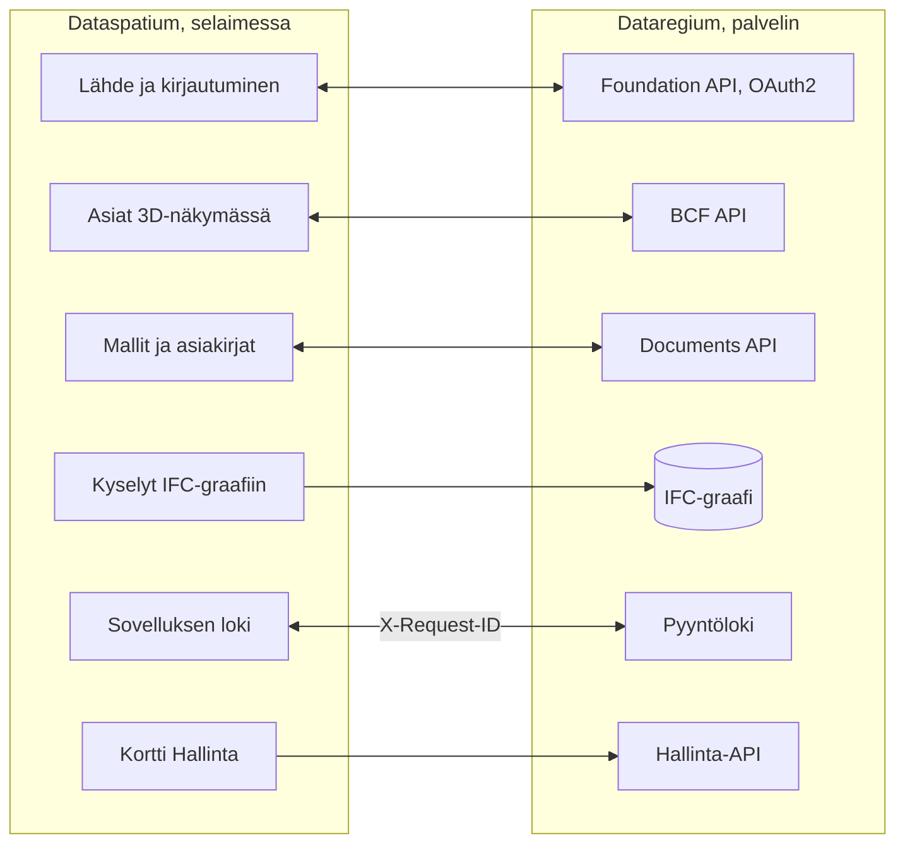

[Svenska](../../README.md) · [Dansk](../da/README.md) · [Norsk bokmål](../nb/README.md) · [Norsk nynorsk](../nn/README.md) · **Suomi** · [Íslenska](../is/README.md) · [English](../en/README.md)


# Dataregium OpenCDE-palvelin

*Dataregiumin nimi oli Kontroll 8. marraskuuta 2026 asti.*

*Tämä on Dataregium 2.0.0:n README. Uusin julkaisu, 3.0.0, on kuvattu [main-haaran READMEssä](https://github.com/marwiss/Dataregium/blob/main/docs/fi/README.md).*

Dataregium on palvelin, johon rakennushanke kokoaa mallinsa, asiakirjansa ja
asiansa, jotta kaikki hankkeessa työskentelevät käyttävät samaa aineistoa ja näkevät
saman historian. Käytät sitä sovelluksen kautta, esimerkiksi selaimessa toimivan
[Dataspatiumin](https://github.com/marwiss/Dataspatium) avulla; palvelimella itsellään
on vain sivut kirjautumista, lataamista ja ylläpitoa varten. Palvelimen ylläpitäjä
päättää, kuka saa kirjautua ja mitä kukin saa tehdä kussakin projektissa.

Teknisesti Dataregium on palvelin buildingSMARTin avoimille **OpenCDE-rajapinnoille**
(Foundation API 1.0, BCF API 3.0 ja 2.1 sekä Documents API 1.0), ja se on rakennettu
Neo4j- tai Memgraph-graafitietokannan päälle. 2.0.0:ssa jokaisesta ladatusta IFC-mallista tulee graafi IFC-LPG-moduulin avulla, yhdistettynä asioiden
näkymien rakennusosiin. Palvelin kirjoitettiin
alusta uudelleen vuoden 2023 tutkimusprototyypin pohjalta niin, että tietoturva on
ensimmäinen vaatimus, ja mikä tahansa määrityksiä noudattava asiakas voi muodostaa
yhteyden.


**Sisältö**

- [Lataa ja aloita](#lataa-ja-aloita)
- [Vaatimukset](#vaatimukset)
- [Sanoja, jotka on hyvä tuntea](#sanoja-jotka-on-hyvä-tuntea)
- [Mitä voit tehdä](#mitä-voit-tehdä)
- [OpenCDE-rajapinnat ja niiden asiakkaat](#opencde-rajapinnat-ja-niiden-asiakkaat)
- [Dataregium ja Dataspatium](#dataregium-ja-dataspatium)
- [Lue lisää](#lue-lisää)
- [Rajoitukset lyhyesti](#rajoitukset-lyhyesti)
- [Henkilötiedot](#henkilötiedot)
- [Uudemmat julkaisut](#uudemmat-julkaisut)
- [Virheet ja ehdotukset](#virheet-ja-ehdotukset)
- [Kehitys](#kehitys)
- [Lisenssi](#lisenssi)

## Lataa ja aloita

Jos vain käytät Dataregiumia, sinun ei tarvitse asentaa mitään: pyydä palvelimen
ylläpitäjältä osoite ja tunnus, ja kirjaudu Dataspatiumista tai muusta
OpenCDE-sovelluksesta. Jos haluat kokeilla palvelinta omalla tietokoneellasi, seuraa
alla olevaa pika-aloitusta. Se vie noin kaksikymmentä minuuttia ja vaatii Docker
Desktopin tai Podmanin. Jos kontit ja Python ovat sinulle tuttuja, lyhyt tie on kohdassa
[Teknisesti osaavalle](#teknisesti-osaavalle).

### Pika-aloitus (paikallisesti, Docker tai Podman)

Kontti on valmiiksi paketoitu ohjelma, joka toimii tietokoneella muusta erillään, ja
Docker ja Podman ovat ohjelmia, jotka käynnistävät kontteja. Pika-aloitus käynnistää
kaksi: palvelimen ja sen tietokannan.

1. **Lataa.** Hae koodi gitillä tai ZIP-tiedostona GitHubin kohdasta *Code > Download
   ZIP*. Alla oleva komento hakee haaran `release-2`, joka on 2.0.0; `main` on 3.0.0 ja
   `release-1` on 1.0.0.

   ```sh
   git clone --branch release-2 https://github.com/marwiss/Dataregium.git
   cd Dataregium
   ```

2. **Määritä.** Kopioi `.env.example` tiedostoksi `.env`, joka sisältää palvelimen
   asetukset, ja aseta `OPENCDE_GRAPH_PASSWORD` omaksi vähintään 16 merkin
   salasanaksi. Jos haluat kokeilla Dataspatiumin ja mallien kanssa, aseta myös
   `OPENCDE_DYNAMIC_CLIENT_REGISTRATION=true`, `OPENCDE_REQUEST_LOG_ENABLED=true` ja
   `OPENCDE_IFC_LPG_ENABLED=true`; [Dataspatiumin pika-aloitus](quickstart.md) kertoo
   miksi. Jokainen asetus selitetään tiedostossa [.env.example](../../.env.example).
3. **Käynnistä.** Samat compose-tiedostot toimivat Dockerin ja Podmanin kanssa; valitse se, joka sinulla on:

   <details open>
   <summary><b>Docker</b></summary>

   ```sh
   docker compose up -d --build
   ```

   käynnistää palvelimen osoitteeseen <http://127.0.0.1:8000> ja Neo4j-tietokannan; ensimmäinen kerta vie muutaman minuutin. `docker compose logs -f api` näyttää palvelimen lokin.

   </details>

   <details>
   <summary><b>Podman</b></summary>

   ```sh
   podman compose up -d --build
   ```

   tekee saman Podman 5:llä (rootless, ilman daemonia); `podman compose logs -f api` näyttää palvelimen lokin. Katso Podmanin erityispiirteet sivulta [deploy/local.md](deploy/local.md).

   </details>

   <details>
   <summary><b>Ilman konttia</b></summary>

   ```sh
   uv sync --extra ifc-lpg          # asentaa Python 3.13:n ja kaikki riippuvuudet, IFC-LPG mukaan lukien
   uv run opencde doctor            # tarkistaa määritykset ja tietokannan
   uv run opencde serve             # http://127.0.0.1:8000
   ```

   ajaa palvelinta työkopiosta [uv](https://docs.astral.sh/uv/):lla; tietokanta tarvitaan silti (Neo4j Desktop, Memgraph Lab tai compose-tiedostojen tietokanta).

   </details>

4. **Katso ympärillesi.** <http://127.0.0.1:8000/docs> näyttää jokaisen kutsun, jonka
   palvelin ottaa vastaan, ja antaa kokeilla niitä, <http://127.0.0.1:8000/readyz>
   kertoo, ovatko palvelin ja tietokanta valmiita, ja <http://127.0.0.1:7484> on Neo4j
   Browser, jossa näet tietokannan (Bolt osoitteessa `127.0.0.1:7697`;
   kehityskerros välttää Neo4j:n oletusportit, jotka ovat usein saman tietokoneen
   toisen Neo4j:n käytössä).
5. **Lisää esittelytiedot ja kirjaudu.**

   <details open>
   <summary><b>Docker</b></summary>

   ```sh
   docker compose exec api opencde seed
   ```

   </details>

   <details>
   <summary><b>Podman</b></summary>

   ```sh
   podman compose exec api opencde seed
   ```

   </details>

   <details>
   <summary><b>Ilman konttia</b></summary>

   ```sh
   uv run opencde seed
   ```

   </details>

   Komento luo esittelykäyttäjät, projektit, asiakkaat ja yhden asian, ja kun
   IFC-LPG on käytössä, myös esimerkkimallin graafina. Salasanat tulostetaan kerran.
   Kirjaudu osoitteessa <http://127.0.0.1:8000/signin> käyttäjänä `admin` ja avaa `/admin`.
6. **Yhdistä asiakas.** Rekisteröi sovelluksesi kohdassa *Asiakkaat* (tai anna sen
   rekisteröityä itse, kun `OPENCDE_DYNAMIC_CLIENT_REGISTRATION=true`) ja osoita se
   osoitteeseen `http://127.0.0.1:8000`; [Dataspatium](#dataregium-ja-dataspatium)
   ja Python-kirjasto hakemistossa [client/](../../client/) ovat valmiita asiakkaita.
   Jos kirjaudut Dataspatiumista, seuraa [pika-aloitusta](quickstart.md): se käy läpi
   kaikki tarvittavat asetukset ja sen, mitä teet, jos jokin menee vikaan.

### Käyttöönotto

Jotta muut voivat käyttää palvelinta, sen on oltava tietokoneella, joka on aina päällä
ja tavoitettavissa internetistä, omalla osoitteellaan ja https:llä. Taulukko näyttää
tavat tehdä se; joka ei itse ylläpidä palvelimia, jättää sen jollekulle, joka ylläpitää.
Jokainen tapa on yksi compose-tiedosto ja yksi lisäkerros:

| Tilanne | Ohje |
|---|---|
| Paikallinen testi omalla tietokoneellasi | [deploy/local.md](deploy/local.md) |
| Julkinen https-osoite asiakastesteihin ilman omaa palvelinta (tunneli) | [deploy/tunnel.md](deploy/tunnel.md) |
| Tuotanto omalla palvelimella Caddyn (automaattinen TLS) ja öisten varmuuskopioiden kanssa | [deploy/vps-caddy.md](deploy/vps-caddy.md) |
| Coolify, Dokploy, Portainer | [deploy/paas.md](deploy/paas.md) |
| Konttipalvelu sekä hallittu Neo4j AuraDB tai Memgraph Cloud | [deploy/cloud-aura.md](deploy/cloud-aura.md) |
| Varmuuskopiointi ja palautus (siirrettävissä Neo4j:n ja Memgraphin välillä) | [deploy/backup.md](deploy/backup.md) |

`uv run opencde init --public-url https://cde.example.org` kirjoittaa tuotannon
`.env`-tiedoston uusine salaisuuksineen; `opencde doctor` tarkistaa tuloksen.

### Määritykset

Kaikki luetaan ympäristömuuttujista, joiden etuliite on `OPENCDE_`, tiedostosta
`.env` tai Dockerin salaisuuksista polussa `/run/secrets/opencde_<nimi>`. Kommentoitu
luettelo on tiedostossa [.env.example](../../.env.example). Oletusarvot ovat
turvallisia: tuotanto kieltäytyy käynnistymästä ilman julkista `https`-osoitetta ja
tietokannan salasanaa, eikä mikään ole auki ennen kuin se on määritetty.

### Teknisesti osaavalle

- **Image**: `ghcr.io/marwiss/opencdeserver:2.0.0` amd64:lle ja arm64:lle, Trivyllä skannattu ja SBOM:n
  kanssa; `OPENCDE_IMAGE_TAG` valitsee compose-tiedostoissa, ja 3-sarjan tagi on `3.0.0`.
- **Compose**: `docker/compose.yaml` sekä lisäkerrokset kehitykseen, tuotantoon Caddyn kanssa,
  Memgraphille, ulkoiselle tietokannalle, Boltille TLS:n kanssa ja tunnelille. `COMPOSE_FILE` tiedostossa `.env`
  valitsee ne, joten komennot ovat ilman `-f`:ää.
- **Ilman konttia**: Python 3.11 tai uudempi uv:n kanssa (testattu versioilla 3.11,
  3.13 ja 3.14), `uv sync --extra ifc-lpg`, ja Neo4j 5.26 tai Memgraph 3.14
  osoitteessa `OPENCDE_GRAPH_URI`.
- **Tärkeimmät asetukset**: `OPENCDE_APIS` valitsee rajapinnat (oletuksena kaikki kolme);
  `OPENCDE_IFC_LPG_ENABLED=true` ottaa graafin käyttöön; `OPENCDE_ENVIRONMENT` on `development` tai `production`.
- **Päätepisteet**: `/.well-known/dataregium` (versio ja käytössä olevat laajennukset),
  `/foundation/versions`, `/openapi.json` ja `/docs`, `/healthz` ja `/readyz`, `/admin/api` (ylläpito) ja
  `/manage/1.0` (projektin ylläpito).
- **Komentorivi**: `opencde serve`, `init`, `doctor`, `seed`, `backup`, `restore`,
  `revoke`, `cleanup` ja ryhmät `user`, `project`, `client` ja `ifcgraph`;
  `uv run opencde --help`.
- **Asiakkaan rakentaminen**: [asiakasopas](client-guide.md) sisältää kulut,
  kyvykkyysasiakirjan, virhekoodit ja laajennukset, ja [docs/examples/](../examples/)
  ajettavia esimerkkejä.

## Vaatimukset

Joka käyttää Dataregiumia vain sovelluksen kautta, tarvitsee selaimen ja tunnuksen.
Palvelimen ajamiseen itse:

- Windows, macOS tai Linux ja Docker (Desktop Windowsissa/macOS:ssä, Engine Linuxissa)
  tai Podman 5, tai Python 3.11 tai uudempi [uv](https://docs.astral.sh/uv/):n kanssa
  ja oma Neo4j 5.26- tai Memgraph 3.14 -tietokanta.
- Noin 1 Gt muistia tietokantakontille (`NEO4J_HEAP` ja `NEO4J_PAGECACHE` tiedostossa
  `.env`), ja enemmän suurille malleille IFC-LPG:n kanssa.
- Paikallisesti: portti 8000 palvelimelle ja 7484/7697 tietokannalle, kaikki
  sidottuina osoitteeseen `127.0.0.1`. Tuotannossa: portit 80 ja 443 tavoitettavissa
  internetistä ja DNS-nimi palvelimelle.
- Asiakkaat tarvitsevat tuotannossa `https`-osoitteen; paikallisesti
  `http://127.0.0.1` hyväksytään uudelleenohjaus-URI:ksi, ja `http://localhost`
  asetuksella `OPENCDE_ALLOW_LOCALHOST_REDIRECTS=true`.

## Sanoja, jotka on hyvä tuntea

Tämän README:n käyttämät sanat arkikielellä; koko sanasto on sivulla
[glossary.md](glossary.md).

- **BIM**: rakentaminen ja ylläpito rakennuksen digitaalisen mallin avulla, jossa
  jokainen seinä, ovi ja huone on ominaisuuksia sisältävä kohde eikä vain viivoja
  piirustuksessa.
- **CAD**: ohjelmat piirustuksiin ja malleihin; BIM-malli tehdään CAD-ohjelmassa.
- **IFC**: BIM-mallien avoin tiedostomuoto, jota suuret ohjelmat osaavat lukea ja kirjoittaa.
- **BCF ja asiat**: avoin muoto mallia koskeville kysymyksille ja huomautuksille,
  kommentteineen ja näkymineen (viewpoint), joka näyttää, mihin kohtaan mallia asia liittyy.
- **IDS**: vaatimus siitä, mitä mallin on sisällettävä, esimerkiksi että jokaisella
  ovella on paloluokka; palvelin tarkistaa mallit projektin vaatimuksia vasten.
- **OpenCDE**: buildingSMARTin avoimet säännöt siitä, miten rakennushankkeen
  sovellukset ja palvelimet keskustelevat keskenään. CDE tarkoittaa yhteistä
  tietoympäristöä.
- **Rajapinta (API)**: tapa, jolla sovellus keskustelee palvelimen kanssa, sovituin
  kysymyksin ja vastauksin.
- **Palvelin ja asiakas**: palvelin tallentaa ja jakaa projektin aineiston; asiakas on
  sovellus, jossa työskentelet, esimerkiksi Dataspatium.
- **Tietokanta ja graafi**: tietokanta on paikka, johon palvelin tallentaa kaiken.
  Graafitietokanta tallentaa asiat ja niiden väliset yhteydet, kuten seinän, joka on
  jossakin kerroksessa, ja voi siksi vastata kysymyksiin siitä, miten osat liittyvät
  toisiinsa.
- **Kontti**: valmiiksi paketoitu ohjelma, joka toimii tietokoneella muusta erillään;
  Docker ja Podman käynnistävät niitä.
- **OAuth2**: turvallinen tapa kirjautua sovelluksesta ilman, että sovellus saa
  salasanaasi.
- **Versio**: aina kun asiakirja ladataan uudelleen, siitä tulee uusi versio, ja aiemmat säilyvät.

## Mitä voit tehdä

Mikä toimii yhdessä versiossa, toimii myös seuraavassa. Jokainen versio kuuluu yhteen
saman Dataspatium-version kanssa.

### Versio 1 (Dataspatium 1:n kanssa)

- **Asiakirjat yhdessä paikassa** (Documents API 1.0): asiakirjojen ja niiden
  versioiden valitseminen, lataaminen ja hakeminen palvelimen sivujen kautta
  esimerkiksi Dataspatiumista.
- **Kirjautuminen ja sovellukset** (Foundation API 1.0): yksi tunnus henkilöä kohti,
  kirjautuminen OAuth2:lla ja PKCE:llä, ja sovellukset, jotka ylläpitäjä rekisteröi
  tai jotka rekisteröityvät itse, kun ylläpitäjä sallii sen (katso
  [asiakasopas](client-guide.md)).
- **Ylläpito** selaimessa (`/admin`) ja komentorivillä: käyttäjät ja heidän
  projektiroolinsa, projektit, asiakkaat, istunnot, tarkastusloki ja
  terveystarkistukset; jokaisella käyttäjällä on `/account` salasanaa ja sovelluksia varten.
- **Apua sovelluksen tekijälle**, laajennuksiksi merkittyinä: kyvykkyysasiakirja
  (`/.well-known/dataregium`), vakaa virhekoodi jokaisessa virhevastauksessa ja
  pyyntöloki.
- **Asiakaskirjasto** Pythonille ([client/](../../client/)) ajettavine esimerkkeineen,
  ja julkaistu image jokaista käyttöönottoa varten.
- **Projektin vastuuhenkilöt ylläpitävät projektiaan**: `manager` lisää ja poistaa
  jäseniä, vaihtaa heidän roolejaan ja nimeää projektin uudelleen olematta palvelimen
  ylläpitäjä.

### Lisäksi versiossa 2 (Dataspatium 2:n kanssa)

- **Mallia koskevat asiat** (BCF API 3.0 ja 2.1): kysymykset ja huomautukset
  kommentteineen, kuvineen ja näkymineen, jotka osoittavat rakennusosia, suodattimineen
  ja tapahtumalokeineen, validoituina buildingSMARTin skeemoja vasten.
- **Malli graafina** (IFC-LPG-moduuli, joka otetaan käyttöön asetuksella
  `OPENCDE_IFC_LPG_ENABLED`): ladatusta IFC-mallista tulee graafi tietokantaan,
  yhdistettynä asioiden näkymien rakennusosiin (katso [IFC-LPG](ifc-lpg.md)).

Mitä versiossa 3 on lisäksi, kerrotaan [main-haaran READMEssä](https://github.com/marwiss/Dataregium/blob/main/docs/fi/README.md#mitä-voit-tehdä).


## OpenCDE-rajapinnat ja niiden asiakkaat

OpenCDE on buildingSMART Internationalin avoimien verkkorajapintojen perhe yhteiselle
tietoympäristölle, paikalle, jossa projekti jakaa mallinsa, asiakirjansa ja asiansa.
Asiakas ja palvelin, jotka noudattavat samoja määrittelyjä, voivat toimia yhdessä, olipa
ne rakentanut kuka tahansa. Dataregium toteuttaa ne kaikki kolme:

| API | Mihin se on tarkoitettu | Määrittely |
|---|---|---|
| Foundation API 1.0 | Kertoo, mitä rajapintoja palvelin tarjoaa, miten kirjaudutaan ja kuka käyttäjä on | [foundation-API](https://github.com/buildingSMART/foundation-API) |
| BCF API 3.0 ja 2.1 | Mallia koskevat asiat, kommentit ja näkymät kameroineen, komponentteineen ja kuvineen | [BCF-API](https://github.com/buildingSMART/BCF-API) |
| Documents API 1.0 | Asiakirjojen ja niiden versioiden valinta, nouto ja lataaminen palvelimen sivuilla | [documents-API](https://github.com/buildingSMART/documents-API) |

**Dataspatium on yksi asiakas, ei ainoa.** Jokaisen näitä määrittelyjä noudattavan
asiakkaan pitäisi pystyä muodostamaan yhteys: mikään palvelimella ei riipu Dataspatiumista,
ja määrittelyjen ulkopuoliset laajennukset ovat valinnaisia, joten asiakas, joka ei tunne
niitä, ei huomaa niitä. Asiakas tarvitsee kolme asiaa:

- rekisteröinnin palvelimelle, jonka tekee ylläpitäjä kohdassa *Asiakkaat* tai asiakas itse,
  kun `OPENCDE_DYNAMIC_CLIENT_REGISTRATION=true`;
- OAuth2 authorization code -kulun ja PKCE:n `S256`, jota palvelin vaatii jokaiselta
  asiakkaalta paitsi luottamukselliselta, jonka ylläpitäjä on merkinnyt;
- BCF API 3.0:n tai 2.1:n asiakkaalle, joka osaa vain sen version. `GET /foundation/versions` luettelee molemmat, ja
  [asiakasopas](client-guide.md) kertoo, mikä niitä erottaa.

Näin pitkälle tämä on osoitettu: palvelimen vastaukset testataan buildingSMARTin skeemoja
vasten jokaisella pushilla, ja Dataspatium ja Python-kirjasto kansiossa [client/](../../client/)
ajetaan palvelinta vasten. Riippumattomille asiakkaille, kuten Bonsaille ja ifc-litelle, on
valmis tarkistuslista, mutta sitä ei ole vielä
ajettu. Jos kokeilet jotakin asiakasta, kerro, miten kävi, kohdassa
[Virheet ja ehdotukset](#virheet-ja-ehdotukset). Kun asiakas ja määrittely ovat ristiriidassa, määrittely ratkaisee.
[docs/fi/client-guide.md](client-guide.md) on tarkoitettu asiakkaan rakentajille.

## Dataregium ja Dataspatium

Dataspatium on sovellus, jossa työskentelet, ja Dataregium on palvelin, jossa projektin
yhteinen aineisto on. [Dataspatium](https://github.com/marwiss/Dataspatium) toimii
kokonaan selaimessa, ja nämä kaksi on kehitetty toimimaan yhdessä. Sama julkaisunumero
tarkoittaa, että ne toimivat yhdessä: Dataspatium 2.0.0 toimii Dataregium 2.0.0:n kanssa
([pika-aloitus](quickstart.md)).

Dataspatium lisää Dataregium-palvelimen lähteeksi: sovellus löytää rajapinnat polun
`/foundation/versions` kautta, kirjautuu OAuth2 authorization code -kululla ja PKCE:llä
ja rekisteröi itsensä julkiseksi asiakkaaksi, kun dynaaminen rekisteröinti on
käytössä, luettelee projektin mallit ja asiakirjat, lukee ja kirjoittaa BCF-asioita
kommentteineen ja 3D-näkymästään otettuine viewpointeineen ja lataa tietojoukkoja,
tiedostoja ja työtilapaketteja Documents API:n kautta. Ylläpitäjä voi kysellä IFC-graafia Cypherillä palvelimen lukevan päätepisteen kautta tai Boltin kautta,
jos ylläpitäjä on avannut sen tarkoituksella. Sovellus lähettää
jokaisen kutsun mukana `X-Request-ID`:n, jotta tämän palvelimen pyyntöloki ja
sovelluksen loki näyttävät saman keskustelun, lukee palvelimen kyvykkyysasiakirjan
nähdäkseen, mitkä laajennukset ovat käytössä, ja reagoi virhekoodeihin, jotka palvelin
lisää virhevastauksiinsa.

Näin ne liittyvät toisiinsa:



Merkittyjä laajennuksia lukuun ottamatta kaikki, mitä Dataspatium tekee palvelimen
kanssa, kulkee kolmen OpenCDE-rajapinnan kautta, joten sovellus ei käytä mitään, mitä
toinen asiakas ei voisi käyttää; katso
[OpenCDE-rajapinnat ja niiden asiakkaat](#opencde-rajapinnat-ja-niiden-asiakkaat).
Tuotteet asennetaan erikseen: tämä repositorio ei sisällä Dataspatiumia (lisenssit
eroavat, täällä AGPL ja siellä PolyForm Strict), ja Dataspatiumin README kertoo, miten
sovellus haetaan ja miten sitä käytetään.

### Julkaisut 1, 2 ja 3

Jokaista pääversionumeroa kohti on yksi julkaisu, ja se julkaistaan uudelleen, kun se
kasvaa; vain kunkin sarjan uusinta korjataan. Saman numeron Dataregium ja Dataspatium
kuuluvat yhteen:

| Dataregium | Mitä siinä on | Image | Kuuluu yhteen |
|---|---|---|---|
| 1.0.0 | Asiakirjapalvelin: Foundation API ja Documents API, verkkoylläpito seitsemällä kielellä, projektin ylläpito projektin vastuuhenkilölle ja pyyntöloki. Se on 2.0.0:n koodi, jossa vain Documents API on käytössä (`OPENCDE_APIS`) | `1.0.0` | Dataspatium 1.0.0 |
| 2.0.0 | Lisäksi BCF API 3.0 ja 2.1 samoilla tiedoilla ja IFC-LPG-moduuli, joka tekee graafin jokaisesta ladatusta IFC-tiedostosta | `2.0.0` | Dataspatium 2.0.0 |
| 3.0.0 | Lisäksi häviötön graafi IFC-LPG-kirjastosta, jokaisen latauksen tarkistus, kyselyt, vertailut ja törmäystarkastus, versiot muutosehdotuksineen, jotka kokeillaan, hyväksytään ja yhdistetään, geometria glTF:nä, paikallinen moottori ja ohjeet pilveen ja nginxille | `3.0.0`, `latest`, `3.0.0-gherkin` | Dataspatium 3.0.0 |

## Lue lisää

- [quickstart.md](quickstart.md): Dataregium ja Dataspatium yhdessä kahdessakymmenessä
  minuutissa, tyhjästä tietokoneesta 3D-näkymässä luotuun asiaan.
- [client-guide.md](client-guide.md) ja [docs/examples/](../examples/): miten asiakas rakennetaan, kyvykkyysasiakirja, virhekoodit ja ajettavat esimerkit hakemiston [client/](../../client/) Python-kirjastolla.
- [architecture.md](architecture.md): miten osat liittyvät toisiinsa, mitä kutsulle tapahtuu ja missä kaikki on koodissa.
- [glossary.md](glossary.md): dokumentaation käyttämät sanat.
- [flows/](flows/): sekvenssikaaviot OAuth2-, Documents API- ja BCF-viewpoint-kuluista.
- [graph-schema.md](graph-schema.md): graafimalli.
- [ifc-lpg.md](ifc-lpg.md): valinnainen IFC-LPG-moduuli ja esimerkkejä Cypher-kyselyistä.
- Pysyvät arkkitehtuuripäätökset: graafitietokanta ainoana tallennuspaikkana, läpinäkymättömät
  tunnisteet JWT:n sijaan, siirrettävä Cypher Neo4j:lle ja Memgraphille, verkkokäyttöliittymä ilman
  sovelluskehystä, varmuuskopio sovellustasolla, yhteinen tallennus rajoituksille ja BCF API 2.1 3.0:n rinnalla.
- [spec/SOURCES.md](../../spec/SOURCES.md): tarkat määritysversiot, joita vasten
  palvelinta testataan.

Dokumentaatio on tämän README:n seitsemällä kielellä, kukin kieli hakemistossa
`docs/<kieli>/`; englanti hakemistossa `docs/en/` on lähde. CONTRIBUTING on englanniksi.

### Lisälukemista

- [BCF API](https://github.com/buildingSMART/BCF-API), [Foundation API](https://github.com/buildingSMART/foundation-API) ja [Documents API](https://github.com/buildingSMART/documents-API):
  määritykset, joita palvelin noudattaa.
- [IFC](https://github.com/buildingSMART/IFC4.x-development): rakennusmallien tiedostomuoto, ja [IDS](https://github.com/buildingSMART/IDS): vaatimusmääritykset, joita vasten malleja tarkistetaan.
- [RFC 9700](https://www.rfc-editor.org/rfc/rfc9700): nykyinen paras käytäntö OAuth 2.0:n tietoturvalle, ja
  [OAuth 2.1](https://datatracker.ietf.org/doc/draft-ietf-oauth-v2-1/), sen kokoava luonnos.
- [RFC 7636](https://www.rfc-editor.org/rfc/rfc7636) (PKCE), [RFC 8252](https://www.rfc-editor.org/rfc/rfc8252) (sovellukset tietokoneella tai puhelimessa) ja
  [RFC 7591](https://www.rfc-editor.org/rfc/rfc7591) (asiakkaiden rekisteröinti).
- [OWASP ASVS](https://owasp.org/www-project-application-security-verification-standard/): tietoturvatyön tarkistuslista.

## Rajoitukset lyhyesti

- IFC-LPG-moduuli on pois käytöstä, kunnes `OPENCDE_IFC_LPG_ENABLED=true`, eikä ilman sitä mistään mallista tule
  graafia.
- Palvelin toteuttaa BCF API 3.0:n ja 2.1:n, ei 1.0:aa, jonka resurssit näyttävät erilaisilta.
- Projektin vienti BCFzip-tiedostona jätetään asiakkaille; palvelin tallentaa asiat, kommentit ja viewpointit niin
  kuin rajapinta ne määrittelee.
- Neo4j:n ja Memgraphin yhteisöversioista puuttuvat vain lukuoikeuden tietokantakäyttäjät, joten avoin Bolt-portti
  antaa täyden pääsyn sille, jolla on salasana. Portti pysyy suljettuna, ellei ylläpitäjä julkaise sitä
  tarkoituksella; ylläpitorajapinnan lukeva graafikysely (`OPENCDE_GRAPH_QUERY_ENABLED`) antaa Cypherin ilman porttia.
- IFC-LPG-tuonti toimii erillisessä prosessissa muisti- ja aikarajoin (`OPENCDE_IFC_LPG_*`); hyvin suuret mallit
  hylätään sen sijaan, että ne jäisivät puoliksi tuoduiksi.
- Verkkosivut ovat kirjautumista, ylläpitoa, lataamista ja asiakirjojen valintaa varten; loppukäyttäjät
  työskentelevät asiakkaassa, kuten Dataspatiumissa tai Bonsaissa.
- Sivut ovat tämän README:n seitsemällä kielellä (vaihda jokaisen sivun alareunasta); komentorivi ja rajapintojen
  virheilmoitukset ovat englanniksi.
- Ei vielä ulkoista arviointia. OAuch- ja testssl-ajot ovat ylläpitäjän vaiheita ennen tuotantoon ottamista.

## Henkilötiedot

Joka ylläpitää Dataregiumia muille, on tämän rekisterinpitäjä. Palvelin tallentaa käyttäjätilit (käyttäjänimi, nimi,
valinnainen sähköposti, salasanan tiiviste), projektijäsenyydet, asiat ja kommentit kirjoittajien nimineen, ladatut
tiedostot lataajineen, IFC-graafin tiedoston omistushistorioineen ja tarkastuslokin siitä, kuka teki mitä ja mistä
osoitteesta. Salasanat, tunnisteet ja salaisuudet tallennetaan vain tiivisteinä. Tunnisteet, istunnot,
latausistunnot ja käyttämättömät itse rekisteröityneet asiakkaat vanhenevat, ja palvelin siivoaa ne; tarkastuslokia
karsii ylläpitäjä. Ylläpitäjä poistaa tilin kohdassa `/admin/users`, ja sen istunnot ja tunnisteet poistuvat
samalla; nimi jää henkilön kirjoittamiin asioihin, kunnes ne poistetaan. Tarkastusloki viedään CSV-muodossa, BCF- ja
asiakirjatiedot rajapintojen kautta ja koko tietokanta komennolla `opencde backup`. Se, mitä Dataspatium tallentaa
selaimeen, kerrotaan sovelluksen omassa dokumentaatiossa.

## Uudemmat julkaisut

Dataregium 3.0.0, joka tehtiin yhdessä Dataspatium 3.0.0:n kanssa, tekee IFC-graafista häviöttömän, tarkistaa
jokaisen latauksen IFC-skeemaa, buildingSMARTin sääntöjä ja projektin IDS:ää vasten ja tuo nimetyt kyselyt,
vertailut ja törmäystarkastuksen, versiot muutosehdotuksineen, jotka kokeillaan ja hyväksytään, geometrian glTF:nä ja
paikallisen moottorin. Se on haarassa `main` ja imagessa `3.0.0`, ja se on kuvattu [main-haaran READMEssä](https://github.com/marwiss/Dataregium/blob/main/docs/fi/README.md).

## Virheet ja ehdotukset

Ilmoita virheet ja toiveet *Issues*-kohdassa täällä GitHubissa. Kerro, mitä
palvelinversiota käytät (`version` osoitteessa `/.well-known/dataregium` tai
`/healthz`), mitä asiakasohjelmaa käytit ja epäonnistuneen kutsun
`X-Request-ID`; pyyntöloki ja asiakasohjelman loki jakavat sen. Älä liitä
henkilötietoja tai salaisuuksia. Se, miten muutokset otetaan vastaan, kerrotaan
tiedostossa [CONTRIBUTING.md](../../CONTRIBUTING.md). Tietoturvahaavoittuvuudesta
ilmoitetaan tiedoston [SECURITY.md](../../SECURITY.md) mukaisesti, ei
issuena.

## Kehitys

```sh
uv run pytest                    # yksikkö-, yhdenmukaisuus- ja tietoturvatestit
uv run pytest -m integration     # käynnistää Neo4j:n/Memgraphin testcontainersilla (vaatii Dockerin)
uv run pytest -m e2e             # asiakaskirjasto käynnissä olevaa palvelinta vastaan (vaatii Dockerin)
uv run pytest -m ui              # Playwright + axe-core (uv sync --group ui; playwright install chromium)
uv run ruff format . && uv run ruff check .
uv run ty check opencde client/opencde_client
```

Koodi ja kommentit ovat englanniksi, ja tyyli noudattaa IfcOpenShellin
käytäntöjä (ruff, 120 saraketta), jotta palvelimen luovuttaminen
IfcOpenShelliin pysyy mahdollisena. README on englanniksi, ruotsiksi, tanskaksi, norjaksi
(bokmål ja nynorsk), suomeksi ja islanniksi (`docs/<kieli>/README.md`, sama
rakenne kuin Dataspatiumissa); dokumentaatio ja selainkäyttöliittymä ovat
saatavilla samoilla kielillä, englanti aina yhtenä
vaihtoehtona, ja yhteiset termit noudattavat Dataspatiumin sanastoa. Jokainen
push ajaa lintauksen, tyyppitarkistuksen, testisarjat kolmella
Python-versiolla, selaintestit axe-corella ja staattiset tietoturvatarkistukset;
yölliset ajot suorittavat OWASP ZAP:n, Schemathesisin ja Trivyn. Katso
[CONTRIBUTING.md](../../CONTRIBUTING.md).

## Lisenssi

Palvelin on lisensoitu GNU Affero General Public License v3.0 -lisenssillä tai
uudemmalla ([LICENSE](../../LICENSE)): se on palvelinohjelmisto, ja AGPL:n
verkkolauseke pitää hostattujen asennusten parannukset avoimina.
Asiakaskirjasto kansiossa [client/](../../client/) on LGPL-3.0-or-later.
Spesifikaatiotiedostot kansiossa [spec/](../../spec/) ovat © buildingSMART
International, ja niitä jaetaan muuttamattomina testausta varten. Katso
[SECURITY.md](../../SECURITY.md): miten haavoittuvuudesta ilmoitetaan ja mitä
projekti tekee pysyäkseen turvallisena.
