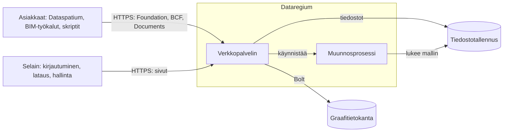

# Arkkitehtuuri

Dataregium on yksi verkkopalvelin yhden graafitietokannan edessä. Tämä sivu näyttää,
miten osat liittyvät toisiinsa, mitä pyynnölle tapahtuu ja missä kaikki on koodissa.
Lue se, jos haluat ylläpitää palvelinta luottavaisin mielin, muuttaa sitä tai
rakentaa sen päälle. Sanat selitetään [sanastossa](glossary.md).

## Osat

| Osa | Mitä se tekee | Koodi |
|---|---|---|
| Foundation API | Kertoo, mitä API-rajapintoja palvelin tarjoaa, miten kirjaudutaan ja kuka olet | `opencde/foundation/` |
| Kirjautuminen | OAuth2 ja PKCE, tokenit, asiakkaat, kirjautumissivut ja odotus epäonnistuneiden yritysten jälkeen | `opencde/auth/`, `opencde/web/` |
| BCF API | Asiat, kommentit, näkymät, tapahtumat, liittyvät asiat ja projektin asiakirjat | `opencde/bcf/` |
| Documents API | Lataus ja valinta selaimen sivuilla, versiot ja metatiedot | `opencde/documents/` |
| Tilit | Käyttäjät, projektit, jäsenyydet ja roolit | `opencde/accounts/` |
| Hallinta | Sivut ja API ylläpitäjille, terveystarkistukset ja pyyntöloki | `opencde/admin/`, `opencde/requestlog.py` |
| IFC-LPG | Muuttaa ladatut mallit solmuiksi ja linkittää näkymien komponentit niihin | `opencde/ifcgraph/` |
| Graafikerros | Ajuri, kaksi tietokantadialektia, skeema ja se, mikä vanhenee | `opencde/graph/` |
| Sivut | Mallipohjat, tyylit, skriptit ja kieliluettelot | `opencde/ui/` |

## Pyynnön kulku

1. uvicorn ottaa pyynnön vastaan. Se uskoo otsakkeeseen `X-Forwarded-For` vain
   proxyiltä, jotka on lueteltu asetuksessa `OPENCDE_TRUSTED_PROXIES`, joten
   asiakkaan osoite on oikea.
2. Tiedoston `opencde/main.py` väliohjelmisto antaa pyynnölle tunnuksen, kirjaa sen
   lokiin ilman sisältöä ja tokeneita, rajoittaa koon, vastaa CORS- ja ehdollisiin
   pyyntöihin, lisää turvaotsakkeet ja soveltaa pyyntörajaa.
3. Reitin riippuvuudet selvittävät, kuka kysyy: bearer-token API-rajapinnoissa
   (`opencde/auth/dependencies.py`), istuntoeväste sivuilla
   (`opencde/web/dependencies.py`).
4. Tietovarasto kysyy graafilta, vain parametreilla. Jokainen projektitietojen kysely
   alkaa käyttäjän solmusta ja kulkee reunan `MEMBER_OF` kautta, joten se, minkä
   jäsen käyttäjä ei ole, ei ole hänelle olemassa ja vastaus on 404.
5. Vastaus noudattaa kansion `spec/` skeemoja, ja kaikilla virheillä on sama muoto
   (`opencde/errors.py`).

## Missä tiedot ovat

| Mitä | Missä | Lue lisää |
|---|---|---|
| Käyttäjät, projektit, asiat, kommentit, näkymät, asiakirjojen metatiedot, asiakkaat ja tarkastusloki | Graafitietokanta | [Graafiskeema](graph-schema.md) |
| Tokenit, koodit ja asiakassalaisuudet SHA-256-tiivisteinä; salasanat Argon2id-tiivisteinä | Graafitietokanta | `tests/security/` |
| Ladatut tiedostot ja näkymien kuvat palvelimen valitsemilla nimillä | Tiedostotallennus kansiossa `OPENCDE_DATA_DIR` | [Documents API -kulut](flows/documents.md) |
| Mallit solmuina ja suhteina | Graafitietokanta | [IFC-LPG](ifc-lpg.md) |
| Palvelimen omat asetukset ja salaisuudet | `.env` tai `/run/secrets` | [Paikallinen testi](deploy/local.md) |

## Työ pyyntöjen ulkopuolella

- Joka minuutti (`OPENCDE_CLEANUP_INTERVAL_SECONDS`) palvelin poistaa sen, mikä on
  vanhentunut, kuten koodit, tokenit, istunnot ja keskeneräiset lataukset, ja ottaa
  työn alle muunnokset, jotka pysäytetty palvelin jätti kesken.
- IFC-muunnokset ajetaan yksi kerrallaan omassa prosessissaan aika- ja muistirajoin,
  joten rikkinäinen malli ei voi kaataa palvelinta.
- Kun pyyntöloki on käytössä (`OPENCDE_REQUEST_LOG_ENABLED`), kirjoittaja tallentaa
  pyynnöt graafiin erissä ja poistaa vanhat.

## Turvallinen alusta alkaen

- Mikään ei ole auki, ennen kuin joku avaa sen: asiakkaiden itserekisteröinti,
  IFC-graafi, pyyntöloki ja graafikyselyt ovat oletuksena pois päältä.
- Tuotannossa palvelin kieltäytyy käynnistymästä ilman https-yhteyttä ja tietokannan
  salasanaa.
- Sivuilla ei ole upotettuja skriptejä tai tyylejä, jokaisella lomakkeella on
  allekirjoitettu token, ja jokainen sivu toimii ilman JavaScriptiä.

Jokaisen toimen takana on testi hakemistossa `tests/security/`.

## Kaksi tietokantaa

Palvelin toimii Neo4j:llä tai Memgraphilla samalla Cypherillä. Vain skeemalauseet
eroavat, ja ne ovat tiedostossa `opencde/graph/dialect.py` yhdessä luettelon kanssa
funktioista, joita koodi ei saa käyttää.

## Näin sitä testataan

| Kansio | Mitä se osoittaa | Milloin se ajetaan |
|---|---|---|
| `tests/unit` | Funktiot ja dokumentit ilman tietokantaa | Jokaisella pushilla |
| `tests/conformance` | Reitit ja vastaukset kansion `spec/` skeemoja vasten | Jokaisella pushilla |
| `tests/security` | Otsakkeet, tokenit, rajat ja se, että jokainen toiminto vaatii tokenin | Jokaisella pushilla |
| `tests/integration` | Kaikki oikeaa tietokantaa vasten Dockerissa | Jokaisella pushilla; myös Memgraphilla joka yö |
| `tests/ui` | Sivut oikeassa selaimessa saavutettavuustarkistuksen kanssa | Jokaisella pushilla |
| `tests/e2e` | Asiakaskirjasto käynnissä olevaa palvelinta vasten, generoidut pyynnöt ja koko pinon uudelleenkäynnistys | Jokaisella pushilla; pitkät ajot joka yö |

## Lue lisää

- [Pika-aloitus](quickstart.md): palvelin ja Dataspatium omalla koneellasi.
- [Asiakassovelluksen rakentaminen](client-guide.md): mitä asiakas tarvitsee.
- [Kulut](flows/oauth2.md): kirjautuminen, [asiakirjat](flows/documents.md) ja
  [BCF-näkymät](flows/bcf-viewpoint.md) sekvenssikaavioina.
