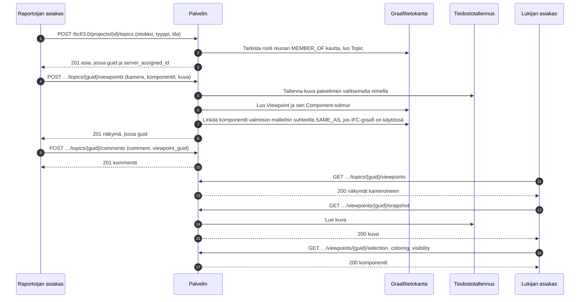

# BCF-näkymän kulku

Miten asiakas luo asian, jossa on näkymä malliin, ja miten joku toinen avaa saman
näkymän. Tämä on BCF API 3.0, osat 3.2 (asiat) ja 3.5 (näkymät). Esimerkki
[create_topic.py](../../examples/create_topic.py) tekee ensimmäisen puoliskon
asiakaskirjastolla.



Näkymää ei voi muuttaa. Se luodaan kokonaisena ja poistetaan kokonaisena, joten siihen
osoittava kommentti osoittaa yhä samaan asiaan.

## Mitä näkymä sisältää

| Osa | Mitä se kertoo | Mistä asiakas sen lukee |
|---|---|---|
| Kamera | Sijainti, suunta ja ylösvektori, perspektiivi tai ortogonaalinen | Näkymästä |
| Viivat ja leikkaustasot | Mitä näkymään piirretään ja mitä leikataan pois | Näkymästä |
| Valinta | Valitut komponentit | `/selection` |
| Väritys | Komponentit, joilla on väri | `/coloring` |
| Näkyvyys | Mikä näkyy oletuksena, ja poikkeukset | `/visibility` |
| Tilannekuva | Kuva näkymästä, PNG tai JPEG | `/snapshot` |
| Bittikartat | Näkymään sijoitetut kuvat | `/bitmaps/{id}` |

## Kuka saa tehdä mitä

| Toiminto | Vaatii |
|---|---|
| Lukea asioita, kommentteja ja näkymiä | Jäsenyyden projektissa, missä tahansa roolissa |
| Luoda asian | Toiminnon `createTopic`: contributor, editor tai manager |
| Lisätä näkymän tai kommentin | Toiminnon `createViewpoint` tai `createComment`: contributor, editor tai manager |
| Poistaa näkymän | Sen tekijä roolissa contributor; editor ja manager poistavat minkä tahansa |

Projekti, jonka jäsen käyttäjä ei ole, ei ole hänelle olemassa (404).

## Näkymästä malliin

Kun [IFC-LPG](../ifc-lpg.md) on käytössä, jokainen komponentti, joka nimeää
`GlobalId`-tunnuksen, saa `SAME_AS`-suhteen kyseiseen elementtiin projektin valmiissa
malleissa, myös kun malli ladataan jälkeenpäin.

```cypher
MATCH (:Viewpoint {guid: $viewpoint})-[:HAS_COMPONENT]->(c:Component)-[:SAME_AS]->(e:IfcProduct)
RETURN c.ifc_guid, e.Name, c.gtin
```
