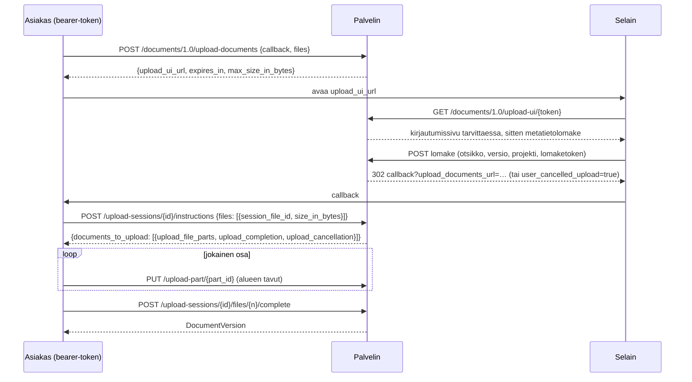
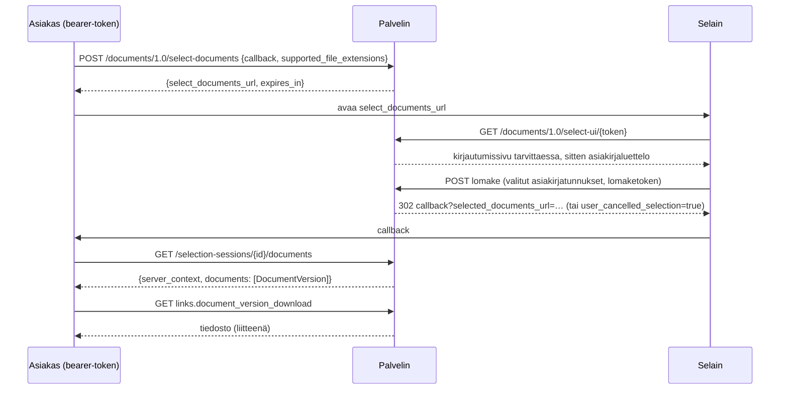

# Documents API -kulut

Documents API 1.0 on kolmen osapuolen keskustelu: asiakassovelluksen, tämän
palvelimen ja käyttäjän selaimen. Asiakas puhuu rajapinnalle
bearer-tokenilla; selain näyttää palvelimen omat sivut (kirjautuminen,
metatietojen syöttö, asiakirjojen valinta); palvelin ei koskaan kutsu
asiakasta, se vain ohjaa selaimen asiakkaan callback-URLiin.

## Lähetys

* Käyttöliittymän linkki on voimassa `OPENCDE_DOCUMENTS_SESSION_TTL_SECONDS`
  (10 minuuttia); kun ohjeet on annettu, istunto elää
  `OPENCDE_UPLOAD_SESSION_TTL_SECONDS` (24 tuntia), jotta suuret tiedostot
  voidaan lähettää.
* Osat ovat `OPENCDE_UPLOAD_PART_BYTES` (50 MiB) kukin, lähetetään missä
  tahansa järjestyksessä, rinnakkain jos asiakas haluaa. Osan on oltava
  täsmälleen ilmoitettu alue.
* Valmistuminen kokoaa osat, tarkistaa kokonaiskoon, laskee SHA-256:n ja luo
  version. Jos tämä kestää yli 15 sekuntia, vastaus alkaa tyhjemerkeillä
  yhteyden pitämiseksi auki.
* `document_id` tiedostomerkinnässä tekee lähetyksestä kyseisen asiakirjan
  uuden version; otsikko säilyy, versioindeksi kasvaa.
* `base_version_index` tiedostomerkinnässä (laajennus) kertoo, mihin versioon
  lähetys perustuu: viimeistely vastaa `412 version_conflict`, kun dokumentilla
  on jo uudempi, ja version metatiedot kirjaavat perustan.
* Projekti voi hylätä tiedostot, joissa on validointivirheitä: viimeistely
  vastaa silloin `422 ifc_validation_failed` ja raportin osoitteen, ja
  `POST …/projects/{id}/ifc-precheck` tarkistaa tiedoston tallentamatta sitä.
* Luottamuksellinen asiakas, jonka ylläpitäjä on hyväksynyt siihen (*Saa
  lähettää dokumentteja ilman selainsivua* asiakkaan sivulla), lähettää ilman
  sivua: `project_id` pyynnössä sekä `title` ja `version_number` tiedostoa
  kohden ohittavat sivun, ja ohjeet ovat heti osoitteessa
  `upload-sessions/{id}/instructions`; jokainen tällainen lähetys on
  tarkastuslokissa. 403 kaikille muille asiakkaille.

## Valinta ja lataus

* Luettelo näyttää käyttäjän projektien jokaisen asiakirjan uusimman
  version, suodatettuna asiakkaan tiedostopäätteillä, ja linkin "näytä
  kaikki".
* Käyttäjät, joilla on rooli editor tai manager, voivat lähettää tiedoston
  sivulta; se ilmestyy luetteloon heti (tämä on lisäys spesifikaatioon).
* `POST /documents/1.0/document-versions` vastaa asiakirjatunnuslistan
  uusimmilla versioilla ja `ETag`-otsakkeella; `If-None-Match` antaa `304`.

[Dataspatium](https://github.com/marwiss/Dataspatium) toteuttaa molemmat kulut
selaimesta (`src/api/families/opencde.js`): se avaa palvelimen valintasivun
ponnahdusikkunaan ja tuo valitut tiedostot, ja lähettää datamäärät,
tiedostot ja työtilapaketit osissa käyttäen palvelimen lähetyssivua
metatiedoille; sen live-testisarjat ajavat nämä kulut kehityspinoa vasten.

## Kuka saa tehdä mitä

| Toiminto | Vaatii |
|---|---|
| Lähetyksen tai valinnan aloittaminen | bearer-tokenin, jossa on `documents`-scope |
| Selainsivujen käyttö | selainistunnon samana käyttäjänä (`/signin`) |
| Metatietojen tallennus, lähetyksen valmistaminen, lähetys sivulta | projektitoiminnon `createDocument` (editor, manager) |
| Asiakirjojen katselu, valinta ja lataus | projektin jäsenyyden (mikä tahansa rooli) |
| Version julkaisu | roolin `manager` |

Muiden projektien asiakirjoja ei ole kutsujalle olemassa (404), joten niiden
tunnukset tai olemassaolo eivät vuoda.
