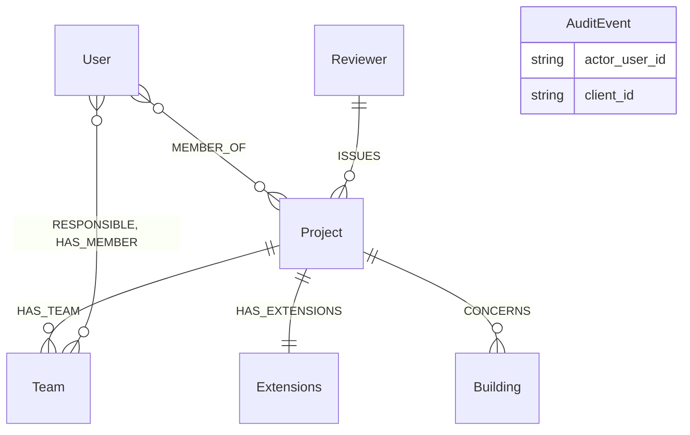
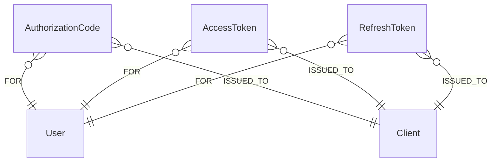
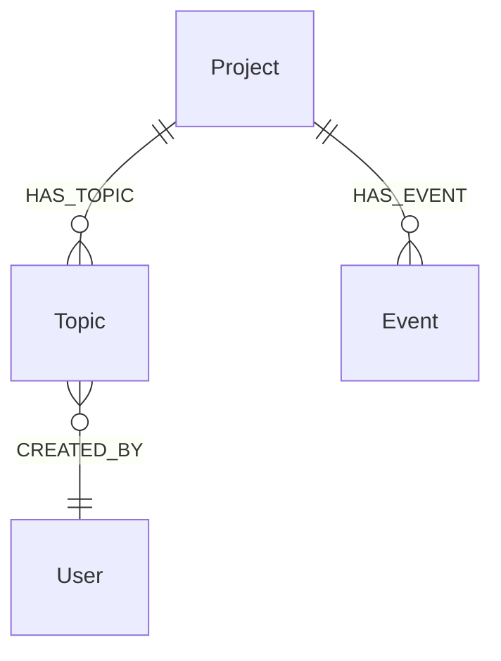
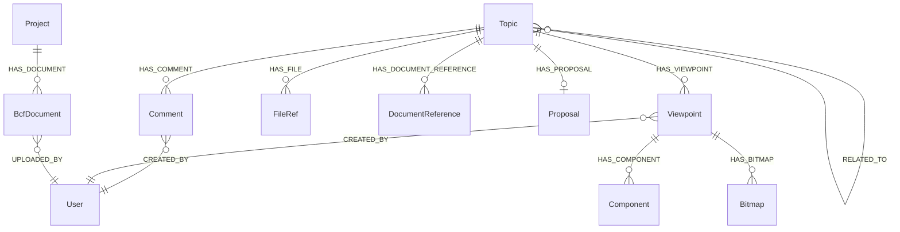
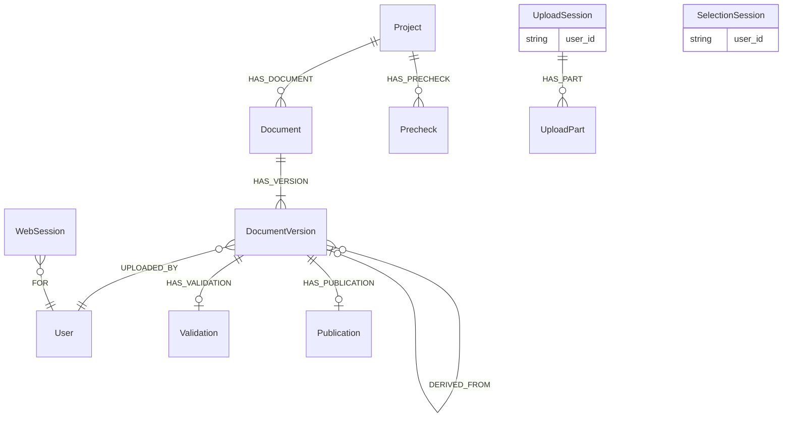
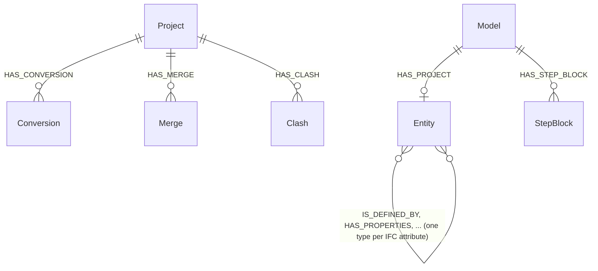

# Graafiskeema

Tietokanta on skeematon; `opencde/graph/schema.py` on skeema. Tämä sivu
selittää käytännöt ja nimiöt osio kerrallaan siinä järjestyksessä, jossa
suunnitelman vaiheet lisäsivät ne.

## Käytännöt

- Jokaisella solmulla on palvelimen luoma UUID kentässä `id` (tai
  spesifikaation nimi sille: `project_id`, `guid`, `client_id`,
  `document_id`) ja yksilöllisyysrajoite. Mikään asiakkaan lähettämä ei
  päädy tarkistamatta tiedostopolkuun tai tietokanta-avaimeen.
- Aikaleimat ovat ISO 8601 -merkkijonoja UTC-ajassa millisekunnein ja
  `Z`-päätteellä (`2026-11-05T12:34:56.789Z`). Merkkijonojärjestys on sama
  kuin aikajärjestys.
- Koordinaatit ja vektorit ovat tavallisia liukulukuja (`x`, `y`, `z`), ei
  koskaan `point()`.
- Kaikki vanheneva kantaa `expires_at`-kenttää (sama muoto); palvelin poistaa
  vanhentuneet solmut ajastimella (`opencde/graph/cleanup.py`).
- Salaisuudet (koodit, tokenit, asiakassalaisuudet) tallennetaan vain
  SHA-256-tiivisteinä.
- Cypher on murteesta riippumatonta, jotta Neo4j ja Memgraph käyttäytyvät
  samoin (ADR 0003). Skeeman DDL on ainoa tuotekohtainen teksti, ja se on
  tiedostossa `graph/dialect.py`.
- Nimet: nimiöt kirjoitetaan PascalCase-muodossa (`DocumentVersion`,
  `Model`), suhdetyypit isoin kirjaimin ja alaviivoin (`HAS_TOPIC`,
  `CREATED_BY`, ja `IS_DEFINED_BY` IFC-attribuuttisuhteille). Alla olevat
  kaaviot piirtävät vain todelliset solmut ja suhteet; ominaisuutena pidetty
  viittaus (`AuditEvent.actor_user_id`, `UploadSession.user_id`) luetellaan
  laatikossa sen sijaan, että se piirrettäisiin viivana.
- Nimiö, joka alkaa `Ifc`, on aina yksi IFC:n luokista, sellaisina kuin IFC-LPG
  ne kirjoittaa; palvelimen omat tietueet (`Validation`, `Precheck`, `Proposal`,
  `Clash`, `Merge`) eivät koskaan ala niin, jotta kysely erottaa IFC-datan
  palvelimen omasta.

## Tilit ja pääsy (vaihe 1)

| Nimiö | Avain | Ominaisuudet | Huomautukset |
|---|---|---|---|
| `User` | `id`, yksilöllinen `username` | `email`, `full_name`, `password_hash` (Argon2id), `is_admin`, `disabled`, `created_at`, `must_change_password` | Käyttäjätunnus on se käyttäjän tunnus, jonka rajapinnat näyttävät |
| `MEMBER_OF` (suhde User → Project) | | `role` (viewer, contributor, editor, manager), `since` | Roolit kuvautuvat BCF:n `*_actions`-arvoihin, katso `accounts/roles.py` |
| `Project` | `project_id` | `name`, `created_at`, `topic_counter`, `block_on_validation_errors` | `topic_counter` numeroi `server_assigned_id`-arvot; `block_on_validation_errors` hylkää lähetykset, joissa on validointivirheitä (ADR 0021) |
| `Extensions` | `id` | `topic_type[]`, `topic_status[]`, `topic_label[]`, `snippet_type[]`, `priority[]`, `stage[]`, `custom_information[]` | `users[]` lasketaan jäsenistä |
| `Team` | `id` | `name`, `ids_document_id`, `created_at`, `updated_at` | Projektin tiimi (`HAS_TEAM`), suhteilla `RESPONSIBLE` ja `HAS_MEMBER` käyttäjiin; sen osa mallista on se, mihin sen IDS-asiakirjan määrittelyt kohdistuvat. Poistetaan projektin mukana |
| `Client` | `client_id` | `name`, `description`, `url`, `redirect_uris[]`, `is_public`, `secret_hash`, `disabled`, `pending_approval`, `created_at`, `created_by`, `dynamic`, `expires_at` (vain itse rekisteröityneet) | OAuth2-asiakas; itse rekisteröitynyt poistetaan, kun `expires_at` on ohitettu ilman tokenin myöntämistä |
| `AuditEvent` | `id` | `type`, `at`, `actor_user_id`, `client_id`, `ip`, `details` (JSON-merkkijono) | Turvallisuuden kannalta merkitykselliset tapahtumat |
| `Reviewer`, `Building` | `id` | `name`, `status` | Konteksti tarkastussuunnitelman käyttötapauksesta (seed-data): tarkastava organisaatio (alkuperäisessä tarinassa kunta) ja rakennus |

## OAuth2 (vaihe 2)

`AuthorizationCode`, `AccessToken` ja `RefreshToken` (jolla on `family_id`)
avainnetaan salaisuuden tiivisteellä, kantavat `expires_at`-kenttää ja on
linkitetty `-[:FOR]->(:User)` ja `-[:ISSUED_TO]->(:Client)`. `WebSession`
(selainkirjautuminen, vaihe 5) on linkitetty vain `-[:FOR]->(:User)`.

## BCF-asiat ja tapahtumat (vaihe 3)

| Nimiö | Avain | Ominaisuudet | Huomautukset |
|---|---|---|---|
| `Topic` | `guid` | `server_assigned_id`, `title`, `topic_type`, `topic_status`, `priority`, `stage`, `labels[]`, `reference_links[]`, `assigned_to`, `description`, `index`, `due_date`, `creation_date`, `creation_author`, `modified_date`, `modified_author`, `snippet_type`, `snippet_is_external`, `snippet_reference`, `snippet_reference_schema` | Kenttien nimet seuraavat `topic_GET.json`-tiedostoa; BIM snippet -objekti litistetään neljäksi ominaisuudeksi. `server_assigned_id` on `<etuliite><laskuri>` kentästä `Project.topic_counter` |
| `Proposal` | `id` | `state`, `created_at`, `checked_at`, `base_document_id`, `base_version_index`, `change_count`, `applied`, `issue_count`, `error_count`, `truncated`, `ruleset`, `checks`, `report`, `storage_key`, `snippet_key`, `author`, `error` | Asian muutosjoukon kokeilu sen perustaversiota vasten (ADR 0021); `report` sisältää huomautukset, joita perustassa ei ole, `storage_key` sovelletun tiedoston, joka säilytetään hyväksyntää varten. Poistetaan asian mukana |
| `Event` | `id` | `kind` (`topic` tai `comment`), `topic_guid`, `comment_guid`, `author`, `date`, `action_types[]`, `action_values[]` | Yksi solmu jokaista jotakin muuttanutta pyyntöä kohti; kaksi rinnakkaista listaa ovat BCF 3.9/3.10:n `actions`-taulukko. Liitetty projektiin, jotta tapahtumat säilyvät asiansa jälkeen |

Jokainen asiakysely alkaa kutsujan `User`-solmusta ja kulkee
`MEMBER_OF`-suhteen kautta projektiin ennen kuin se koskee asiaan, joten
asia projektissa, jonka jäsen kutsuja ei ole, ei ole rajapinnan kannalta
olemassa (404).

## BCF-kommentit, viewpointit ja viittaukset (vaihe 4)

| Nimiö | Avain | Ominaisuudet | Huomautukset |
|---|---|---|---|
| `Comment` | `guid` | `topic_guid`, `date`, `author`, `comment`, `viewpoint_guid`, `modified_date`, `modified_author` | `viewpoint_guid`:n on nimettävä saman asian viewpoint |
| `Viewpoint` | `guid` | `index`, `author`, `creation_date`, `camera_kind`, `camera` (JSON), `lines` (JSON), `clipping_planes` (JSON), `snapshot_type`, `storage_key`, `has_components`, `default_visibility`, `has_hints`, `spaces_visible`, `space_boundaries_visible`, `openings_visible` | Muuttumaton. Geometria on JSON-tekstiä: opaakkia ja samanlaista molemmissa tietokannoissa |
| `Component` | `id`, indeksoitu `ifc_guid` | `role` (`selection`, `coloring`, `exception`), `group_index`, `position`, `color`, `ifc_guid`, `originating_system`, `authoring_tool_id` | Yksi solmu esiintymää kohti; IFC-graafi linkittää `ifc_guid`:n mallin elementteihin (vaihe 9) |
| `Bitmap` | `guid` | `position`, `bitmap_type`, `storage_key`, `height`, `loc_*`, `nrm_*`, `up_*` | Kuvatavut tallennustilassa polussa `bitmaps/<guid>.<tyyppi>` |
| `FileRef` | `id` | `position`, `ifc_project`, `ifc_spatial_structure_element`, `filename`, `date`, `reference` | Asian otsakkeen tiedostot (BCF 3.3) |
| `DocumentReference` | `guid` | `document_guid` tai `url`, `description`, `created_at` | Tasan yksi kahdesta kohteesta |
| `BcfDocument` | `guid` | `filename`, `storage_key`, `size`, `created_at`, `author` | BCF 3.8:n kautta lähetetty tiedosto; tavut polussa `bcf-documents/<guid>` |
| `RELATED_TO` (suhde Topic → Topic) | | | Suunnattu; PUT korvaa asian lähtevän listan |

Asiat pitävät snippet-tiedostonsa kentässä `snippet_storage_key` (tavut
polussa `snippets/<asian guid>.bin`). Asian poisto poistaa kaiken sen alla
sekä solmuista kerätyt tallennusavaimet; tapahtumat säilyvät.

## Asiakirjat ja selainistunnot (vaihe 5)

| Nimiö | Avain | Ominaisuudet | Huomautukset |
|---|---|---|---|
| `Document` | `document_id` | `title`, `created_at`, `latest_index` | `latest_index` numeroi versiot |
| `DocumentVersion` | `id` | `version_index`, `version_number`, `creation_date`, `title`, `file_name`, `size_in_bytes`, `sha256`, `storage_key`, `author`, `metadata` (JSON), `parent_version_index`, `approved_by`, `change_set_id`, `change_set` | Tavut polussa `documents/<id>`; rajapinnan runko näyttää vain spesifikaation kentät; `parent_version_index`, `approved_by`, `change_set_id` ja `change_set` (muutokset pakattuina) toisen päälle rakennetulla versiolla, linkitettynä siihen suhteella `DERIVED_FROM` (ADR 0021) |
| `Validation` | `id` | `state`, `checked_at`, `issue_count`, `truncated`, `ruleset`, `report`, `storage_key`, `file_name`, `error` | Lähetetyn IFC-tiedoston tarkistus IFC-skeemaa vasten (ADR 0011); `report` on enintään 10 000 huomautusta pakattuna JSONina. Poistetaan version projektin mukana |
| `Publication` | `id` | `storage_key`, `file_name`, `size_in_bytes`, `sha256`, `published_at`, `published_by` | Julkaistun version arkisto, `.ifczip` tai `.zip`, polussa `published/<id>`; yksi versiota kohden. Poistetaan version projektin mukana |
| `Precheck` | `id` | samat kuin `Validation`, `project_id`, `author`, `expires_at` | Tiedosto, joka tarkistettiin tulematta versioksi, tai lähetys, jonka projekti hylkäsi (ADR 0021); myös nimiöllä `Validation`. Siivoustyö poistaa sen ja sen tiedoston vuorokauden kuluttua |
| `UploadSession` | `id`, indeksoitu `token_hash` | `user_id`, `username`, `callback_url`, `callback_expires_at`, `expires_at`, `server_context`, `project_id`, `state`, `files_json` | `id` esiintyy rajapinnan URLeissa (bearer vaaditaan); käyttöliittymän URL kantaa tokenia, jonka tiiviste tallennetaan |
| `UploadPart` | `id` | `file_index`, `part_index`, `range_start`, `range_end`, `received`, `storage_key`, `size`, `expires_at` | Tavut polussa `parts/<id>`, kunnes tiedosto kootaan; siivoustyö poistaa vanhentuneet osat ja niiden tiedostot |
| `SelectionSession` | `id`, indeksoitu `token_hash` | `user_id`, `callback_url`, `callback_expires_at`, `expires_at`, `server_context`, `extensions[]`, `state`, `selected[]` | `selected` sisältää selaimessa valitut `document_id:version_index`-parit |
| `WebSession` | `id` (evästeen tiiviste) | `created_at`, `expires_at`, `idle_expires_at`, `ip` | Selainkirjautuminen; `expires_at` on absoluuttinen elinaika |
| `SignInThrottle` | `key` (käyttäjätunnuksen tiiviste) | `failures`, `blocked_until`, `expires_at` | Epäonnistuneet kirjautumiset käyttäjätunnuksittain; vanhenee vuorokauden kuluttua viimeisestä epäonnistumisesta, ja onnistunut kirjautuminen poistaa sen |

## IFC-graafi (vaihe 9)

| Nimiö | Avain | Ominaisuudet | Huomautukset |
|---|---|---|---|
| `Conversion` | `id`, indeksoitu `project_id`, `document_id` | `model_id`, `document_id`, `version_index` tai `bcf_document_guid`, `file_name`, `storage_key`, `state`, `created_at`, `running_at`, `done_at`, `failed_at`, `error`, `geometry_key`, `spatial_pending`, `spatial_error`, `graph_report`, `graph_issue_count`, `graph_error_count`, `graph_ruleset`, `graph_checked_at`, `merge_of`, sekä kopio tuonnin kentistä `schema`, `ifc_project_guid`, `entities`, `relationships`, `skipped`, `lossless`, `geometry`, `ifc_header`, `form_version`, `format`, `spatial_at`, `spatial_products` ja `spatial_failed` | Palvelimen tietue muunnoksesta (`HAS_CONVERSION`): tiedosto, josta se tuli, sen elinkaari (`state` on `queued`, `running`, `done` tai `failed`), geometriatietueet ja graafitarkistus; `model_id` nimeää mallin, jolla on sama tunniste, eikä mikään muu yhdistä niitä. Poistetaan projektin mukana |
| `Model` | `id` | `schema`, `ifc_project_guid`, `entities`, `relationships`, `skipped`, `lossless`, `geometry`, `ifc_header`, `format`, `form_version`, `imported_at`, `spatial_at`, `spatial_products`, `spatial_failed`, `prepared_…` | IFC-LPG:n tietue tuodusta mallista, jonka vain kirjasto kirjoittaa; `imported_at` kertoo, että se on kokonaan graafissa (ennen 2026-11-11 tuotu malli säilyttää sitä varten `state`-arvon `done`). Palvelin ei koskaan kirjoita siihen |
| `Entity` + luokkanimiöt | `id` (`<mallin tunnus>:<step-tunnus>`), indeksoitu `GlobalId`, `model_id` | `ifc_class`, `step_id`, `bbox_min`, `bbox_max`, `bbox_centre` (pisteet projektikoordinaateissa, metreinä, rakennusosalla, jolla on muoto), jokainen literaali IFC-attribuutti nimellään | Entiteettien väliset suhteet nimetään IFC-attribuutin mukaan (eteen- ja käänteissuuntaan), kirjoitettuina kuten jokainen suhdetyyppi isoin kirjaimin ja alaviivoin: `IsDefinedBy` muuttuu `IS_DEFINED_BY`:ksi |
| `StepBlock` | `id` (`<mallin tunnus>:<ensimmäinen step-tunnus>`) | `first_step`, `instances`, `text` | Asetuksella `OPENCDE_IFC_LPG_LOSSLESS` muunnetun mallin instanssit, jotka eivät ole solmuja: kirjoitettu STEP-muotoon tunnusjärjestyksessä ja pakattu. Älä palauta solmua kokonaisena kyselyssä `text`-kentän vuoksi |
| `Merge` | `id` | `project_id`, `kind` (`merge` tai `prepare`), `state`, `request`, `author`, `created_at`, `running_at`, `finished_at`, `model_id`, `version_index`, `expires_at`, `report`, `error` | Mallin B rakennus tuotuna projektin malliin (`HAS_MERGE`); `request` nimeää molemmat versiot, ja `version_index` on versio, joksi se tuli. Yhdistetty malli poistetaan graafista, kun se on kirjoitettu ulos. Poistetaan projektin mukana |
| `Clash` | `id` | `project_id`, `state`, `request`, `author`, `created_at`, `running_at`, `done_at`, `failed_at`, `count`, `set_a`, `set_b`, `missing`, `seconds`, `truncated`, `report`, `error` | Törmäystarkastus projektin kahden dokumenttiversion välillä (`HAS_CLASH`; ADR 0019); `request` nimeää molemmat versiot, tilan ja toleranssin, ja `report` sisältää löydetyt parit pakattuna JSONina. Poistetaan projektin mukana |

Katso [ifc-lpg.md](ifc-lpg.md) muunnossäännöt ja esimerkkikyselyt.
