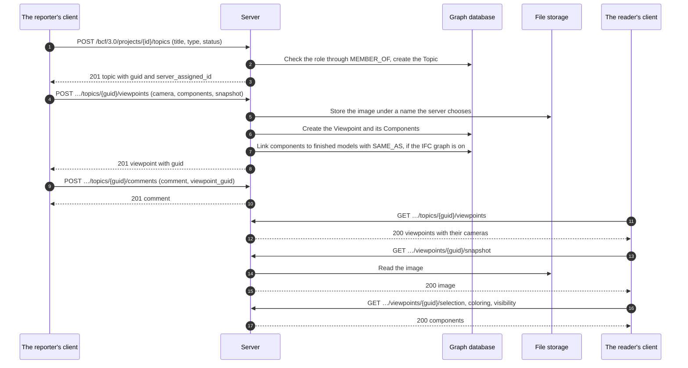

# BCF viewpoint flow

How a client files a topic with a view of the model, and how someone else opens the
same view. This is BCF API 3.0, sections 3.2 (topics) and 3.5 (viewpoints). The
example [create_topic.py](../examples/create_topic.py) does the first half with the
client library.



A viewpoint cannot be changed. It is created whole and deleted whole, so that a
comment that points at it keeps pointing at the same thing.

## What a viewpoint holds

| Part | What it says | Where a client reads it |
|---|---|---|
| Camera | Position, direction and up vector, perspective or orthogonal | In the viewpoint |
| Lines and clipping planes | What is drawn in the view and what is cut away | In the viewpoint |
| Selection | The components that are selected | `/selection` |
| Coloring | The components that have a color | `/coloring` |
| Visibility | What is visible by default, and the exceptions | `/visibility` |
| Snapshot | An image of the view, PNG or JPEG | `/snapshot` |
| Bitmaps | Images placed in the view | `/bitmaps/{id}` |

## Who may do what

| Action | Needs |
|---|---|
| Read topics, comments and viewpoints | Membership of the project, in any role |
| Create a topic | The `createTopic` action: contributor, editor or manager |
| Add a viewpoint or a comment | The `createViewpoint` or `createComment` action: contributor, editor or manager |
| Delete a viewpoint | Its author as contributor; editors and managers delete any |

A project the user is not a member of does not exist for them (404).

## From a viewpoint to the model

With the [IFC-LPG](../ifc-lpg.md) on, every component that names a `GlobalId`
gets a `SAME_AS` relationship to that element in the project's finished models,
also when the model is uploaded afterwards.

```cypher
MATCH (:Viewpoint {guid: $viewpoint})-[:HAS_COMPONENT]->(c:Component)-[:SAME_AS]->(e:IfcProduct)
RETURN c.ifc_guid, e.Name, c.gtin
```
