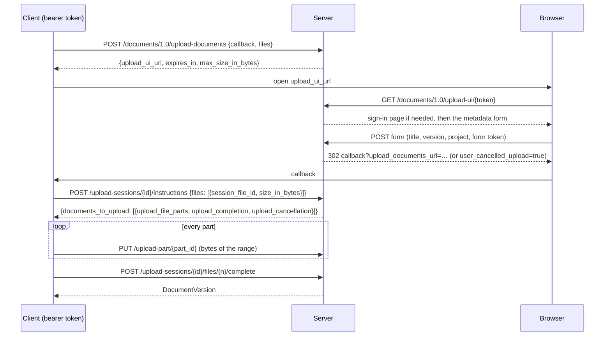
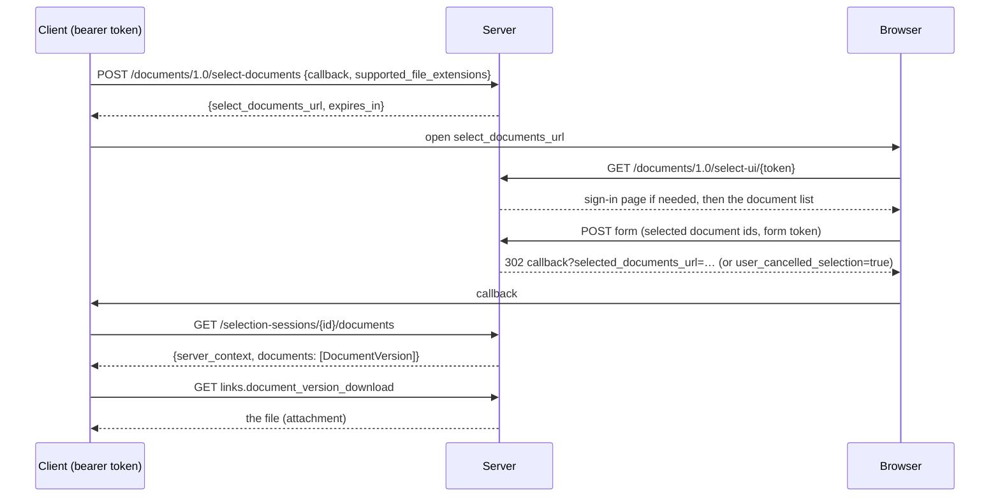

# Documents API flows

The Documents API 1.0 is a conversation between three parties: the client
application, this server, and the user's browser. The client talks to the API
with a bearer token; the browser shows the server's own pages (sign-in,
metadata entry, document selection); the server never calls the client, it
only redirects the browser to the client's callback URL.

## Upload

* The UI link is valid for `OPENCDE_DOCUMENTS_SESSION_TTL_SECONDS` (10 minutes);
  once instructions are issued the session lives `OPENCDE_UPLOAD_SESSION_TTL_SECONDS`
  (24 hours) so large files can be uploaded.
* Parts are `OPENCDE_UPLOAD_PART_BYTES` (50 MiB) each, uploaded in any order,
  concurrently if the client likes. A part must be exactly the announced range.
* Completion assembles the parts, verifies the total size, computes the
  SHA-256 and creates the version. If this takes more than 15 seconds the
  response starts with whitespace to keep the connection open.
* `document_id` in a file entry makes the upload a new version of that
  document; the title is kept, the version index increases.

## Selection and download

* The list shows the latest version of every document in the user's
  projects, filtered on the client's extensions with a "show all" link.
* Editors and managers can upload a file from the page; it appears in the
  list at once (this is an addition to the specification).
* `POST /documents/1.0/document-versions` answers the latest versions of a
  list of document ids with an `ETag`; `If-None-Match` gives `304`.

[Dataspatium](https://github.com/marwiss/Dataspatium) implements both flows
from the browser (`src/api/families/opencde.js`): it opens the server's
selection page in a popup and imports the chosen files, and uploads datasets,
files and workspace bundles in parts with the server's upload page for the
metadata; its live suites run these flows against the development stack
([acceptance.md](../acceptance.md)).

## Who may do what

| Action | Needs |
|---|---|
| Start an upload or a selection | a bearer token with the `documents` scope |
| Use the browser pages | a browser session as the same user (`/signin`) |
| Save metadata, complete an upload, upload from the page | the `createDocument` project action (editor, manager) |
| See, select and download documents | membership of the project (any role) |

Documents of other projects do not exist for the caller (404), so neither
their ids nor their existence leaks.
