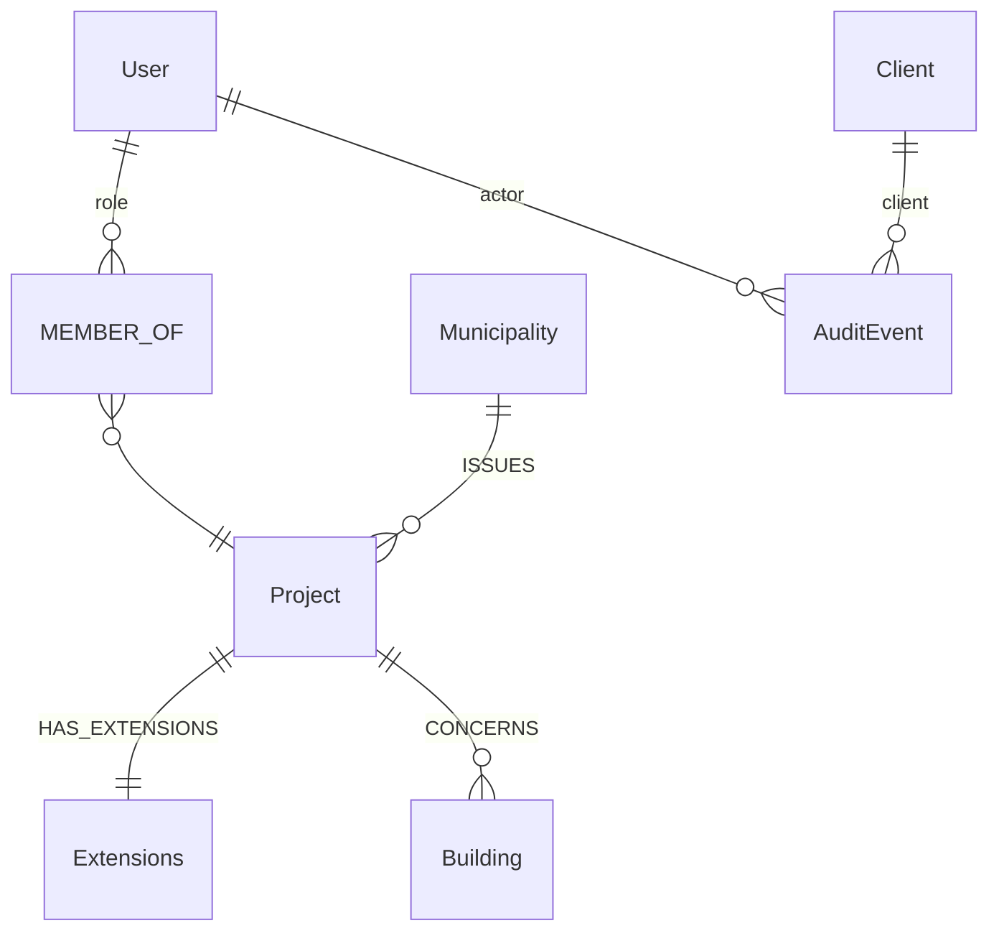

# Graph schema

The database is schemaless; `opencde/graph/schema.py` is the schema. This page
explains the conventions and the labels. Later stages add the BCF and
Documents labels as they are implemented.

## Conventions

- Every node has a server-generated UUID in `id` (or the spec's name for it:
  `project_id`, `guid`, `client_id`, `document_id`) with a unique constraint.
  Nothing a client sends ends up in a file path or a database key unchecked.
- Timestamps are ISO 8601 strings in UTC with milliseconds and a `Z`
  (`2026-11-05T12:34:56.789Z`). String order equals time order.
- Coordinates and vectors are plain floats (`x`, `y`, `z`), never `point()`.
- Anything that expires carries `expires_at` (same format); the server
  deletes expired nodes on a timer (`opencde/graph/cleanup.py`).
- Secrets (codes, tokens, client secrets) are stored only as SHA-256 hashes.
- Cypher is dialect-neutral so Neo4j and Memgraph behave the same (ADR 0003).
  Schema DDL is the only product-specific text and lives in `graph/dialect.py`.

## Accounts and access (stage 1)

| Label | Key | Properties | Notes |
|---|---|---|---|
| `User` | `id`, unique `username` | `email`, `full_name`, `password_hash` (Argon2id), `is_admin`, `disabled`, `created_at`, `must_change_password` | The user name is the user id the APIs expose |
| `MEMBER_OF` (relationship User → Project) | | `role` (viewer, contributor, editor, manager), `since` | Roles map to BCF `*_actions`, see `accounts/roles.py` |
| `Project` | `project_id` | `name`, `created_at`, `topic_counter` | `topic_counter` numbers `server_assigned_id` |
| `Extensions` | `id` | `topic_type[]`, `topic_status[]`, `topic_label[]`, `snippet_type[]`, `priority[]`, `stage[]`, `custom_information[]` | `users[]` is computed from members |
| `Client` | `client_id` | `name`, `description`, `url`, `redirect_uris[]`, `is_public`, `secret_hash`, `disabled`, `created_at`, `created_by`, `dynamic` | OAuth2 client |
| `AuditEvent` | `id` | `type`, `at`, `actor_user_id`, `client_id`, `ip`, `details` (JSON string) | Security-relevant events |
| `Municipality`, `Building` | `id` | `name`, `status` | Context from the inspection-plan use case (seed data) |

## OAuth2 (stage 2)

`AuthorizationCode`, `AccessToken`, `RefreshToken` (with `family_id`), `WebSession`:
all keyed by a hash of the secret, all with `expires_at`, all linked
`-[:ISSUED_TO]->(:Client)` and `-[:FOR]->(:User)`.

## BCF (stages 3–4) and Documents (stage 5)

Added when implemented: `Topic`, `Comment`, `Viewpoint`, `Component`, `Line`,
`ClippingPlane`, `Bitmap`, `FileRef`, `DocumentReference`, `BcfDocument`,
`Event`, `Document`, `DocumentVersion`, `UploadSession`, `UploadPart`,
`SelectionSession`, `IfcModel`, `IfcEntity`.
