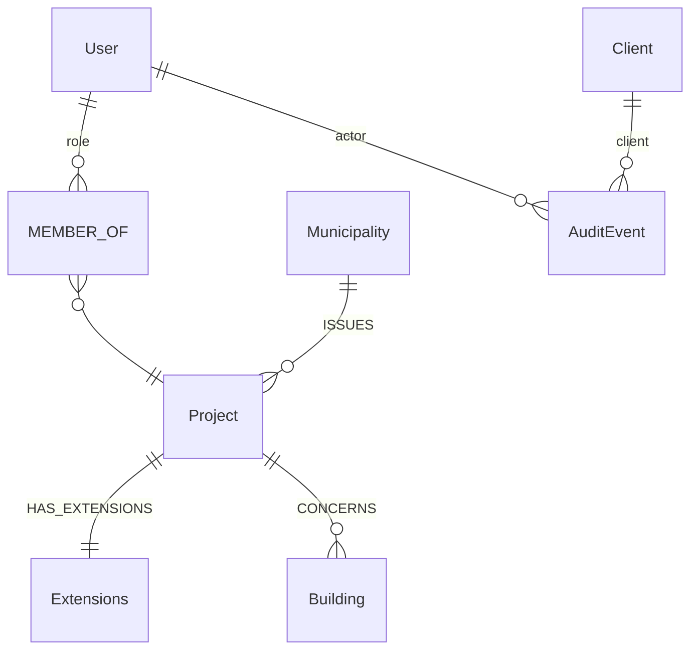
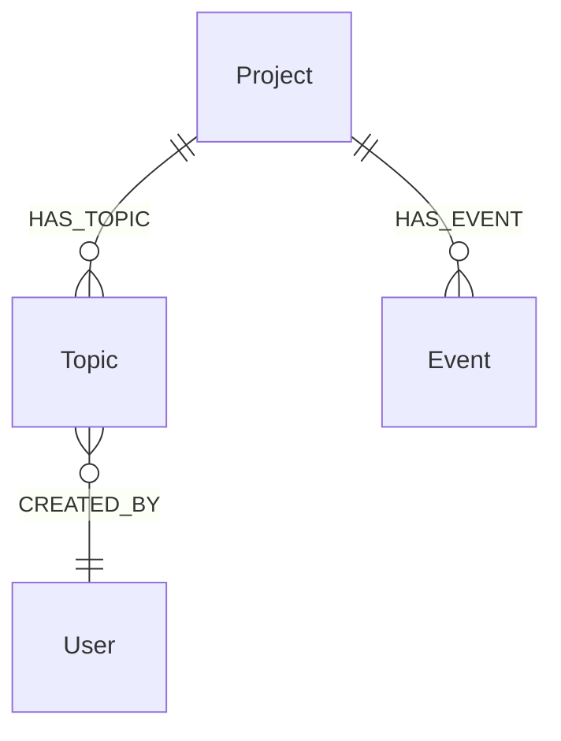
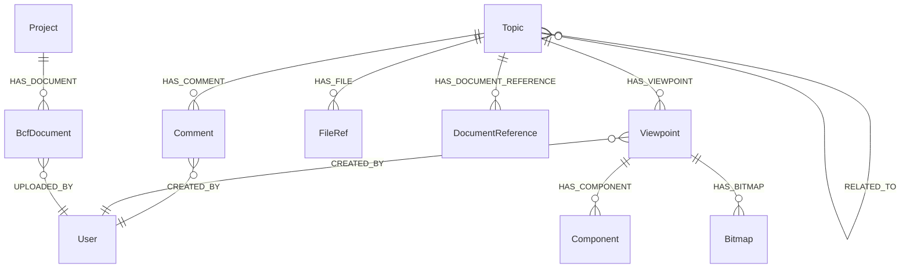

# Graph schema

The database is schemaless; `opencde/graph/schema.py` is the schema. This page
explains the conventions and the labels. Later stages add the BCF and
Documents labels as they are implemented.

## Conventions

- Every node has a server-generated UUID in `id` (or the spec's name for it:
  `project_id`, `guid`, `client_id`, `document_id`) with a unique constraint.
  Nothing a client sends ends up in a file path or a database key unchecked.
- Timestamps are ISO 8601 strings in UTC with milliseconds and a `Z`
  (`2026-11-05T12:34:56.789Z`). String order equals time order.
- Coordinates and vectors are plain floats (`x`, `y`, `z`), never `point()`.
- Anything that expires carries `expires_at` (same format); the server
  deletes expired nodes on a timer (`opencde/graph/cleanup.py`).
- Secrets (codes, tokens, client secrets) are stored only as SHA-256 hashes.
- Cypher is dialect-neutral so Neo4j and Memgraph behave the same (ADR 0003).
  Schema DDL is the only product-specific text and lives in `graph/dialect.py`.

## Accounts and access (stage 1)

| Label | Key | Properties | Notes |
|---|---|---|---|
| `User` | `id`, unique `username` | `email`, `full_name`, `password_hash` (Argon2id), `is_admin`, `disabled`, `created_at`, `must_change_password` | The user name is the user id the APIs expose |
| `MEMBER_OF` (relationship User → Project) | | `role` (viewer, contributor, editor, manager), `since` | Roles map to BCF `*_actions`, see `accounts/roles.py` |
| `Project` | `project_id` | `name`, `created_at`, `topic_counter` | `topic_counter` numbers `server_assigned_id` |
| `Extensions` | `id` | `topic_type[]`, `topic_status[]`, `topic_label[]`, `snippet_type[]`, `priority[]`, `stage[]`, `custom_information[]` | `users[]` is computed from members |
| `Client` | `client_id` | `name`, `description`, `url`, `redirect_uris[]`, `is_public`, `secret_hash`, `disabled`, `created_at`, `created_by`, `dynamic` | OAuth2 client |
| `AuditEvent` | `id` | `type`, `at`, `actor_user_id`, `client_id`, `ip`, `details` (JSON string) | Security-relevant events |
| `Municipality`, `Building` | `id` | `name`, `status` | Context from the inspection-plan use case (seed data) |

## OAuth2 (stage 2)

`AuthorizationCode`, `AccessToken`, `RefreshToken` (with `family_id`), `WebSession`:
all keyed by a hash of the secret, all with `expires_at`, all linked
`-[:ISSUED_TO]->(:Client)` and `-[:FOR]->(:User)`.

## BCF topics and events (stage 3)

| Label | Key | Properties | Notes |
|---|---|---|---|
| `Topic` | `guid` | `server_assigned_id`, `title`, `topic_type`, `topic_status`, `priority`, `stage`, `labels[]`, `reference_links[]`, `assigned_to`, `description`, `index`, `due_date`, `creation_date`, `creation_author`, `modified_date`, `modified_author`, `snippet_type`, `snippet_is_external`, `snippet_reference`, `snippet_reference_schema` | Field names follow `topic_GET.json`; the BIM snippet object is flattened into four properties. `server_assigned_id` is `<prefix><counter>` from `Project.topic_counter` |
| `Event` | `id` | `kind` (`topic` or `comment`), `topic_guid`, `comment_guid`, `author`, `date`, `action_types[]`, `action_values[]` | One node per request that changed something; the two parallel lists are the `actions` array of BCF 3.9/3.10. Attached to the project so that events outlive their topic |

Every topic query starts at the caller's `User` node and walks `MEMBER_OF`
to the project before it touches a topic, so a topic in a project the caller
is not a member of does not exist as far as the API is concerned (404).

## BCF comments, viewpoints and references (stage 4)

| Label | Key | Properties | Notes |
|---|---|---|---|
| `Comment` | `guid` | `topic_guid`, `date`, `author`, `comment`, `viewpoint_guid`, `modified_date`, `modified_author` | `viewpoint_guid` must name a viewpoint of the same topic |
| `Viewpoint` | `guid` | `index`, `author`, `creation_date`, `camera_kind`, `camera` (JSON), `lines` (JSON), `clipping_planes` (JSON), `snapshot_type`, `storage_key`, `has_components`, `default_visibility`, `has_hints`, `spaces_visible`, `space_boundaries_visible`, `openings_visible` | Immutable. Geometry is JSON text: opaque, and identical on both databases |
| `Component` | `id` | `role` (`selection`, `coloring`, `exception`), `group_index`, `position`, `color`, `ifc_guid`, `originating_system`, `authoring_tool_id` | One node per occurrence; the IFC graph links `ifc_guid` to model elements (stage 9) |
| `Bitmap` | `guid` | `position`, `bitmap_type`, `storage_key`, `height`, `loc_*`, `nrm_*`, `up_*` | Image bytes in storage under `bitmaps/<guid>.<type>` |
| `FileRef` | `id` | `position`, `ifc_project`, `ifc_spatial_structure_element`, `filename`, `date`, `reference` | The topic header's files (BCF 3.3) |
| `DocumentReference` | `guid` | `document_guid` or `url`, `description`, `created_at` | Exactly one of the two targets |
| `BcfDocument` | `guid` | `filename`, `storage_key`, `size`, `created_at`, `author` | A file uploaded through BCF 3.8; bytes under `bcf-documents/<guid>` |
| `RELATED_TO` (relationship Topic → Topic) | | | Directed; PUT replaces a topic's outgoing list |

Topics keep their snippet file in `snippet_storage_key` (bytes under
`snippets/<topic guid>.bin`). Deleting a topic deletes everything below it
and the storage keys collected from the nodes; events stay.

## Documents (stage 5)

Added when implemented: `Document`, `DocumentVersion`, `UploadSession`,
`UploadPart`, `SelectionSession`, `IfcModel`, `IfcEntity`.
