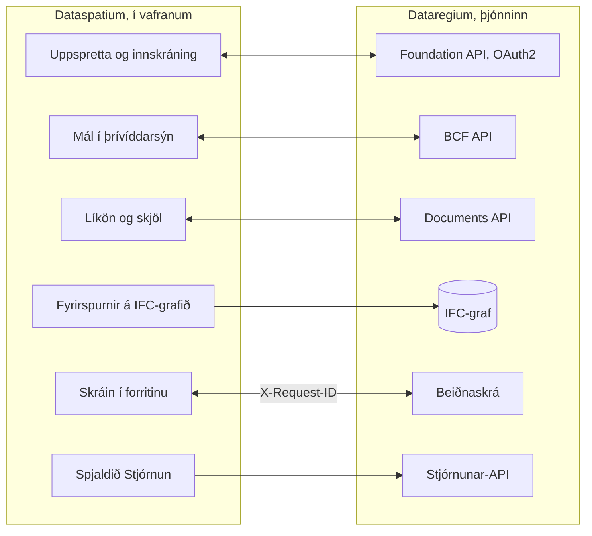

[Svenska](../../README.md) · [Dansk](../da/README.md) · [Norsk bokmål](../nb/README.md) · [Norsk nynorsk](../nn/README.md) · [Suomi](../fi/README.md) · **Íslenska** · [English](../en/README.md)


# Dataregium OpenCDE-þjónn

*Dataregium hét Kontroll til 8. nóvember 2026.*

Dataregium er þjónn fyrir **OpenCDE-forritaskil** buildingSMART (Foundation API
1.0, BCF API 3.0 og 2.1 og Documents API 1.0), byggður á grafgagnagrunni, með
vefstjórnun og valkvæðri IFC-LPG-einingu sem tengir BCF-einingar við
byggingarhlutana sem þær vísa á. Hann spratt upp úr rannsóknarfrumgerð frá
2023 fyrir stafrænar eftirlitsáætlanir í sænskum byggingarleyfum og var
endurskrifaður frá grunni með öryggi sem fyrstu kröfu.
Biðlarar sem fylgja forskriftunum eiga að geta tengst, svo að þjónninn er ekki
bundinn við eitt tiltekið forrit.


**Efni**

- [Sækja og hefjast handa](#sækja-og-hefjast-handa)
- [Kröfur](#kröfur)
- [Hvað þú getur gert](#hvað-þú-getur-gert)
- [OpenCDE-forritaskilin og biðlarar þeirra](#opencde-forritaskilin-og-biðlarar-þeirra)
- [Dataregium og Dataspatium](#dataregium-og-dataspatium)
- [Lærðu meira](#lærðu-meira)
- [Takmarkanir í stuttu máli](#takmarkanir-í-stuttu-máli)
- [Villur og tillögur](#villur-og-tillögur)
- [Þróun](#þróun)
- [Leyfi](#leyfi)

## Sækja og hefjast handa

### Fljótleg byrjun (staðbundið, Docker)

1. **Sækja.** Klónaðu safnið eða sæktu útgefnu myndina
   `ghcr.io/marwiss/opencdeserver` (margar arkitektúrgerðir, skönnuð og með
   SBOM við hverja útgáfu):

   ```sh
   git clone https://github.com/marwiss/Dataregium.git
   cd Dataregium
   ```

2. **Stilla.** Afritaðu `.env.example` í `.env` og settu
   `OPENCDE_GRAPH_PASSWORD` (minnst 16 stafir). Hver stilling er útskýrð í
   [.env.example](../../.env.example).
3. **Ræsa.** `docker compose -f compose.yaml -f compose.dev.yaml up -d --build`
   ræsir þjóninn á <http://127.0.0.1:8000> og Neo4j-gagnagrunn.
   `docker compose logs -f api` sýnir atvikaskrá þjónsins.
4. **Litast um.** <http://127.0.0.1:8000/docs> er gagnvirka API-skjölunin,
   <http://127.0.0.1:8000/readyz> viðbúnaðarathugunin og
   <http://127.0.0.1:7484> Neo4j Browser (Bolt á `127.0.0.1:7697`;
   þróunaryfirlagið sneiðir hjá sjálfgefnum gáttum Neo4j, sem annar Neo4j á
   sömu tölvu tekur oft).
5. **Bæta við sýnigögnum og skrá sig inn.**
   `docker compose -f compose.yaml -f compose.dev.yaml exec api opencde seed`
   býr til sýninotendur og -verkefni og prentar lykilorð þeirra einu sinni.
   Skráðu þig inn á <http://127.0.0.1:8000/signin> sem `admin` og opnaðu
   `/admin`.
6. **Tengja biðlara.** Skráðu forritið þitt undir *Biðlarar* (eða láttu það
   skrá sig sjálft þegar `OPENCDE_DYNAMIC_CLIENT_REGISTRATION=true`) og
   beindu því á `http://127.0.0.1:8000`; [Dataspatium](#dataregium-og-dataspatium)
   og Python-safnið í [client/](../../client/) eru tilbúnir biðlarar.
   Ef þú ætlar að skrá þig inn úr Dataspatium skaltu fylgja [fljótlegu
   byrjuninni](quickstart.md): hún fjallar um allar stillingar sem þarf og hvað þú
   gerir ef eitthvað fer úrskeiðis.

Án Docker fyrir þjóninn sjálfan (gagnagrunn þarf samt):

```sh
uv sync                          # setur upp Python 3.13 og öll ósjálfstæði
uv run opencde doctor            # athugar stillingar og gagnagrunn
uv run opencde serve             # http://127.0.0.1:8000
```

### Uppsetning í rekstur

Ein compose-skrá auk eins yfirlags fyrir hverja aðstæðu:

| Aðstæður | Leiðbeiningar |
|---|---|
| Staðbundin prófun á eigin tölvu | [docs/is/deploy/local.md](deploy/local.md) |
| Opinbert https-vistfang fyrir biðlaraprófanir án eigin þjóns (tunnel) | [docs/is/deploy/tunnel.md](deploy/tunnel.md) |
| Rekstur á eigin þjóni með Caddy (sjálfvirkt TLS) og næturlegum öryggisafritum | [docs/is/deploy/vps-caddy.md](deploy/vps-caddy.md) |
| Coolify, Dokploy, Portainer | [docs/is/deploy/paas.md](deploy/paas.md) |
| Gámaþjónusta auk Neo4j AuraDB eða Memgraph Cloud í umsjón þjónustuaðila | [docs/is/deploy/cloud-aura.md](deploy/cloud-aura.md) |
| Öryggisafritun og endurheimt (flytjanleg milli Neo4j og Memgraph) | [docs/is/deploy/backup.md](deploy/backup.md) |

`uv run opencde init --public-url https://cde.example.org` skrifar
`.env`-skrá fyrir rekstur með nýjum leyndarmálum; `opencde doctor` athugar
niðurstöðuna.

### Stillingar

Allt er lesið úr umhverfisbreytum með forskeytinu `OPENCDE_`, úr `.env` eða úr
Docker-leyndarmálum í `/run/secrets/opencde_<nafn>`. Listinn með skýringum er
í [.env.example](../../.env.example). Sjálfgefin gildi eru örugg: í rekstri
neitar þjónninn að ræsa án opinbers `https`-vistfangs og lykilorðs að
gagnagrunninum, og ekkert er opið fyrr en það hefur verið stillt.

## Kröfur

- Windows, macOS eða Linux með Docker (Desktop á Windows/macOS, Engine á
  Linux), eða Python 3.11 eða nýrra með [uv](https://docs.astral.sh/uv/) og
  eigin Neo4j 5.26- eða Memgraph 3.14-gagnagrunni.
- Um 1 GB af minni fyrir gagnagrunnsgáminn (`NEO4J_HEAP` og `NEO4J_PAGECACHE`
  í `.env`), meira með IFC-LPG-einingunni.
- Staðbundið: gátt 8000 fyrir þjóninn og 7484/7697 fyrir gagnagrunninn, allar
  bundnar við `127.0.0.1`. Í rekstri: gáttir 80 og 443 aðgengilegar af
  internetinu og DNS-nafn fyrir þjóninn.
- Biðlarar þurfa `https`-vistfang í rekstri; staðbundið er `http://127.0.0.1` samþykkt sem redirect-URI, og `http://localhost` með `OPENCDE_ALLOW_LOCALHOST_REDIRECTS=true`.

## Hvað þú getur gert

- **Foundation API 1.0**: uppgötvun þjónustu, OAuth2 authorization code með
  PKCE, núverandi notandi, afturköllun tóka og kvik
  biðlaraskráning með opinberum biðlurum (óvirk sjálfgefið).
- **BCF API 3.0 og 2.1**: verkefni, extensions, mál með OData-fyrirspurnum,
  athugasemdir, viewpoint með skjámyndum, bitamyndum og einingum, skrár,
  skjalatilvísanir, skjöl og atburðaskrárnar, allt sannreynt gegn skemum
  buildingSMART.
- **Documents API 1.0**: val og niðurhal skjala, upphal í hlutum með vefsíðum
  þjónsins fyrir lýsigögn og val, útgáfufyrirspurnir með ETag.
- **Stjórnun** í vafranum: skráðu þig inn á `/signin` með stjórnendareikningi
  og opnaðu `/admin` til að stjórna notendum og verkefnishlutverkum þeirra,
  verkefnum og BCF-extensions-gildum þeirra, OAuth2-biðlurum, setum,
  endurskoðunarskránni, valkvæðu beiðnaskránni og heilsuathugunum þjónsins.
  Hver notandi hefur `/account` fyrir eigið lykilorð, eigin forrit og eigin
  setur. Skipanalínan (`uv run opencde --help`) gerir það sama úr skjáhermi.
- **Viðbætur utan forskriftanna**, hver merkt sem slík: getuskjal á
  `/.well-known/dataregium` sem segir biðlaranum hvaða viðbætur eru virkar,
  stöðugur `code` í hverju villusvari, beiðnaskrá til villuleitar í biðlurum
  (`/admin/requests`, `GET /admin/api/requests` með heimildinni `admin`) og
  IFC-LPG-einingin sem breytir upphöluðum IFC-líkönum í grafgögn tengd
  BCF-einingum.
- **Biðlarasafn** í Python ([client/](../../client/), LGPL) með keyranlegum
  dæmum, auk Dockerfile, compose-yfirlaga og útgefinnar myndar fyrir hverja
  rekstraraðstæðu.
- **Staða**: öll ellefu stig áætlunarinnar eru útfærð (forritaskilin þrjú,
  stjórnunin, biðlarasafnið, uppsetning í rekstur, IFC-LPG,
  samþykktargátlistinn og öryggisherðingin); framlagið til IfcOpenShell hefur
  ekki enn verið lagt fram (uppköst í [docs/upstream/](../upstream/)).


## OpenCDE-forritaskilin og biðlarar þeirra

OpenCDE er fjölskylda buildingSMART International af opnum vefforritaskilum fyrir
sameiginlegt gagnaumhverfi, staðinn þar sem verkefni deilir líkönum sínum, skjölum og
málum. Biðlari og þjónn sem fylgja sömu forskriftum geta unnið saman, hver sem smíðaði þá.
Dataregium útfærir öll þrjú:

| Forritaskil | Til hvers þau eru | Forskrift |
|---|---|---|
| Foundation API 1.0 | Segja hvaða forritaskil þjónn býður, hvernig á að skrá sig inn og hver notandinn er | [foundation-API](https://github.com/buildingSMART/foundation-API) |
| BCF API 3.0 og 2.1 | Mál um líkan, með athugasemdum og sjónarhornum með myndavél, einingum og myndum | [BCF-API](https://github.com/buildingSMART/BCF-API) |
| Documents API 1.0 | Að velja, sækja og hlaða upp skjölum og útgáfum þeirra, á síðum á þjóninum | [documents-API](https://github.com/buildingSMART/documents-API) |

**Dataspatium er einn biðlari, ekki sá eini.** Sérhver biðlari sem fylgir þessum forskriftum
á að geta tengst: ekkert á þjóninum er háð Dataspatium, og viðbæturnar utan forskriftanna
eru valfrjálsar, svo að biðlari sem þekkir þær ekki verður ekki var við þær. Biðlari þarf
þrennt:

- skráningu á þjóninum, sem stjórnandi gerir undir *Biðlarar* eða biðlarinn sjálfur þegar
  `OPENCDE_DYNAMIC_CLIENT_REGISTRATION=true`;
- OAuth2 authorization code með PKCE `S256`, sem þjónninn krefst af hverjum biðlara nema trúnaðarbiðlara sem stjórnandi hefur merkt;
- BCF API 3.0, eða 2.1 fyrir biðlara sem kann aðeins þá útgáfu. `GET /foundation/versions` telur upp báðar, og
  [biðlaraleiðbeiningarnar](client-guide.md) segja hvað skilur þær að.

Svo langt hefur þetta verið sýnt: svör þjónsins eru prófuð gagnvart skemum buildingSMART við
hvert push, og Dataspatium og Python-safnið í [client/](../../client/) keyra gagnvart þjóninum.
Óháðir biðlarar eins og Bonsai og ifc-lite hafa tilbúinn gátlista í
[docs/acceptance.md](../acceptance.md) sem hefur ekki enn verið keyrður. Ef þú prófar biðlara,
segðu frá hvernig gekk undir [Villur og tillögur](#villur-og-tillögur). Þegar biðlari og forskrift stangast
á ræður forskriftin. [docs/is/client-guide.md](client-guide.md) er fyrir þá sem smíða biðlara.

## Dataregium og Dataspatium

Dataregium (þjónninn) og [Dataspatium](https://github.com/marwiss/Dataspatium)
(gagnaforrit sem keyrir alfarið í vafranum) eru þróuð til að vinna saman sem
þjónn og biðlari, og sama útgáfunúmer á báðum þýðir að þau vinna saman:
Dataspatium 2.0.0 vinnur með Dataregium 2.0.0 ([fljótleg byrjun](quickstart.md)).
Dataspatium bætir Dataregium-þjóni
við sem uppsprettu: forritið uppgötvar forritaskilin um `/foundation/versions`,
skráir sig inn með OAuth2 authorization code og PKCE og skráir sig sjálft sem
opinberan biðlara þegar kvik skráning er virk, telur upp líkön og skjöl
verkefnisins, les og skrifar BCF-mál með athugasemdum og viewpoint sem tekin
eru úr þrívíddarsýn þess, hleður upp gagnasöfnum, skrám og vinnusvæðispökkum
um Documents API, spyr IFC-grafið með Cypher yfir Bolt þegar rekstraraðilinn
opnar það, og sendir `X-Request-ID` með hverju kalli svo að beiðnaskráin hér
og atvikaskráin í forritinu sýni sama samtal. Forritið les getuskjal þjónsins
til að sjá hvaða viðbætur eru virkar og bregst við villukóðunum sem þjónninn
setur í villusvör sín.

Svona tengjast þau:



Fyrir utan merktu viðbæturnar fer allt sem Dataspatium gerir gagnvart þjóninum
um OpenCDE-forritaskilin þrjú, svo að forritið notar ekkert sem annar biðlari
getur ekki notað, sjá [OpenCDE-forritaskilin og biðlarar þeirra](#opencde-forritaskilin-og-biðlarar-þeirra). Vörurnar tvær eru settar
upp hvor fyrir sig: þetta safn pakkar Dataspatium ekki með (leyfin eru ólík,
AGPL hér og PolyForm Strict þar), og README Dataspatium lýsir hvernig forritið
er sótt. Biðlarahliðinni er lýst í README Dataspatium og skjölun þess;
samþykktarkeyrslur parsins eru hér í [docs/acceptance.md](../acceptance.md),
og það sem verkefnin tvö samræma er í
[docs/dataspatium-coordination.md](../dataspatium-coordination.md).

## Lærðu meira

- [docs/is/quickstart.md](quickstart.md): Dataregium og Dataspatium saman á tuttugu
  mínútum, frá tómri tölvu að máli sem er búið til í þrívíddarsýninni.
- [docs/is/client-guide.md](client-guide.md) og [docs/examples/](../examples/):
  hvernig biðlari er smíðaður, getuskjalið, villukóðarnir og keyranleg dæmi
  með Python-safninu í [client/](../../client/).
- [docs/is/architecture.md](architecture.md): hvernig hlutarnir tengjast, hvað gerist við beiðni og hvar allt er í kóðanum.
- [docs/is/glossary.md](glossary.md): orðin sem skjölunin notar.
- [docs/is/flows/](flows/): runurit fyrir OAuth2-, Documents API- og BCF-sjónarhornsferlin.
- [docs/is/graph-schema.md](graph-schema.md): graflíkanið.
- [docs/is/ifc-lpg.md](ifc-lpg.md): valkvæða IFC-LPG-einingin og dæmi um Cypher-fyrirspurnir.
- [docs/acceptance.md](../acceptance.md): gátlisti fyrir sjónræna samþykkt
  með óháðum biðlurum (Bonsai, ifc-lite, Dataspatium).
- [docs/dataspatium-coordination.md](../dataspatium-coordination.md): hvað
  Dataregium og Dataspatium eiga sameiginlegt og ákvarðanir eigandans.
- Arkitektúrákvarðanir sem standa: grafgagnagrunnur sem eina geymslan,
  ógegnsæir tókar í stað JWT, flytjanlegt Cypher fyrir Neo4j og Memgraph,
  vefviðmót án umgjarða, öryggisafrit á forritsstigi, BCF API 2.1 við hlið 3.0,
  og þróun hér með framlagi til IfcOpenShell síðar.
- [docs/upstream/](../upstream/): uppköst að máli og pull request fyrir
  IfcOpenShell (ekki send).
- [spec/SOURCES.md](../../spec/SOURCES.md): nákvæmar útgáfur forskriftanna
  sem þjónninn er prófaður gegn.

Skjölunin er til á sjö tungumálum þessarar README-skrár: enska undir `docs/`,
hin undir `docs/<tungumál>/`. Verkefnaskrárnar (samþykkt, yfirlit, samræming),
arkitektúrákvarðanirnar, uppköstin fyrir IfcOpenShell og CONTRIBUTING eru höfð
á ensku.

### Frekari lestur

- [BCF API](https://github.com/buildingSMART/BCF-API), [Foundation API](https://github.com/buildingSMART/foundation-API) og [Documents API](https://github.com/buildingSMART/documents-API):
  forskriftirnar sem þjónninn fylgir.
- [IFC](https://github.com/buildingSMART/IFC4.x-development): skráarsniðið fyrir byggingarlíkön.
- [RFC 9700](https://www.rfc-editor.org/rfc/rfc9700): bestu starfsvenjur nútímans um öryggi í OAuth 2.0, og
  [OAuth 2.1](https://datatracker.ietf.org/doc/draft-ietf-oauth-v2-1/), drögin sem safna þeim saman.
- [RFC 7636](https://www.rfc-editor.org/rfc/rfc7636) (PKCE), [RFC 8252](https://www.rfc-editor.org/rfc/rfc8252) (forrit í tölvu eða síma) og
  [RFC 7591](https://www.rfc-editor.org/rfc/rfc7591) (skráning biðlara).
- [OWASP ASVS](https://owasp.org/www-project-application-security-verification-standard/): gátlistinn fyrir öryggisstarfið.

## Takmarkanir í stuttu máli

- Þjónninn útfærir BCF API 3.0 og 2.1, ekki 1.0, þar sem tilföngin eru öðruvísi í laginu.
- Útflutningur verkefnis sem BCFzip er látinn biðlurum eftir; þjónninn geymir
  mál, athugasemdir og viewpoint eins og forritaskilin skilgreina þau.
- Community-útgáfur Neo4j og Memgraph hafa enga gagnagrunnsnotendur með
  lesaðgang eingöngu, svo að opin Bolt-gátt veitir þeim sem hefur lykilorðið
  fullan aðgang. Gáttin er lokuð nema stjórnandinn opni hana viljandi; lesandi
  graffyrirspurn stjórnunarforritaskilanna (`OPENCDE_GRAPH_QUERY_ENABLED`) gefur
  Cypher án gáttarinnar.
- IFC-LPG-innflutningurinn keyrir í sérstöku ferli með minnis- og tímamörkum
  (`OPENCDE_IFC_LPG_*`); mjög stórum líkönum er hafnað frekar en að skilja
  þau eftir hálfinnflutt.
- Vefsíðurnar þjóna stjórnendum og OAuth2- og Documents API-ferlunum;
  endanotendur vinna í biðlara eins og Dataspatium eða Bonsai.
- Síðurnar eru til á sjö tungumálum þessarar README-skrár (skiptu neðst á hverri
  síðu); skipanalínan og villuboð forritaskilanna eru á ensku.
- Engin ytri úttekt enn. OAuch- og testssl-keyrslurnar eru skref
  rekstraraðilans fyrir uppsetningu í rekstur.

## Persónuupplýsingar

Sá sem rekur Dataregium fyrir aðra er ábyrgðaraðili þessara gagna. Þjónninn
geymir notendareikninga (notandanafn, nafn, valfrjálst netfang, tætigildi
lykilorðs), verkefnisaðild, mál og athugasemdir með nöfnum höfunda, upphlaðnar
skrár með þeim sem hlóð upp, IFC-grafið með eigendasögu skrárinnar og
endurskoðunarskrá yfir hver gerði hvað og frá hvaða vistfangi. Lykilorð, tókar
og leyndarmál eru aðeins geymd sem tætigildi. Tókar, setur, upphleðslusetur og
ónotaðir sjálfskráðir biðlarar renna út og þjónninn hreinsar þá;
rekstraraðilinn grisjar endurskoðunarskrána. Stjórnandi eyðir reikningi undir
`/admin/users`, og setur hans og tókar fylgja með; nafnið stendur áfram á
málunum sem viðkomandi skrifaði þar til þeim er eytt. Endurskoðunarskráin er
flutt út sem CSV, BCF- og skjalagögn um forritaskilin og allur gagnagrunnurinn
með `opencde backup`. Hvað Dataspatium geymir í vafranum stendur í skjölun
forritsins sjálfs.

## Villur og tillögur

Tilkynntu villur og óskir sem *Issues* hér á GitHub. Segðu hvaða útgáfu
þjónsins þú keyrir (`version` í `/.well-known/dataregium` eða `/healthz`), hvaða
biðlara þú notaðir og `X-Request-ID` kalls sem mistókst; beiðnaskráin og
atvikaskrá biðlarans deila því. Hengdu hvorki persónuupplýsingar né leyndarmál
við. Hvernig breytingar eru teknar inn er lýst í
[CONTRIBUTING.md](../../CONTRIBUTING.md). Fyrir öryggisveikleika fylgdu
[SECURITY.md](../../SECURITY.md) í stað þess að opna mál.

## Þróun

```sh
uv run pytest                    # einingaprófanir, samræmisprófanir og öryggisprófanir
uv run pytest -m integration     # ræsir Neo4j/Memgraph með testcontainers (krefst Docker)
uv run pytest -m e2e             # biðlarasafnið gegn þjóni í keyrslu (krefst Docker)
uv run pytest -m ui              # Playwright + axe-core (uv sync --group ui; playwright install chromium)
uv run ruff format . && uv run ruff check .
uv run ty check opencde client/opencde_client
```

Kóði og athugasemdir eru á ensku því að þjónninn og biðlarasafnið eiga að
verða framlag til IfcOpenShell, en stíllinn fylgir venjum þess (ruff, 120
dálkar). README er til á ensku, sænsku, dönsku, norsku (bokmál og nynorsk),
finnsku og íslensku (`docs/<tungumál>/README.md`, sama skipan sem Dataspatium
notar); skjölunin og vefviðmótið eru til á sömu tungumálum, með ensku
alltaf sem einn kostinn, og sameiginleg hugtök fylgja orðalista Dataspatium.
Hvert push keyrir lint, tegundarathugun, prófunarsvíturnar á þremur
Python-útgáfum, vafraprófanir með axe-core og stöðugar öryggisathuganir;
næturkeyrslur keyra OWASP ZAP, Schemathesis og Trivy. Sjá
[CONTRIBUTING.md](../../CONTRIBUTING.md).

## Leyfi

Þjónninn er gefinn út með leyfinu GNU Affero General Public License v3.0 eða
nýrra ([LICENSE](../../LICENSE)): hann er þjónhugbúnaður og netákvæði AGPL
heldur endurbótum á hýstum uppsetningum opnum. Biðlarasafnið í
[client/](../../client/) er LGPL-3.0-or-later. Forskriftarskrárnar undir
[spec/](../../spec/) eru © buildingSMART International og er dreift
óbreyttum til prófana. Sjá [SECURITY.md](../../SECURITY.md) um hvernig
veikleiki er tilkynntur og hvað verkefnið gerir til að halda sér öruggu.
