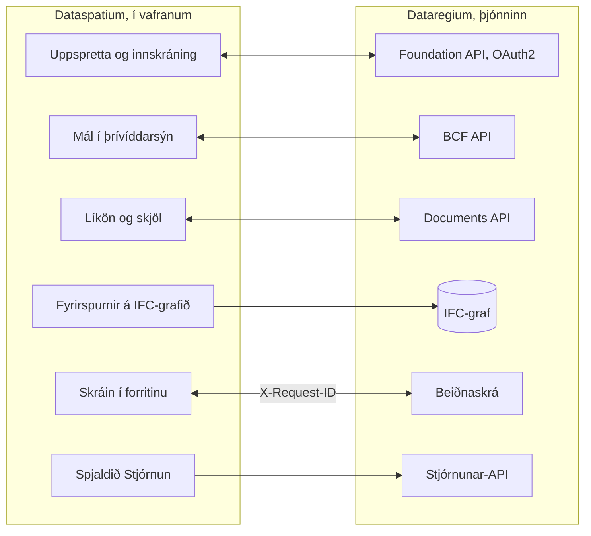

[Svenska](../../README.md) · [Dansk](../da/README.md) · [Norsk bokmål](../nb/README.md) · [Norsk nynorsk](../nn/README.md) · [Suomi](../fi/README.md) · **Íslenska** · [English](../en/README.md)


# Dataregium OpenCDE-þjónn

*Dataregium hét Kontroll til 8. nóvember 2026.*

Dataregium er þjónn þar sem byggingarverkefni safnar saman líkönum sínum, skjölum og
málum, svo að allir í verkefninu vinni út frá sömu gögnum og sjái sömu sögu. Þú vinnur
með hann í gegnum forrit, til dæmis [Dataspatium](https://github.com/marwiss/Dataspatium)
í vafranum; þjónninn sjálfur hefur aðeins síður fyrir innskráningu, upphleðslu og
stjórnun. Sá sem rekur þjóninn ákveður hver má skrá sig inn og hvað hver og einn má
gera í hverju verkefni.

Tæknilega er Dataregium þjónn fyrir opin **OpenCDE-forritaskil** buildingSMART
(Foundation API 1.0, BCF API 3.0 og 2.1 og Documents API 1.0), byggður á
netgagnagrunninum Neo4j eða Memgraph. Í 3-röðinni verður hvert upphlaðið IFC-líkan að
taplausu neti með safninu [IFC-LPG](https://github.com/marwiss/IFC-LPG), með útgáfum,
prófunum og breytingatillögum. Þjónninn var endurskrifaður frá grunni út frá
rannsóknarfrumgerð frá 2023, með öryggi sem fyrstu kröfu, og hver biðlari sem fylgir
forskriftunum getur tengst.


**Efni**

- [Sækja og hefjast handa](#sækja-og-hefjast-handa)
- [Kröfur](#kröfur)
- [Orð sem gott er að þekkja](#orð-sem-gott-er-að-þekkja)
- [Hvað þú getur gert](#hvað-þú-getur-gert)
- [OpenCDE-forritaskilin og biðlarar þeirra](#opencde-forritaskilin-og-biðlarar-þeirra)
- [Dataregium og Dataspatium](#dataregium-og-dataspatium)
- [Lærðu meira](#lærðu-meira)
- [Takmarkanir í stuttu máli](#takmarkanir-í-stuttu-máli)
- [Persónuupplýsingar](#persónuupplýsingar)
- [Næst í 3-röðinni](#næst-í-3-röðinni)
- [Villur og tillögur](#villur-og-tillögur)
- [Þróun](#þróun)
- [Leyfi](#leyfi)

## Sækja og hefjast handa

Ef þú notar Dataregium aðeins þarftu ekki að setja neitt upp: biddu þann sem rekur
þjóninn um vefslóðina og aðgang, og skráðu þig inn úr Dataspatium eða öðru
OpenCDE-forriti. Ef þú vilt prófa þjóninn á þinni eigin tölvu fylgirðu fljótlegu
byrjuninni hér fyrir neðan. Hún tekur um tuttugu mínútur og krefst Docker Desktop eða
Podman. Ef þú ert vanur gámum og Python er stutta leiðin undir
[Fyrir þau sem kunna tæknina](#fyrir-þau-sem-kunna-tæknina).

### Fljótleg byrjun (staðbundið, Docker eða Podman)

Gámur er fullpakkað forrit sem keyrir aðskilið á tölvunni, og Docker og Podman eru
forrit sem ræsa gáma. Fljótlega byrjunin ræsir tvo: þjóninn og gagnagrunn hans.

1. **Sækja.** Sæktu kóðann með git, eða sem ZIP-skrá undir *Code > Download ZIP* á
   GitHub. Greinin `main` er 3-röðin; `release-2` og `release-1` eru 2- og 1-röðin.

   ```sh
   git clone https://github.com/marwiss/Dataregium.git
   cd Dataregium
   ```

2. **Stilla.** Afritaðu `.env.example` í `.env`, skrána með stillingum þjónsins, og
   settu `OPENCDE_GRAPH_PASSWORD` sem eigið lykilorð með að minnsta kosti 16 stöfum.
   Ef þú vilt prófa með Dataspatium og líkönum skaltu líka setja
   `OPENCDE_DYNAMIC_CLIENT_REGISTRATION=true`, `OPENCDE_REQUEST_LOG_ENABLED=true` og
   `OPENCDE_IFC_LPG_ENABLED=true`; [fljótlega byrjunin með Dataspatium](quickstart.md)
   útskýrir hvers vegna. Hver stilling er útskýrð í [.env.example](../../.env.example).
3. **Ræsa.** Sömu compose-skrár virka með Docker og Podman; veldu það sem þú hefur:

   <details open>
   <summary><b>Docker</b></summary>

   ```sh
   docker compose up -d --build
   ```

   ræsir þjóninn á <http://127.0.0.1:8000> og Neo4j-gagnagrunn; fyrsta skiptið tekur nokkrar mínútur. `docker compose logs -f api` sýnir þjónsannálinn.

   </details>

   <details>
   <summary><b>Podman</b></summary>

   ```sh
   podman compose up -d --build
   ```

   gerir það sama með Podman 5 (rootless, án daemons); `podman compose logs -f api` sýnir þjónsannálinn. Sjá [deploy/local.md](deploy/local.md) um sérkenni Podman.

   </details>

   <details>
   <summary><b>Án gáms</b></summary>

   ```sh
   uv sync --extra ifc-lpg          # setur upp Python 3.13 og öll ósjálfstæði, með IFC-LPG
   uv run opencde doctor            # athugar stillingar og gagnagrunn
   uv run opencde serve             # http://127.0.0.1:8000
   ```

   keyrir þjóninn úr útskráðu eintaki með [uv](https://docs.astral.sh/uv/); gagnagrunnur þarf samt (Neo4j Desktop, Memgraph Lab eða gagnagrunnurinn úr compose-skránum).

   </details>

4. **Litast um.** <http://127.0.0.1:8000/docs> sýnir hvert kall sem þjónninn tekur
   við og leyfir þér að prófa þau, <http://127.0.0.1:8000/readyz> segir hvort þjónninn
   og gagnagrunnurinn séu tilbúnir, og <http://127.0.0.1:7484> er Neo4j Browser, þar
   sem þú sérð gagnagrunninn (Bolt á `127.0.0.1:7697`; þróunarlagið forðast
   sjálfgefnar gáttir Neo4j, sem annað Neo4j á sömu tölvu notar oft).
5. **Hlaða inn sýnigögnum og skrá sig inn.**

   <details open>
   <summary><b>Docker</b></summary>

   ```sh
   docker compose exec api opencde seed
   ```

   </details>

   <details>
   <summary><b>Podman</b></summary>

   ```sh
   podman compose exec api opencde seed
   ```

   </details>

   <details>
   <summary><b>Án gáms</b></summary>

   ```sh
   uv run opencde seed
   ```

   </details>

   Skipunin býr til sýninotendur, verkefni, biðlara og eitt mál, og með IFC-LPG
   virkt líka sýnilíkan sem net. Lykilorðin eru prentuð einu sinni. Skráðu þig inn á
   <http://127.0.0.1:8000/signin> sem `admin` og opnaðu `/admin`.
6. **Tengja biðlara.** Skráðu forritið þitt undir *Biðlarar* (eða leyfðu því að skrá
   sig sjálft þegar `OPENCDE_DYNAMIC_CLIENT_REGISTRATION=true`) og beindu því að
   `http://127.0.0.1:8000`; [Dataspatium](#dataregium-og-dataspatium) og
   Python-safnið í [client/](../../client/) eru tilbúnir biðlarar. Ef þú skráir þig
   inn úr Dataspatium skaltu fylgja [fljótlegu byrjuninni](quickstart.md): hún fer yfir
   allar stillingar sem þarf og hvað þú gerir ef eitthvað fer úrskeiðis.

### Uppsetning í rekstur

Eigi aðrir að nota þjóninn þarf hann að vera á tölvu sem er alltaf í gangi og næst frá
internetinu, með eigin vefslóð og https. Taflan sýnir leiðirnar til þess; sá sem rekur
ekki sjálfur þjóna lætur það eftir einhverjum sem gerir það. Hver leið er ein
compose-skrá auk eins lags:

| Aðstæður | Leiðbeiningar |
|---|---|
| Staðbundin prófun á tölvunni þinni | [deploy/local.md](deploy/local.md) |
| Opinber https-slóð fyrir prófanir á biðlurum án eigin þjóns (göng) | [deploy/tunnel.md](deploy/tunnel.md) |
| Rekstur á eigin þjóni með Caddy (sjálfvirkt TLS) og afritum á hverri nóttu | [deploy/vps-caddy.md](deploy/vps-caddy.md) |
| Við hlið þess sem þegar keyrir á þjóni, á bak við nginx hans | [deploy/proxied.md](deploy/proxied.md) |
| Coolify, Dokploy, Portainer | [deploy/paas.md](deploy/paas.md) |
| Þitt eigið svæði hjá AWS, Azure eða Google Cloud: ein vél, sett upp með cloud-init-skrá | [deploy/cloud.md](deploy/cloud.md) |
| Gámaþjónusta auk rekinnar Neo4j AuraDB eða Memgraph Cloud | [deploy/cloud-aura.md](deploy/cloud-aura.md) |
| Afritun og endurheimt (færanleg milli Neo4j og Memgraph) | [deploy/backup.md](deploy/backup.md) |

`uv run opencde init --public-url https://cde.example.org` skrifar `.env` fyrir rekstur
með nýjum leyndarmálum; `opencde doctor` prófar niðurstöðuna.

### Stillingar

Allt er lesið úr umhverfisbreytum með forskeytinu `OPENCDE_`, úr `.env` eða úr
Docker-leyndarmálum í `/run/secrets/opencde_<nafn>`. Listinn með skýringum er í
[.env.example](../../.env.example). Sjálfgefin gildi eru örugg: rekstur neitar að
ræsast án opinberrar `https`-slóðar og lykilorðs gagnagrunns, og ekkert er opið fyrr
en það hefur verið stillt.

### Fyrir þau sem kunna tæknina

- **Mynd (image)**: `ghcr.io/marwiss/opencdeserver` fyrir amd64 og arm64, skönnuð með
  Trivy og með SBOM. Merkin eru `3.0.0` og `latest` fyrir 3-röðina, `3.0.0-gherkin` og
  `latest-gherkin` með ifc-gherkin-rules frá buildingSMART, `2.0.0` og `1.0.0`;
  `OPENCDE_IMAGE_TAG` velur í compose-skránum.
- **Compose**: `docker/compose.yaml` auk laga fyrir þróun, rekstur með Caddy, á bak við
  fyrirliggjandi proxy, Memgraph, ytri gagnagrunn, Bolt með TLS, göng, staðbundnu
  vélina og vinnueintakið. `COMPOSE_FILE` í `.env` velur þau, svo skipanirnar eru án `-f`.
- **Án gáms**: Python 3.11 eða nýrra með uv (prófað á 3.11, 3.13 og 3.14),
  `uv sync --extra ifc-lpg`, og Neo4j 5.26 eða Memgraph 3.14 á `OPENCDE_GRAPH_URI`.
- **Helstu stillingar**: `OPENCDE_APIS` velur forritaskilin (öll þrjú sjálfgefið,
  `["documents"]` í 1.0.0); `OPENCDE_IFC_LPG_ENABLED=true` virkjar netið og allt í 2- og
  3-röðinni sem snýr að líkönum; `OPENCDE_ENVIRONMENT` er `development`, `production`
  eða `local` (staðbundna vélin, `opencde init --local`).
- **Endapunktar**: `/.well-known/dataregium` (útgáfan og viðbæturnar sem eru virkar),
  `/foundation/versions`, `/openapi.json` og `/docs`, `/healthz` og `/readyz`,
  `/admin/api` (stjórnun) og `/manage/1.0` (verkefnastjórnun).
  Viðbætur 3-raðarinnar eru undir `/documents/1.0/` (`ifc-queries`, `ifc-diff`,
  `ifc-changes` og `ifc-geometry` útgáfnanna, `ifc-precheck` og `ifc-clash`
  verkefnanna) og undir BCF 3.0-máli (`snippet` og `ifc-proposal/approve`).
- **Skipanalínan**: `opencde serve`, `init`, `doctor`, `seed`, `backup`, `restore`,
  `revoke`, `cleanup` og hóparnir `user`, `project`, `client` og `ifcgraph`;
  `uv run opencde --help`.
- **Að smíða biðlara**: [biðlaraleiðbeiningarnar](client-guide.md) hafa flæðin,
  getuskjalið, villukóðana og viðbæturnar, og [docs/examples/](../examples/) keyranleg dæmi.

## Kröfur

Sá sem notar Dataregium aðeins í gegnum forrit þarf vafra og aðgang. Til að keyra
þjóninn sjálfur:

- Windows, macOS eða Linux með Docker (Desktop á Windows/macOS, Engine á Linux) eða
  Podman 5, eða Python 3.11 eða nýrra með [uv](https://docs.astral.sh/uv/) og eigin
  Neo4j 5.26- eða Memgraph 3.14-gagnagrunn.
- Um 1 GB minni fyrir gagnagrunnsgáminn (`NEO4J_HEAP` og `NEO4J_PAGECACHE` í `.env`),
  og meira fyrir stór líkön með IFC-LPG.
- Staðbundið: gátt 8000 fyrir þjóninn og 7484/7697 fyrir gagnagrunninn, allar bundnar
  við `127.0.0.1`. Í rekstri: gáttir 80 og 443 aðgengilegar frá internetinu og
  DNS-nafn fyrir þjóninn.
- Biðlarar þurfa `https`-slóð í rekstri; staðbundið er `http://127.0.0.1` samþykkt sem
  redirect-URI, og `http://localhost` með `OPENCDE_ALLOW_LOCALHOST_REDIRECTS=true`.

## Orð sem gott er að þekkja

Orðin sem þessi README notar, á daglegu máli; allur orðalistinn er í
[glossary.md](glossary.md).

- **BIM**: að byggja og reka með stafrænu líkani af byggingunni, þar sem hver veggur,
  hurð og hvert herbergi er hlutur með eiginleikum en ekki bara línur á teikningu.
- **CAD**: forrit fyrir teikningar og líkön; BIM-líkan er gert í CAD-forriti.
- **IFC**: opna skráarsniðið fyrir BIM-líkön, sem stóru forritin geta lesið og skrifað.
- **BCF og mál**: opið snið fyrir spurningar og athugasemdir um líkan, með
  athugasemdum og sjónarhorni (viewpoint) sem sýnir hvar í líkaninu það á við.
- **IDS**: krafa um hvað líkan á að innihalda, til dæmis að hver hurð hafi brunaflokk;
  þjónninn prófar líkönin gagnvart kröfum verkefnisins.
- **OpenCDE**: opnar reglur buildingSMART um hvernig forrit og þjónar í
  byggingarverkefni tala saman. CDE merkir sameiginlegt gagnaumhverfi.
- **Forritaskil (API)**: hvernig forrit talar við þjóninn, með föstum spurningum og svörum.
- **Þjónn og biðlari**: þjónninn geymir og deilir gögnum verkefnisins; biðlarinn er
  forritið sem þú vinnur í, til dæmis Dataspatium.
- **Gagnagrunnur og net**: gagnagrunnurinn er þar sem þjónninn geymir allt.
  Netgagnagrunnur geymir hluti og tengslin á milli þeirra, eins og vegg sem stendur á
  hæð, og getur því svarað spurningum um hvernig hlutarnir hanga saman.
- **Gámur**: fullpakkað forrit sem keyrir aðskilið á tölvunni; Docker og Podman ræsa þá.
- **OAuth2**: örugga leiðin til að skrá sig inn úr forriti án þess að forritið fái
  lykilorðið þitt.
- **Útgáfa og breytingasafn**: í hvert sinn sem líkan er vistað á þjóninum verður það
  ný útgáfa. Breytingasafn er tillaga að breytingum sem ábyrgðarmaður samþykkir áður
  en hún verður næsta útgáfa.

## Hvað þú getur gert

Það sem virkar í einni útgáfu virkar líka í þeirri næstu. Hver útgáfa á við sömu
útgáfu af Dataspatium.

### Útgáfa 1 (með Dataspatium 1)

- **Skjöl á einum stað** (Documents API 1.0): að velja, hlaða upp og sækja skjöl og
  útgáfur þeirra í gegnum síður þjónsins, úr forriti eins og Dataspatium.
- **Innskráning og forrit** (Foundation API 1.0): einn aðgangur á mann, innskráning
  með OAuth2 og PKCE, og forrit sem stjórnandi skráir eða sem skrá sig sjálf þegar
  rekstraraðilinn leyfir það (sjá [biðlaraleiðbeiningarnar](client-guide.md)).
- **Stjórnun** í vafranum (`/admin`) og á skipanalínunni: notendur og verkefnahlutverk
  þeirra, verkefni, biðlarar, lotur, endurskoðunarannállinn og heilsuprófanirnar; hver
  notandi hefur `/account` fyrir lykilorð sitt og forrit.
- **Hjálp fyrir þann sem smíðar forrit**, merkt sem viðbætur: getuskjal
  (`/.well-known/dataregium`), stöðugur villukóði í hverju villusvari og beiðnaannáll.
- **Biðlarasafn** í Python ([client/](../../client/)) með keyranlegum dæmum, og
  útgefin mynd fyrir hverja uppsetningu.
- **Verkefnastjórar stjórna verkefni sínu**: `manager` bætir við og fjarlægir
  meðlimi, breytir hlutverkum þeirra og endurnefnir verkefnið, án þess að vera
  stjórnandi þjónsins.

### Einnig í útgáfu 2 (með Dataspatium 2)

- **Mál um líkanið** (BCF API 3.0 og 2.1): spurningar og athugasemdir með ummælum,
  myndum og sjónarhornum sem benda á byggingarhluta, með síum og atburðaannál,
  sannprófuð gagnvart skemum buildingSMART.
- **Líkanið sem net** (IFC-LPG-einingin, virkjuð með `OPENCDE_IFC_LPG_ENABLED`):
  upphlaðið IFC-líkan verður að neti í gagnagrunninum, tengt byggingarhlutunum í
  sjónarhornum málanna (sjá [IFC-LPG](ifc-lpg.md)).

### Einnig í útgáfu 3 (með Dataspatium 3)

- **Taplaust líkan**: netið kemur úr safninu IFC-LPG og geymir allt í skránni, svo
  hægt sé að skrifa hana til baka eins og hún kom.
- **Prófun hverrar upphleðslu** gagnvart IFC-skemanu, reglum buildingSMART og
  IDS-kröfum verkefnisins; verkefni getur hafnað skrám með villum, og hægt er að
  forprófa skrá án þess að vista hana.
- **Fyrirspurnir og samanburður**: nefndar fyrirspurnir fyrir meðlimi, hvað hefur
  breyst frá útgáfu, samanburður tveggja útgáfna (líka á síðu á þjóninum) og
  árekstrarprófun þar sem árekstrar geta orðið að málum.
- **Breytingar sem tillögur**: hver ný útgáfa tilgreinir grunn sinn, og breytingasafn
  í BCF-máli er prófað og samþykkt af `manager` sem næsta útgáfa, sameinað eftir
  tilvikum við það sem kom á milli; raunverulegur árekstur sýnir gildi grunnsins,
  nýjustu útgáfunnar og tillögunnar.
- **Að gefa út**: `manager` gefur út útgáfu þar sem prófunin fann engar villur, og
  þjónninn geymir hana sem eina heila `.ifczip`-skrá sem allir í verkefninu geta halað niður.
- **Bygging inn í annað líkan**: bygging úr einu líkani kemur inn í líkan annars
  verkefnis sem næsta útgáfa þess, fyrst með skýrslu um hvað fylgir með og vali fyrir
  hvern hlut sem bæði hafa í ólíkri mynd; `manager` gerir það.
- **Rúmfræðin sem glTF**: hver útgáfa sem tvíundar-glTF með samnýttum möskvum og einum
  hnút á hvern byggingarhluta, og kassi á hvern byggingarhluta í netinu fyrir
  spurningar um hvað er nálægt.
- **Staðbundin vél og eigið svæði**: Dataregium á þinni eigin tölvu á bak við
  Dataspatium, með vinnueintak í minni fyrir stór líkön, og tilbúnar uppskriftir fyrir
  eigin vél hjá AWS, Azure eða Google Cloud eða við hlið fyrirliggjandi nginx.


## OpenCDE-forritaskilin og biðlarar þeirra

OpenCDE er fjölskylda buildingSMART International af opnum vefforritaskilum fyrir
sameiginlegt gagnaumhverfi, staðinn þar sem verkefni deilir líkönum sínum, skjölum og
málum. Biðlari og þjónn sem fylgja sömu forskriftum geta unnið saman, hver sem smíðaði þá.
Dataregium útfærir öll þrjú:

| Forritaskil | Til hvers þau eru | Forskrift |
|---|---|---|
| Foundation API 1.0 | Segja hvaða forritaskil þjónn býður, hvernig á að skrá sig inn og hver notandinn er | [foundation-API](https://github.com/buildingSMART/foundation-API) |
| BCF API 3.0 og 2.1 | Mál um líkan, með athugasemdum og sjónarhornum með myndavél, einingum og myndum | [BCF-API](https://github.com/buildingSMART/BCF-API) |
| Documents API 1.0 | Að velja, sækja og hlaða upp skjölum og útgáfum þeirra, á síðum á þjóninum | [documents-API](https://github.com/buildingSMART/documents-API) |

**Dataspatium er einn biðlari, ekki sá eini.** Sérhver biðlari sem fylgir þessum forskriftum
á að geta tengst: ekkert á þjóninum er háð Dataspatium, og viðbæturnar utan forskriftanna
eru valfrjálsar, svo að biðlari sem þekkir þær ekki verður ekki var við þær. Biðlari þarf
þrennt:

- skráningu á þjóninum, sem stjórnandi gerir undir *Biðlarar* eða biðlarinn sjálfur þegar
  `OPENCDE_DYNAMIC_CLIENT_REGISTRATION=true`;
- OAuth2 authorization code með PKCE `S256`, sem þjónninn krefst af hverjum biðlara nema trúnaðarbiðlara sem stjórnandi hefur merkt;
- BCF API 3.0, eða 2.1 fyrir biðlara sem kann aðeins þá útgáfu. `GET /foundation/versions` telur upp báðar, og
  [biðlaraleiðbeiningarnar](client-guide.md) segja hvað skilur þær að.

Svo langt hefur þetta verið sýnt: svör þjónsins eru prófuð gagnvart skemum buildingSMART við
hvert push, og Dataspatium og Python-safnið í [client/](../../client/) keyra gagnvart þjóninum.
Óháðir biðlarar eins og Bonsai og ifc-lite hafa tilbúinn gátlista sem hefur ekki enn verið keyrður. Ef þú prófar biðlara,
segðu frá hvernig gekk undir [Villur og tillögur](#villur-og-tillögur). Þegar biðlari og forskrift stangast
á ræður forskriftin. [docs/is/client-guide.md](client-guide.md) er fyrir þá sem smíða biðlara.

## Dataregium og Dataspatium

Dataspatium er forritið sem þú vinnur í, og Dataregium er þjónninn þar sem
sameiginleg gögn verkefnisins eru geymd. [Dataspatium](https://github.com/marwiss/Dataspatium)
keyrir alfarið í vafranum, og þau tvö eru þróuð til að vinna saman. Sama útgáfunúmer
þýðir að þau virka saman: Dataspatium 3.0.0 virkar með Dataregium 3.0.0
([fljótleg byrjun](quickstart.md)).

Dataspatium bætir Dataregium-þjóni við sem gagnalind: forritið finnur forritaskilin í
gegnum `/foundation/versions`, skráir sig inn með OAuth2 authorization code og PKCE og
skráir sig sjálft sem opinberan biðlara þegar kvik skráning er virk, sýnir líkön og
skjöl verkefnisins, les og skrifar BCF-mál með athugasemdum og sjónarhornum úr
þrívíddarsýn sinni og hleður upp gagnasöfnum, skrám og vinnusvæðispökkum í gegnum
Documents API. Í 3-röðinni gefur forritið út útgáfur með grunnútgáfu og forprófun,
sendir breytingasöfn sem þjónninn prófar, lætur verkefnastjórann samþykkja þau og
skera úr árekstrum, ber saman útgáfur í þrívídd og spyr netið nefndra fyrirspurna;
stjórnandi getur líka spurt netið með Cypher í gegnum lesendapunkt þjónsins. Forritið
sendir `X-Request-ID` með hverju kalli, svo að beiðnaannállinn hér og annállinn í
forritinu sýni sama samtalið, les getuskjal þjónsins til að sjá hvaða viðbætur eru
virkar og bregst við villukóðunum sem þjónninn setur í villusvör sín.

Svona hanga þau saman:



Fyrir utan merktu viðbæturnar fer allt sem Dataspatium gerir gagnvart þjóninum í
gegnum OpenCDE-forritaskilin þrjú, svo forritið notar ekkert sem annar biðlari getur
ekki notað; sjá
[OpenCDE-forritaskilin og biðlarar þeirra](#opencde-forritaskilin-og-biðlarar-þeirra).
Vörurnar tvær eru settar upp hvor fyrir sig: þessi geymsla inniheldur ekki Dataspatium
(leyfin eru ólík, AGPL hér og PolyForm Strict þar), og README Dataspatium lýsir því
hvernig forritið er sótt og notað.

### Útgáfurnar 1, 2 og 3

Það er ein útgáfa fyrir hvert aðalnúmer, og hún er gefin út aftur þegar hún stækkar;
aðeins sú nýjasta í hverri röð er lagfærð. Dataregium og Dataspatium með sama númeri
eiga saman:

| Dataregium | Hvað hún hefur | Mynd | Á við |
|---|---|---|---|
| 1.0.0 | Skjalaþjónn: Foundation API og Documents API, vefstjórnunin á sjö tungumálum, verkefnastjórnunin fyrir verkefnastjórann og beiðnaannállinn. Hún er kóði 2.0.0 með aðeins Documents API virkt (`OPENCDE_APIS`) | `1.0.0` | Dataspatium 1.0.0 |
| 2.0.0 | Einnig BCF API 3.0 og 2.1 á sömu gögnum og IFC-LPG-eininguna sem gerir net úr hverri upphlaðinni IFC-skrá | `2.0.0` | Dataspatium 2.0.0 |
| 3.0.0 | Einnig taplausa netið úr safninu IFC-LPG, prófun hverrar upphleðslu, fyrirspurnirnar, samanburðinn og árekstrarprófunina, útgáfur með breytingatillögum sem eru prófaðar, samþykktar og sameinaðar, birtingu útgáfu, byggingu úr einu líkani inn í annað, rúmfræðina sem glTF, staðbundnu vélina og uppskriftirnar fyrir skýið og nginx | `3.0.0`, `latest`, `3.0.0-gherkin` | Dataspatium 3.0.0 |

## Lærðu meira

- [quickstart.md](quickstart.md): Dataregium og Dataspatium saman á tuttugu mínútum,
  frá tómri tölvu að máli sem búið er til í þrívíddarsýninni.
- [client-guide.md](client-guide.md) og [docs/examples/](../examples/): hvernig biðlari
  er smíðaður, getuskjalið, villukóðarnir, viðbætur 3-raðarinnar og keyranleg dæmi með
  Python-safninu í [client/](../../client/).
- [architecture.md](architecture.md): hvernig hlutarnir hanga saman, hvað gerist við kall og hvar allt er í kóðanum.
- [glossary.md](glossary.md): orðin sem skjölunin notar.
- [flows/](flows/): runuskýringarmyndir fyrir OAuth2-, Documents API- og BCF-viewpoint-flæðin.
- [graph-schema.md](graph-schema.md): netlíkanið.
- [ifc-lpg.md](ifc-lpg.md): IFC-LPG-einingin, prófanirnar, útgáfurnar, breytingasöfnin, rúmfræðin og dæmi um Cypher-fyrirspurnir.
- [mcp.md](mcp.md): MCP-endapunkturinn, sem gervigreindarforrit lesa líkön verkefnanna í gegnum: að kveikja á honum, tókar hans, samskiptareglan, verkfærin, gervigreindarstefnan og mörkin.
- Högunarákvarðanir sem standa: netgagnagrunnur sem eina geymslan, ógegnsæir tókar í
  stað JWT, færanlegt Cypher fyrir Neo4j og Memgraph, vefviðmót án ramma, afritun á
  forritsstigi, BCF API 2.1 við hlið 3.0, taplaust IFC-net sem les og skrifar STEP
  sjálft og er sannprófað þegar það er skrifað, reglur buildingSMART í eigin umhverfi,
  IFC-LPG sem safn, prófun gagnvart IDS verkefnisins, nefndar fyrirspurnir fyrir
  meðlimi, árekstrarprófun á þjóninum með IfcClash, útgáfur sem hnútar með breytingum
  og grunni, staðbundin vél sem svarar aðeins á þinni eigin tölvu, og vinnueintak í
  minni við hlið safnsins.
- [spec/SOURCES.md](../../spec/SOURCES.md): nákvæmu forskriftarútgáfurnar sem
  þjónninn er prófaður gagnvart.

Skjölunin er á sjö tungumálum þessarar README, hvert tungumál undir `docs/<mál>/`;
enskan undir `docs/en/` er frumtextinn. CONTRIBUTING er á ensku.

### Frekari lestur

- [BCF API](https://github.com/buildingSMART/BCF-API), [Foundation API](https://github.com/buildingSMART/foundation-API) og [Documents API](https://github.com/buildingSMART/documents-API):
  forskriftirnar sem þjónninn fylgir.
- [IFC](https://github.com/buildingSMART/IFC4.x-development): skráarsniðið fyrir byggingarlíkön, og [IDS](https://github.com/buildingSMART/IDS): kröfulýsingar sem líkön eru prófuð gagnvart.
- [RFC 9700](https://www.rfc-editor.org/rfc/rfc9700): besta núverandi framkvæmd fyrir öryggi í OAuth 2.0, og
  [OAuth 2.1](https://datatracker.ietf.org/doc/draft-ietf-oauth-v2-1/), drögin sem safna henni saman.
- [RFC 7636](https://www.rfc-editor.org/rfc/rfc7636) (PKCE), [RFC 8252](https://www.rfc-editor.org/rfc/rfc8252) (forrit á tölvunni eða símanum) og
  [RFC 7591](https://www.rfc-editor.org/rfc/rfc7591) (skráning biðlara).
- [OWASP ASVS](https://owasp.org/www-project-application-security-verification-standard/): gátlistinn fyrir öryggisvinnuna.

## Takmarkanir í stuttu máli

- Allt sem snýr að líkönum, í 2- og 3-röðinni, krefst IFC-LPG-einingarinnar, sem er
  óvirk þar til `OPENCDE_IFC_LPG_ENABLED=true`. Reglur buildingSMART keyra aðeins með
  myndinni `-gherkin`; án hennar eru skemað og IDS prófuð.
- Þjónninn útfærir BCF API 3.0 og 2.1, ekki 1.0, þar sem tilföngin líta öðruvísi út.
- Útflutningur verkefnis sem BCFzip er látinn biðlurunum eftir; þjónninn geymir mál,
  athugasemdir og sjónarhorn eins og forritaskilin skilgreina þau.
- Samfélagsútgáfur Neo4j og Memgraph hafa ekki gagnagrunnsnotendur með lesaðgang
  eingöngu, svo opin Bolt-gátt veitir fullan aðgang þeim sem hefur lykilorðið. Gáttin
  er áfram lokuð nema stjórnandinn birti hana viljandi; lesandi netfyrirspurn
  stjórnunarforritaskilanna (`OPENCDE_GRAPH_QUERY_ENABLED`) gefur Cypher án gáttarinnar.
- IFC-LPG-innflutningurinn, prófanirnar og prófun breytingasafna keyra í aðskildum
  ferlum með minnis- og tímamörkum (`OPENCDE_IFC_LPG_*`); mjög stórum líkönum er
  hafnað í stað þess að þau verði hálfinnflutt, eða staðbundna vélin sér um þau.
- Vefsíðurnar eru fyrir innskráningu, stjórnun, upphleðslu og val á skjölum og fyrir
  prófun og samanburð útgáfu; endanotendur vinna í biðlara eins og Dataspatium eða Bonsai.
- Síðurnar eru á sjö tungumálum þessarar README (skipt neðst á hverri síðu);
  skipanalínan og villuboð forritaskilanna eru á ensku.
- Engin ytri úttekt enn. OAuch- og testssl-keyrslurnar eru skref rekstraraðilans fyrir
  uppsetningu í rekstur.

## Persónuupplýsingar

Sá sem rekur Dataregium fyrir aðra er ábyrgðaraðili þessa. Þjónninn geymir
notendaaðganga (notandanafn, nafn, valfrjálst netfang, tætigildi lykilorðs),
verkefnaaðild, mál og athugasemdir með nöfnum höfunda, upphlaðnar skrár með þeim sem
hlóð þeim upp, IFC-netið með eignarsögu skrárinnar, útgáfurnar með höfundi og
samþykkjanda, breytingatillögurnar með því hver lagði þær fram og, þar sem gervigreind
gerði það, hvaða gervigreindarlíkan og hvaða verkfærakall, og endurskoðunarannál yfir
það hver gerði hvað og frá hvaða vistfangi. Lykilorð, tókar og leyndarmál eru aðeins
geymd sem tætigildi. Tókar, lotur, upphleðslulotur og ónotaðir sjálfskráðir biðlarar
renna út og þjónninn hreinsar þá; rekstraraðilinn grisjar endurskoðunarannálinn.
Stjórnandi eyðir aðgangi undir `/admin/users`, og lotur hans og tókar fylgja með;
nafnið stendur eftir á málunum og útgáfunum sem viðkomandi skrifaði þar til þeim er
eytt. Endurskoðunarannállinn er fluttur út sem CSV, BCF- og skjalagögn í gegnum
forritaskilin og allur gagnagrunnurinn með `opencde backup`. Hvað Dataspatium geymir í
vafranum kemur fram í eigin skjölun forritsins.

## Næst í 3-röðinni

3.0.0 er eina útgáfa 3-raðarinnar og er gefin út aftur þegar hún stækkar; það sem hún
hefur í dag er undir [Hvað þú getur gert](#hvað-þú-getur-gert). Opinberu
OpenCDE-forritaskilin haldast eins og buildingSMART skilgreinir þau; það sem röðin
bætir við eru viðbætur við þau, undir eigin nöfnum og með eigin OpenAPI. Þessi hluti
segir hvað hefur verið ákveðið, fyrir þann, mann eða gervigreindarfulltrúa, sem ber
hluta þess áfram. Vinnulagið er í [CONTRIBUTING.md](../../CONTRIBUTING.md) og IFC-netið í
[ifc-lpg.md](ifc-lpg.md).

### Ákveðið

- **Breytingar á líkönum í Native IFC.** Create er upphleðslan, Read nefndu
  fyrirspurnirnar, Update og Delete breytingasafn (að setja, bæta við, fjarlægja og
  afrita tilvik) sem er prófað og samþykkt, og Export að skrifa STEP til baka. Gögnin
  halda sig við IFC, ifc-gherkin-rules og IDS verkefnisins, við innflutning og eftir
  hverja breytingu.
- **Útgáfusaga í gagnagrunninum, ekki í git**, í sama anda og
  [ifcmerge](https://github.com/brunopostle/ifcmerge) eftir Bruno Postle. Hver samþykkt
  útgáfa er hnútur með foreldri sínu, höfundi, samþykkjanda og breytingum; netið geymir
  nýjustu útgáfuna, og hvaða útgáfa sem er er skrifuð út eftir beiðni. Breyting er tekin
  inn þegar skráin sem skrifuð er úr henni hefur enga athugasemd sem útgáfuna á undan vantaði.
- **BIM-snippets sem virk sýnikennsla.** Fyrirhuguð breyting ferðast sem `bim_snippet`
  í BCF 3.0-máli, með útgefnu skema á bak við `reference_schema` þess, svo að breytingin,
  umræðan og ákvörðunin séu á einum stað. Óútgefnar þróunargreinar buildingSMART hafa
  fellt þær út; Dataregium smíðar þær til að sýna hvernig þær gætu virkað. Snippet bendir
  á það sem það breytir með GlobalId og slóð af eiginleikaheitum IFC þaðan, með STEP-auðkenni
  aðeins þar sem ekkert GlobalId nær; GlobalId og slóð náðu 98 til 100 prósentum
  tilvikanna í 28 prófunarskrám.
- **Hver má breyta hverju.** `editor` leggur til, `manager` samþykkir, og gervigreind
  leggur aðeins til; hver breyting ber með sér hver lagði hana til, og hvaða
  gervigreindarlíkan og hvaða verkfærakall, þar sem gervigreind gerði það. Teymi
  verkefnisins, þar sem IDS-skjal afmarkar hluta þess í líkaninu eins og ábyrgðarteymi
  ISO 19650 gera, lætur ábyrgðarmann sinn samþykkja breytingar á þeim hluta; breyting
  sem nær yfir hluta fleiri teyma fer til `manager`.
- **Árekstrarprófun á báðum stöðum**: á þjóninum með IfcClash frá IfcOpenShell og í
  Dataspatium með eigin kjarna í JavaScript.
- **Næst**: endapunktur fyrir gervigreindarverkfæri (MCP) á þinni eigin tölvu, þar
  sem gervigreind leggur til og manneskja samþykkir; prófun flokkana og eiginleika
  gagnvart bSDD; ný prófun útgáfnanna þegar IDS verkefnisins breytist, með
  niðurstöðum buildingSMART tengdum byggingarhlutum; séreignarsnið í gegnum
  IFC-útflutning upprunaforritanna; og prófunarsvíta gegn kvaðningarinnspýtingu
  (prompt injection) í snippets og MCP.

## Villur og tillögur

Tilkynntu villur og óskir sem *Issues* hér á GitHub. Segðu hvaða útgáfu
þjónsins þú keyrir (`version` í `/.well-known/dataregium` eða `/healthz`), hvaða
biðlara þú notaðir og `X-Request-ID` kalls sem mistókst; beiðnaskráin og
atvikaskrá biðlarans deila því. Hengdu hvorki persónuupplýsingar né leyndarmál
við. Hvernig breytingar eru teknar inn er lýst í
[CONTRIBUTING.md](../../CONTRIBUTING.md). Fyrir öryggisveikleika fylgdu
[SECURITY.md](../../SECURITY.md) í stað þess að opna mál.

## Þróun

```sh
uv run pytest                    # einingaprófanir, samræmisprófanir og öryggisprófanir
uv run pytest -m integration     # ræsir Neo4j/Memgraph með testcontainers (krefst Docker)
uv run pytest -m e2e             # biðlarasafnið gegn þjóni í keyrslu (krefst Docker)
uv run pytest -m ui              # Playwright + axe-core (uv sync --group ui; playwright install chromium)
uv run ruff format . && uv run ruff check .
uv run ty check opencde client/opencde_client
```

Kóði og athugasemdir eru á ensku, og stíllinn fylgir venjum IfcOpenShell
(ruff, 120 dálkar), svo að það haldist mögulegt að leggja þjóninn fram til
IfcOpenShell. README er til á ensku, sænsku, dönsku, norsku (bokmál og nynorsk),
finnsku og íslensku (`docs/<tungumál>/README.md`, sama skipan sem Dataspatium
notar); skjölunin og vefviðmótið eru til á sömu tungumálum, með ensku
alltaf sem einn kostinn, og sameiginleg hugtök fylgja orðalista Dataspatium.
Hvert push keyrir lint, tegundarathugun, prófunarsvíturnar á þremur
Python-útgáfum, vafraprófanir með axe-core og stöðugar öryggisathuganir;
næturkeyrslur keyra OWASP ZAP, Schemathesis og Trivy. Sjá
[CONTRIBUTING.md](../../CONTRIBUTING.md).

## Leyfi

Þjónninn er gefinn út með leyfinu GNU Affero General Public License v3.0 eða
nýrra ([LICENSE](../../LICENSE)): hann er þjónhugbúnaður og netákvæði AGPL
heldur endurbótum á hýstum uppsetningum opnum. Biðlarasafnið í
[client/](../../client/) er LGPL-3.0-or-later. Forskriftarskrárnar undir
[spec/](../../spec/) eru © buildingSMART International og er dreift
óbreyttum til prófana. Sjá [SECURITY.md](../../SECURITY.md) um hvernig
veikleiki er tilkynntur og hvað verkefnið gerir til að halda sér öruggu.
