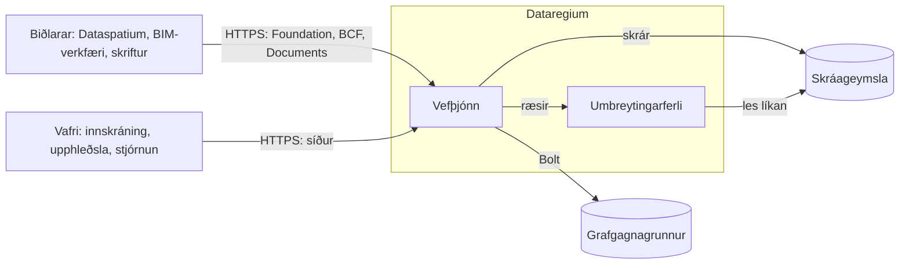

# Högun

Dataregium er einn vefþjónn fyrir framan einn grafgagnagrunn. Þessi síða sýnir hvernig
hlutarnir tengjast, hvað gerist við beiðni og hvar allt er í kóðanum. Lestu hana ef
þú vilt reka þjóninn af öryggi, breyta honum eða byggja ofan á hann. Orðin eru
útskýrð í [orðasafninu](glossary.md).

## Hlutarnir

| Hluti | Hvað hann gerir | Kóði |
|---|---|---|
| Foundation API | Segir hvaða API þjónninn býður, hvernig á að skrá sig inn og hver þú ert | `opencde/foundation/` |
| Innskráning | OAuth2 með PKCE, tókar, biðlarar, innskráningarsíðurnar og biðin eftir misheppnaðar tilraunir | `opencde/auth/`, `opencde/web/` |
| BCF API | Mál, athugasemdir, sjónarhorn, atburðir, tengd mál og skjöl verkefnis | `opencde/bcf/` |
| Documents API | Upphleðsla og val á síðum í vafranum, útgáfur og lýsigögn | `opencde/documents/` |
| Reikningar | Notendur, verkefni, aðild og hlutverk | `opencde/accounts/` |
| Geymslan | Eigin gögn þjónsins eftir sviðum: reikningar, OAuth2, BCF, Documents og verk, hvert þeirra geymsluklasi með sinni Cypher bak við samskiptareglu; aðskilið frá IFC-netinu, sem IFC-DB heldur | `opencde/store/` |
| Stjórnun | Síður og API fyrir stjórnendur, heilsufarsathuganir og beiðnaskráin | `opencde/admin/`, `opencde/requestlog.py` |
| IFC-DB | Gerir upphlaðin líkön að hnútum og tengir sjónarhornseiningar við þá | `opencde/ifcgraph/` |
| MCP-endapunkturinn | Verkfæri sem gervigreindarforrit lesa líkön verkefnanna í gegnum og leggja til, meðan manneskja samþykkir | `opencde/mcp/` |
| Graflagið | Rekillinn, gagnagrunnsmállýskurnar tvær, skemað og það sem rennur út | `opencde/graph/` |
| Síður | Sniðmát, stílar, skriftur og tungumálaskrárnar | `opencde/ui/` |

## Leið beiðni

1. uvicorn tekur við beiðninni. Hann trúir `X-Forwarded-For` aðeins frá milliþjónunum
   í `OPENCDE_TRUSTED_PROXIES`, svo að vistfang biðlarans er það rétta.
2. Millibúnaðurinn í `opencde/main.py` gefur beiðninni auðkenni, skráir hana án
   innihalds og tóka, takmarkar stærðina, svarar CORS og skilyrtum beiðnum, bætir við
   öryggishausum og beitir mörkum á fjölda beiðna.
3. Ákvæði leiðarinnar finna út hver spyr: bearer-tóki fyrir API
   (`opencde/auth/dependencies.py`), setukaka fyrir síðurnar
   (`opencde/web/dependencies.py`).
4. Geymsluklasi spyr grafið, eingöngu með færibreytum. Hver fyrirspurn um verkefnagögn
   byrjar í hnúti notandans og fer um `MEMBER_OF`, svo að það sem notandi á ekki aðild
   að er ekki til fyrir hann og svarið er 404.
5. Svarið fylgir skemunum í `spec/`, og allar villur hafa sama snið
   (`opencde/errors.py`).

## Hvar gögnin eru

| Hvað | Hvar | Lesa meira |
|---|---|---|
| Notendur, verkefni, mál, athugasemdir, sjónarhorn, lýsigögn skjala, biðlarar og endurskoðunarskráin | Grafgagnagrunnurinn | [Grafskema](graph-schema.md) |
| Tókar, kóðar og biðlaraleyndarmál sem SHA-256-tætigildi; lykilorð sem Argon2id-tætigildi | Grafgagnagrunnurinn | `tests/security/` |
| Upphlaðnar skrár og myndir sjónarhorna, undir nöfnum sem þjónninn velur | Skráageymslan í `OPENCDE_DATA_DIR` | [Documents API-ferli](flows/documents.md) |
| Líkön sem hnútar og tengsl | Grafgagnagrunnurinn | [IFC-DB](ifc-db.md) |
| Eigin stillingar og leyndarmál þjónsins | `.env` eða `/run/secrets` | [Staðbundin prófun](deploy/local.md) |

## Vinna utan beiðna

- Á hverri mínútu (`OPENCDE_CLEANUP_INTERVAL_SECONDS`) eyðir þjónninn því sem er
  útrunnið, svo sem kóðum, tókum, setum og ókláruðum upphleðslum, og tekur upp
  umbreytingar sem stöðvaður þjónn skildi eftir.
- IFC-umbreytingar keyra ein í einu í eigin ferli, með mörkum á tíma og minni, svo að
  gallað líkan getur ekki fellt þjóninn.
- Þegar beiðnaskráin er virk (`OPENCDE_REQUEST_LOG_ENABLED`) geymir skrifari beiðnirnar
  í grafinu í lotum og eyðir þeim gömlu.

## Öruggt frá upphafi

- Ekkert er opið fyrr en einhver opnar það: sjálfskráning biðlara, IFC-grafið,
  beiðnaskráin og graffyrirspurnir eru óvirk í upphafi.
- Í rekstri neitar þjónninn að ræsast án https og lykilorðs að gagnagrunni.
- Síðurnar hafa engar innfelldar skriftur eða stíla, hvert eyðublað hefur undirritaðan
  tóka og hver síða virkar án JavaScript.

Að baki hverri aðgerð hér er próf í `tests/security/`.

## Tveir gagnagrunnar

Þjónninn keyrir á Neo4j eða Memgraph með sama Cypher. Aðeins skemasetningarnar eru
ólíkar, og þær eru í `opencde/graph/dialect.py` ásamt listanum yfir föll sem kóðinn má
ekki nota.

## Svona er hann prófaður

| Mappa | Hvað hún sýnir | Hvenær hún keyrir |
|---|---|---|
| `tests/unit` | Föll og skjöl, án gagnagrunns | Við hvert push |
| `tests/conformance` | Leiðir og svör gagnvart skemunum í `spec/` | Við hvert push |
| `tests/security` | Hausar, tókar, mörk og að hver aðgerð krefjist tóka | Við hvert push |
| `tests/integration` | Allt gagnvart raunverulegum gagnagrunni í Docker | Við hvert push; einnig á Memgraph á hverri nóttu |
| `tests/ui` | Síðurnar í raunverulegum vafra, með aðgengisathugun | Við hvert push |
| `tests/e2e` | Biðlarasafnið gagnvart keyrandi þjóni, sjálfvirkt myndaðar beiðnir og endurræsing alls staflans | Við hvert push; löngu keyrslurnar á hverri nóttu |

## Lestu áfram

- [Fljótleg byrjun](quickstart.md): þjónninn og Dataspatium á þinni eigin tölvu.
- [Að smíða biðlara](client-guide.md): það sem biðlari þarf.
- [MCP-endapunkturinn](mcp.md): hvað gervigreindarforrit ná til, og hvernig.
- [Ferli](flows/oauth2.md): innskráning, [skjöl](flows/documents.md) og
  [BCF-sjónarhorn](flows/bcf-viewpoint.md) sem runurit.
