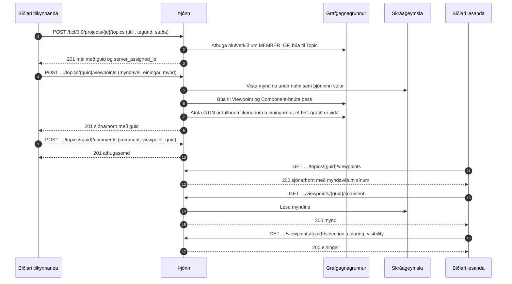

# BCF-sjónarhornsferlið

Hvernig biðlari stofnar mál með sýn á líkanið og hvernig einhver annar opnar sömu sýn.
Þetta er BCF API 3.0, kaflar 3.2 (mál) og 3.5 (sjónarhorn). Dæmið
[create_topic.py](../../examples/create_topic.py) gerir fyrri helminginn með
biðlarasafninu.



Sjónarhorni er ekki hægt að breyta. Það er búið til í heilu lagi og því eytt í heilu
lagi, svo að athugasemd sem vísar á það vísar áfram á það sama.

## Hvað sjónarhorn inniheldur

| Hluti | Hvað hann segir | Hvar biðlari les hann |
|---|---|---|
| Myndavél | Staðsetning, stefna og upp-vigur, fjarvídd eða hornrétt | Í sjónarhorninu |
| Línur og skurðarfletir | Hvað er teiknað í sýnina og hvað er skorið burt | Í sjónarhorninu |
| Val | Einingarnar sem eru valdar | `/selection` |
| Litun | Einingarnar sem hafa lit | `/coloring` |
| Sýnileiki | Hvað er sýnilegt í upphafi, og undantekningarnar | `/visibility` |
| Skyndimynd | Mynd af sýninni, PNG eða JPEG | `/snapshot` |
| Punktamyndir | Myndir settar í sýnina | `/bitmaps/{id}` |

## Hver má hvað

| Aðgerð | Krefst |
|---|---|
| Lesa mál, athugasemdir og sjónarhorn | Aðildar að verkefninu, í hvaða hlutverki sem er |
| Stofna mál | Aðgerðarinnar `createTopic`: contributor, editor eða manager |
| Bæta við sjónarhorni eða athugasemd | Aðgerðarinnar `createViewpoint` eða `createComment`: contributor, editor eða manager |
| Eyða sjónarhorni | Höfundur þess sem contributor; editor og manager eyða hvaða sjónarhorni sem er |

Verkefni sem notandinn á ekki aðild að er ekki til fyrir hann (404).

## Frá sjónarhorni til líkansins

Þegar [IFC-LPG](../ifc-lpg.md) er virkt fær hver eining sem nefnir `GlobalId` sem
fullbúin líkön verkefnisins hafa GTIN staksins sem `gtin`, einnig þegar líkanið er
hlaðið upp síðar; stakið sjálft finnst með `GlobalId` þess:

```cypher
MATCH (:Viewpoint {guid: $viewpoint})-[:HAS_COMPONENT]->(c:Component)
MATCH (e:IfcProduct {GlobalId: c.ifc_guid})
RETURN c.ifc_guid, e.Name, c.gtin
```
