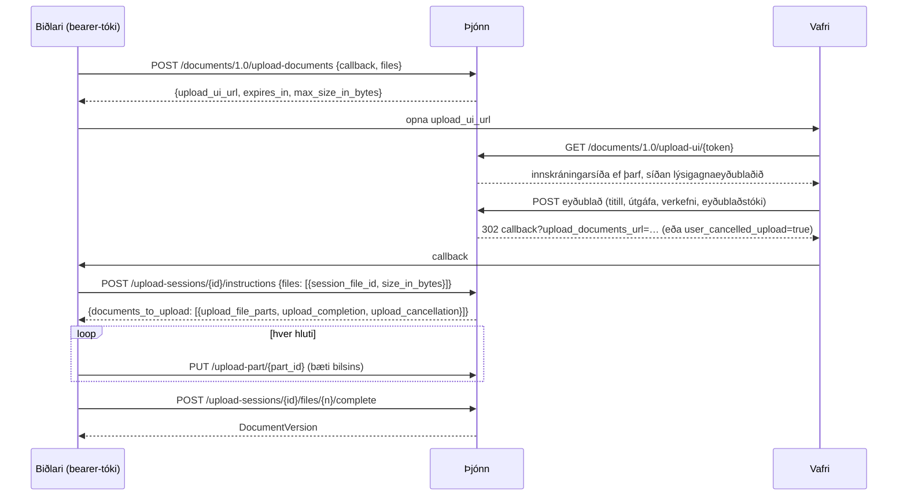
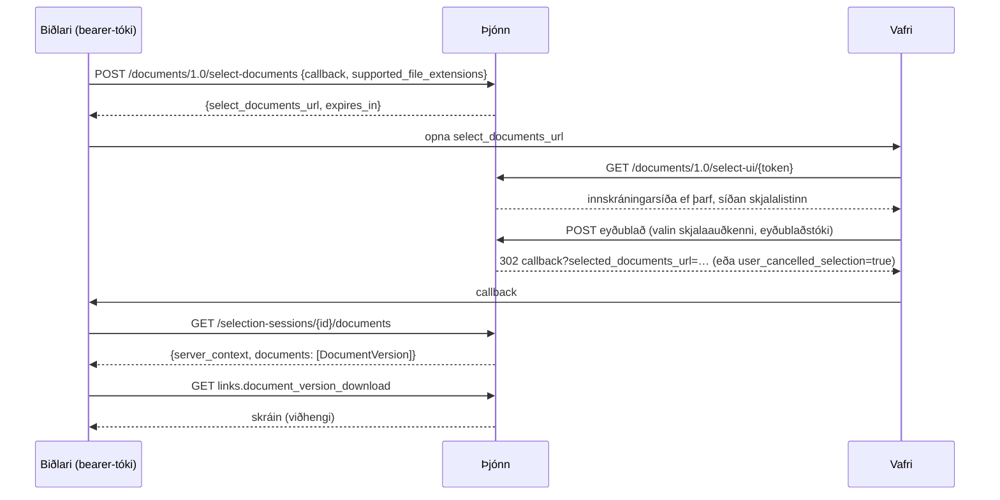

# Documents API-ferli

Documents API 1.0 er samtal þriggja aðila: biðlaraforritsins, þessa þjóns og
vafra notandans. Biðlarinn talar við forritaskilin með bearer-tóka; vafrinn
sýnir eigin síður þjónsins (innskráning, innsláttur lýsigagna, skjalaval);
þjónninn kallar aldrei á biðlarann, hann áframsendir aðeins vafranum á
callback-URL biðlarans.

## Upphal

* UI-tengillinn gildir í `OPENCDE_DOCUMENTS_SESSION_TTL_SECONDS` (10
  mínútur); þegar fyrirmæli hafa verið gefin út lifir setan
  `OPENCDE_UPLOAD_SESSION_TTL_SECONDS` (24 klukkustundir) svo hlaða megi upp
  stórum skrám.
* Hlutar eru `OPENCDE_UPLOAD_PART_BYTES` (50 MiB) hver, hlaðið upp í hvaða
  röð sem er, samhliða ef biðlarinn vill. Hluti þarf að vera nákvæmlega
  tilkynnta bilið.
* Lokun setur hlutana saman, sannreynir heildarstærðina, reiknar SHA-256 og
  býr til útgáfuna. Taki þetta meira en 15 sekúndur hefst svarið á bilum til
  að halda tengingunni opinni.
* `document_id` í skráarfærslu gerir upphalið að nýrri útgáfu þess skjals;
  titillinn helst, útgáfuvísirinn hækkar.
* `base_version_index` í skráarfærslu (viðbót) segir á hvaða útgáfu
  upphleðslan byggir: frágangurinn svarar `412 version_conflict` þegar skjalið
  hefur þegar nýrri, og lýsigögn útgáfunnar skrá grunninn.
* Verkefni getur hafnað skrám með sannprófunarvillum: frágangurinn svarar þá
  `422 ifc_validation_failed` með heimilisfangi skýrslunnar, og
  `POST …/projects/{id}/ifc-precheck` prófar skrá án þess að vista hana.
* Trúnaðarbiðlari sem kerfisstjóri hefur samþykkt til þess (*Má hlaða upp
  skjölum án vafrasíðunnar* á síðu biðlarans) hleður upp án síðunnar:
  `project_id` í beiðninni, með `title` og `version_number` á hverja skrá,
  sleppir síðunni, og leiðbeiningarnar eru strax á
  `upload-sessions/{id}/instructions`; hvert slíkt upphal er í
  endurskoðunarskránni. 403 fyrir hvern annan biðlara.

## Val og niðurhal

* Listinn sýnir nýjustu útgáfu hvers skjals í verkefnum notandans, síaðan
  eftir skráarendingum biðlarans með tenglinum „sýna allt“.
* Notendur með hlutverkið editor eða manager geta hlaðið upp skrá frá
  síðunni; hún birtist strax í listanum (þetta er viðbót við forskriftina).
* `POST /documents/1.0/document-versions` svarar með nýjustu útgáfum lista
  skjalaauðkenna með `ETag`; `If-None-Match` gefur `304`.

[Dataspatium](https://github.com/marwiss/Dataspatium) útfærir bæði ferlin úr
vafranum (`src/api/families/opencde.js`): það opnar valsíðu þjónsins í
sprettiglugga og flytur inn völdu skrárnar, og hleður upp gagnasöfnum, skrám
og vinnusvæðispökkum í hlutum með upphalssíðu þjónsins fyrir lýsigögnin;
lifandi svítur þess keyra þessi ferli gegn þróunarstaflanum.

## Hver má hvað

| Aðgerð | Þarf |
|---|---|
| Hefja upphal eða val | bearer-tóka með heimildinni `documents` |
| Nota vafrasíðurnar | vafrasetu sem sami notandi (`/signin`) |
| Vista lýsigögn, ljúka upphali, hlaða upp frá síðunni | verkefnisaðgerðina `createDocument` (editor, manager) |
| Sjá, velja og hala niður skjölum | aðild að verkefninu (hvaða hlutverk sem er) |

Skjöl annarra verkefna eru ekki til fyrir þann sem kallar (404), svo hvorki
auðkenni þeirra né tilvist leka.
