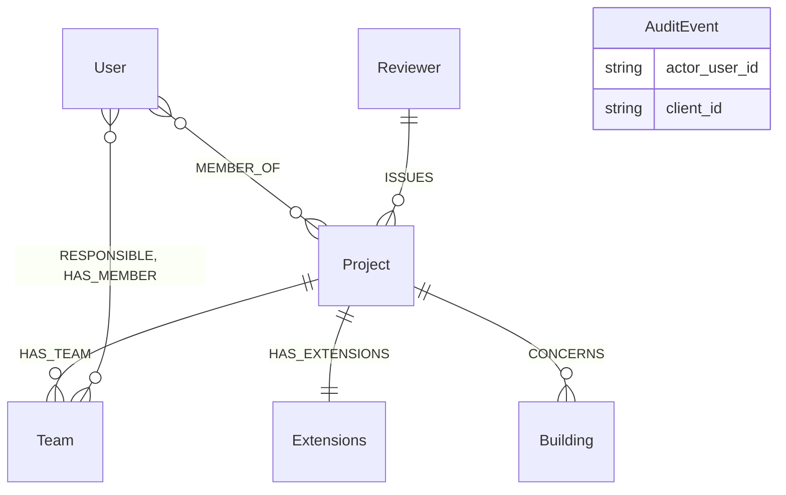
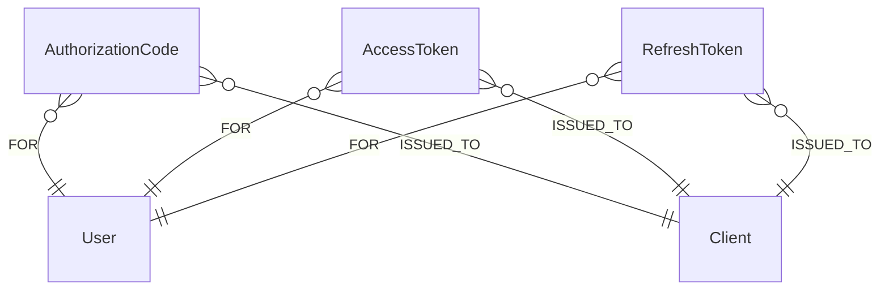
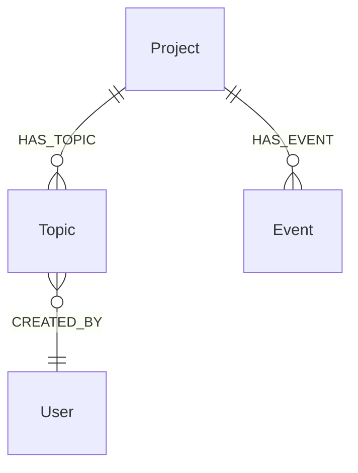
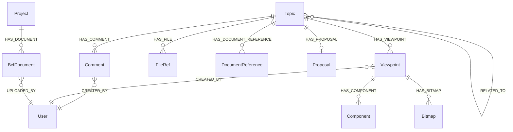
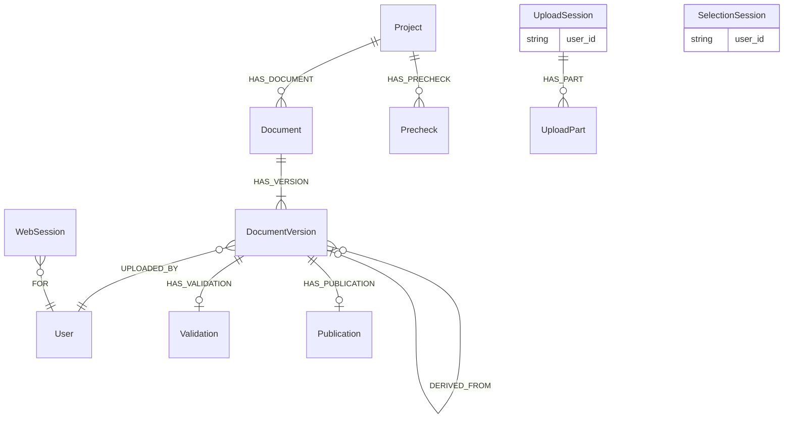
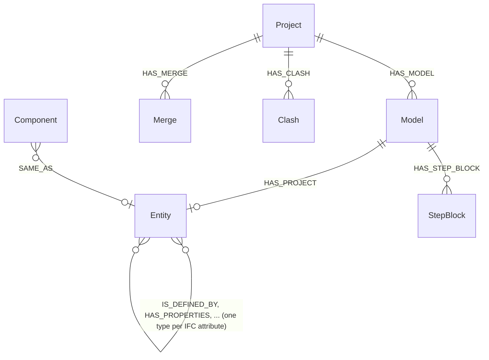

# Grafskema

Gagnagrunnurinn er skemalaus; `opencde/graph/schema.py` er skemað. Þessi síða
skýrir venjurnar og merkimiðana, kafla fyrir kafla í þeirri röð sem áfangar
áætlunarinnar bættu þeim við.

## Venjur

- Hver hnútur hefur UUID búið til af þjóninum í `id` (eða heiti
  forskriftarinnar á því: `project_id`, `guid`, `client_id`, `document_id`)
  með einkvæmnishömlu. Ekkert sem biðlari sendir endar óathugað í skráarslóð
  eða gagnagrunnslykli.
- Tímastimplar eru ISO 8601-strengir í UTC með millisekúndum og `Z`
  (`2026-11-05T12:34:56.789Z`). Strengjaröð jafngildir tímaröð.
- Hnit og vigrar eru venjulegar fleytitölur (`x`, `y`, `z`), aldrei `point()`.
- Allt sem rennur út ber `expires_at` (sama snið); þjónninn eyðir útrunnum
  hnútum á tímamæli (`opencde/graph/cleanup.py`).
- Leyndarmál (kóðar, tókar, biðlaraleyndarmál) eru aðeins geymd sem
  SHA-256-tætigildi.
- Cypher er mállýskuhlutlaust svo Neo4j og Memgraph hegði sér eins (ADR 0003).
  Skema-DDL er eini vöruháði textinn og er í `graph/dialect.py`.
- Heiti: merkimiðar eru skrifaðir í PascalCase (`DocumentVersion`,
  `Model`), venslagerðir með hástöfum og undirstrikum (`HAS_TOPIC`,
  `CREATED_BY`, og `IS_DEFINED_BY` fyrir IFC-eigindavenslin).
  Skýringarmyndirnar hér fyrir neðan teikna aðeins raunverulega hnúta og
  vensl; tilvísun sem er geymd sem eiginleiki (`AuditEvent.actor_user_id`,
  `UploadSession.user_id`) er talin upp í kassanum í stað þess að vera
  teiknuð sem lína.
- Merkimiði sem byrjar á `Ifc` er alltaf einn af flokkum IFC, eins og IFC-LPG
  skrifar þá; eigin færslur þjónsins (`Validation`, `Precheck`, `Proposal`,
  `Clash`, `Merge`) byrja aldrei þannig, svo að fyrirspurn geti greint IFC-gögn
  frá gögnum þjónsins sjálfs.

## Reikningar og aðgangur (áfangi 1)

| Merkimiði | Lykill | Eiginleikar | Athugasemdir |
|---|---|---|---|
| `User` | `id`, einkvæmt `username` | `email`, `full_name`, `password_hash` (Argon2id), `is_admin`, `disabled`, `created_at`, `must_change_password` | Notandanafnið er notandaauðkennið sem forritaskilin sýna |
| `MEMBER_OF` (vensl User → Project) | | `role` (viewer, contributor, editor, manager), `since` | Hlutverk varpast á `*_actions` BCF, sjá `accounts/roles.py` |
| `Project` | `project_id` | `name`, `created_at`, `topic_counter`, `block_on_validation_errors` | `topic_counter` númerar `server_assigned_id`; `block_on_validation_errors` hafnar upphölum með sannprófunarvillum (ADR 0021) |
| `Extensions` | `id` | `topic_type[]`, `topic_status[]`, `topic_label[]`, `snippet_type[]`, `priority[]`, `stage[]`, `custom_information[]` | `users[]` er reiknað úr meðlimum |
| `Team` | `id` | `name`, `ids_document_id`, `created_at`, `updated_at` | Teymi verkefnis (`HAS_TEAM`), með `RESPONSIBLE` og `HAS_MEMBER` til notenda; hluti þess í líkaninu er það sem forskriftir IDS-skjals þess eiga við. Eytt með verkefninu |
| `Client` | `client_id` | `name`, `description`, `url`, `redirect_uris[]`, `is_public`, `secret_hash`, `disabled`, `pending_approval`, `created_at`, `created_by`, `dynamic`, `expires_at` (aðeins sjálfskráðir) | OAuth2-biðlari; sjálfskráðum er eytt þegar `expires_at` er liðið án þess að tóki hafi verið gefinn út |
| `AuditEvent` | `id` | `type`, `at`, `actor_user_id`, `client_id`, `ip`, `details` (JSON-strengur) | Atburðir sem skipta máli fyrir öryggi |
| `Reviewer`, `Building` | `id` | `name`, `status` | Samhengi úr notkunartilviki eftirlitsáætlunarinnar (sýnigögn): yfirfarandi stofnunin (sveitarfélag í upprunalegu sögunni) og byggingin |

## OAuth2 (áfangi 2)

`AuthorizationCode`, `AccessToken` og `RefreshToken` (með `family_id`) eru
lykluð með tætigildi leyndarmálsins, bera `expires_at` og eru tengd
`-[:FOR]->(:User)` og `-[:ISSUED_TO]->(:Client)`. `WebSession`
(vafrainnskráning, áfangi 5) er aðeins tengd `-[:FOR]->(:User)`.

## BCF-mál og atburðir (áfangi 3)

| Merkimiði | Lykill | Eiginleikar | Athugasemdir |
|---|---|---|---|
| `Topic` | `guid` | `server_assigned_id`, `title`, `topic_type`, `topic_status`, `priority`, `stage`, `labels[]`, `reference_links[]`, `assigned_to`, `description`, `index`, `due_date`, `creation_date`, `creation_author`, `modified_date`, `modified_author`, `snippet_type`, `snippet_is_external`, `snippet_reference`, `snippet_reference_schema` | Sviðsheiti fylgja `topic_GET.json`; BIM snippet-hluturinn er flattur út í fjóra eiginleika. `server_assigned_id` er `<forskeyti><teljari>` úr `Project.topic_counter` |
| `Proposal` | `id` | `state`, `created_at`, `checked_at`, `base_document_id`, `base_version_index`, `change_count`, `applied`, `issue_count`, `error_count`, `truncated`, `ruleset`, `checks`, `report`, `storage_key`, `snippet_key`, `author`, `error` | Prófun breytingasetts máls á grunnútgáfu þess (ADR 0021); `report` geymir athugasemdirnar sem grunninn vantar, `storage_key` skrána sem breytingunum var beitt á, geymda fyrir samþykktina. Eytt með málinu |
| `Event` | `id` | `kind` (`topic` eða `comment`), `topic_guid`, `comment_guid`, `author`, `date`, `action_types[]`, `action_values[]` | Einn hnútur fyrir hverja beiðni sem breytti einhverju; tveir samsíða listar eru `actions`-fylkið í BCF 3.9/3.10. Tengt verkefninu svo atburðir lifi málið sitt |

Hver málafyrirspurn hefst í `User`-hnút þess sem kallar og fer um `MEMBER_OF`
að verkefninu áður en hún snertir mál, svo mál í verkefni sem sá sem kallar
er ekki meðlimur í er ekki til að því er forritaskilin varðar (404).

## BCF-athugasemdir, viewpoint og tilvísanir (áfangi 4)

| Merkimiði | Lykill | Eiginleikar | Athugasemdir |
|---|---|---|---|
| `Comment` | `guid` | `topic_guid`, `date`, `author`, `comment`, `viewpoint_guid`, `modified_date`, `modified_author` | `viewpoint_guid` þarf að nefna viewpoint sama máls |
| `Viewpoint` | `guid` | `index`, `author`, `creation_date`, `camera_kind`, `camera` (JSON), `lines` (JSON), `clipping_planes` (JSON), `snapshot_type`, `storage_key`, `has_components`, `default_visibility`, `has_hints`, `spaces_visible`, `space_boundaries_visible`, `openings_visible` | Óbreytanlegt. Rúmfræðin er JSON-texti: ógegnsær og eins í báðum gagnagrunnum |
| `Component` | `id` | `role` (`selection`, `coloring`, `exception`), `group_index`, `position`, `color`, `ifc_guid`, `originating_system`, `authoring_tool_id` | Einn hnútur fyrir hvert tilvik; IFC-grafið tengir `ifc_guid` við líkanseiningar (áfangi 9) |
| `Bitmap` | `guid` | `position`, `bitmap_type`, `storage_key`, `height`, `loc_*`, `nrm_*`, `up_*` | Myndabæti í geymslunni undir `bitmaps/<guid>.<gerð>` |
| `FileRef` | `id` | `position`, `ifc_project`, `ifc_spatial_structure_element`, `filename`, `date`, `reference` | Skrár í haus málsins (BCF 3.3) |
| `DocumentReference` | `guid` | `document_guid` eða `url`, `description`, `created_at` | Nákvæmlega eitt af markmiðunum tveimur |
| `BcfDocument` | `guid` | `filename`, `storage_key`, `size`, `created_at`, `author` | Skrá hlaðið upp um BCF 3.8; bæti undir `bcf-documents/<guid>` |
| `RELATED_TO` (vensl Topic → Topic) | | | Stefnt; PUT kemur í stað útleiðarlista máls |

Mál geyma snippet-skrá sína í `snippet_storage_key` (bæti undir
`snippets/<guid máls>.bin`). Að eyða máli eyðir öllu undir því og
geymslulyklunum sem safnað er úr hnútunum; atburðir haldast.

## Skjöl og vafrasetur (áfangi 5)

| Merkimiði | Lykill | Eiginleikar | Athugasemdir |
|---|---|---|---|
| `Document` | `document_id` | `title`, `created_at`, `latest_index` | `latest_index` númerar útgáfurnar |
| `DocumentVersion` | `id` | `version_index`, `version_number`, `creation_date`, `title`, `file_name`, `size_in_bytes`, `sha256`, `storage_key`, `author`, `metadata` (JSON), `parent_version_index`, `approved_by`, `change_set_id`, `change_set` | Bæti undir `documents/<id>`; meginmál forritaskilanna sýnir aðeins svið forskriftarinnar; `parent_version_index`, `approved_by`, `change_set_id` og `change_set` (breytingarnar, pakkaðar) á útgáfu sem byggir á annarri, tengd henni með `DERIVED_FROM` (ADR 0021) |
| `Validation` | `id` | `state`, `checked_at`, `issue_count`, `truncated`, `ruleset`, `report`, `storage_key`, `file_name`, `error` | Prófun upphalaðrar IFC-skrár gagnvart IFC-skemanu (ADR 0011); `report` er allt að 10.000 athugasemdir sem þjappað JSON. Eytt með verkefni útgáfunnar |
| `Publication` | `id` | `storage_key`, `file_name`, `size_in_bytes`, `sha256`, `published_at`, `published_by` | Þjöppuð skrá útgefinnar útgáfu, `.ifczip` eða `.zip`, undir `published/<id>`; ein fyrir hverja útgáfu. Eytt með verkefni útgáfunnar |
| `Precheck` | `id` | þau sömu og `Validation`, `project_id`, `author`, `expires_at` | Skrá sem var prófuð án þess að verða útgáfa, eða upphal sem verkefnið hafnaði (ADR 0021); ber líka merkimiðann `Validation`. Tiltektarverkið eyðir henni og skrá hennar eftir sólarhring |
| `UploadSession` | `id`, atriðaskráð `token_hash` | `user_id`, `username`, `callback_url`, `callback_expires_at`, `expires_at`, `server_context`, `project_id`, `state`, `files_json` | `id` kemur fyrir í URL forritaskilanna (bearer krafist); UI-URL ber tókann sem tætigildið er geymt fyrir |
| `UploadPart` | `id` | `file_index`, `part_index`, `range_start`, `range_end`, `received`, `storage_key`, `size`, `expires_at` | Bæti undir `parts/<id>` þar til skráin er sett saman; hreinsunarverkið eyðir útrunnum hlutum og skrám þeirra |
| `SelectionSession` | `id`, atriðaskráð `token_hash` | `user_id`, `callback_url`, `callback_expires_at`, `expires_at`, `server_context`, `extensions[]`, `state`, `selected[]` | `selected` geymir `document_id:version_index`-pör valin í vafranum |
| `WebSession` | `id` (tætigildi vefkökunnar) | `created_at`, `expires_at`, `idle_expires_at`, `ip` | Vafrainnskráning; `expires_at` er heildarlíftíminn |
| `SignInThrottle` | `key` (tætigildi notandanafnsins) | `failures`, `blocked_until`, `expires_at` | Misheppnaðar innskráningar á hvert notandanafn; rennur út sólarhring eftir síðustu villu, og vel heppnuð innskráning fjarlægir hann |

## IFC-graf (áfangi 9)

| Merkimiði | Lykill | Eiginleikar | Athugasemdir |
|---|---|---|---|
| `Model` | `id`, atriðaskráð `project_id` | `document_id`, `version_index` eða `bcf_document_guid`, `file_name`, `storage_key`, `state`, `schema`, `ifc_project_guid`, `entities`, `relationships`, `skipped`, `lossless`, `geometry`, `ifc_header`, `geometry_key`, `spatial_at`, `spatial_products`, `spatial_failed`, `spatial_error`, `error`, tímastimplar | Eitt fyrir hverja innflutta skrá; `state` er `queued`, `running`, `done` eða `failed` |
| `Entity` + flokkamerkimiðar | `id` (`<líkansauðkenni>:<step-auðkenni>`), atriðaskráð `GlobalId`, `model_id` | `ifc_class`, `step_id`, `bbox_min`, `bbox_max`, `bbox_centre` (punktar í verkefnishnitum, metrar, á byggingarhluta með lögun), hvert bókstaflegt IFC-eigindi með heiti | Vensl milli eininga eru nefnd eftir IFC-eigindinu (áfram og andhverft), skrifuð eins og hver venslagerð með hástöfum og undirstrikum: `IsDefinedBy` verður `IS_DEFINED_BY` |
| `StepBlock` | `id` (`<líkansauðkenni>:<fyrsta step-auðkenni>`) | `first_step`, `instances`, `text` | Tilvik í líkani sem var umbreytt með `OPENCDE_IFC_LPG_LOSSLESS` og eru ekki hnútar: skrifuð út sem STEP í röð auðkenna og þjöppuð. Skilaðu ekki hnútnum heilum í fyrirspurn, vegna `text` |
| `Merge` | `id` | `project_id`, `kind` (`merge` eða `prepare`), `state`, `request`, `author`, `created_at`, `running_at`, `finished_at`, `model_id`, `version_index`, `expires_at`, `report`, `error` | Bygging úr líkani B færð inn í líkan verkefnisins (`HAS_MERGE`); `request` nefnir báðar útgáfurnar, og `version_index` er útgáfan sem hún varð. Sameinaða líkanið er tekið úr netinu þegar það hefur verið skrifað út. Eytt með verkefninu |
| `Clash` | `id` | `project_id`, `state`, `request`, `author`, `created_at`, `running_at`, `done_at`, `failed_at`, `count`, `set_a`, `set_b`, `missing`, `seconds`, `truncated`, `report`, `error` | Árekstrarprófun milli tveggja skjalaútgáfna í verkefninu (`HAS_CLASH`; ADR 0019); `request` nefnir báðar útgáfurnar, haminn og vikmörkin, og `report` geymir pörin sem fundust sem þjappað JSON. Eytt með verkefninu |

Sjá [ifc-lpg.md](ifc-lpg.md) um umbreytingarreglurnar og dæmafyrirspurnir.
