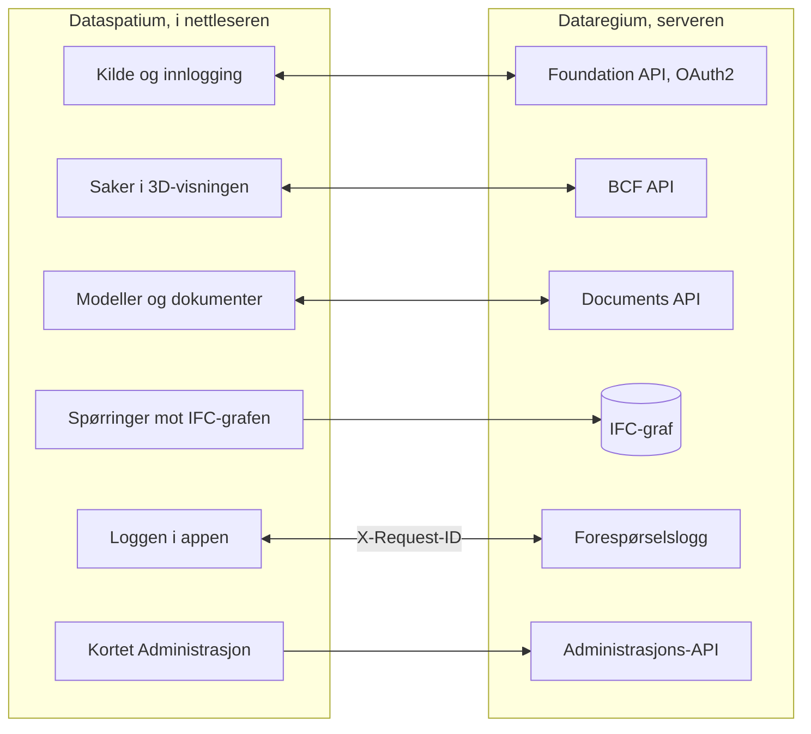

[Svenska](../../README.md) · [Dansk](../da/README.md) · **Norsk bokmål** · [Norsk nynorsk](../nn/README.md) · [Suomi](../fi/README.md) · [Íslenska](../is/README.md) · [English](../en/README.md)


# Dataregium OpenCDE-server

*Dataregium het Kontroll fram til 8. november 2026.*

Dataregium er en server for buildingSMARTs **OpenCDE-API-er** (Foundation API
1.0, BCF API 3.0 og 2.1 samt Documents API 1.0), bygget på en grafdatabase, med
webadministrasjon og en valgfri IFC-LPG-modul som knytter BCF-komponenter
til bygningsdelene de peker på. Den vokste fram av en forskningsprototyp fra
2023 for digitale kontrollplaner i svenske byggetillatelser og ble skrevet om
fra grunnen av med sikkerhet som første krav.
Klienter som følger spesifikasjonene, skal kunne koble seg til, så serveren
ikke er bundet til ett bestemt program.


**Innhold**

- [Last ned og kom i gang](#last-ned-og-kom-i-gang)
- [Hva som kreves](#hva-som-kreves)
- [Hva du kan gjøre](#hva-du-kan-gjøre)
- [OpenCDE-API-ene og klientene deres](#opencde-api-ene-og-klientene-deres)
- [Dataregium og Dataspatium](#dataregium-og-dataspatium)
- [Lær mer](#lær-mer)
- [Begrensninger i korte trekk](#begrensninger-i-korte-trekk)
- [Personopplysninger](#personopplysninger)
- [Det neste i 3-serien](#det-neste-i-3-serien)
- [Feil og forslag](#feil-og-forslag)
- [Utvikling](#utvikling)
- [Lisens](#lisens)

## Last ned og kom i gang

### Hurtigstart (lokalt, Docker eller Podman)

1. **Last ned.** Klon repoet, eller hent det publiserte imaget
   `ghcr.io/marwiss/opencdeserver` (flere arkitekturer, skannet og med SBOM
   ved hver utgivelse):

   ```sh
   git clone https://github.com/marwiss/Dataregium.git
   cd Dataregium
   ```

2. **Konfigurer.** Kopier `.env.example` til `.env` og sett
   `OPENCDE_GRAPH_PASSWORD` (minst 16 tegn). Hver innstilling forklares i
   [.env.example](../../.env.example).
3. **Start.** De samme compose-filene virker med Docker og med Podman; velg den du har:

   <details open>
   <summary><b>Docker</b></summary>

   ```sh
   docker compose up -d --build
   ```

   starter serveren på <http://127.0.0.1:8000> og en Neo4j-database; `docker compose logs -f api` viser serverloggen.

   </details>

   <details>
   <summary><b>Podman</b></summary>

   ```sh
   podman compose up -d --build
   ```

   gjør det samme med Podman 5 (rootless, uten daemon); `podman compose logs -f api` viser serverloggen. Se [docs/nb/deploy/local.md](deploy/local.md) for det som er særegent for Podman.

   </details>

   <details>
   <summary><b>Uten container</b></summary>

   ```sh
   uv sync                          # installerer Python 3.13 og alle avhengigheter
   uv run opencde doctor            # kontrollerer konfigurasjon og database
   uv run opencde serve             # http://127.0.0.1:8000
   ```

   kjører serveren fra utsjekkingen med [uv](https://docs.astral.sh/uv/); en database trengs fortsatt (Neo4j Desktop, Memgraph Lab eller databasen fra compose-filene).

   </details>

4. **Se deg rundt.** <http://127.0.0.1:8000/docs> er den interaktive
   API-dokumentasjonen, <http://127.0.0.1:8000/readyz> beredskapskontrollen
   og <http://127.0.0.1:7484> Neo4j Browser (Bolt på `127.0.0.1:7697`;
   utviklingsoverlegget unngår Neo4js standardporter, som ofte er opptatt av
   en annen Neo4j på samme maskin).
5. **Legg inn demodata og logg inn.**

   <details open>
   <summary><b>Docker</b></summary>

   ```sh
   docker compose exec api opencde seed
   ```

   </details>

   <details>
   <summary><b>Podman</b></summary>

   ```sh
   podman compose exec api opencde seed
   ```

   </details>

   <details>
   <summary><b>Uten container</b></summary>

   ```sh
   uv run opencde seed
   ```

   </details>

   Kommandoen oppretter demobrukere og prosjekter og skriver ut passordene deres én gang. Logg inn på <http://127.0.0.1:8000/signin> som `admin` og åpne `/admin`.
6. **Koble til en klient.** Registrer appen din under *Klienter* (eller la
   den registrere seg selv når `OPENCDE_DYNAMIC_CLIENT_REGISTRATION=true`) og
   pek den mot `http://127.0.0.1:8000`; [Dataspatium](#dataregium-og-dataspatium)
   og Python-biblioteket i [client/](../../client/) er ferdige klienter.
   Skal du logge inn fra Dataspatium, følg [hurtigstarten](quickstart.md): den tar for
   seg alle innstillingene som trengs, og hva du gjør hvis noe går galt.

### Utrulling

Én compose-fil pluss ett overlegg per scenario:

| Scenario | Veiledning |
|---|---|
| Lokal test på egen maskin | [docs/nb/deploy/local.md](deploy/local.md) |
| Offentlig https-adresse for klienttester uten egen server (tunnel) | [docs/nb/deploy/tunnel.md](deploy/tunnel.md) |
| Produksjon på egen server med Caddy (automatisk TLS) og nattlige sikkerhetskopier | [docs/nb/deploy/vps-caddy.md](deploy/vps-caddy.md) |
| Coolify, Dokploy, Portainer | [docs/nb/deploy/paas.md](deploy/paas.md) |
| Containertjeneste pluss administrert Neo4j AuraDB eller Memgraph Cloud | [docs/nb/deploy/cloud-aura.md](deploy/cloud-aura.md) |
| Sikkerhetskopiering og gjenoppretting (flyttbar mellom Neo4j og Memgraph) | [docs/nb/deploy/backup.md](deploy/backup.md) |

`uv run opencde init --public-url https://cde.example.org` skriver en
produksjons-`.env` med nye hemmeligheter; `opencde doctor` kontrollerer
resultatet.

### Konfigurasjon

Alt leses fra miljøvariabler med prefikset `OPENCDE_`, fra `.env` eller fra
Docker-hemmeligheter i `/run/secrets/opencde_<navn>`. Den kommenterte listen
finnes i [.env.example](../../.env.example). Standardverdiene er trygge:
produksjon nekter å starte uten en offentlig `https`-adresse og et
databasepassord, og ingenting er åpent før det er konfigurert.

## Hva som kreves

- Windows, macOS eller Linux med Docker (Desktop på Windows/macOS, Engine på
  Linux), eller Python 3.11 eller nyere med [uv](https://docs.astral.sh/uv/)
  og en egen Neo4j 5.26- eller Memgraph 3.14-database.
- Omtrent 1 GB minne til databasecontaineren (`NEO4J_HEAP` og
  `NEO4J_PAGECACHE` i `.env`), mer med IFC-LPG-modulen.
- Lokalt: port 8000 for serveren og 7484/7697 for databasen, alle bundet til
  `127.0.0.1`. I produksjon: portene 80 og 443 nåbare fra internett og et
  DNS-navn for serveren.
- Klienter trenger en `https`-adresse i produksjon; lokalt godtas
  `http://127.0.0.1` som redirect-URI, og `http://localhost` med `OPENCDE_ALLOW_LOCALHOST_REDIRECTS=true`.

## Hva du kan gjøre

Det som virker i én versjon, virker også i den neste, så listen begynner med
versjon 1, og hver versjon etter den legger til. Hver versjon av Dataregium
hører sammen med den samme versjonen av Dataspatium.

### Versjon 1 (med Dataspatium 1)

- **Foundation API 1.0**: tjenesteoppdagelse, OAuth2 authorization code med
  PKCE, gjeldende bruker, tilbakekalling av tokens og
  dynamisk klientregistrering med offentlige klienter (av som standard).
- **Documents API 1.0**: valg og nedlasting av dokumenter, opplasting i deler
  med serverens websider for metadata og valg, versjonsspørringer med ETag.
- **Administrasjon** i nettleseren: logg inn på `/signin` med en
  administratorkonto og åpne `/admin` for å administrere brukere og
  prosjektrollene deres, prosjekter og BCF-extension-verdiene deres,
  OAuth2-klienter, sesjoner, revisjonsloggen, den valgfrie forespørselsloggen
  og serverens helsekontroller. Hver bruker har `/account` for eget passord,
  egne apper og egne sesjoner. Kommandolinjen (`uv run opencde --help`) gjør
  det samme fra en terminal.
- **Tillegg utenfor spesifikasjonene**, hvert merket som det: et
  kapabilitetsdokument på `/.well-known/dataregium` som forteller klienten
  hvilke tillegg som er slått på, en stabil `code` i hver feilkropp og en
  forespørselslogg for feilsøking av klienter (`/admin/requests`,
  `GET /admin/api/requests` med scopet `admin`).
- **Et klientbibliotek** i Python ([client/](../../client/), LGPL) med
  kjørbare eksempler, samt Dockerfile, compose-overlegg og et publisert image
  for hvert utrullingsscenario.

### Også i versjon 2 (med Dataspatium 2)

- **BCF API 3.0 og 2.1**: prosjekter, extensions, saker med OData-spørringer,
  kommentarer, viewpoints med snapshots, bitmaps og komponenter, filer,
  dokumentreferanser, dokumenter og hendelsesloggene, alt validert mot
  buildingSMARTs skjemaer.
- **IFC-LPG-modulen**, valgfri: hver opplastet IFC-modell blir grafdata, og
  komponentene i et BCF-viewpoint knyttes til bygningsdelene de peker på.

### Også i versjon 3 (med Dataspatium 3)

- **En tapsfri IFC-graf** fra IFC-LPG, et eget bibliotek: hele modellen tas vare
  på, slik at filen kan skrives tilbake slik den kom.
- **Kontrollerte opplastinger**: hver IFC-opplasting kontrolleres mot
  IFC-skjemaet, buildingSMARTs regler og prosjektets IDS-dokumenter; et prosjekt
  kan avvise filer med feil, og en fil kan kontrolleres før den blir en versjon.
- **Spørsmål til modellen** for medlemmer: navngitte spørringer mot grafen til
  en versjon, hva som er endret siden en versjon, forskjellen mellom to
  versjoner bygningsdel for bygningsdel og kollisjonskontroll mellom to
  versjoner.
- **Endringer som forslag**: en opplasting oppgir hvilken versjon den bygger på;
  en endring av en modell reiser som et endringssett i en BCF-sak, prøves mot
  sin base, og en `manager` godkjenner den til neste versjon, slått sammen med
  det som kom imellom.
- **Den lokale motoren og arbeidskopien**: serveren på en persons egen
  datamaskin bak Dataspatium, bare på loopback, og hovedmodellen til hvert
  dokument i minnet i Memgraph, for modeller større enn en nettleser rommer.
- **Opplasting uten nettsiden** for konfidensielle klienter som en administrator
  har godkjent.

**Status**: alle elleve etappene i planen er gjennomført (de tre API-ene,
administrasjonen, klientbiblioteket, utrulling, IFC-LPG,
akseptansesjekklisten og sikkerhetsherdingen); et bidrag av serveren til IfcOpenShell
er ennå ikke foreslått.


## OpenCDE-API-ene og klientene deres

OpenCDE er buildingSMART Internationals familie av åpne web-API-er for et felles
datamiljø, stedet der et prosjekt deler modeller, dokumenter og saker. En klient og en
server som følger de samme spesifikasjonene, kan arbeide sammen, uansett hvem som har
bygget dem. Dataregium implementerer alle tre:

| API | Hva det er til | Spesifikasjon |
|---|---|---|
| Foundation API 1.0 | Sier hvilke API-er en server tilbyr, hvordan man logger inn, og hvem brukeren er | [foundation-API](https://github.com/buildingSMART/foundation-API) |
| BCF API 3.0 og 2.1 | Saker om en modell, med kommentarer og viewpoints med kamera, komponenter og bilder | [BCF-API](https://github.com/buildingSMART/BCF-API) |
| Documents API 1.0 | Å velge, hente og laste opp dokumenter og versjonene deres, via sider på serveren | [documents-API](https://github.com/buildingSMART/documents-API) |

**Dataspatium er én klient, ikke den eneste.** Enhver klient som følger disse
spesifikasjonene, skal kunne koble seg til: ingenting på serveren er avhengig av
Dataspatium, og utvidelsene utenfor spesifikasjonene er valgfrie, så en klient som ikke
kjenner dem, merker dem ikke. En klient trenger tre ting:

- en registrering på serveren, gjort av en administrator under *Klienter* eller av klienten
  selv når `OPENCDE_DYNAMIC_CLIENT_REGISTRATION=true`;
- OAuth2 authorization code med PKCE `S256`, som serveren krever av hver klient unntatt en konfidensiell som en administrator har merket;
- BCF API 3.0, eller 2.1 for en klient som bare kan den versjonen. `GET /foundation/versions` lister begge, og
  [klientguiden](client-guide.md) forteller hva som skiller dem.

Så langt er det vist: serverens svar testes mot buildingSMARTs skjemaer ved hver push,
og Dataspatium og Python-biblioteket i [client/](../../client/) kjører mot serveren. Uavhengige
klienter som Bonsai og ifc-lite har en ferdig sjekkliste som ennå ikke er kjørt. Hvis du prøver en klient, fortell
hvordan det gikk under [Feil og forslag](#feil-og-forslag). Når en klient og en spesifikasjon ikke
stemmer overens, avgjør spesifikasjonen. [docs/nb/client-guide.md](client-guide.md) er for dem som bygger en
klient.

## Dataregium og Dataspatium

Dataregium (serveren) og [Dataspatium](https://github.com/marwiss/Dataspatium)
(en dataapp som kjører helt i nettleseren) er utviklet for å virke sammen som
server og klient, og samme utgivelsesnummer på begge betyr at de virker
sammen: Dataspatium 3.0.0 virker med Dataregium 3.0.0
([hurtigstart](quickstart.md)). Dataspatium legger til
en Dataregium-server som kilde: appen oppdager API-ene gjennom
`/foundation/versions`, logger inn med OAuth2 authorization code og PKCE og
registrerer seg selv som offentlig klient når dynamisk registrering er slått
på, lister prosjektets modeller og dokumenter, leser og skriver BCF-saker med
kommentarer og viewpoints tatt fra 3D-visningen sin, laster opp datasett,
filer og arbeidsområdepakker gjennom Documents API, spør IFC-grafen med
Cypher over Bolt når operatøren eksponerer den, og sender `X-Request-ID` på
hvert kall slik at forespørselsloggen her og loggen i appen viser samme
samtale. Appen leser serverens kapabilitetsdokument for å se hvilke tillegg
som er slått på, og reagerer på feilkodene serveren legger i feilkroppene
sine.

Slik henger de sammen:



Bortsett fra de merkede tilleggene går alt Dataspatium gjør mot serveren
gjennom de tre OpenCDE-API-ene, så appen bruker ingenting en annen klient
ikke kan bruke, se [OpenCDE-API-ene og klientene deres](#opencde-api-ene-og-klientene-deres). De to produktene installeres hver
for seg: dette repoet bunter ikke Dataspatium (lisensene er forskjellige, AGPL
her og PolyForm Strict der), og Dataspatiums README beskriver hvordan appen
hentes. Klientsiden beskrives i Dataspatiums README og dokumentasjonen der.

### Utgivelsene 1, 2 og 3

Hvert hovednummer er én utgivelse som gis ut igjen etter hvert som den vokser,
og det samme nummeret av Dataspatium hører til den. De tre skiller seg slik:

- **1.0.0** er en dokumentserver: Foundation API 1.0 (versjoner, innlogging med
  OAuth2 og PKCE, gjeldende bruker, selvregistrering av klienter når operatøren
  tillater det) og Documents API 1.0 (velge, laste opp og hente dokumenter og
  versjonene deres), med webadministrasjonen på sju språk og forespørselsloggen.
  Det er 2.0.0-koden med bare Documents API slått på (`OPENCDE_APIS`), for
  Dataspatium 1.
- **2.0.0** legger til BCF API 3.0 og 2.1 på de samme dataene (saker,
  kommentarer, viewpoints, dokumenter) og den valgfrie IFC-LPG-modulen som lager
  en graf av hver opplastet IFC-fil, for Dataspatium 2.
- **3.0.0** gjør grafen tapsfri slik at filen kan skrives tilbake, kontrollerer
  hver opplasting mot IFC-skjemaet, buildingSMARTs regler og prosjektets
  IDS-dokumenter, gir medlemmer navngitte spørringer, kollisjonskontroll mellom
  to versjoner, basisversjon ved opplasting, en sperre mot valideringsfeil med
  forhåndskontroll, og endringssett som prøves og godkjennes til nye versjoner,
  for Dataspatium 3. IFC-LPG er et eget bibliotek.

## Lær mer

- [docs/nb/quickstart.md](quickstart.md): Dataregium og Dataspatium sammen på tjue
  minutter, fra en tom maskin til en sak opprettet i 3D-visningen.
- [docs/nb/client-guide.md](client-guide.md) og [docs/examples/](../examples/):
  hvordan bygge en klient, kapabilitetsdokumentet, feilkodene og kjørbare
  eksempler med Python-biblioteket i [client/](../../client/).
- [docs/nb/architecture.md](architecture.md): hvordan delene henger sammen, hva som skjer med en forespørsel, og hvor alt finnes i koden.
- [docs/nb/glossary.md](glossary.md): ordene dokumentasjonen bruker.
- [docs/nb/flows/](flows/): sekvensdiagrammer for OAuth2-, Documents API- og BCF-viewpoint-flytene.
- [docs/nb/graph-schema.md](graph-schema.md): grafmodellen.
- [docs/nb/ifc-lpg.md](ifc-lpg.md): den valgfrie IFC-LPG-modulen og eksempler på Cypher-spørringer.
- Arkitekturbeslutninger som ligger fast: grafdatabase som eneste lager, opake
  tokener i stedet for JWT, portabel Cypher for Neo4j og Memgraph, webgrensesnitt
  uten rammeverk, sikkerhetskopi på applikasjonsnivå, BCF API 2.1 ved siden av
  3.0, en tapsfri IFC-graf som selv leser og skriver STEP og valideres når den
  skrives, buildingSMARTs regler i et eget miljø, IFC-LPG som bibliotek,
  kontroll mot prosjektets IDS og navngitte spørringer for medlemmer.
- [spec/SOURCES.md](../../spec/SOURCES.md): de nøyaktige
  spesifikasjonsversjonene serveren testes mot.

Dokumentasjonen finnes på denne READMEens sju språk, hvert språk under
`docs/<språk>/`; engelsk under `docs/en/` er kilden. CONTRIBUTING er på engelsk.

### Videre lesning

- [BCF API](https://github.com/buildingSMART/BCF-API), [Foundation API](https://github.com/buildingSMART/foundation-API) og [Documents API](https://github.com/buildingSMART/documents-API):
  spesifikasjonene serveren følger.
- [IFC](https://github.com/buildingSMART/IFC4.x-development): filformatet for bygningsmodeller, og [IDS](https://github.com/buildingSMART/IDS): kravspesifikasjoner som modeller kontrolleres mot.
- [RFC 9700](https://www.rfc-editor.org/rfc/rfc9700): dagens beste praksis for sikkerhet i OAuth 2.0, og
  [OAuth 2.1](https://datatracker.ietf.org/doc/draft-ietf-oauth-v2-1/), utkastet som samler den.
- [RFC 7636](https://www.rfc-editor.org/rfc/rfc7636) (PKCE), [RFC 8252](https://www.rfc-editor.org/rfc/rfc8252) (apper på datamaskin eller telefon) og
  [RFC 7591](https://www.rfc-editor.org/rfc/rfc7591) (registrering av klienter).
- [OWASP ASVS](https://owasp.org/www-project-application-security-verification-standard/): sjekklisten for sikkerhetsarbeidet.

## Begrensninger i korte trekk

- Serveren implementerer BCF API 3.0 og 2.1, ikke 1.0, der ressursene ser annerledes ut.
- Eksport av et prosjekt som BCFzip overlates til klientene; serveren lagrer
  saker, kommentarer og viewpoints slik API-et definerer dem.
- Community-utgavene av Neo4j og Memgraph har ingen skrivebeskyttede
  databasebrukere, så en eksponert Bolt-port gir full tilgang til den som
  har passordet. Porten forblir lukket med mindre administratoren bevisst
  publiserer den; administrasjons-API-ets lesende grafspørring
  (`OPENCDE_GRAPH_QUERY_ENABLED`) gir Cypher uten porten.
- IFC-LPG-importen kjører i en egen prosess med minne- og tidsgrenser
  (`OPENCDE_IFC_LPG_*`); svært store modeller avvises i stedet for å bli
  liggende halvt importert.
- Websidene er for administratorer og for OAuth2- og Documents API-flytene;
  sluttbrukere arbeider i en klient som Dataspatium eller Bonsai.
- Sidene finnes på denne READMEens sju språk (bytt nederst på hver side);
  kommandolinjen og API-enes feilmeldinger er på engelsk.
- Ingen ekstern revisjon ennå. OAuch- og testssl-kjøringene er
  operatørens steg før en produksjonsutrulling.

## Personopplysninger

Den som driver Dataregium for andre, er behandlingsansvarlig for disse dataene.
Serveren lagrer brukerkontoer (brukernavn, navn, valgfri e-post, passordhash),
prosjektmedlemskap, saker og kommentarer med forfatternes navn, opplastede filer
med opplaster, IFC-grafen med filens eierhistorikk og en revisjonslogg over hvem
som gjorde hva og fra hvilken adresse. Passord, tokener og hemmeligheter lagres
bare som hasher. Tokener, økter, opplastingsøkter og ubrukte selvregistrerte
klienter utløper og ryddes av serveren; revisjonsloggen beskjæres av operatøren.
En administrator sletter en konto under `/admin/users`, og øktene og tokenene
følger med; navnet blir stående på sakene personen skrev til de slettes.
Revisjonsloggen eksporteres som CSV, BCF- og dokumentdata gjennom API-ene og
hele databasen med `opencde backup`. Hva Dataspatium lagrer i nettleseren, står
i appens egen dokumentasjon.

## Det neste i 3-serien

3.0.0 er 3-seriens første utgivelse, laget sammen med Dataspatium 3.0.0:
IFC-grafen som en tapsfri modell, kontrollen av hver opplasting og de navngitte
spørringene, slik [Hva du kan gjøre](#hva-du-kan-gjøre) beskriver. Siden
2026-11-10 rommer den også kollisjonskontrollen mellom to versjoner,
basisversjonen ved opplasting, avvisningen av opplastinger med valideringsfeil
og forhåndskontrollen av en fil. Som hvert hovednummer har serien én utgivelse,
som gis ut igjen etter hvert som den vokser. Det som følger, gjør grafen til en
modell som kan redigeres og versjonshåndteres i databasen, med Dataspatium som
klienten som redigerer den og viser versjonene. De offisielle OpenCDE-API-ene
forblir slik buildingSMART definerer dem; det serien legger til, er utvidelser
av dem under egne navn. Denne delen sier hva som er besluttet, for den, menneske
eller AI-agent, som fører en del av det videre. Beslutningene står i korte trekk
under [Lær mer](#lær-mer), arbeidsmåtene i
[CONTRIBUTING.md](../../CONTRIBUTING.md) og IFC-grafen i
[docs/nb/ifc-lpg.md](ifc-lpg.md).

### Besluttet

- **Redigering av modeller i Native IFC.** Create er opplastingen og Read de
  navngitte spørringene, begge i 3.0.0. Update er en endring som en klient
  foreslår gjennom API-et, og som prøves før den føres inn. Delete fjerner
  valgte deler av grafen: en entitet, en bygning eller et prosjekt. Export
  skriver STEP tilbake, som nå.
- **Versjonshistorikk i databasen, ikke i git**, i samme ånd som Bruno Postles
  [ifcmerge](https://github.com/brunopostle/ifcmerge): hva som ble endret, hvem
  som foreslo det, og hvem som godkjente det. Dataene må holde seg til IFC,
  ifc-gherkin-rules og prosjektets IDS ved import og etter hver endring.
- **BIM-snippets som en fungerende demonstrasjon.** En foreslått endring reiser
  som `bim_snippet` i en BCF 3.0-sak, med et publisert skjema bak dens
  `reference_schema`, så endringen, diskusjonen og beslutningen er på ett sted.
  Ingen programvare bruker en snippet i dag, og buildingSMARTs uutgitte
  utviklingsgrener har fjernet dem; Dataregium bygger dem for å vise hvordan de
  kunne virke. En snippet peker ut det den endrer med GlobalId og en
  sti derfra, og med STEP-id bare der ingen GlobalId når. STEP-id-en når alltid en instans; GlobalId og sti
  nådde 98 til 100 prosent av instansene i 28 prøvefiler, med steg tilbake
  gjennom inverse attributter.
- **Utvidelser, ikke nye versjoner av API-ene.** BCF-saker med `bim_snippet`,
  Documents API-ets metadata og versjoner og kapabilitetsdokumentet bærer det
  serien legger til, beskrevet av en egen OpenAPI.
- **Kollisjonskontroll begge steder**: på serveren med IfcOpenShells IfcClash og
  i Dataspatium med den egne kjernen i JavaScript.
- **Administrasjon av et prosjekt av prosjektlederen**, som ikke trenger å være
  serveradministrator, og team med ansvar utover prosjektrollene.
- **Hvordan en versjon lagres** (besluttet 2026-11-10). Hver godkjent versjon
  er en node med forelder, forfatter, godkjenner og endringer per GlobalId,
  sti og attributt; grafen holder hovedversjonen; en versjon lagres som endringen sin,
  med en hel fil, som `.ifczip`, bare når den publiseres, og hvilken som helst
  versjon skrives på forespørsel; to endringer slås sammen attributt for
  attributt, slik ifcmerge gjør, og en endring føres inn når filen som skrives
  fra den, ikke har noen anmerkning som versjonen før den manglet. I 3.0.0:
  basisversjonen ved opplasting (`412` ved konflikt), avvisningen av
  opplastinger med valideringsfeil og forhåndskontrollen av en fil.
  Versjonsnodene og sammenslåingen kommer deretter.
- **Hvem som får endre hva** (besluttet). Prosjektrollene først: `editor`
  foreslår, `manager` godkjenner, og en AI foreslår bare. Ansvarsregler som
  peker ut en del av modellen med IDS-utvalg som klasse, egenskap,
  klassifikasjon eller etasje, slik ISO 19650s ansvarlige team gjør, kommer
  senere.
- **Snippetens detaljer** (besluttet). En sti skrives med IFCs attributtnavn
  med indekser, fra en GlobalId, med STEP-id bare der ingen GlobalId når; en endring av en
  instans som flere deler, endrer den for alle, og en egen kopi må bes om; hver
  endring bærer hvem som foreslo den, og hvilken AI-modell og hvilket
  verktøykall, der en AI gjorde det.

## Feil og forslag

Rapporter feil og ønsker som *Issues* her på GitHub. Oppgi hvilken
serverversjon du kjører (`version` i `/.well-known/dataregium` eller
`/healthz`), hvilken klient du brukte og `X-Request-ID` for et mislykket
kall; forespørselsloggen og klientens logg deler den. Legg ikke ved
personopplysninger eller hemmeligheter. Hvordan endringer tas imot står i
[CONTRIBUTING.md](../../CONTRIBUTING.md). Ved en sikkerhetssårbarhet, følg
[SECURITY.md](../../SECURITY.md) i stedet for å åpne en sak.

## Utvikling

```sh
uv run pytest                    # enhets-, konformans- og sikkerhetstester
uv run pytest -m integration     # starter Neo4j/Memgraph med testcontainers (krever Docker)
uv run pytest -m e2e             # klientbiblioteket mot en kjørende server (krever Docker)
uv run pytest -m ui              # Playwright + axe-core (uv sync --group ui; playwright install chromium)
uv run ruff format . && uv run ruff check .
uv run ty check opencde client/opencde_client
```

Kode og kommentarer er på engelsk, og stilen følger IfcOpenShells
konvensjoner (ruff, 120 kolonner), slik at det forblir mulig å bidra med
serveren til IfcOpenShell.
README finnes på engelsk, svensk, dansk, norsk (bokmål og nynorsk), finsk og
islandsk (`docs/<språk>/README.md`, samme oppsett som Dataspatium);
dokumentasjonen og webgrensesnittet finnes på de samme språkene, med
engelsk alltid som et valg, og felles termer følger Dataspatiums ordliste.
Hvert push kjører lint, typekontroll, testsuitene på tre Python-versjoner,
nettlesertester med axe-core og statiske sikkerhetskontroller; nattlige
jobber kjører OWASP ZAP, Schemathesis og Trivy. Se
[CONTRIBUTING.md](../../CONTRIBUTING.md).

## Lisens

Serveren er lisensiert under GNU Affero General Public License v3.0 eller
senere ([LICENSE](../../LICENSE)): den er serverprogramvare, og AGPLs
nettverksklausul holder forbedringer av driftssatte instanser åpne.
Klientbiblioteket i [client/](../../client/) er LGPL-3.0-or-later.
Spesifikasjonsfilene under [spec/](../../spec/) er © buildingSMART
International og videredistribueres uendret for testing. Se
[SECURITY.md](../../SECURITY.md) for hvordan en sårbarhet rapporteres og hva
prosjektet gjør for å holde seg sikkert.
