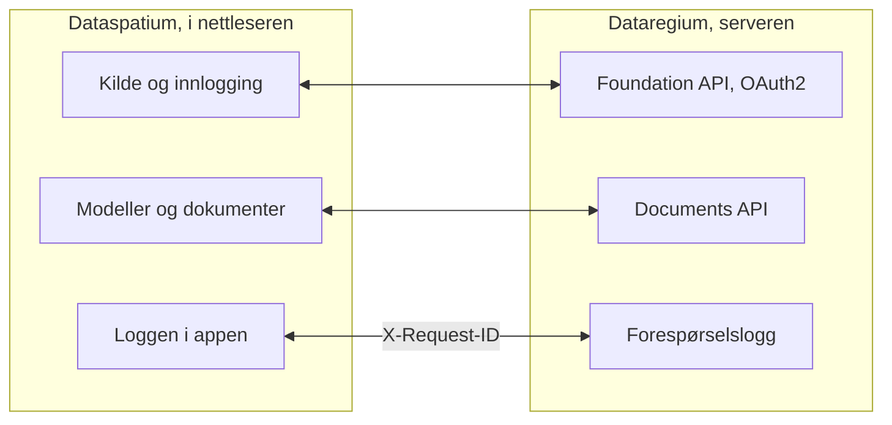

[Svenska](../../README.md) · [Dansk](../da/README.md) · **Norsk bokmål** · [Norsk nynorsk](../nn/README.md) · [Suomi](../fi/README.md) · [Íslenska](../is/README.md) · [English](../en/README.md)


# Dataregium OpenCDE-server

*Dataregium het Kontroll fram til 8. november 2026.*

*Dette er README for Dataregium 1.0.0. Den siste utgivelsen, 3.0.0, beskrives i [README på main](https://github.com/marwiss/Dataregium/blob/main/docs/nb/README.md).*

Dataregium er en server der et byggeprosjekt samler modellene, dokumentene og
sakene sine, slik at alle i prosjektet arbeider ut fra det samme grunnlaget og ser
den samme historikken. Du arbeider med den gjennom en app, for eksempel
[Dataspatium](https://github.com/marwiss/Dataspatium) i nettleseren; serveren har
selv bare sider for innlogging, opplasting og administrasjon. Den som driver
serveren, bestemmer hvem som får logge inn, og hva hver enkelt får gjøre i hvert prosjekt.

Teknisk er Dataregium en server for buildingSMARTs åpne **OpenCDE-API-er**
(Foundation API 1.0, BCF API 3.0 og 2.1 og Documents API 1.0), bygget på
grafdatabasen Neo4j eller Memgraph. 1.0.0 er en dokumentserver med Foundation API og Documents API; saker og modeller som graf kommer i 2.0.0. Serveren ble skrevet om fra grunnen av ut
fra en forskningsprototype fra 2023, med sikkerhet som det første kravet, og enhver
klient som følger spesifikasjonene, kan koble seg til.


**Innhold**

- [Last ned og kom i gang](#last-ned-og-kom-i-gang)
- [Hva som kreves](#hva-som-kreves)
- [Ord du bør kjenne](#ord-du-bør-kjenne)
- [Hva du kan gjøre](#hva-du-kan-gjøre)
- [OpenCDE-API-ene og klientene deres](#opencde-api-ene-og-klientene-deres)
- [Dataregium og Dataspatium](#dataregium-og-dataspatium)
- [Lær mer](#lær-mer)
- [Begrensninger i korte trekk](#begrensninger-i-korte-trekk)
- [Personopplysninger](#personopplysninger)
- [Nyere utgivelser](#nyere-utgivelser)
- [Feil og forslag](#feil-og-forslag)
- [Utvikling](#utvikling)
- [Lisens](#lisens)

## Last ned og kom i gang

Skal du bare bruke Dataregium, trenger du ikke installere noe: be den som driver
serveren, om adressen og en konto, og logg inn fra Dataspatium eller en annen
OpenCDE-app. Vil du prøve serveren på din egen datamaskin, følger du hurtigstarten
nedenfor. Den tar omtrent tjue minutter og krever Docker Desktop eller Podman. Er du
vant med containere og Python, står den korte veien under
[For den teknisk kyndige](#for-den-teknisk-kyndige).

### Hurtigstart (lokalt, Docker eller Podman)

En container er et ferdigpakket program som kjører atskilt på datamaskinen, og
Docker og Podman er programmer som starter containere. Hurtigstarten starter to:
serveren og databasen dens.

1. **Last ned.** Hent koden med git, eller som ZIP-fil under *Code > Download ZIP*
   på GitHub. Kommandoen nedenfor henter grenen `release-1`, som er 1.0.0; `release-2` er 2.0.0, og
   `main` er 3.0.0.

   ```sh
   git clone --branch release-1 https://github.com/marwiss/Dataregium.git
   cd Dataregium
   ```

2. **Still inn.** Kopier `.env.example` til `.env`, filen med serverens
   innstillinger, og sett `OPENCDE_GRAPH_PASSWORD` til ditt eget passord på minst
   16 tegn. Skal du prøve med Dataspatium, setter du også
   `OPENCDE_DYNAMIC_CLIENT_REGISTRATION=true` og `OPENCDE_REQUEST_LOG_ENABLED=true`; [hurtigstarten med Dataspatium](quickstart.md)
   forklarer hvorfor. Hver innstilling er forklart i [.env.example](../../.env.example).
3. **Start.** De samme compose-filene virker med Docker og med Podman; velg den du har:

   <details open>
   <summary><b>Docker</b></summary>

   ```sh
   docker compose up -d --build
   ```

   starter serveren på <http://127.0.0.1:8000> og en Neo4j-database; første gang tar noen minutter. `docker compose logs -f api` viser serverloggen.

   </details>

   <details>
   <summary><b>Podman</b></summary>

   ```sh
   podman compose up -d --build
   ```

   gjør det samme med Podman 5 (rootless, uten daemon); `podman compose logs -f api` viser serverloggen. Se [deploy/local.md](deploy/local.md) for Podmans særtrekk.

   </details>

   <details>
   <summary><b>Uten container</b></summary>

   ```sh
   uv sync                          # installerer Python 3.13 og alle avhengigheter
   uv run opencde doctor            # kontrollerer konfigurasjonen og databasen
   uv run opencde serve             # http://127.0.0.1:8000
   ```

   kjører serveren fra utsjekkingen med [uv](https://docs.astral.sh/uv/); en database trengs fortsatt (Neo4j Desktop, Memgraph Lab eller databasen fra compose-filene).

   </details>

4. **Se deg rundt.** <http://127.0.0.1:8000/docs> viser hvert kall serveren tar
   imot, og lar deg prøve dem, <http://127.0.0.1:8000/readyz> sier om serveren og
   databasen er klare, og <http://127.0.0.1:7484> er Neo4j Browser, der du ser
   databasen (Bolt på `127.0.0.1:7697`; utviklingsoverlagringen unngår Neo4js
   standardporter, som ofte er opptatt av en annen Neo4j på samme datamaskin).
5. **Legg inn demodata og logg inn.**

   <details open>
   <summary><b>Docker</b></summary>

   ```sh
   docker compose exec api opencde seed
   ```

   </details>

   <details>
   <summary><b>Podman</b></summary>

   ```sh
   podman compose exec api opencde seed
   ```

   </details>

   <details>
   <summary><b>Uten container</b></summary>

   ```sh
   uv run opencde seed
   ```

   </details>

   Kommandoen oppretter demobrukere, prosjekter, klienter og en eksempelmodell som dokument. Passordene skrives ut én gang. Logg inn
   på <http://127.0.0.1:8000/signin> som `admin` og åpne `/admin`.
6. **Koble til en klient.** Registrer appen din under *Klienter* (eller la den
   registrere seg selv når `OPENCDE_DYNAMIC_CLIENT_REGISTRATION=true`) og pek den mot
   `http://127.0.0.1:8000`; [Dataspatium](#dataregium-og-dataspatium) og
   Python-biblioteket i [client/](../../client/) er ferdige klienter. Skal du logge
   inn fra Dataspatium, følger du [hurtigstarten](quickstart.md): den går gjennom alle
   innstillingene som kreves, og hva du gjør hvis noe går galt.

### Utrulling

Skal andre bruke serveren, må den ligge på en datamaskin som alltid er på og kan nås
fra internett, med sin egen adresse og https. Tabellen viser måtene å gjøre det på;
den som ikke selv driver servere, overlater det til noen som gjør det. Hver måte er
én compose-fil pluss en overlagring:

| Scenario | Veiledning |
|---|---|
| Lokal test på datamaskinen din | [deploy/local.md](deploy/local.md) |
| Offentlig https-adresse for klienttester uten egen server (tunnel) | [deploy/tunnel.md](deploy/tunnel.md) |
| Produksjon på egen server med Caddy (automatisk TLS) og nattlige sikkerhetskopier | [deploy/vps-caddy.md](deploy/vps-caddy.md) |
| Coolify, Dokploy, Portainer | [deploy/paas.md](deploy/paas.md) |
| En containertjeneste pluss en administrert Neo4j AuraDB eller Memgraph Cloud | [deploy/cloud-aura.md](deploy/cloud-aura.md) |
| Sikkerhetskopiering og gjenoppretting (flyttbar mellom Neo4j og Memgraph) | [deploy/backup.md](deploy/backup.md) |

`uv run opencde init --public-url https://cde.example.org` skriver en
produksjons-`.env` med nye hemmeligheter; `opencde doctor` kontrollerer resultatet.

### Konfigurasjon

Alt leses fra miljøvariabler med prefikset `OPENCDE_`, fra `.env` eller fra
Docker-hemmeligheter i `/run/secrets/opencde_<navn>`. Den kommenterte listen finnes i
[.env.example](../../.env.example). Standardverdiene er trygge: produksjon nekter å
starte uten en offentlig `https`-adresse og et databasepassord, og ingenting er åpent
før det er konfigurert.

### For den teknisk kyndige

- **Image**: `ghcr.io/marwiss/opencdeserver:1.0.0` for amd64 og arm64, skannet med Trivy og med
  SBOM; `OPENCDE_IMAGE_TAG` velger i compose-filene, og 3-serien har taggen `3.0.0`.
- **Compose**: `docker/compose.yaml` pluss overlagringer for utvikling, produksjon med Caddy, Memgraph,
  en ekstern database, Bolt med TLS og en tunnel. `COMPOSE_FILE` i `.env` velger dem, så kommandoene er uten `-f`.
- **Uten container**: Python 3.11 eller nyere med uv (prøvd på 3.11, 3.13 og 3.14), `uv sync`, og
  Neo4j 5.26 eller Memgraph 3.14 på `OPENCDE_GRAPH_URI`.
- **De viktigste innstillingene**: `OPENCDE_APIS` velger API-ene og er `["documents"]` i 1.0.0, så
  BCF API er slått av; `OPENCDE_ENVIRONMENT` er `development` eller `production`.
- **Endepunkter**: `/.well-known/dataregium` (versjonen og utvidelsene som er slått på),
  `/foundation/versions`, `/openapi.json` og `/docs`, `/healthz` og `/readyz`, `/admin/api` (administrasjon) og
  `/manage/1.0` (prosjektadministrasjon).
- **Kommandolinjen**: `opencde serve`, `init`, `doctor`, `seed`, `backup`, `restore`,
  `revoke`, `cleanup` og gruppene `user`, `project`, `client` og `ifcgraph`;
  `uv run opencde --help`.
- **Å bygge en klient**: [klientguiden](client-guide.md) har flytene,
  kapabilitetsdokumentet, feilkodene og utvidelsene, og [docs/examples/](../examples/)
  kjørbare eksempler.

## Hva som kreves

Den som bare bruker Dataregium gjennom en app, trenger en nettleser og en konto. For
å kjøre serveren selv:

- Windows, macOS eller Linux med Docker (Desktop på Windows/macOS, Engine på Linux)
  eller Podman 5, eller Python 3.11 eller nyere med [uv](https://docs.astral.sh/uv/)
  og en egen Neo4j 5.26- eller Memgraph 3.14-database.
- Omtrent 1 GB minne til databasecontaineren (`NEO4J_HEAP` og `NEO4J_PAGECACHE` i
  `.env`), og mer for store modeller med IFC-LPG.
- Lokalt: port 8000 for serveren og 7484/7697 for databasen, alle bundet til
  `127.0.0.1`. I produksjon: portene 80 og 443 tilgjengelige fra internett og et
  DNS-navn for serveren.
- Klienter trenger en `https`-adresse i produksjon; lokalt godtas `http://127.0.0.1`
  som redirect-URI, og `http://localhost` med `OPENCDE_ALLOW_LOCALHOST_REDIRECTS=true`.

## Ord du bør kjenne

Ordene denne README bruker, i hverdagsspråk; hele ordlisten finnes i
[glossary.md](glossary.md).

- **BIM**: å bygge og forvalte med en digital modell av bygningen, der hver vegg, dør
  og hvert rom er et objekt med egenskaper og ikke bare streker på en tegning.
- **CAD**: programmer for tegninger og modeller; en BIM-modell lages i et CAD-program.
- **IFC**: det åpne filformatet for BIM-modeller, som de store programmene kan lese og skrive.
- **BCF og saker**: et åpent format for spørsmål og merknader om en modell, med
  kommentarer og en visning (viewpoint) som viser hvor i modellen det gjelder.
- **IDS**: et krav til hva en modell skal inneholde, for eksempel at hver dør har en
  brannklasse; serveren kontrollerer modellene mot prosjektets krav.
- **OpenCDE**: buildingSMARTs åpne regler for hvordan apper og servere i et
  byggeprosjekt snakker med hverandre. CDE betyr felles datamiljø.
- **API**: måten en app snakker med serveren på, med faste spørsmål og svar.
- **Server og klient**: serveren lagrer og deler prosjektets grunnlag; klienten er
  appen du arbeider i, for eksempel Dataspatium.
- **Database og graf**: databasen er der serveren lagrer alt. En grafdatabase lagrer
  ting og forbindelsene mellom dem, som en vegg som står på en etasje, og kan derfor
  svare på spørsmål om hvordan delene henger sammen.
- **Container**: et ferdigpakket program som kjører atskilt på datamaskinen; Docker og
  Podman starter dem.
- **OAuth2**: den sikre måten å logge inn fra en app på uten at appen får passordet ditt.
- **Versjon**: hver gang et dokument lastes opp på nytt, blir det en ny versjon, og de tidligere blir
  liggende.

## Hva du kan gjøre

Det som virker i én versjon, virker også i den neste. Hver versjon hører sammen med
den samme versjonen av Dataspatium.

### Versjon 1 (med Dataspatium 1)

- **Dokumenter på ett sted** (Documents API 1.0): velge, laste opp og hente dokumenter
  og versjonene deres gjennom serverens sider, fra en app som Dataspatium.
- **Innlogging og apper** (Foundation API 1.0): én konto per person, innlogging med
  OAuth2 og PKCE, og apper som en administrator registrerer, eller som registrerer seg
  selv når operatøren tillater det (se [klientguiden](client-guide.md)).
- **Administrasjon** i nettleseren (`/admin`) og på kommandolinjen: brukere og
  prosjektrollene deres, prosjekter, klienter, økter, revisjonsloggen og
  helsesjekkene; hver bruker har `/account` for passordet og appene sine.
- **Hjelp for den som bygger en app**, merket som utvidelser: et kapabilitetsdokument
  (`/.well-known/dataregium`), en stabil feilkode i hvert feilsvar og en
  forespørselslogg.
- **Et klientbibliotek** i Python ([client/](../../client/)) med kjørbare eksempler, og
  et publisert image for hver utrulling.
- **Prosjektansvarlige administrerer prosjektet sitt**: en `manager` legger til og
  fjerner medlemmer, bytter rollene deres og gir prosjektet nytt navn, uten å være
  serveradministrator.

Det som også finnes i versjon 2 og 3, står i [README på main](https://github.com/marwiss/Dataregium/blob/main/docs/nb/README.md#hva-du-kan-gjøre).


## OpenCDE-API-ene og klientene deres

OpenCDE er buildingSMART Internationals familie av åpne web-API-er for et felles
datamiljø, stedet der et prosjekt deler modeller, dokumenter og saker. En klient og en
server som følger de samme spesifikasjonene, kan arbeide sammen, uansett hvem som har
bygget dem. Dataregium implementerer alle tre:

| API | Hva det er til | Spesifikasjon |
|---|---|---|
| Foundation API 1.0 | Sier hvilke API-er en server tilbyr, hvordan man logger inn, og hvem brukeren er | [foundation-API](https://github.com/buildingSMART/foundation-API) |
| BCF API 3.0 og 2.1 | Saker om en modell, med kommentarer og viewpoints med kamera, komponenter og bilder | [BCF-API](https://github.com/buildingSMART/BCF-API) |
| Documents API 1.0 | Å velge, hente og laste opp dokumenter og versjonene deres, via sider på serveren | [documents-API](https://github.com/buildingSMART/documents-API) |

**Dataspatium er én klient, ikke den eneste.** Enhver klient som følger disse
spesifikasjonene, skal kunne koble seg til: ingenting på serveren er avhengig av
Dataspatium, og utvidelsene utenfor spesifikasjonene er valgfrie, så en klient som ikke
kjenner dem, merker dem ikke. En klient trenger tre ting:

- en registrering på serveren, gjort av en administrator under *Klienter* eller av klienten
  selv når `OPENCDE_DYNAMIC_CLIENT_REGISTRATION=true`;
- OAuth2 authorization code med PKCE `S256`, som serveren krever av hver klient unntatt en konfidensiell som en administrator har merket;
- BCF API 3.0, eller 2.1 for en klient som bare kan den versjonen. `GET /foundation/versions` lister begge, og
  [klientguiden](client-guide.md) forteller hva som skiller dem.

Så langt er det vist: serverens svar testes mot buildingSMARTs skjemaer ved hver push,
og Dataspatium og Python-biblioteket i [client/](../../client/) kjører mot serveren. Uavhengige
klienter som Bonsai og ifc-lite har en ferdig sjekkliste som ennå ikke er kjørt. Hvis du prøver en klient, fortell
hvordan det gikk under [Feil og forslag](#feil-og-forslag). Når en klient og en spesifikasjon ikke
stemmer overens, avgjør spesifikasjonen. [docs/nb/client-guide.md](client-guide.md) er for dem som bygger en
klient.

## Dataregium og Dataspatium

Dataspatium er appen du arbeider i, og Dataregium er serveren der prosjektets felles
grunnlag ligger. [Dataspatium](https://github.com/marwiss/Dataspatium) kjører helt i
nettleseren, og de to er utviklet for å virke sammen. Det samme utgivelsesnummeret
betyr at de virker sammen: Dataspatium 1.0.0 virker med Dataregium 1.0.0
([hurtigstart](quickstart.md)).

Dataspatium legger til en Dataregium-server som kilde: appen oppdager API-ene gjennom
`/foundation/versions`, logger inn med OAuth2 authorization code og PKCE og registrerer seg selv som offentlig
klient når dynamisk registrering er slått på. Den velger dokumenter på serverens sider, får dem som datasett og
laster opp datasett, filer og arbeidsområdepakker gjennom Documents API. Appen sender `X-Request-ID` med hvert
kall, slik at forespørselsloggen her og loggen i appen viser den samme samtalen, og reagerer på feilkodene
serveren legger i feilsvarene sine.

Slik henger de sammen:



Bortsett fra de merkede utvidelsene går alt Dataspatium gjør mot serveren, gjennom de
tre OpenCDE-API-ene, så appen bruker ingenting som en annen klient ikke kan bruke; se
[OpenCDE-API-ene og klientene deres](#opencde-api-ene-og-klientene-deres). De to
produktene installeres hver for seg: dette repoet pakker ikke med Dataspatium
(lisensene er forskjellige, AGPL her og PolyForm Strict der), og Dataspatiums README
beskriver hvordan appen hentes og brukes.

### Utgivelsene 1, 2 og 3

Det finnes én utgivelse per hovednummer, og den gis ut på nytt når den vokser; bare
den siste i hver serie rettes. Dataregium og Dataspatium med samme nummer hører sammen:

| Dataregium | Hva den har | Image | Hører sammen med |
|---|---|---|---|
| 1.0.0 | En dokumentserver: Foundation API og Documents API, nettadministrasjonen på sju språk, prosjektadministrasjonen for den prosjektansvarlige og forespørselsloggen. Den er 2.0.0-koden med bare Documents API slått på (`OPENCDE_APIS`) | `1.0.0` | Dataspatium 1.0.0 |
| 2.0.0 | Også BCF API 3.0 og 2.1 på de samme dataene og IFC-LPG-modulen som lager en graf av hver opplastet IFC-fil | `2.0.0` | Dataspatium 2.0.0 |
| 3.0.0 | Også den tapsfrie grafen fra biblioteket IFC-LPG, kontrollen av hver opplasting, spørringene, sammenligningene og kollisjonskontrollen, versjoner med endringsforslag som prøves, godkjennes og slås sammen, geometrien som glTF, den lokale motoren og oppskriftene for skyen og nginx | `3.0.0`, `latest`, `3.0.0-gherkin` | Dataspatium 3.0.0 |

## Lær mer

- [quickstart.md](quickstart.md): Dataregium og Dataspatium sammen på tjue minutter,
  fra en tom datamaskin til en sak opprettet i 3D-visningen.
- [client-guide.md](client-guide.md) og [docs/examples/](../examples/): hvordan man bygger en klient, kapabilitetsdokumentet, feilkodene og kjørbare eksempler med Python-biblioteket i [client/](../../client/).
- [architecture.md](architecture.md): hvordan delene henger sammen, hva som skjer med et kall, og hvor alt finnes i koden.
- [glossary.md](glossary.md): ordene dokumentasjonen bruker.
- [flows/](flows/): sekvensdiagrammer for OAuth2-, Documents API- og BCF-viewpoint-flytene.
- [graph-schema.md](graph-schema.md): grafmodellen.
- [ifc-lpg.md](ifc-lpg.md): den valgfrie IFC-LPG-modulen og eksempler på Cypher-spørringer.
- Arkitekturbeslutninger som ligger fast: en grafdatabase som eneste lager, opake tokener i stedet for
  JWT, portabel Cypher for Neo4j og Memgraph, et nettgrensesnitt uten rammeverk, sikkerhetskopi på
  applikasjonsnivå, et felles lager for begrensninger og BCF API 2.1 ved siden av 3.0.
- [spec/SOURCES.md](../../spec/SOURCES.md): de nøyaktige spesifikasjonsversjonene
  serveren testes mot.

Dokumentasjonen finnes på denne README-ens sju språk, hvert språk under
`docs/<språk>/`; engelsk under `docs/en/` er kilden. CONTRIBUTING er på engelsk.

### Videre lesning

- [BCF API](https://github.com/buildingSMART/BCF-API), [Foundation API](https://github.com/buildingSMART/foundation-API) og [Documents API](https://github.com/buildingSMART/documents-API):
  spesifikasjonene serveren følger.
- [IFC](https://github.com/buildingSMART/IFC4.x-development): filformatet for bygningsmodeller, og [IDS](https://github.com/buildingSMART/IDS): kravspesifikasjoner som modeller kontrolleres mot.
- [RFC 9700](https://www.rfc-editor.org/rfc/rfc9700): dagens beste praksis for sikkerhet i OAuth 2.0, og
  [OAuth 2.1](https://datatracker.ietf.org/doc/draft-ietf-oauth-v2-1/), utkastet som samler den.
- [RFC 7636](https://www.rfc-editor.org/rfc/rfc7636) (PKCE), [RFC 8252](https://www.rfc-editor.org/rfc/rfc8252) (apper på datamaskinen eller telefonen) og
  [RFC 7591](https://www.rfc-editor.org/rfc/rfc7591) (registrering av klienter).
- [OWASP ASVS](https://owasp.org/www-project-application-security-verification-standard/): sjekklisten for sikkerhetsarbeidet.

## Begrensninger i korte trekk

- 1.0.0 tilbyr Foundation API og Documents API; saker gjennom BCF API og modeller som graf hører til 2.0.0 og 3.0.0.
- Community-utgavene av Neo4j og Memgraph mangler databasebrukere med bare lesetilgang, så en eksponert Bolt-port gir
  full tilgang til den som har passordet. Porten forblir stengt med mindre administratoren publiserer den med vilje.
- Nettsidene er for innlogging, administrasjon, opplasting og valg av dokumenter; sluttbrukere arbeider i en klient
  som Dataspatium.
- Sidene finnes på denne README-ens sju språk (bytt nederst på hver side); kommandolinjen og API-enes feilmeldinger
  er på engelsk.
- Ingen ekstern gjennomgang ennå. OAuch- og testssl-kjøringene er operatørens steg før en produksjonsutrulling.

## Personopplysninger

Den som driver Dataregium for andre, er behandlingsansvarlig for dette. Serveren lagrer brukerkontoer (brukernavn,
navn, valgfri e-post, passordhash), prosjektmedlemskap, opplastede filer med den som lastet dem opp og en
revisjonslogg over hvem som gjorde hva og fra hvilken adresse. Passord, tokener og hemmeligheter lagres bare som
hasher. Tokener, økter, opplastingsøkter og ubrukte selvregistrerte klienter utløper og ryddes av serveren;
revisjonsloggen beskjæres av operatøren. En administrator sletter en konto under `/admin/users`, og øktene og
tokenene følger med. Revisjonsloggen eksporteres som CSV, dokumentene gjennom Documents API og hele databasen med
`opencde backup`. Hva Dataspatium lagrer i nettleseren, står i appens egen dokumentasjon.

## Nyere utgivelser

Dataregium 2.0.0 legger til BCF API 3.0 og 2.1 med saker og viewpoints og IFC-LPG-modulen, som lager en graf av hver
opplastet modell. 3.0.0 gjør dessuten grafen tapsfri, kontrollerer opplastingene og gir spørringer, sammenligninger,
versjoner med endringsforslag, geometrien som glTF og en lokal motor. 2.0.0 ligger på grenen `release-2` og 3.0.0 på
`main`; begge beskrives i [README på main](https://github.com/marwiss/Dataregium/blob/main/docs/nb/README.md).

## Feil og forslag

Rapporter feil og ønsker som *Issues* her på GitHub. Oppgi hvilken
serverversjon du kjører (`version` i `/.well-known/dataregium` eller
`/healthz`), hvilken klient du brukte og `X-Request-ID` for et mislykket
kall; forespørselsloggen og klientens logg deler den. Legg ikke ved
personopplysninger eller hemmeligheter. Hvordan endringer tas imot står i
[CONTRIBUTING.md](../../CONTRIBUTING.md). Ved en sikkerhetssårbarhet, følg
[SECURITY.md](../../SECURITY.md) i stedet for å åpne en sak.

## Utvikling

```sh
uv run pytest                    # enhets-, konformans- og sikkerhetstester
uv run pytest -m integration     # starter Neo4j/Memgraph med testcontainers (krever Docker)
uv run pytest -m e2e             # klientbiblioteket mot en kjørende server (krever Docker)
uv run pytest -m ui              # Playwright + axe-core (uv sync --group ui; playwright install chromium)
uv run ruff format . && uv run ruff check .
uv run ty check opencde client/opencde_client
```

Kode og kommentarer er på engelsk, og stilen følger IfcOpenShells
konvensjoner (ruff, 120 kolonner), slik at det forblir mulig å bidra med
serveren til IfcOpenShell.
README finnes på engelsk, svensk, dansk, norsk (bokmål og nynorsk), finsk og
islandsk (`docs/<språk>/README.md`, samme oppsett som Dataspatium);
dokumentasjonen og webgrensesnittet finnes på de samme språkene, med
engelsk alltid som et valg, og felles termer følger Dataspatiums ordliste.
Hvert push kjører lint, typekontroll, testsuitene på tre Python-versjoner,
nettlesertester med axe-core og statiske sikkerhetskontroller; nattlige
jobber kjører OWASP ZAP, Schemathesis og Trivy. Se
[CONTRIBUTING.md](../../CONTRIBUTING.md).

## Lisens

Serveren er lisensiert under GNU Affero General Public License v3.0 eller
senere ([LICENSE](../../LICENSE)): den er serverprogramvare, og AGPLs
nettverksklausul holder forbedringer av driftssatte instanser åpne.
Klientbiblioteket i [client/](../../client/) er LGPL-3.0-or-later.
Spesifikasjonsfilene under [spec/](../../spec/) er © buildingSMART
International og videredistribueres uendret for testing. Se
[SECURITY.md](../../SECURITY.md) for hvordan en sårbarhet rapporteres og hva
prosjektet gjør for å holde seg sikkert.
