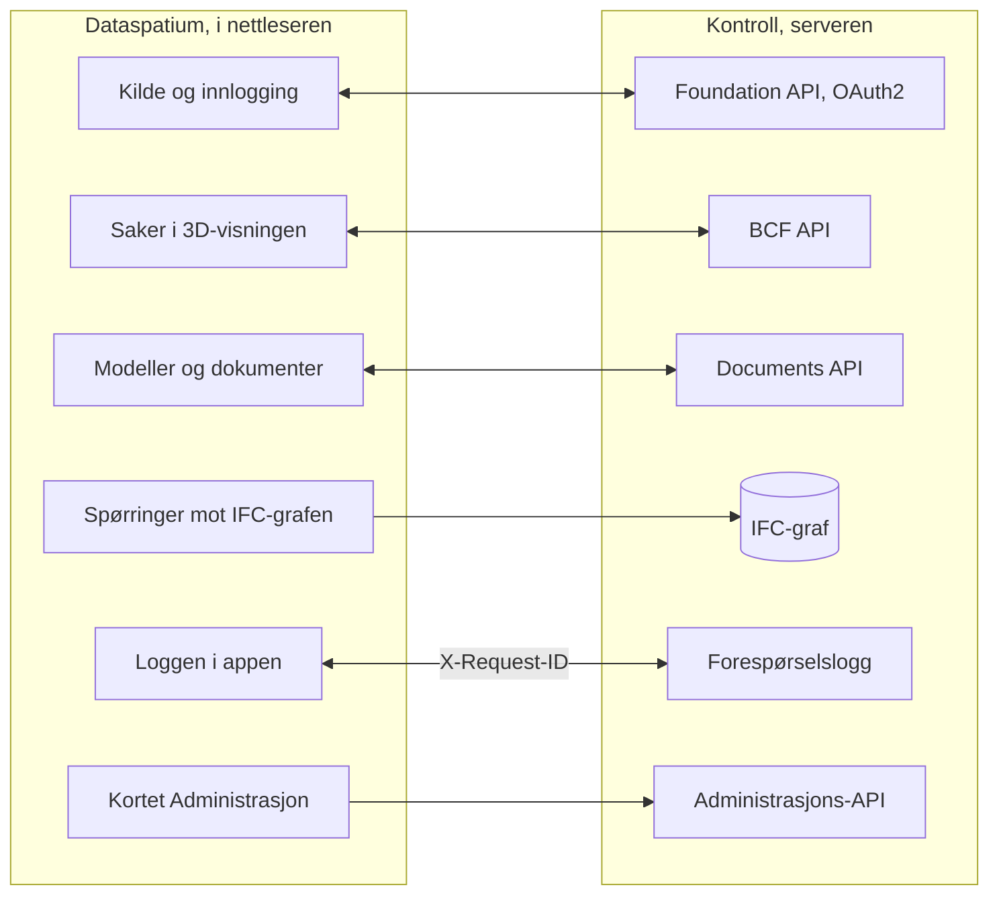

[Svenska](../../README.md) · [Dansk](../da/README.md) · **Norsk bokmål** · [Norsk nynorsk](../nn/README.md) · [Suomi](../fi/README.md) · [Íslenska](../is/README.md) · [English](../en/README.md)


# Kontroll OpenCDE-server

Kontroll er en server for buildingSMARTs **OpenCDE-API-er** (Foundation API
1.0, BCF API 3.0 og 2.1 samt Documents API 1.0), bygget på en grafdatabase, med
webadministrasjon og en valgfri IFC-grafmodul som knytter BCF-komponenter
til bygningsdelene de peker på. Den vokste fram av en forskningsprototyp fra
2023 for digitale kontrollplaner i svenske byggetillatelser og ble skrevet om
fra grunnen av med sikkerhet som første krav.
Klienter som følger spesifikasjonene, skal kunne koble seg til, så serveren
ikke er bundet til ett bestemt program.


**Innhold**

- [Last ned og kom i gang](#last-ned-og-kom-i-gang)
- [Hva som kreves](#hva-som-kreves)
- [Hva du kan gjøre](#hva-du-kan-gjøre)
- [OpenCDE-API-ene og klientene deres](#opencde-api-ene-og-klientene-deres)
- [Kontroll og Dataspatium](#kontroll-og-dataspatium)
- [Lær mer](#lær-mer)
- [Begrensninger i korte trekk](#begrensninger-i-korte-trekk)
- [Feil og forslag](#feil-og-forslag)
- [Utvikling](#utvikling)
- [Lisens](#lisens)

## Last ned og kom i gang

### Hurtigstart (lokalt, Docker)

1. **Last ned.** Klon repoet, eller hent det publiserte imaget
   `ghcr.io/marwiss/opencdeserver` (flere arkitekturer, skannet og med SBOM
   ved hver utgivelse):

   ```sh
   git clone https://github.com/marwiss/Kontroll.git
   cd Kontroll
   ```

2. **Konfigurer.** Kopier `.env.example` til `.env` og sett
   `OPENCDE_GRAPH_PASSWORD` (minst 16 tegn). Hver innstilling forklares i
   [.env.example](../../.env.example).
3. **Start.** `docker compose -f compose.yaml -f compose.dev.yaml up -d --build`
   starter serveren på <http://127.0.0.1:8000> og en Neo4j-database.
   `docker compose logs -f api` viser serverloggen.
4. **Se deg rundt.** <http://127.0.0.1:8000/docs> er den interaktive
   API-dokumentasjonen, <http://127.0.0.1:8000/readyz> beredskapskontrollen
   og <http://127.0.0.1:7484> Neo4j Browser (Bolt på `127.0.0.1:7697`;
   utviklingsoverlegget unngår Neo4js standardporter, som ofte er opptatt av
   en annen Neo4j på samme maskin).
5. **Legg inn demodata og logg inn.**
   `docker compose -f compose.yaml -f compose.dev.yaml exec api opencde seed`
   oppretter demobrukere og prosjekter og skriver ut passordene deres én
   gang. Logg inn på <http://127.0.0.1:8000/signin> som `admin` og åpne
   `/admin`.
6. **Koble til en klient.** Registrer appen din under *Klienter* (eller la
   den registrere seg selv når `OPENCDE_DYNAMIC_CLIENT_REGISTRATION=true`) og
   pek den mot `http://127.0.0.1:8000`; [Dataspatium](#kontroll-og-dataspatium)
   og Python-biblioteket i [client/](../../client/) er ferdige klienter.
   Skal du logge inn fra Dataspatium, følg [hurtigstarten](quickstart.md): den tar for
   seg alle innstillingene som trengs, og hva du gjør hvis noe går galt.

Uten Docker for selve serveren (en database trengs fortsatt):

```sh
uv sync                          # installerer Python 3.13 og alle avhengigheter
uv run opencde doctor            # kontrollerer konfigurasjon og database
uv run opencde serve             # http://127.0.0.1:8000
```

### Utrulling

Én compose-fil pluss ett overlegg per scenario:

| Scenario | Veiledning |
|---|---|
| Lokal test på egen maskin | [docs/nb/deploy/local.md](deploy/local.md) |
| Offentlig https-adresse for klienttester uten egen server (tunnel) | [docs/nb/deploy/tunnel.md](deploy/tunnel.md) |
| Produksjon på egen server med Caddy (automatisk TLS) og nattlige sikkerhetskopier | [docs/nb/deploy/vps-caddy.md](deploy/vps-caddy.md) |
| Coolify, Dokploy, Portainer | [docs/nb/deploy/paas.md](deploy/paas.md) |
| Containertjeneste pluss administrert Neo4j AuraDB eller Memgraph Cloud | [docs/nb/deploy/cloud-aura.md](deploy/cloud-aura.md) |
| Sikkerhetskopiering og gjenoppretting (flyttbar mellom Neo4j og Memgraph) | [docs/nb/deploy/backup.md](deploy/backup.md) |

`uv run opencde init --public-url https://cde.example.org` skriver en
produksjons-`.env` med nye hemmeligheter; `opencde doctor` kontrollerer
resultatet.

### Konfigurasjon

Alt leses fra miljøvariabler med prefikset `OPENCDE_`, fra `.env` eller fra
Docker-hemmeligheter i `/run/secrets/opencde_<navn>`. Den kommenterte listen
finnes i [.env.example](../../.env.example). Standardverdiene er trygge:
produksjon nekter å starte uten en offentlig `https`-adresse og et
databasepassord, og ingenting er åpent før det er konfigurert.

## Hva som kreves

- Windows, macOS eller Linux med Docker (Desktop på Windows/macOS, Engine på
  Linux), eller Python 3.11 eller nyere med [uv](https://docs.astral.sh/uv/)
  og en egen Neo4j 5.26- eller Memgraph 3.14-database.
- Omtrent 1 GB minne til databasecontaineren (`NEO4J_HEAP` og
  `NEO4J_PAGECACHE` i `.env`), mer med IFC-grafmodulen.
- Lokalt: port 8000 for serveren og 7484/7697 for databasen, alle bundet til
  `127.0.0.1`. I produksjon: portene 80 og 443 nåbare fra internett og et
  DNS-navn for serveren.
- Klienter trenger en `https`-adresse i produksjon; lokalt godtas
  `http://127.0.0.1` som redirect-URI, og `http://localhost` med `OPENCDE_ALLOW_LOCALHOST_REDIRECTS=true`.

## Hva du kan gjøre

- **Foundation API 1.0**: tjenesteoppdagelse, OAuth2 authorization code med
  PKCE, gjeldende bruker, tilbakekalling av tokens og
  dynamisk klientregistrering med offentlige klienter (av som standard).
- **BCF API 3.0 og 2.1**: prosjekter, extensions, saker med OData-spørringer,
  kommentarer, viewpoints med snapshots, bitmaps og komponenter, filer,
  dokumentreferanser, dokumenter og hendelsesloggene, alt validert mot
  buildingSMARTs skjemaer.
- **Documents API 1.0**: valg og nedlasting av dokumenter, opplasting i deler
  med serverens websider for metadata og valg, versjonsspørringer med ETag.
- **Administrasjon** i nettleseren: logg inn på `/signin` med en
  administratorkonto og åpne `/admin` for å administrere brukere og
  prosjektrollene deres, prosjekter og BCF-extension-verdiene deres,
  OAuth2-klienter, sesjoner, revisjonsloggen, den valgfrie forespørselsloggen
  og serverens helsekontroller. Hver bruker har `/account` for eget passord,
  egne apper og egne sesjoner. Kommandolinjen (`uv run opencde --help`) gjør
  det samme fra en terminal.
- **Tillegg utenfor spesifikasjonene**, hvert merket som det: et
  kapabilitetsdokument på `/.well-known/kontroll` som forteller klienten
  hvilke tillegg som er slått på, en stabil `code` i hver feilkropp, en
  forespørselslogg for feilsøking av klienter (`/admin/requests`,
  `GET /admin/api/requests` med scopet `admin`), og IFC-grafmodulen som gjør
  opplastede IFC-modeller til grafdata knyttet til BCF-komponenter.
- **Et klientbibliotek** i Python ([client/](../../client/), LGPL) med
  kjørbare eksempler, samt Dockerfile, compose-overlegg og et publisert image
  for hvert utrullingsscenario.
- **Status**: alle elleve etappene i planen er gjennomført (de tre API-ene,
  administrasjonen, klientbiblioteket, utrulling, IFC-graf,
  akseptansesjekklisten og sikkerhetsherdingen); bidraget til IfcOpenShell
  er ennå ikke foreslått (utkast i [docs/upstream/](../upstream/)).
  [docs/inventory.md](../inventory.md) viser hva prototypen fra 2023 gjorde og
  hvor hver funksjon står i den nye koden.


## OpenCDE-API-ene og klientene deres

OpenCDE er buildingSMART Internationals familie av åpne web-API-er for et felles
datamiljø, stedet der et prosjekt deler modeller, dokumenter og saker. En klient og en
server som følger de samme spesifikasjonene, kan arbeide sammen, uansett hvem som har
bygget dem. Kontroll implementerer alle tre:

| API | Hva det er til | Spesifikasjon |
|---|---|---|
| Foundation API 1.0 | Sier hvilke API-er en server tilbyr, hvordan man logger inn, og hvem brukeren er | [foundation-API](https://github.com/buildingSMART/foundation-API) |
| BCF API 3.0 og 2.1 | Saker om en modell, med kommentarer og viewpoints med kamera, komponenter og bilder | [BCF-API](https://github.com/buildingSMART/BCF-API) |
| Documents API 1.0 | Å velge, hente og laste opp dokumenter og versjonene deres, via sider på serveren | [documents-API](https://github.com/buildingSMART/documents-API) |

**Dataspatium er én klient, ikke den eneste.** Enhver klient som følger disse
spesifikasjonene, skal kunne koble seg til: ingenting på serveren er avhengig av
Dataspatium, og utvidelsene utenfor spesifikasjonene er valgfrie, så en klient som ikke
kjenner dem, merker dem ikke. En klient trenger tre ting:

- en registrering på serveren, gjort av en administrator under *Klienter* eller av klienten
  selv når `OPENCDE_DYNAMIC_CLIENT_REGISTRATION=true`;
- OAuth2 authorization code med PKCE `S256`, som serveren krever av hver klient unntatt en konfidensiell som en administrator har merket;
- BCF API 3.0, eller 2.1 for en klient som bare kan den versjonen. `GET /foundation/versions` lister begge, og
  [klientguiden](client-guide.md) forteller hva som skiller dem.

Så langt er det vist: serverens svar testes mot buildingSMARTs skjemaer ved hver push,
og Dataspatium og Python-biblioteket i [client/](../../client/) kjører mot serveren. Uavhengige
klienter som Bonsai og ifc-lite har en ferdig sjekkliste i
[docs/acceptance.md](../acceptance.md) som ennå ikke er kjørt. Hvis du prøver en klient, fortell
hvordan det gikk under [Feil og forslag](#feil-og-forslag). Når en klient og en spesifikasjon ikke
stemmer overens, avgjør spesifikasjonen. [docs/nb/client-guide.md](client-guide.md) er for dem som bygger en
klient.

## Kontroll og Dataspatium

Kontroll (serveren) og [Dataspatium](https://github.com/marwiss/Dataspatium)
(en dataapp som kjører helt i nettleseren) er utviklet for å virke sammen som
server og klient, og samme utgivelsesnummer på begge betyr at de virker
sammen: Dataspatium 2.5.0 virker med Kontroll 2.5.0
([hurtigstart](quickstart.md)). Dataspatium legger til
en Kontroll-server som kilde: appen oppdager API-ene gjennom
`/foundation/versions`, logger inn med OAuth2 authorization code og PKCE og
registrerer seg selv som offentlig klient når dynamisk registrering er slått
på, lister prosjektets modeller og dokumenter, leser og skriver BCF-saker med
kommentarer og viewpoints tatt fra 3D-visningen sin, laster opp datasett,
filer og arbeidsområdepakker gjennom Documents API, spør IFC-grafen med
Cypher over Bolt når operatøren eksponerer den, og sender `X-Request-ID` på
hvert kall slik at forespørselsloggen her og loggen i appen viser samme
samtale. Appen leser serverens kapabilitetsdokument for å se hvilke tillegg
som er slått på, og reagerer på feilkodene serveren legger i feilkroppene
sine.

Slik henger de sammen:



Bortsett fra de merkede tilleggene går alt Dataspatium gjør mot serveren
gjennom de tre OpenCDE-API-ene, så appen bruker ingenting en annen klient
ikke kan bruke, se [OpenCDE-API-ene og klientene deres](#opencde-api-ene-og-klientene-deres). De to produktene installeres hver
for seg: dette repoet bunter ikke Dataspatium (lisensene er forskjellige, AGPL
her og PolyForm Strict der), og Dataspatiums README beskriver hvordan appen
hentes. Klientsiden beskrives i Dataspatiums README og dokumentasjonen der;
parets akseptansekjøringer står i [docs/acceptance.md](../acceptance.md) her,
og hva de to prosjektene samordner står i
[docs/dataspatium-coordination.md](../dataspatium-coordination.md).

## Lær mer

- [docs/nb/quickstart.md](quickstart.md): Kontroll og Dataspatium sammen på tjue
  minutter, fra en tom maskin til en sak opprettet i 3D-visningen.
- [docs/nb/client-guide.md](client-guide.md) og [docs/examples/](../examples/):
  hvordan bygge en klient, kapabilitetsdokumentet, feilkodene og kjørbare
  eksempler med Python-biblioteket i [client/](../../client/).
- [docs/nb/architecture.md](architecture.md): hvordan delene henger sammen, hva som skjer med en forespørsel, og hvor alt finnes i koden.
- [docs/nb/glossary.md](glossary.md): ordene dokumentasjonen bruker.
- [docs/nb/flows/](flows/): sekvensdiagrammer for OAuth2-, Documents API- og BCF-viewpoint-flytene.
- [docs/nb/graph-schema.md](graph-schema.md): grafmodellen.
- [docs/nb/ifcgraph.md](ifcgraph.md): den valgfrie IFC-grafmodulen og eksempler på Cypher-spørringer.
- [docs/nb/ui-styleguide.md](ui-styleguide.md): regler for serverens sider og merket.
- [docs/acceptance.md](../acceptance.md): sjekkliste for visuell akseptanse
  med uavhengige klienter (Bonsai, ifc-lite, Dataspatium).
- [docs/dataspatium-coordination.md](../dataspatium-coordination.md): hva
  Kontroll og Dataspatium deler, og eierens beslutninger.
- [docs/inventory.md](../inventory.md): funksjonsinventar over prototypen fra
  2023 og status i omskrivingen, med merknader om særtrekk i spesifikasjonene.
- [docs/adr/](../adr/): arkitekturbeslutninger (grafdatabase, opake tokens,
  portabel Cypher, webgrensesnitt uten rammeverk, repostrategi).
- [docs/nb/security/](security/): trusselmodell, kontroller knyttet til
  tester, OWASP ASVS nivå 2-sjekklisten, personopplysninger og lagringstid, og
  hvordan skannerne kjøres.
- [docs/upstream/](../upstream/): utkast til sak og pull request for
  IfcOpenShell (ikke sendt).
- [spec/SOURCES.md](../../spec/SOURCES.md): de nøyaktige
  spesifikasjonsversjonene serveren testes mot.

Dokumentasjonen finnes på denne READMEens sju språk: engelsk under `docs/`, de
andre under `docs/<språk>/`. Prosjektloggene (akseptanse, inventar, samordning),
arkitekturbeslutningene, utkastene til IfcOpenShell og CONTRIBUTING holdes på
engelsk.

### Videre lesning

- [BCF API](https://github.com/buildingSMART/BCF-API), [Foundation API](https://github.com/buildingSMART/foundation-API) og [Documents API](https://github.com/buildingSMART/documents-API):
  spesifikasjonene serveren følger.
- [IFC](https://github.com/buildingSMART/IFC4.x-development): filformatet for bygningsmodeller.
- [RFC 9700](https://www.rfc-editor.org/rfc/rfc9700): dagens beste praksis for sikkerhet i OAuth 2.0, og
  [OAuth 2.1](https://datatracker.ietf.org/doc/draft-ietf-oauth-v2-1/), utkastet som samler den.
- [RFC 7636](https://www.rfc-editor.org/rfc/rfc7636) (PKCE), [RFC 8252](https://www.rfc-editor.org/rfc/rfc8252) (apper på datamaskin eller telefon) og
  [RFC 7591](https://www.rfc-editor.org/rfc/rfc7591) (registrering av klienter).
- [OWASP ASVS](https://owasp.org/www-project-application-security-verification-standard/): sjekklisten for sikkerhetsarbeidet.

## Begrensninger i korte trekk

- Serveren implementerer BCF API 3.0 og 2.1, ikke 1.0, der ressursene ser annerledes ut.
- Eksport av et prosjekt som BCFzip overlates til klientene; serveren lagrer
  saker, kommentarer og viewpoints slik API-et definerer dem.
- Community-utgavene av Neo4j og Memgraph har ingen skrivebeskyttede
  databasebrukere, så en eksponert Bolt-port gir full tilgang til den som
  har passordet. Porten forblir lukket med mindre administratoren bevisst
  publiserer den; administrasjons-API-ets lesende grafspørring
  (`OPENCDE_GRAPH_QUERY_ENABLED`) gir Cypher uten porten.
- IFC-grafimporten kjører i en egen prosess med minne- og tidsgrenser
  (`OPENCDE_IFCGRAPH_*`); svært store modeller avvises i stedet for å bli
  liggende halvt importert.
- Websidene er for administratorer og for OAuth2- og Documents API-flytene;
  sluttbrukere arbeider i en klient som Dataspatium eller Bonsai.
- Sidene finnes på denne READMEens sju språk (bytt nederst på hver side);
  kommandolinjen og API-enes feilmeldinger er på engelsk.
- Ingen ekstern revisjon ennå. OAuch- og testssl-kjøringene i
  [docs/nb/security/pentest-howto.md](security/pentest-howto.md) er
  operatørens steg før en produksjonsutrulling.

## Feil og forslag

Rapporter feil og ønsker som *Issues* her på GitHub. Oppgi hvilken
serverversjon du kjører (`version` i `/.well-known/kontroll` eller
`/healthz`), hvilken klient du brukte og `X-Request-ID` for et mislykket
kall; forespørselsloggen og klientens logg deler den. Legg ikke ved
personopplysninger eller hemmeligheter. Hvordan endringer tas imot står i
[CONTRIBUTING.md](../../CONTRIBUTING.md). Ved en sikkerhetssårbarhet, følg
[SECURITY.md](../../SECURITY.md) i stedet for å åpne en sak.

## Utvikling

```sh
uv run pytest                    # enhets-, konformans- og sikkerhetstester
uv run pytest -m integration     # starter Neo4j/Memgraph med testcontainers (krever Docker)
uv run pytest -m e2e             # klientbiblioteket mot en kjørende server (krever Docker)
uv run pytest -m ui              # Playwright + axe-core (uv sync --group ui; playwright install chromium)
uv run ruff format . && uv run ruff check .
uv run ty check opencde client/opencde_client
```

Kode og kommentarer er på engelsk fordi serveren og klientbiblioteket skal
bidras til IfcOpenShell, hvis konvensjoner (ruff, 120 kolonner) følges.
README finnes på engelsk, svensk, dansk, norsk (bokmål og nynorsk), finsk og
islandsk (`docs/<språk>/README.md`, samme oppsett som Dataspatium);
dokumentasjonen og webgrensesnittet finnes på de samme språkene, med
engelsk alltid som et valg, og felles termer følger Dataspatiums ordliste.
Hvert push kjører lint, typekontroll, testsuitene på tre Python-versjoner,
nettlesertester med axe-core og statiske sikkerhetskontroller; nattlige
jobber kjører OWASP ZAP, Schemathesis og Trivy. Se
[CONTRIBUTING.md](../../CONTRIBUTING.md).

## Lisens

Serveren er lisensiert under GNU Affero General Public License v3.0 eller
senere ([LICENSE](../../LICENSE)): den er serverprogramvare, og AGPLs
nettverksklausul holder forbedringer av driftssatte instanser åpne.
Klientbiblioteket i [client/](../../client/) er LGPL-3.0-or-later.
Spesifikasjonsfilene under [spec/](../../spec/) er © buildingSMART
International og videredistribueres uendret for testing. Se
[SECURITY.md](../../SECURITY.md) for hvordan en sårbarhet rapporteres og hva
prosjektet gjør for å holde seg sikkert.
