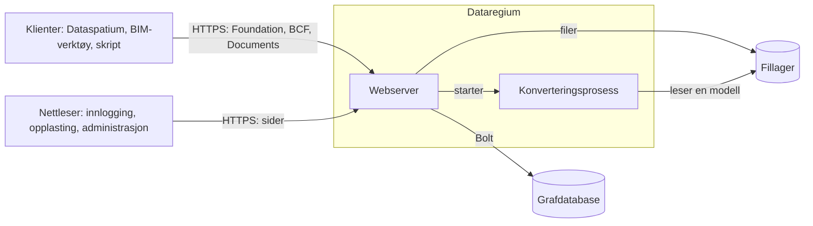

# Arkitektur

Dataregium er en webserver foran en grafdatabase. Denne siden viser hvordan delene
henger sammen, hva som skjer med en forespørsel, og hvor alt finnes i koden. Les
den hvis du vil drive serveren trygt, endre den eller bygge videre på den. Ordene
forklares i [ordlisten](glossary.md).

## Delene

| Del | Hva den gjør | Kode |
|---|---|---|
| Foundation API | Sier hvilke API-er serveren tilbyr, hvordan man logger inn, og hvem du er | `opencde/foundation/` |
| Innlogging | OAuth2 med PKCE, tokener, klienter, innloggingssidene og ventetiden etter mislykkede forsøk | `opencde/auth/`, `opencde/web/` |
| BCF API | Saker, kommentarer, viewpoints, hendelser, relaterte saker og prosjektdokumenter | `opencde/bcf/` |
| Documents API | Opplasting og utvalg via sider i nettleseren, versjoner og metadata | `opencde/documents/` |
| Kontoer | Brukere, prosjekter, medlemskap og roller | `opencde/accounts/` |
| Administrasjon | Sider og et API for administratorer, helsesjekker og forespørselsloggen | `opencde/admin/`, `opencde/requestlog.py` |
| IFC-LPG | Gjør opplastede modeller til noder og lenker viewpoint-komponenter til dem | `opencde/ifcgraph/` |
| Graflaget | Driveren, de to databasedialektene, skjemaet og det som utløper | `opencde/graph/` |
| Sider | Maler, stiler, skript og språkkatalogene | `opencde/ui/` |

## Veien til en forespørsel

1. uvicorn tar imot forespørselen. Den tror på `X-Forwarded-For` bare fra proxyene i
   `OPENCDE_TRUSTED_PROXIES`, så klientens adresse er den riktige.
2. Middleware i `opencde/main.py` gir forespørselen en id, logger den uten innhold
   og tokener, begrenser størrelsen, svarer på CORS og betingede forespørsler,
   legger til sikkerhetsheadere og bruker grensen for antall forespørsler.
3. Rutens avhengigheter finner ut hvem som spør: et bearer-token for API-ene
   (`opencde/auth/dependencies.py`), en sesjonskake for sidene
   (`opencde/web/dependencies.py`).
4. Et repository spør grafen, bare med parametere. Hver spørring etter prosjektdata
   begynner i brukerens node og går gjennom `MEMBER_OF`, så det en bruker ikke er
   medlem av, finnes ikke for vedkommende og svarer 404.
5. Svaret følger skjemaene i `spec/`, og alle feil har samme form
   (`opencde/errors.py`).

## Hvor data finnes

| Hva | Hvor | Les mer |
|---|---|---|
| Brukere, prosjekter, saker, kommentarer, viewpoints, dokumentmetadata, klienter og revisjonsloggen | Grafdatabasen | [Grafskjema](graph-schema.md) |
| Tokener, koder og klienthemmeligheter som SHA-256-hasher; passord som Argon2id-hasher | Grafdatabasen | [Sikkerhetskontroller](security/controls.md) |
| Opplastede filer og viewpoint-bilder, under navn serveren velger | Fillageret i `OPENCDE_DATA_DIR` | [Documents API-flyter](flows/documents.md) |
| Modeller som noder og relasjoner | Grafdatabasen | [IFC-LPG](ifc-lpg.md) |
| Serverens egne innstillinger og hemmeligheter | `.env` eller `/run/secrets` | [Lokal test](deploy/local.md) |

## Arbeid utenfor forespørslene

- Hvert minutt (`OPENCDE_CLEANUP_INTERVAL_SECONDS`) sletter serveren det som er
  utløpt, som koder, tokener, sesjoner og uferdige opplastinger, og tar opp
  konverteringer en stoppet server har etterlatt.
- IFC-konverteringer kjører én om gangen i en egen prosess, med grenser for tid og
  minne, så en ødelagt modell ikke kan velte serveren.
- Når forespørselsloggen er på (`OPENCDE_REQUEST_LOG_ENABLED`), lagrer en skriver
  forespørslene i grafen i porsjoner og sletter de gamle.

## Trygg fra start

- Ingenting er åpent før noen åpner det: selvregistrering av klienter, IFC-grafen,
  forespørselsloggen og grafspørringer er av fra start.
- I produksjon nekter serveren å starte uten https og databasepassord.
- Sidene har ingen innebygde skript eller stiler, hvert skjema har et signert token,
  og hver side virker uten JavaScript.

[Trusselmodellen](security/threat-model.md) sier hva dette beskytter mot, og
[kontrollene](security/controls.md) nevner testen bak hvert tiltak.

## To databaser

Serveren kjører på Neo4j eller Memgraph med samme Cypher. Bare skjemasetningene er
forskjellige, og de finnes i `opencde/graph/dialect.py` sammen med listen over
funksjoner koden ikke får bruke. Grunnene står i
[ADR 0003](../adr/0003-dialect-neutral-cypher.md).

## Slik testes den

| Mappe | Hva den viser | Når den kjører |
|---|---|---|
| `tests/unit` | Funksjoner og dokumenter, uten database | Ved hver push |
| `tests/conformance` | Ruter og svar mot skjemaene i `spec/` | Ved hver push |
| `tests/security` | Headere, tokener, grenser, og at hver operasjon krever token | Ved hver push |
| `tests/integration` | Alt mot en ekte database i Docker | Ved hver push; også på Memgraph hver natt |
| `tests/ui` | Sidene i en ekte nettleser, med tilgjengelighetssjekk | Ved hver push |
| `tests/e2e` | Klientbiblioteket mot en kjørende server, genererte forespørsler og en omstart av hele stakken | Ved hver push; de lange kjøringene hver natt |

## Les videre

- [Hurtigstart](quickstart.md): serveren og Dataspatium på din egen maskin.
- [Å bygge en klient](client-guide.md): det en klient trenger.
- [Flyter](flows/oauth2.md): innlogging, [dokumenter](flows/documents.md) og
  [BCF-viewpoints](flows/bcf-viewpoint.md) som sekvensdiagrammer.
- [Arkitekturbeslutninger](../adr/): hvorfor det er bygget slik.
