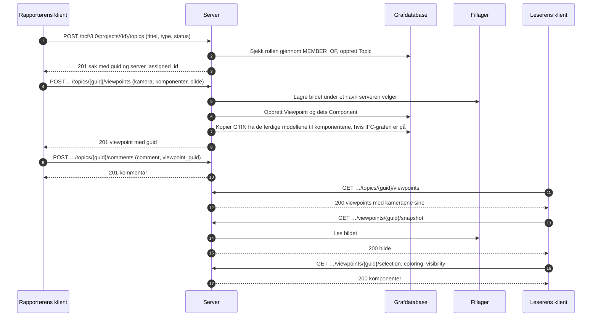

# BCF-viewpoint-flyten

Hvordan en klient oppretter en sak med en visning av modellen, og hvordan noen andre
åpner den samme visningen. Dette er BCF API 3.0, avsnitt 3.2 (saker) og 3.5
(viewpoints). Eksemplet [create_topic.py](../../examples/create_topic.py) gjør første
halvdel med klientbiblioteket.



Et viewpoint kan ikke endres. Det opprettes helt og slettes helt, så en kommentar som
peker på det, fortsatt peker på det samme.

## Hva et viewpoint inneholder

| Del | Hva den sier | Hvor en klient leser den |
|---|---|---|
| Kamera | Posisjon, retning og oppvektor, perspektiv eller ortogonal | I viewpointet |
| Linjer og snittplan | Hva som tegnes i visningen, og hva som skjæres bort | I viewpointet |
| Markering | Komponentene som er markert | `/selection` |
| Fargelegging | Komponentene som har en farge | `/coloring` |
| Synlighet | Hva som er synlig fra start, og unntakene | `/visibility` |
| Øyeblikksbilde | Et bilde av visningen, PNG eller JPEG | `/snapshot` |
| Bitmaps | Bilder plassert i visningen | `/bitmaps/{id}` |

## Hvem får gjøre hva

| Handling | Krever |
|---|---|
| Lese saker, kommentarer og viewpoints | Medlemskap i prosjektet, i hvilken som helst rolle |
| Opprette en sak | Handlingen `createTopic`: contributor, editor eller manager |
| Legge til et viewpoint eller en kommentar | Handlingen `createViewpoint` eller `createComment`: contributor, editor eller manager |
| Legge til et dokument i prosjektet og vise til det fra en sak | Handlingen `createDocument`: contributor, editor eller manager; en contributor viser til det fra sine egne saker |
| Slette et viewpoint | Forfatteren som contributor; editor og manager sletter hvilket som helst |

Et prosjekt brukeren ikke er medlem av, finnes ikke for vedkommende (404).

## Fra et viewpoint til modellen

Når [IFC-LPG](../ifc-lpg.md) er på, får hver komponent som nevner en `GlobalId`
prosjektets ferdige modeller har, elementets GTIN som `gtin`, også når modellen
lastes opp etterpå; selve elementet finnes gjennom sin `GlobalId`:

```cypher
MATCH (:Viewpoint {guid: $viewpoint})-[:HAS_COMPONENT]->(c:Component)
MATCH (e:IfcProduct {GlobalId: c.ifc_guid})
RETURN c.ifc_guid, e.Name, c.gtin
```
