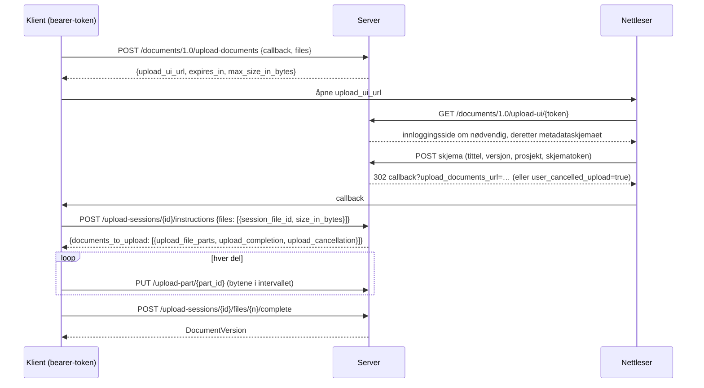
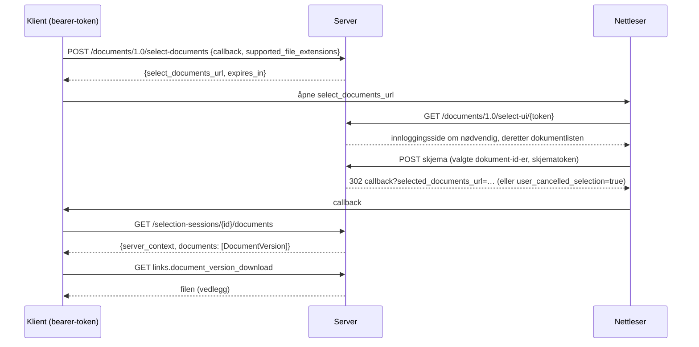

# Documents API-flyter

Documents API 1.0 er en samtale mellom tre parter: klientapplikasjonen, denne
serveren og brukerens nettleser. Klienten snakker med API-et med et
bearer-token; nettleseren viser serverens egne sider (innlogging, inntasting
av metadata, dokumentvalg); serveren kaller aldri klienten, den omdirigerer
bare nettleseren til klientens callback-URL.

## Opplasting

* UI-lenken er gyldig i `OPENCDE_DOCUMENTS_SESSION_TTL_SECONDS` (10
  minutter); når instruksjoner er utstedt, lever sesjonen
  `OPENCDE_UPLOAD_SESSION_TTL_SECONDS` (24 timer) slik at store filer kan
  lastes opp.
* Delene er `OPENCDE_UPLOAD_PART_BYTES` (50 MiB) hver, lastes opp i vilkårlig
  rekkefølge, parallelt hvis klienten vil. En del må være nøyaktig det
  annonserte intervallet.
* Fullføringen setter sammen delene, verifiserer den totale størrelsen,
  beregner SHA-256 og oppretter versjonen. Tar det mer enn 15 sekunder,
  begynner svaret med blanktegn for å holde forbindelsen åpen.
* `document_id` i en filpost gjør opplastingen til en ny versjon av det
  dokumentet; tittelen beholdes, versjonsindeksen øker.
* `base_version_index` i en filpost (en utvidelse) sier hvilken versjon
  opplastingen bygger på: fullføringen svarer `412 version_conflict` når
  dokumentet allerede har en nyere, og versjonens metadata angir basen.
* Et prosjekt kan avvise filer med valideringsfeil: fullføringen svarer da
  `422 ifc_validation_failed` med rapportens adresse, og
  `POST …/projects/{id}/ifc-precheck` kontrollerer en fil uten å lagre den.

## Utvalg og nedlasting

* Listen viser den siste versjonen av hvert dokument i brukerens prosjekter,
  filtrert på klientens filendelser med en lenke "vis alle".
* Brukere med rollen editor eller manager kan laste opp en fil fra siden; den
  vises i listen straks (dette er et tillegg til spesifikasjonen).
* `POST /documents/1.0/document-versions` svarer med de siste versjonene av
  en liste dokument-id-er med en `ETag`; `If-None-Match` gir `304`.

[Dataspatium](https://github.com/marwiss/Dataspatium) implementerer begge
flytene fra nettleseren (`src/api/families/opencde.js`): den åpner serverens
utvalgsside i et popup-vindu og importerer de valgte filene, og laster opp
datasett, filer og arbeidsområdepakker i deler med serverens opplastingsside
for metadata; live-suitene dets kjører disse flytene mot utviklingsstakken.

## Hvem får gjøre hva

| Handling | Krever |
|---|---|
| Starte en opplasting eller et utvalg | et bearer-token med scopet `documents` |
| Bruke nettlesersidene | en nettlesersesjon som samme bruker (`/signin`) |
| Lagre metadata, fullføre en opplasting, laste opp fra siden | prosjekthandlingen `createDocument` (editor, manager) |
| Se, velge og laste ned dokumenter | medlemskap i prosjektet (enhver rolle) |

Dokumenter i andre prosjekter finnes ikke for kalleren (404), så verken
id-ene eller eksistensen deres lekker.
