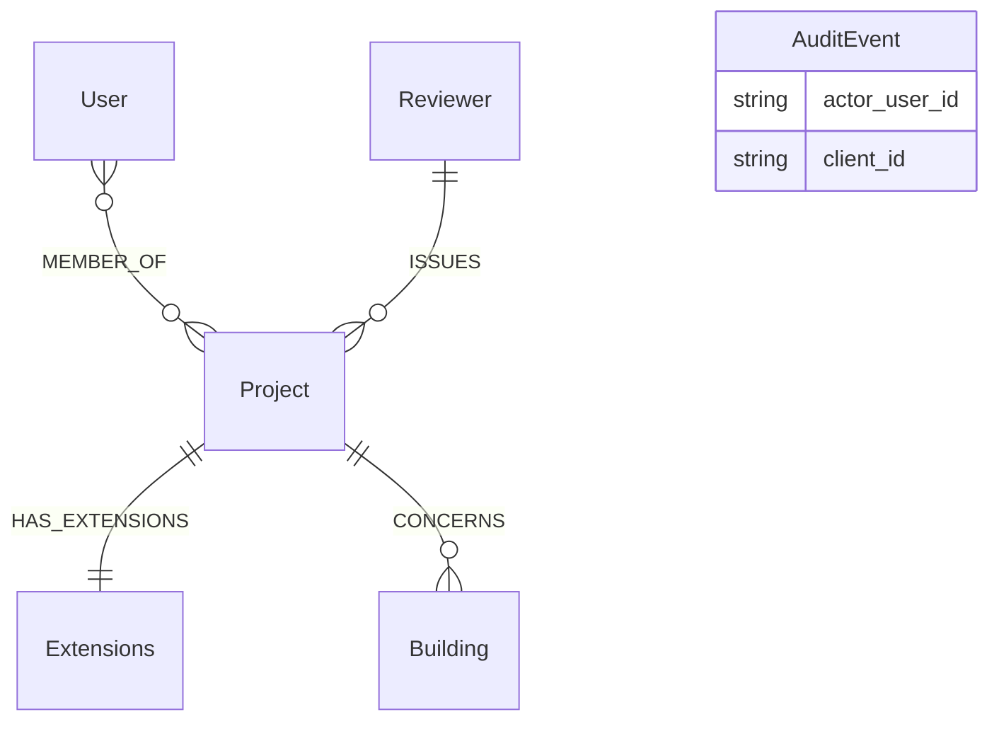
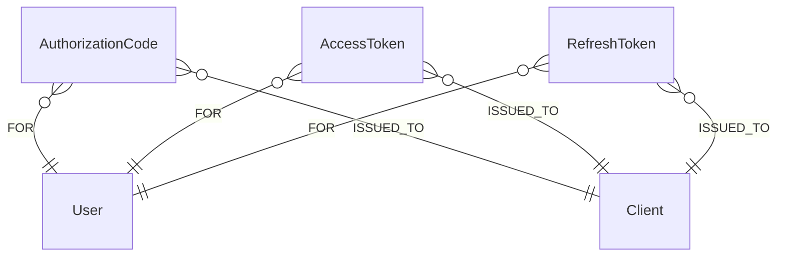
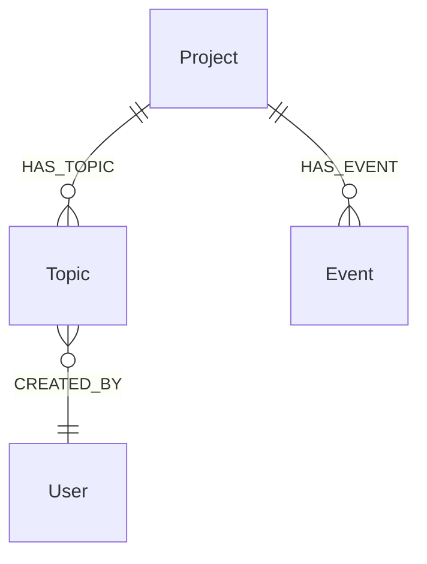
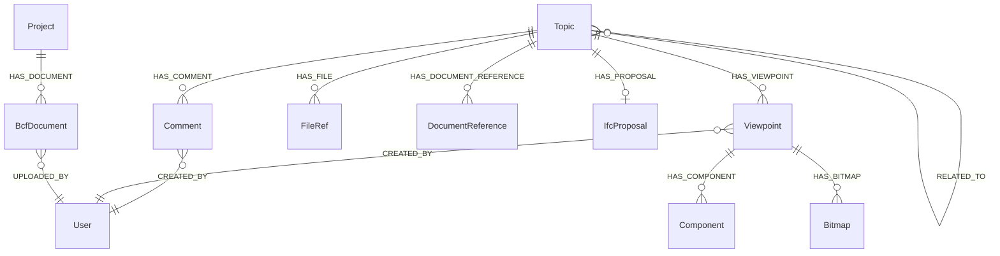
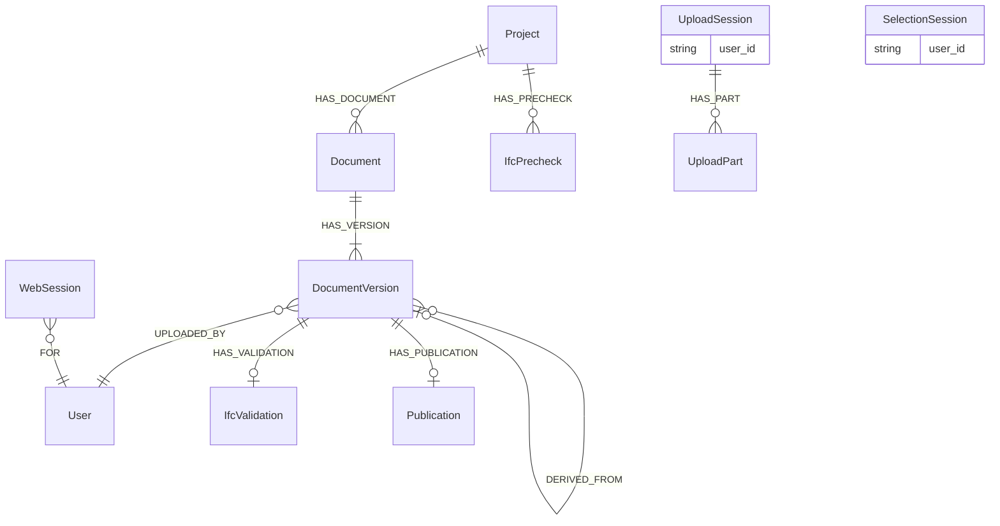
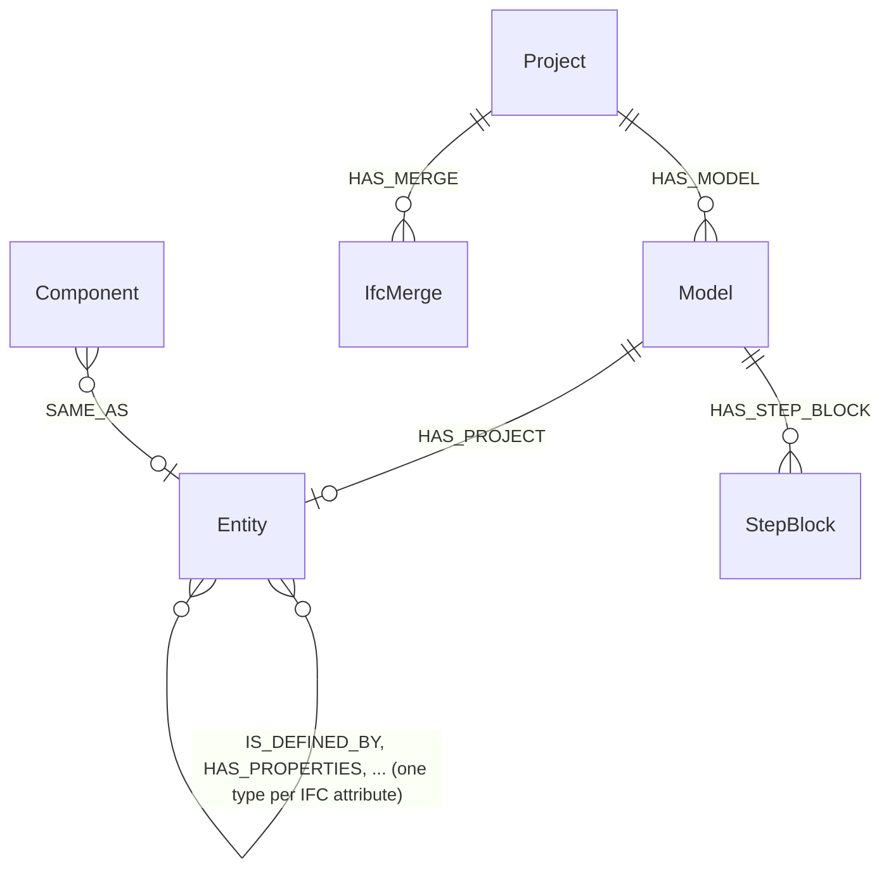

# Grafskjema

Databasen er skjemaløs; `opencde/graph/schema.py` er skjemaet. Denne siden
forklarer konvensjonene og etikettene, avsnitt for avsnitt i den rekkefølgen
planens etapper la dem til.

## Konvensjoner

- Hver node har en servergenerert UUID i `id` (eller spesifikasjonens navn på
  den: `project_id`, `guid`, `client_id`, `document_id`) med en unik
  constraint. Ingenting en klient sender, ender ukontrollert i en filsti eller
  en databasenøkkel.
- Tidsstempler er ISO 8601-strenger i UTC med millisekunder og en `Z`
  (`2026-11-05T12:34:56.789Z`). Strengrekkefølge er lik tidsrekkefølge.
- Koordinater og vektorer er vanlige flyttall (`x`, `y`, `z`), aldri `point()`.
- Alt som utløper, bærer `expires_at` (samme format); serveren sletter utløpte
  noder på en timer (`opencde/graph/cleanup.py`).
- Hemmeligheter (koder, tokens, klienthemmeligheter) lagres bare som
  SHA-256-hasher.
- Cypher er dialektnøytral, så Neo4j og Memgraph oppfører seg likt (ADR 0003).
  Skjema-DDL er den eneste produktspesifikke teksten og ligger i
  `graph/dialect.py`.
- Navn: etiketter skrives i PascalCase (`DocumentVersion`, `Model`),
  relasjonstyper med store bokstaver og understreker (`HAS_TOPIC`,
  `CREATED_BY`, og `IS_DEFINED_BY` for IFC-attributtrelasjonene). Diagrammene
  nedenfor tegner bare virkelige noder og relasjoner; en referanse som holdes
  som egenskap (`AuditEvent.actor_user_id`, `UploadSession.user_id`), listes i
  boksen i stedet for å tegnes som en linje.

## Kontoer og tilgang (etappe 1)

| Etikett | Nøkkel | Egenskaper | Merknader |
|---|---|---|---|
| `User` | `id`, unikt `username` | `email`, `full_name`, `password_hash` (Argon2id), `is_admin`, `disabled`, `created_at`, `must_change_password` | Brukernavnet er bruker-id-en API-ene eksponerer |
| `MEMBER_OF` (relasjon User → Project) | | `role` (viewer, contributor, editor, manager), `since` | Rollene avbildes på BCFs `*_actions`, se `accounts/roles.py` |
| `Project` | `project_id` | `name`, `created_at`, `topic_counter`, `block_on_validation_errors` | `topic_counter` nummererer `server_assigned_id`; `block_on_validation_errors` avviser opplastinger med valideringsfeil (ADR 0021) |
| `Extensions` | `id` | `topic_type[]`, `topic_status[]`, `topic_label[]`, `snippet_type[]`, `priority[]`, `stage[]`, `custom_information[]` | `users[]` beregnes fra medlemmene |
| `Client` | `client_id` | `name`, `description`, `url`, `redirect_uris[]`, `is_public`, `secret_hash`, `disabled`, `pending_approval`, `created_at`, `created_by`, `dynamic`, `expires_at` (bare selvregistrerte) | OAuth2-klient; en selvregistrert slettes når `expires_at` er passert uten at et token er utstedt |
| `AuditEvent` | `id` | `type`, `at`, `actor_user_id`, `client_id`, `ip`, `details` (JSON-streng) | Sikkerhetsrelevante hendelser |
| `Reviewer`, `Building` | `id` | `name`, `status` | Kontekst fra kontrollplan-bruksområdet (seed-data): den granskende organisasjonen (en kommune i den opprinnelige historien) og bygningen |

## OAuth2 (etappe 2)

`AuthorizationCode`, `AccessToken` og `RefreshToken` (med `family_id`) nøkles
på en hash av hemmeligheten, bærer `expires_at` og er knyttet
`-[:FOR]->(:User)` og `-[:ISSUED_TO]->(:Client)`. `WebSession`
(nettleserinnlogging, etappe 5) er bare knyttet `-[:FOR]->(:User)`.

## BCF-saker og hendelser (etappe 3)

| Etikett | Nøkkel | Egenskaper | Merknader |
|---|---|---|---|
| `Topic` | `guid` | `server_assigned_id`, `title`, `topic_type`, `topic_status`, `priority`, `stage`, `labels[]`, `reference_links[]`, `assigned_to`, `description`, `index`, `due_date`, `creation_date`, `creation_author`, `modified_date`, `modified_author`, `snippet_type`, `snippet_is_external`, `snippet_reference`, `snippet_reference_schema` | Feltnavnene følger `topic_GET.json`; BIM snippet-objektet flates ut til fire egenskaper. `server_assigned_id` er `<prefiks><teller>` fra `Project.topic_counter` |
| `IfcProposal` | `id` | `state`, `created_at`, `checked_at`, `base_document_id`, `base_version_index`, `change_count`, `applied`, `issue_count`, `error_count`, `truncated`, `ruleset`, `checks`, `report`, `storage_key`, `snippet_key`, `author`, `error` | Prøven av en saks endringssett mot basisversjonen (ADR 0021); `report` holder anmerkningene basen mangler, `storage_key` den brukte filen, lagret for godkjenningen. Slettes med saken |
| `Event` | `id` | `kind` (`topic` eller `comment`), `topic_guid`, `comment_guid`, `author`, `date`, `action_types[]`, `action_values[]` | Én node per forespørsel som endret noe; de to parallelle listene er `actions`-arrayen i BCF 3.9/3.10. Knyttet til prosjektet slik at hendelser overlever saken sin |

Hver saksspørring starter i kallerens `User`-node og går via `MEMBER_OF` til
prosjektet før den rører en sak, så en sak i et prosjekt kalleren ikke er
medlem av, finnes ikke så langt API-et angår (404).

## BCF-kommentarer, viewpoints og referanser (etappe 4)

| Etikett | Nøkkel | Egenskaper | Merknader |
|---|---|---|---|
| `Comment` | `guid` | `topic_guid`, `date`, `author`, `comment`, `viewpoint_guid`, `modified_date`, `modified_author` | `viewpoint_guid` må navngi et viewpoint i samme sak |
| `Viewpoint` | `guid` | `index`, `author`, `creation_date`, `camera_kind`, `camera` (JSON), `lines` (JSON), `clipping_planes` (JSON), `snapshot_type`, `storage_key`, `has_components`, `default_visibility`, `has_hints`, `spaces_visible`, `space_boundaries_visible`, `openings_visible` | Uforanderlig. Geometri er JSON-tekst: opak, og identisk i begge databasene |
| `Component` | `id` | `role` (`selection`, `coloring`, `exception`), `group_index`, `position`, `color`, `ifc_guid`, `originating_system`, `authoring_tool_id` | Én node per forekomst; IFC-grafen knytter `ifc_guid` til modellelementer (etappe 9) |
| `Bitmap` | `guid` | `position`, `bitmap_type`, `storage_key`, `height`, `loc_*`, `nrm_*`, `up_*` | Bildebytes i lageret under `bitmaps/<guid>.<type>` |
| `FileRef` | `id` | `position`, `ifc_project`, `ifc_spatial_structure_element`, `filename`, `date`, `reference` | Filene i sakens hode (BCF 3.3) |
| `DocumentReference` | `guid` | `document_guid` eller `url`, `description`, `created_at` | Nøyaktig ett av de to målene |
| `BcfDocument` | `guid` | `filename`, `storage_key`, `size`, `created_at`, `author` | En fil lastet opp gjennom BCF 3.8; bytes under `bcf-documents/<guid>` |
| `RELATED_TO` (relasjon Topic → Topic) | | | Rettet; PUT erstatter en saks utgående liste |

Saker holder snippet-filen sin i `snippet_storage_key` (bytes under
`snippets/<saks-guid>.bin`). Sletting av en sak sletter alt under den og
lagernøklene samlet fra nodene; hendelsene blir igjen.

## Dokumenter og nettlesersesjoner (etappe 5)

| Etikett | Nøkkel | Egenskaper | Merknader |
|---|---|---|---|
| `Document` | `document_id` | `title`, `created_at`, `latest_index` | `latest_index` nummererer versjonene |
| `DocumentVersion` | `id` | `version_index`, `version_number`, `creation_date`, `title`, `file_name`, `size_in_bytes`, `sha256`, `storage_key`, `author`, `metadata` (JSON), `parent_version_index`, `approved_by`, `change_set_id`, `change_set` | Bytes under `documents/<id>`; API-kroppen viser bare spesifikasjonens felter; `parent_version_index`, `approved_by`, `change_set_id` og `change_set` (endringene, pakket) på en versjon bygget på en annen, lenket til den med `DERIVED_FROM` (ADR 0021) |
| `IfcValidation` | `id` | `state`, `checked_at`, `issue_count`, `truncated`, `ruleset`, `report`, `storage_key`, `file_name`, `error` | Kontrollen av en opplastet IFC-fil mot IFC-skjemaet (ADR 0011); `report` er opptil 10 000 anmerkninger som komprimert JSON. Slettes med versjonens prosjekt |
| `Publication` | `id` | `storage_key`, `file_name`, `size_in_bytes`, `sha256`, `published_at`, `published_by` | Arkivet til en publisert versjon, `.ifczip` eller `.zip`, under `published/<id>`; ett per versjon. Slettes med versjonens prosjekt |
| `IfcPrecheck` | `id` | de samme som `IfcValidation`, `project_id`, `author`, `expires_at` | En fil kontrollert uten å bli en versjon, eller en opplasting prosjektet avviste (ADR 0021); har også etiketten `IfcValidation`. Oppryddingsjobben sletter den og filen dens etter et døgn |
| `UploadSession` | `id`, indeksert `token_hash` | `user_id`, `username`, `callback_url`, `callback_expires_at`, `expires_at`, `server_context`, `project_id`, `state`, `files_json` | `id` opptrer i API-URL-er (bearer kreves); UI-URL-en bærer tokenet hvis hash lagres |
| `UploadPart` | `id` | `file_index`, `part_index`, `range_start`, `range_end`, `received`, `storage_key`, `size`, `expires_at` | Bytes under `parts/<id>` til filen settes sammen; oppryddingsjobben sletter utløpte deler og filene deres |
| `SelectionSession` | `id`, indeksert `token_hash` | `user_id`, `callback_url`, `callback_expires_at`, `expires_at`, `server_context`, `extensions[]`, `state`, `selected[]` | `selected` holder `document_id:version_index`-par valgt i nettleseren |
| `WebSession` | `id` (hash av cookien) | `created_at`, `expires_at`, `idle_expires_at`, `ip` | Nettleserinnlogging; `expires_at` er den absolutte levetiden |
| `SignInThrottle` | `key` (hash av brukernavnet) | `failures`, `blocked_until`, `expires_at` | Mislykkede innlogginger per brukernavn; utløper et døgn etter siste feil, og en vellykket innlogging fjerner den |

## IFC-graf (etappe 9)

| Etikett | Nøkkel | Egenskaper | Merknader |
|---|---|---|---|
| `Model` | `id`, indeksert `project_id` | `document_id`, `version_index` eller `bcf_document_guid`, `file_name`, `storage_key`, `state`, `schema`, `ifc_project_guid`, `entities`, `relationships`, `skipped`, `lossless`, `geometry`, `ifc_header`, `geometry_key`, `spatial_at`, `spatial_products`, `spatial_failed`, `spatial_error`, `error`, tidsstempler | Én per importert fil; `state` er `queued`, `running`, `done` eller `failed` |
| `Entity` + klasseetiketter | `id` (`<modell-id>:<step-id>`), indeksert `GlobalId`, `model_id` | `ifc_class`, `step_id`, `bbox_min`, `bbox_max`, `bbox_centre` (punkter i prosjektkoordinater, meter, på en bygningsdel med form), hvert literalt IFC-attributt ved navn | Relasjoner mellom entiteter navngis etter IFC-attributtet (forover og inverst), skrevet som enhver relasjonstype med store bokstaver og understreker: `IsDefinedBy` blir `IS_DEFINED_BY` |
| `StepBlock` | `id` (`<modell-id>:<første step-id>`) | `first_step`, `instances`, `text` | Instanser i en modell konvertert med `OPENCDE_IFC_LPG_LOSSLESS` som ikke er noder: skrevet ut som STEP i id-rekkefølge og komprimert. Ikke returner noden hel i en spørring, på grunn av `text` |
| `IfcMerge` | `id` | `project_id`, `state`, `request`, `author`, `created_at`, `running_at`, `finished_at`, `model_id`, `version_index`, `report`, `error` | En bygning fra modell B ført inn i en modell i prosjektet (`HAS_MERGE`); `request` oppgir begge versjonene, og `version_index` er versjonen den ble. Den sammenslåtte modellen tas ut av grafen når den er skrevet ut. Slettes med prosjektet |

Se [ifc-lpg.md](ifc-lpg.md) for konverteringsreglene og eksempelspørringer.
