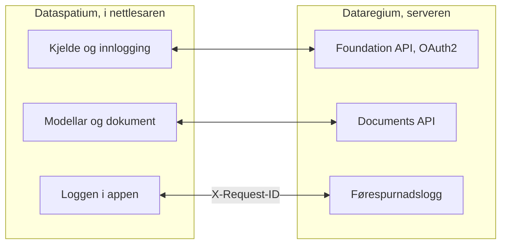

[Svenska](../../README.md) · [Dansk](../da/README.md) · [Norsk bokmål](../nb/README.md) · **Norsk nynorsk** · [Suomi](../fi/README.md) · [Íslenska](../is/README.md) · [English](../en/README.md)


# Dataregium OpenCDE-server

*Dataregium heitte Kontroll fram til 8. november 2026.*

*Dette er README-en for Dataregium 1.0.0. Den siste utgjevinga, 3.0.0, er skildra i [README-en på main](https://github.com/marwiss/Dataregium/blob/main/docs/nn/README.md).*

Dataregium er ein server der eit byggjeprosjekt samlar modellane, dokumenta og sakene
sine, slik at alle i prosjektet arbeider ut frå det same grunnlaget og ser den same
historikken. Du arbeider med han gjennom ein app, til dømes
[Dataspatium](https://github.com/marwiss/Dataspatium) i nettlesaren; serveren har
sjølv berre sider for innlogging, opplasting og administrasjon. Den som driv serveren,
avgjer kven som får logge inn, og kva kvar enkelt får gjere i kvart prosjekt.

Teknisk er Dataregium ein server for dei opne **OpenCDE-API-a** til buildingSMART
(Foundation API 1.0, BCF API 3.0 og 2.1 og Documents API 1.0), bygd på
grafdatabasen Neo4j eller Memgraph. 1.0.0 er ein dokumentserver med Foundation API og Documents API; saker og modellar som graf kjem i 2.0.0. Serveren vart skriven om frå grunnen av ut
frå ein forskingsprototype frå 2023, med tryggleik som det første kravet, og kvar
klient som følgjer spesifikasjonane, kan kople seg til.


**Innhald**

- [Last ned og kom i gang](#last-ned-og-kom-i-gang)
- [Kva som krevst](#kva-som-krevst)
- [Ord du bør kjenne](#ord-du-bør-kjenne)
- [Kva du kan gjere](#kva-du-kan-gjere)
- [OpenCDE-API-a og klientane deira](#opencde-api-a-og-klientane-deira)
- [Dataregium og Dataspatium](#dataregium-og-dataspatium)
- [Lær meir](#lær-meir)
- [Avgrensingar i korte trekk](#avgrensingar-i-korte-trekk)
- [Personopplysningar](#personopplysningar)
- [Nyare utgjevingar](#nyare-utgjevingar)
- [Feil og framlegg](#feil-og-framlegg)
- [Utvikling](#utvikling)
- [Lisens](#lisens)

## Last ned og kom i gang

Skal du berre bruke Dataregium, treng du ikkje installere noko: be den som driv
serveren, om adressa og ein konto, og logg inn frå Dataspatium eller ein annan
OpenCDE-app. Vil du prøve serveren på di eiga datamaskin, følgjer du snøggstarten
nedanfor. Han tek om lag tjue minutt og krev Docker Desktop eller Podman. Er du van
med containerar og Python, står den korte vegen under
[For den teknisk kunnige](#for-den-teknisk-kunnige).

### Snøggstart (lokalt, Docker eller Podman)

Ein container er eit ferdigpakka program som køyrer åtskilt på datamaskina, og Docker
og Podman er program som startar containerar. Snøggstarten startar to: serveren og
databasen hans.

1. **Last ned.** Hent koden med git, eller som ZIP-fil under *Code > Download ZIP* på
   GitHub. Kommandoen nedanfor hentar greina `release-1`, som er 1.0.0; `release-2` er 2.0.0, og
   `main` er 3.0.0.

   ```sh
   git clone --branch release-1 https://github.com/marwiss/Dataregium.git
   cd Dataregium
   ```

2. **Still inn.** Kopier `.env.example` til `.env`, fila med innstillingane til
   serveren, og set `OPENCDE_GRAPH_PASSWORD` til ditt eige passord på minst 16 teikn.
   Skal du prøve med Dataspatium, set du òg
   `OPENCDE_DYNAMIC_CLIENT_REGISTRATION=true` og `OPENCDE_REQUEST_LOG_ENABLED=true`; [snøggstarten med Dataspatium](quickstart.md)
   forklarer kvifor. Kvar innstilling er forklart i [.env.example](../../.env.example).
3. **Start.** Dei same compose-filene verkar med Docker og med Podman; vel den du har:

   <details open>
   <summary><b>Docker</b></summary>

   ```sh
   docker compose up -d --build
   ```

   startar serveren på <http://127.0.0.1:8000> og ein Neo4j-database; første gongen tek nokre minutt. `docker compose logs -f api` viser serverloggen.

   </details>

   <details>
   <summary><b>Podman</b></summary>

   ```sh
   podman compose up -d --build
   ```

   gjer det same med Podman 5 (rootless, utan daemon); `podman compose logs -f api` viser serverloggen. Sjå [deploy/local.md](deploy/local.md) for særdraga til Podman.

   </details>

   <details>
   <summary><b>Utan container</b></summary>

   ```sh
   uv sync                          # installerer Python 3.13 og alle avhengnader
   uv run opencde doctor            # kontrollerer konfigurasjonen og databasen
   uv run opencde serve             # http://127.0.0.1:8000
   ```

   køyrer serveren frå utsjekkinga med [uv](https://docs.astral.sh/uv/); ein database trengst framleis (Neo4j Desktop, Memgraph Lab eller databasen frå compose-filene).

   </details>

4. **Sjå deg rundt.** <http://127.0.0.1:8000/docs> viser kvart kall serveren tek imot,
   og lèt deg prøve dei, <http://127.0.0.1:8000/readyz> seier om serveren og databasen
   er klare, og <http://127.0.0.1:7484> er Neo4j Browser, der du ser databasen (Bolt på
   `127.0.0.1:7697`; utviklingsoverlagringa unngår standardportane til Neo4j, som ofte
   er opptekne av ein annan Neo4j på same datamaskin).
5. **Legg inn demodata og logg inn.**

   <details open>
   <summary><b>Docker</b></summary>

   ```sh
   docker compose exec api opencde seed
   ```

   </details>

   <details>
   <summary><b>Podman</b></summary>

   ```sh
   podman compose exec api opencde seed
   ```

   </details>

   <details>
   <summary><b>Utan container</b></summary>

   ```sh
   uv run opencde seed
   ```

   </details>

   Kommandoen opprettar demobrukarar, prosjekt, klientar og ein eksempelmodell som dokument. Passorda blir skrivne ut éin gong. Logg
   inn på <http://127.0.0.1:8000/signin> som `admin` og opne `/admin`.
6. **Kople til ein klient.** Registrer appen din under *Klientar* (eller la han
   registrere seg sjølv når `OPENCDE_DYNAMIC_CLIENT_REGISTRATION=true`) og peik han mot
   `http://127.0.0.1:8000`; [Dataspatium](#dataregium-og-dataspatium) og
   Python-biblioteket i [client/](../../client/) er ferdige klientar. Skal du logge inn
   frå Dataspatium, følgjer du [snøggstarten](quickstart.md): han går gjennom alle
   innstillingane som trengst, og kva du gjer om noko går gale.

### Utrulling

Skal andre bruke serveren, må han liggje på ei datamaskin som alltid er på og kan
nåast frå internett, med eiga adresse og https. Tabellen viser måtane å gjere det på;
den som ikkje sjølv driv serverar, overlèt det til nokon som gjer det. Kvar måte er éi
compose-fil pluss ei overlagring:

| Scenario | Rettleiing |
|---|---|
| Lokal test på datamaskina di | [deploy/local.md](deploy/local.md) |
| Offentleg https-adresse for klienttestar utan eigen server (tunnel) | [deploy/tunnel.md](deploy/tunnel.md) |
| Produksjon på eigen server med Caddy (automatisk TLS) og nattlege tryggingskopiar | [deploy/vps-caddy.md](deploy/vps-caddy.md) |
| Coolify, Dokploy, Portainer | [deploy/paas.md](deploy/paas.md) |
| Ei containerteneste pluss ein administrert Neo4j AuraDB eller Memgraph Cloud | [deploy/cloud-aura.md](deploy/cloud-aura.md) |
| Tryggingskopiering og gjenoppretting (flyttbar mellom Neo4j og Memgraph) | [deploy/backup.md](deploy/backup.md) |

`uv run opencde init --public-url https://cde.example.org` skriv ein
produksjons-`.env` med nye løyndarmål; `opencde doctor` kontrollerer resultatet.

### Konfigurasjon

Alt blir lese frå miljøvariablar med prefikset `OPENCDE_`, frå `.env` eller frå
Docker-løyndarmål i `/run/secrets/opencde_<namn>`. Den kommenterte lista finst i
[.env.example](../../.env.example). Standardverdiane er trygge: produksjon nektar å
starte utan ei offentleg `https`-adresse og eit databasepassord, og ingenting er ope
før det er konfigurert.

### For den teknisk kunnige

- **Image**: `ghcr.io/marwiss/opencdeserver:1.0.0` for amd64 og arm64, skanna med Trivy og med
  SBOM; `OPENCDE_IMAGE_TAG` vel i compose-filene, og 3-serien har taggen `3.0.0`.
- **Compose**: `docker/compose.yaml` pluss overlagringar for utvikling, produksjon med Caddy, Memgraph,
  ein ekstern database, Bolt med TLS og ein tunnel. `COMPOSE_FILE` i `.env` vel dei, så kommandoane er utan `-f`.
- **Utan container**: Python 3.11 eller nyare med uv (prøvd på 3.11, 3.13 og 3.14), `uv sync`, og
  Neo4j 5.26 eller Memgraph 3.14 på `OPENCDE_GRAPH_URI`.
- **Dei viktigaste innstillingane**: `OPENCDE_APIS` vel API-a og er `["documents"]` i 1.0.0, så
  BCF API er slått av; `OPENCDE_ENVIRONMENT` er `development` eller `production`.
- **Endepunkt**: `/.well-known/dataregium` (versjonen og utvidingane som er slått på),
  `/foundation/versions`, `/openapi.json` og `/docs`, `/healthz` og `/readyz`, `/admin/api` (administrasjon) og
  `/manage/1.0` (prosjektadministrasjon).
- **Kommandolinja**: `opencde serve`, `init`, `doctor`, `seed`, `backup`, `restore`,
  `revoke`, `cleanup` og gruppene `user`, `project`, `client` og `ifcgraph`;
  `uv run opencde --help`.
- **Å byggje ein klient**: [klientrettleiinga](client-guide.md) har flytane,
  kapabilitetsdokumentet, feilkodane og utvidingane, og [docs/examples/](../examples/)
  køyrbare døme.

## Kva som krevst

Den som berre bruker Dataregium gjennom ein app, treng ein nettlesar og ein konto. For
å køyre serveren sjølv:

- Windows, macOS eller Linux med Docker (Desktop på Windows/macOS, Engine på Linux)
  eller Podman 5, eller Python 3.11 eller nyare med [uv](https://docs.astral.sh/uv/)
  og ein eigen Neo4j 5.26- eller Memgraph 3.14-database.
- Om lag 1 GB minne til databasecontaineren (`NEO4J_HEAP` og `NEO4J_PAGECACHE` i
  `.env`), og meir for store modellar med IFC-LPG.
- Lokalt: port 8000 for serveren og 7484/7697 for databasen, alle bundne til
  `127.0.0.1`. I produksjon: portane 80 og 443 tilgjengelege frå internett og eit
  DNS-namn for serveren.
- Klientar treng ei `https`-adresse i produksjon; lokalt blir `http://127.0.0.1`
  godteken som redirect-URI, og `http://localhost` med `OPENCDE_ALLOW_LOCALHOST_REDIRECTS=true`.

## Ord du bør kjenne

Orda denne README-en bruker, i kvardagsspråk; heile ordlista finst i
[glossary.md](glossary.md).

- **BIM**: å byggje og forvalte med ein digital modell av bygningen, der kvar vegg,
  dør og kvart rom er eit objekt med eigenskapar og ikkje berre strekar på ei teikning.
- **CAD**: program for teikningar og modellar; ein BIM-modell blir laga i eit CAD-program.
- **IFC**: det opne filformatet for BIM-modellar, som dei store programma kan lese og skrive.
- **BCF og saker**: eit ope format for spørsmål og merknader om ein modell, med
  kommentarar og ei vising (viewpoint) som viser kvar i modellen det gjeld.
- **IDS**: eit krav til kva ein modell skal innehalde, til dømes at kvar dør har ein
  brannklasse; serveren kontrollerer modellane mot krava til prosjektet.
- **OpenCDE**: dei opne reglane til buildingSMART for korleis appar og serverar i eit
  byggjeprosjekt snakkar med kvarandre. CDE tyder felles datamiljø.
- **API**: måten ein app snakkar med serveren på, med faste spørsmål og svar.
- **Server og klient**: serveren lagrar og deler grunnlaget til prosjektet; klienten
  er appen du arbeider i, til dømes Dataspatium.
- **Database og graf**: databasen er der serveren lagrar alt. Ein grafdatabase lagrar
  ting og sambanda mellom dei, som ein vegg som står på ein etasje, og kan difor svare
  på spørsmål om korleis delane heng saman.
- **Container**: eit ferdigpakka program som køyrer åtskilt på datamaskina; Docker og
  Podman startar dei.
- **OAuth2**: den trygge måten å logge inn frå ein app på utan at appen får passordet ditt.
- **Versjon**: kvar gong eit dokument blir lasta opp på nytt, blir det ein ny versjon, og dei tidlegare
  blir liggjande.

## Kva du kan gjere

Det som verkar i éin versjon, verkar òg i den neste. Kvar versjon høyrer saman med den
same versjonen av Dataspatium.

### Versjon 1 (med Dataspatium 1)

- **Dokument på éin stad** (Documents API 1.0): velje, laste opp og hente dokument og
  versjonane deira gjennom sidene til serveren, frå ein app som Dataspatium.
- **Innlogging og appar** (Foundation API 1.0): éin konto per person, innlogging med
  OAuth2 og PKCE, og appar som ein administrator registrerer, eller som registrerer seg
  sjølve når operatøren tillèt det (sjå [klientrettleiinga](client-guide.md)).
- **Administrasjon** i nettlesaren (`/admin`) og på kommandolinja: brukarar og
  prosjektrollene deira, prosjekt, klientar, økter, revisjonsloggen og helsesjekkane;
  kvar brukar har `/account` for passordet og appane sine.
- **Hjelp for den som byggjer ein app**, merkt som utvidingar: eit
  kapabilitetsdokument (`/.well-known/dataregium`), ein stabil feilkode i kvart
  feilsvar og ein førespurnadslogg.
- **Eit klientbibliotek** i Python ([client/](../../client/)) med køyrbare døme, og
  eit publisert image for kvar utrulling.
- **Prosjektansvarlege administrerer prosjektet sitt**: ein `manager` legg til og
  fjernar medlemmer, byter rollene deira og gjev prosjektet nytt namn, utan å vere
  serveradministrator.

Det som òg finst i versjon 2 og 3, står i [README-en på main](https://github.com/marwiss/Dataregium/blob/main/docs/nn/README.md#kva-du-kan-gjere).


## OpenCDE-API-a og klientane deira

OpenCDE er familien til buildingSMART International av opne web-API-ar for eit felles
datamiljø, staden der eit prosjekt deler modellar, dokument og saker. Ein klient og ein
server som følgjer dei same spesifikasjonane, kan arbeide saman, same kven som har bygd
dei. Dataregium implementerer alle tre:

| API | Kva det er til | Spesifikasjon |
|---|---|---|
| Foundation API 1.0 | Seier kva API-ar ein server tilbyr, korleis ein loggar inn, og kven brukaren er | [foundation-API](https://github.com/buildingSMART/foundation-API) |
| BCF API 3.0 og 2.1 | Saker om ein modell, med kommentarar og viewpointar med kamera, komponentar og bilete | [BCF-API](https://github.com/buildingSMART/BCF-API) |
| Documents API 1.0 | Å velje, hente og laste opp dokument og versjonane deira, via sider på serveren | [documents-API](https://github.com/buildingSMART/documents-API) |

**Dataspatium er éin klient, ikkje den einaste.** Kvar klient som følgjer desse
spesifikasjonane, skal kunne kople seg til: ingenting på serveren er avhengig av
Dataspatium, og utvidingane utanfor spesifikasjonane er valfrie, så ein klient som ikkje
kjenner dei, merkar dei ikkje. Ein klient treng tre ting:

- ei registrering på serveren, gjord av ein administrator under *Klientar* eller av klienten
  sjølv når `OPENCDE_DYNAMIC_CLIENT_REGISTRATION=true`;
- OAuth2 authorization code med PKCE `S256`, som serveren krev av kvar klient unnateke ein konfidensiell som ein administrator har merkt;
- BCF API 3.0, eller 2.1 for ein klient som berre kan den versjonen. `GET /foundation/versions` listar begge, og
  [klientguiden](client-guide.md) fortel kva som skil dei.

Så langt er det vist: svara frå serveren blir testa mot skjemaa til buildingSMART ved kvar
push, og Dataspatium og Python-biblioteket i [client/](../../client/) køyrer mot serveren.
Uavhengige klientar som Bonsai og ifc-lite har ei ferdig sjekkliste som enno ikkje er køyrd. Om du prøver ein klient, fortel
korleis det gjekk under [Feil og framlegg](#feil-og-framlegg). Når ein klient og ein spesifikasjon ikkje
stemmer overeins, avgjer spesifikasjonen. [docs/nn/client-guide.md](client-guide.md) er for dei som byggjer
ein klient.

## Dataregium og Dataspatium

Dataspatium er appen du arbeider i, og Dataregium er serveren der det felles
grunnlaget til prosjektet ligg. [Dataspatium](https://github.com/marwiss/Dataspatium)
køyrer heilt i nettlesaren, og dei to er utvikla for å verke saman. Det same
utgåvenummeret tyder at dei verkar saman: Dataspatium 1.0.0 verkar med Dataregium 1.0.0
([snøggstart](quickstart.md)).

Dataspatium legg til ein Dataregium-server som kjelde: appen oppdagar API-a gjennom
`/foundation/versions`, loggar inn med OAuth2 authorization code og PKCE og registrerer seg sjølv som offentleg
klient når dynamisk registrering er slått på. Han vel dokument på sidene til serveren, får dei som datasett og
lastar opp datasett, filer og arbeidsområdepakkar gjennom Documents API. Appen sender `X-Request-ID` med kvart
kall, slik at førespurnadsloggen her og loggen i appen viser den same samtalen, og reagerer på feilkodane serveren
legg i feilsvara sine.

Slik heng dei saman:



Bortsett frå dei merkte utvidingane går alt Dataspatium gjer mot serveren, gjennom dei
tre OpenCDE-API-a, så appen bruker ingenting som ein annan klient ikkje kan bruke; sjå
[OpenCDE-API-a og klientane deira](#opencde-api-a-og-klientane-deira). Dei to
produkta blir installerte kvar for seg: dette repoet pakkar ikkje med Dataspatium
(lisensane er ulike, AGPL her og PolyForm Strict der), og README-en til Dataspatium
skildrar korleis appen blir henta og brukt.

### Utgåvene 1, 2 og 3

Det finst éi utgåve per hovudnummer, og ho blir gjeven ut på nytt når ho veks; berre
den siste i kvar serie blir retta. Dataregium og Dataspatium med same nummer høyrer saman:

| Dataregium | Kva ho har | Image | Høyrer saman med |
|---|---|---|---|
| 1.0.0 | Ein dokumentserver: Foundation API og Documents API, nettadministrasjonen på sju språk, prosjektadministrasjonen for den prosjektansvarlege og førespurnadsloggen. Ho er 2.0.0-koden med berre Documents API slått på (`OPENCDE_APIS`) | `1.0.0` | Dataspatium 1.0.0 |
| 2.0.0 | Òg BCF API 3.0 og 2.1 på dei same dataa og IFC-LPG-modulen som lagar ein graf av kvar opplasta IFC-fil | `2.0.0` | Dataspatium 2.0.0 |
| 3.0.0 | Òg den tapsfrie grafen frå biblioteket IFC-LPG, kontrollen av kvar opplasting, spørjingane, samanlikningane og kollisjonskontrollen, versjonar med endringsframlegg som blir prøvde, godkjende og slått saman, geometrien som glTF, den lokale motoren og oppskriftene for skya og nginx | `3.0.0`, `latest`, `3.0.0-gherkin` | Dataspatium 3.0.0 |

## Lær meir

- [quickstart.md](quickstart.md): Dataregium og Dataspatium saman på tjue minutt, frå
  ei tom datamaskin til ei sak oppretta i 3D-visinga.
- [client-guide.md](client-guide.md) og [docs/examples/](../examples/): korleis ein byggjer ein klient, kapabilitetsdokumentet, feilkodane og køyrbare døme med Python-biblioteket i [client/](../../client/).
- [architecture.md](architecture.md): korleis delane heng saman, kva som skjer med eit kall, og kvar alt finst i koden.
- [glossary.md](glossary.md): orda dokumentasjonen bruker.
- [flows/](flows/): sekvensdiagram for OAuth2-, Documents API- og BCF-viewpoint-flytane.
- [graph-schema.md](graph-schema.md): grafmodellen.
- [ifc-lpg.md](ifc-lpg.md): den valfrie IFC-LPG-modulen og døme på Cypher-spørjingar.
- Arkitekturavgjerder som ligg fast: ein grafdatabase som einaste lager, opake token i staden for JWT,
  portabel Cypher for Neo4j og Memgraph, eit nettgrensesnitt utan rammeverk, tryggingskopi på applikasjonsnivå,
  eit felles lager for avgrensingar og BCF API 2.1 ved sida av 3.0.
- [spec/SOURCES.md](../../spec/SOURCES.md): dei nøyaktige spesifikasjonsversjonane
  serveren blir testa mot.

Dokumentasjonen finst på dei sju språka til denne README-en, kvart språk under
`docs/<språk>/`; engelsk under `docs/en/` er kjelda. CONTRIBUTING er på engelsk.

### Vidare lesing

- [BCF API](https://github.com/buildingSMART/BCF-API), [Foundation API](https://github.com/buildingSMART/foundation-API) og [Documents API](https://github.com/buildingSMART/documents-API):
  spesifikasjonane serveren følgjer.
- [IFC](https://github.com/buildingSMART/IFC4.x-development): filformatet for bygningsmodellar, og [IDS](https://github.com/buildingSMART/IDS): kravspesifikasjonar som modellar blir kontrollerte mot.
- [RFC 9700](https://www.rfc-editor.org/rfc/rfc9700): dagens beste praksis for tryggleik i OAuth 2.0, og
  [OAuth 2.1](https://datatracker.ietf.org/doc/draft-ietf-oauth-v2-1/), utkastet som samlar han.
- [RFC 7636](https://www.rfc-editor.org/rfc/rfc7636) (PKCE), [RFC 8252](https://www.rfc-editor.org/rfc/rfc8252) (appar på datamaskina eller telefonen) og
  [RFC 7591](https://www.rfc-editor.org/rfc/rfc7591) (registrering av klientar).
- [OWASP ASVS](https://owasp.org/www-project-application-security-verification-standard/): sjekklista for tryggleiksarbeidet.

## Avgrensingar i korte trekk

- 1.0.0 tilbyr Foundation API og Documents API; saker gjennom BCF API og modellar som graf høyrer til 2.0.0 og 3.0.0.
- Community-utgåvene av Neo4j og Memgraph manglar databasebrukarar med berre lesetilgang, så ein eksponert Bolt-port
  gjev full tilgang til den som har passordet. Porten blir verande stengd med mindre administratoren publiserer han
  med vilje.
- Nettsidene er for innlogging, administrasjon, opplasting og val av dokument; sluttbrukarar arbeider i ein klient
  som Dataspatium.
- Sidene finst på dei sju språka til denne README-en (byt nedst på kvar side); kommandolinja og feilmeldingane til
  API-a er på engelsk.
- Inga ekstern gjennomgang enno. OAuch- og testssl-køyringane er stega til operatøren før ei produksjonsutrulling.

## Personopplysningar

Den som driv Dataregium for andre, er behandlingsansvarleg for dette. Serveren lagrar brukarkontoar (brukarnamn,
namn, valfri e-post, passordhash), prosjektmedlemskap, opplasta filer med den som lasta dei opp og ein revisjonslogg
over kven som gjorde kva og frå kva adresse. Passord, token og løyndarmål blir berre lagra som hashar. Token, økter,
opplastingsøkter og ubrukte sjølvregistrerte klientar går ut og blir rydda av serveren; revisjonsloggen blir avgrensa
av operatøren. Ein administrator slettar ein konto under `/admin/users`, og øktene og tokena følgjer med.
Revisjonsloggen blir eksportert som CSV, dokumenta gjennom Documents API og heile databasen med `opencde backup`. Kva
Dataspatium lagrar i nettlesaren, står i den eigne dokumentasjonen til appen.

## Nyare utgjevingar

Dataregium 2.0.0 legg til BCF API 3.0 og 2.1 med saker og viewpoints og IFC-LPG-modulen, som lagar ein graf av kvar
opplasta modell. 3.0.0 gjer dessutan grafen tapsfri, kontrollerer opplastingane og gjev spørjingar, samanlikningar,
versjonar med endringsframlegg, geometrien som glTF og ein lokal motor. 2.0.0 ligg på greina `release-2` og 3.0.0 på
`main`; begge er skildra i [README-en på main](https://github.com/marwiss/Dataregium/blob/main/docs/nn/README.md).

## Feil og framlegg

Rapporter feil og ønske som *Issues* her på GitHub. Oppgje kva serverversjon
du køyrer (`version` i `/.well-known/dataregium` eller `/healthz`), kva klient
du brukte og `X-Request-ID` for eit mislukka kall; førespurnadsloggen og
loggen til klienten deler han. Legg ikkje ved personopplysningar eller
løyndomar. Korleis endringar blir tekne imot står i
[CONTRIBUTING.md](../../CONTRIBUTING.md). Ved ein tryggingssårbarheit, følg
[SECURITY.md](../../SECURITY.md) i staden for å opne ei sak.

## Utvikling

```sh
uv run pytest                    # einings-, konformans- og tryggingstestar
uv run pytest -m integration     # startar Neo4j/Memgraph med testcontainers (krev Docker)
uv run pytest -m e2e             # klientbiblioteket mot ein køyrande server (krev Docker)
uv run pytest -m ui              # Playwright + axe-core (uv sync --group ui; playwright install chromium)
uv run ruff format . && uv run ruff check .
uv run ty check opencde client/opencde_client
```

Kode og kommentarar er på engelsk, og stilen følgjer konvensjonane til
IfcOpenShell (ruff, 120 kolonnar), slik at det held fram med å vere mogleg å
bidra med serveren til IfcOpenShell. README finst på engelsk, svensk, dansk, norsk (bokmål og nynorsk),
finsk og islandsk (`docs/<språk>/README.md`, same oppsett som Dataspatium);
dokumentasjonen og webgrensesnittet finst på dei same språka, med
engelsk alltid som eit val, og felles termar følgjer ordlista til
Dataspatium. Kvart push køyrer lint, typekontroll, testsuitene på tre
Python-versjonar, nettlesartestar med axe-core og statiske
tryggingskontrollar; nattlege jobbar køyrer OWASP ZAP, Schemathesis og Trivy.
Sjå [CONTRIBUTING.md](../../CONTRIBUTING.md).

## Lisens

Serveren er lisensiert under GNU Affero General Public License v3.0 eller
seinare ([LICENSE](../../LICENSE)): han er serverprogramvare, og
nettverksklausulen i AGPL held forbetringar av driftssette instansar opne.
Klientbiblioteket i [client/](../../client/) er LGPL-3.0-or-later.
Spesifikasjonsfilene under [spec/](../../spec/) er © buildingSMART
International og blir vidaredistribuerte uendra for testing. Sjå
[SECURITY.md](../../SECURITY.md) for korleis ein sårbarheit blir rapportert
og kva prosjektet gjer for å halde seg trygt.
