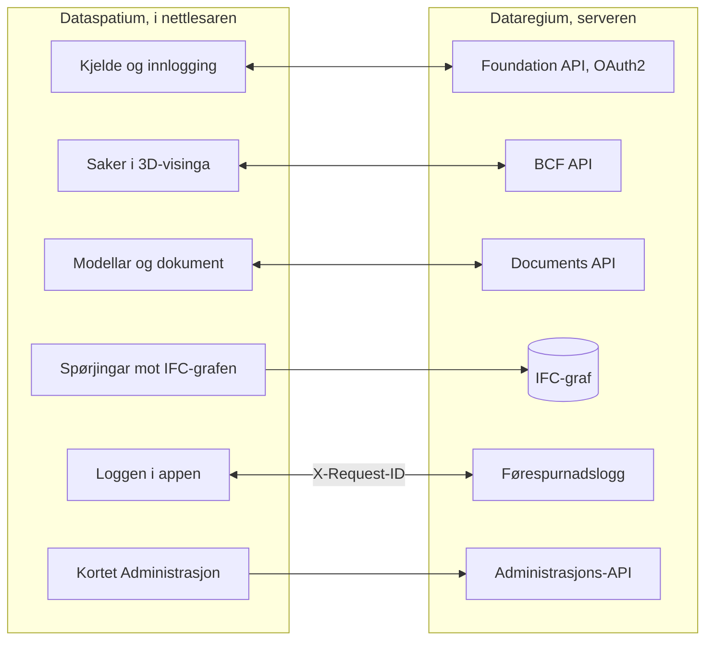

[Svenska](../../README.md) · [Dansk](../da/README.md) · [Norsk bokmål](../nb/README.md) · **Norsk nynorsk** · [Suomi](../fi/README.md) · [Íslenska](../is/README.md) · [English](../en/README.md)


# Dataregium OpenCDE-server

*Dataregium heitte Kontroll fram til 8. november 2026.*

Dataregium er ein server der eit byggjeprosjekt samlar modellane, dokumenta og sakene
sine, slik at alle i prosjektet arbeider ut frå det same grunnlaget og ser den same
historikken. Du arbeider med han gjennom ein app, til dømes
[Dataspatium](https://github.com/marwiss/Dataspatium) i nettlesaren; serveren har
sjølv berre sider for innlogging, opplasting og administrasjon. Den som driv serveren,
avgjer kven som får logge inn, og kva kvar enkelt får gjere i kvart prosjekt.

Teknisk er Dataregium ein server for dei opne **OpenCDE-API-a** til buildingSMART
(Foundation API 1.0, BCF API 3.0 og 2.1 og Documents API 1.0), bygd på
grafdatabasen Neo4j eller Memgraph. I 3-serien blir kvar opplasta IFC-modell ein
tapsfri graf gjennom biblioteket [IFC-LPG](https://github.com/marwiss/IFC-LPG), med
versjonar, kontrollar og endringsframlegg. Serveren vart skriven om frå grunnen av ut
frå ein forskingsprototype frå 2023, med tryggleik som det første kravet, og kvar
klient som følgjer spesifikasjonane, kan kople seg til.


**Innhald**

- [Last ned og kom i gang](#last-ned-og-kom-i-gang)
- [Kva som krevst](#kva-som-krevst)
- [Ord du bør kjenne](#ord-du-bør-kjenne)
- [Kva du kan gjere](#kva-du-kan-gjere)
- [OpenCDE-API-a og klientane deira](#opencde-api-a-og-klientane-deira)
- [Dataregium og Dataspatium](#dataregium-og-dataspatium)
- [Lær meir](#lær-meir)
- [Avgrensingar i korte trekk](#avgrensingar-i-korte-trekk)
- [Personopplysningar](#personopplysningar)
- [Det neste i 3-serien](#det-neste-i-3-serien)
- [Feil og framlegg](#feil-og-framlegg)
- [Utvikling](#utvikling)
- [Lisens](#lisens)

## Last ned og kom i gang

Skal du berre bruke Dataregium, treng du ikkje installere noko: be den som driv
serveren, om adressa og ein konto, og logg inn frå Dataspatium eller ein annan
OpenCDE-app. Vil du prøve serveren på di eiga datamaskin, følgjer du snøggstarten
nedanfor. Han tek om lag tjue minutt og krev Docker Desktop eller Podman. Er du van
med containerar og Python, står den korte vegen under
[For den teknisk kunnige](#for-den-teknisk-kunnige).

### Snøggstart (lokalt, Docker eller Podman)

Ein container er eit ferdigpakka program som køyrer åtskilt på datamaskina, og Docker
og Podman er program som startar containerar. Snøggstarten startar to: serveren og
databasen hans.

1. **Last ned.** Hent koden med git, eller som ZIP-fil under *Code > Download ZIP* på
   GitHub. Greina `main` er 3-serien; `release-2` og `release-1` er 2- og 1-serien.

   ```sh
   git clone https://github.com/marwiss/Dataregium.git
   cd Dataregium
   ```

2. **Still inn.** Kopier `.env.example` til `.env`, fila med innstillingane til
   serveren, og set `OPENCDE_GRAPH_PASSWORD` til ditt eige passord på minst 16 teikn.
   Skal du prøve med Dataspatium og modellar, set du òg
   `OPENCDE_DYNAMIC_CLIENT_REGISTRATION=true`, `OPENCDE_REQUEST_LOG_ENABLED=true` og
   `OPENCDE_IFC_LPG_ENABLED=true`; [snøggstarten med Dataspatium](quickstart.md)
   forklarer kvifor. Kvar innstilling er forklart i [.env.example](../../.env.example).
3. **Start.** Dei same compose-filene verkar med Docker og med Podman; vel den du har:

   <details open>
   <summary><b>Docker</b></summary>

   ```sh
   docker compose up -d --build
   ```

   startar serveren på <http://127.0.0.1:8000> og ein Neo4j-database; første gongen tek nokre minutt. `docker compose logs -f api` viser serverloggen.

   </details>

   <details>
   <summary><b>Podman</b></summary>

   ```sh
   podman compose up -d --build
   ```

   gjer det same med Podman 5 (rootless, utan daemon); `podman compose logs -f api` viser serverloggen. Sjå [deploy/local.md](deploy/local.md) for særdraga til Podman.

   </details>

   <details>
   <summary><b>Utan container</b></summary>

   ```sh
   uv sync --extra ifc-lpg          # installerer Python 3.13 og alle avhengnader, med IFC-LPG
   uv run opencde doctor            # kontrollerer konfigurasjonen og databasen
   uv run opencde serve             # http://127.0.0.1:8000
   ```

   køyrer serveren frå utsjekkinga med [uv](https://docs.astral.sh/uv/); ein database trengst framleis (Neo4j Desktop, Memgraph Lab eller databasen frå compose-filene).

   </details>

4. **Sjå deg rundt.** <http://127.0.0.1:8000/docs> viser kvart kall serveren tek imot,
   og lèt deg prøve dei, <http://127.0.0.1:8000/readyz> seier om serveren og databasen
   er klare, og <http://127.0.0.1:7484> er Neo4j Browser, der du ser databasen (Bolt på
   `127.0.0.1:7697`; utviklingsoverlagringa unngår standardportane til Neo4j, som ofte
   er opptekne av ein annan Neo4j på same datamaskin).
5. **Legg inn demodata og logg inn.**

   <details open>
   <summary><b>Docker</b></summary>

   ```sh
   docker compose exec api opencde seed
   ```

   </details>

   <details>
   <summary><b>Podman</b></summary>

   ```sh
   podman compose exec api opencde seed
   ```

   </details>

   <details>
   <summary><b>Utan container</b></summary>

   ```sh
   uv run opencde seed
   ```

   </details>

   Kommandoen opprettar demobrukarar, prosjekt, klientar og ei sak, og med IFC-LPG
   slått på òg ein eksempelmodell som graf. Passorda blir skrivne ut éin gong. Logg
   inn på <http://127.0.0.1:8000/signin> som `admin` og opne `/admin`.
6. **Kople til ein klient.** Registrer appen din under *Klientar* (eller la han
   registrere seg sjølv når `OPENCDE_DYNAMIC_CLIENT_REGISTRATION=true`) og peik han mot
   `http://127.0.0.1:8000`; [Dataspatium](#dataregium-og-dataspatium) og
   Python-biblioteket i [client/](../../client/) er ferdige klientar. Skal du logge inn
   frå Dataspatium, følgjer du [snøggstarten](quickstart.md): han går gjennom alle
   innstillingane som trengst, og kva du gjer om noko går gale.

### Utrulling

Skal andre bruke serveren, må han liggje på ei datamaskin som alltid er på og kan
nåast frå internett, med eiga adresse og https. Tabellen viser måtane å gjere det på;
den som ikkje sjølv driv serverar, overlèt det til nokon som gjer det. Kvar måte er éi
compose-fil pluss ei overlagring:

| Scenario | Rettleiing |
|---|---|
| Lokal test på datamaskina di | [deploy/local.md](deploy/local.md) |
| Offentleg https-adresse for klienttestar utan eigen server (tunnel) | [deploy/tunnel.md](deploy/tunnel.md) |
| Produksjon på eigen server med Caddy (automatisk TLS) og nattlege tryggingskopiar | [deploy/vps-caddy.md](deploy/vps-caddy.md) |
| Ved sida av det som alt køyrer på ein server, bak nginx-en hans | [deploy/proxied.md](deploy/proxied.md) |
| Coolify, Dokploy, Portainer | [deploy/paas.md](deploy/paas.md) |
| Din eigen region hos AWS, Azure eller Google Cloud: éi maskin, sett opp av ei cloud-init-fil | [deploy/cloud.md](deploy/cloud.md) |
| Ei containerteneste pluss ein administrert Neo4j AuraDB eller Memgraph Cloud | [deploy/cloud-aura.md](deploy/cloud-aura.md) |
| Tryggingskopiering og gjenoppretting (flyttbar mellom Neo4j og Memgraph) | [deploy/backup.md](deploy/backup.md) |

`uv run opencde init --public-url https://cde.example.org` skriv ein
produksjons-`.env` med nye løyndarmål; `opencde doctor` kontrollerer resultatet.

### Konfigurasjon

Alt blir lese frå miljøvariablar med prefikset `OPENCDE_`, frå `.env` eller frå
Docker-løyndarmål i `/run/secrets/opencde_<namn>`. Den kommenterte lista finst i
[.env.example](../../.env.example). Standardverdiane er trygge: produksjon nektar å
starte utan ei offentleg `https`-adresse og eit databasepassord, og ingenting er ope
før det er konfigurert.

### For den teknisk kunnige

- **Image**: `ghcr.io/marwiss/opencdeserver` for amd64 og arm64, skanna med Trivy og
  med SBOM. Taggane er `3.0.0` og `latest` for 3-serien, `3.0.0-gherkin` og
  `latest-gherkin` med ifc-gherkin-rules frå buildingSMART, `2.0.0` og `1.0.0`;
  `OPENCDE_IMAGE_TAG` vel i compose-filene.
- **Compose**: `docker/compose.yaml` pluss overlagringar for utvikling, produksjon med
  Caddy, bak ein eksisterande proxy, Memgraph, ein ekstern database, Bolt med TLS, ein
  tunnel, den lokale motoren og arbeidskopien. `COMPOSE_FILE` i `.env` vel dei, så
  kommandoane er utan `-f`.
- **Utan container**: Python 3.11 eller nyare med uv (prøvd på 3.11, 3.13 og 3.14),
  `uv sync --extra ifc-lpg`, og Neo4j 5.26 eller Memgraph 3.14 på `OPENCDE_GRAPH_URI`.
- **Dei viktigaste innstillingane**: `OPENCDE_APIS` vel API-a (alle tre som standard,
  `["documents"]` i 1.0.0); `OPENCDE_IFC_LPG_ENABLED=true` slår på grafen og alt i 2-
  og 3-serien som gjeld modellar; `OPENCDE_ENVIRONMENT` er `development`, `production`
  eller `local` (den lokale motoren, `opencde init --local`).
- **Endepunkt**: `/.well-known/dataregium` (versjonen og utvidingane som er slått på),
  `/foundation/versions`, `/openapi.json` og `/docs`, `/healthz` og `/readyz`,
  `/admin/api` (administrasjon) og `/manage/1.0` (prosjektadministrasjon). Utvidingane i 3-serien ligg under `/documents/1.0/` (`ifc-queries`,
  `ifc-diff`, `ifc-changes` og `ifc-geometry` for versjonane, `ifc-precheck` og
  `ifc-clash` for prosjekta) og under ei BCF 3.0-sak (`snippet` og
  `ifc-proposal/approve`).
- **Kommandolinja**: `opencde serve`, `init`, `doctor`, `seed`, `backup`, `restore`,
  `revoke`, `cleanup` og gruppene `user`, `project`, `client` og `ifcgraph`;
  `uv run opencde --help`.
- **Å byggje ein klient**: [klientrettleiinga](client-guide.md) har flytane,
  kapabilitetsdokumentet, feilkodane og utvidingane, og [docs/examples/](../examples/)
  køyrbare døme.

## Kva som krevst

Den som berre bruker Dataregium gjennom ein app, treng ein nettlesar og ein konto. For
å køyre serveren sjølv:

- Windows, macOS eller Linux med Docker (Desktop på Windows/macOS, Engine på Linux)
  eller Podman 5, eller Python 3.11 eller nyare med [uv](https://docs.astral.sh/uv/)
  og ein eigen Neo4j 5.26- eller Memgraph 3.14-database.
- Om lag 1 GB minne til databasecontaineren (`NEO4J_HEAP` og `NEO4J_PAGECACHE` i
  `.env`), og meir for store modellar med IFC-LPG.
- Lokalt: port 8000 for serveren og 7484/7697 for databasen, alle bundne til
  `127.0.0.1`. I produksjon: portane 80 og 443 tilgjengelege frå internett og eit
  DNS-namn for serveren.
- Klientar treng ei `https`-adresse i produksjon; lokalt blir `http://127.0.0.1`
  godteken som redirect-URI, og `http://localhost` med `OPENCDE_ALLOW_LOCALHOST_REDIRECTS=true` (eller, medan MCP-endepunktet er på, for ei innlogging mot det aleine).

## Ord du bør kjenne

Orda denne README-en bruker, i kvardagsspråk; heile ordlista finst i
[glossary.md](glossary.md).

- **BIM**: å byggje og forvalte med ein digital modell av bygningen, der kvar vegg,
  dør og kvart rom er eit objekt med eigenskapar og ikkje berre strekar på ei teikning.
- **CAD**: program for teikningar og modellar; ein BIM-modell blir laga i eit CAD-program.
- **IFC**: det opne filformatet for BIM-modellar, som dei store programma kan lese og skrive.
- **BCF og saker**: eit ope format for spørsmål og merknader om ein modell, med
  kommentarar og ei vising (viewpoint) som viser kvar i modellen det gjeld.
- **IDS**: eit krav til kva ein modell skal innehalde, til dømes at kvar dør har ein
  brannklasse; serveren kontrollerer modellane mot krava til prosjektet.
- **OpenCDE**: dei opne reglane til buildingSMART for korleis appar og serverar i eit
  byggjeprosjekt snakkar med kvarandre. CDE tyder felles datamiljø.
- **API**: måten ein app snakkar med serveren på, med faste spørsmål og svar.
- **Server og klient**: serveren lagrar og deler grunnlaget til prosjektet; klienten
  er appen du arbeider i, til dømes Dataspatium.
- **Database og graf**: databasen er der serveren lagrar alt. Ein grafdatabase lagrar
  ting og sambanda mellom dei, som ein vegg som står på ein etasje, og kan difor svare
  på spørsmål om korleis delane heng saman.
- **Container**: eit ferdigpakka program som køyrer åtskilt på datamaskina; Docker og
  Podman startar dei.
- **OAuth2**: den trygge måten å logge inn frå ein app på utan at appen får passordet ditt.
- **Versjon og endringssett**: kvar gong ein modell blir lagra på serveren, blir det
  ein ny versjon. Eit endringssett er eit framlegg til endringar som ein ansvarleg
  godkjenner før det blir neste versjon.

## Kva du kan gjere

Det som verkar i éin versjon, verkar òg i den neste. Kvar versjon høyrer saman med den
same versjonen av Dataspatium.

### Versjon 1 (med Dataspatium 1)

- **Dokument på éin stad** (Documents API 1.0): velje, laste opp og hente dokument og
  versjonane deira gjennom sidene til serveren, frå ein app som Dataspatium.
- **Innlogging og appar** (Foundation API 1.0): éin konto per person, innlogging med
  OAuth2 og PKCE, og appar som ein administrator registrerer, eller som registrerer seg
  sjølve når operatøren tillèt det (sjå [klientrettleiinga](client-guide.md)).
- **Administrasjon** i nettlesaren (`/admin`) og på kommandolinja: brukarar og
  prosjektrollene deira, prosjekt, klientar, økter, revisjonsloggen og helsesjekkane;
  kvar brukar har `/account` for passordet og appane sine.
- **Hjelp for den som byggjer ein app**, merkt som utvidingar: eit
  kapabilitetsdokument (`/.well-known/dataregium`), ein stabil feilkode i kvart
  feilsvar og ein førespurnadslogg.
- **Eit klientbibliotek** i Python ([client/](../../client/)) med køyrbare døme, og
  eit publisert image for kvar utrulling.
- **Prosjektansvarlege administrerer prosjektet sitt**: ein `manager` legg til og
  fjernar medlemmer, byter rollene deira og gjev prosjektet nytt namn, utan å vere
  serveradministrator.

### Òg i versjon 2 (med Dataspatium 2)

- **Saker om modellen** (BCF API 3.0 og 2.1): spørsmål og merknader med kommentarar,
  bilete og visingar som peikar ut bygningsdelar, med filter og ein hendingslogg,
  validerte mot skjemaa til buildingSMART.
- **Modellen som graf** (IFC-LPG-modulen, slått på med `OPENCDE_IFC_LPG_ENABLED`): ein
  opplasta IFC-modell blir ein graf i databasen, knytt til bygningsdelane i visingane
  til sakene (sjå [IFC-LPG](ifc-lpg.md)).

### Òg i versjon 3 (med Dataspatium 3)

- **Ein tapsfri modell**: grafen kjem frå biblioteket IFC-LPG og held alt i fila,
  slik at ho kan skrivast tilbake slik ho kom.
- **Kontroll av kvar opplasting** mot IFC-skjemaet, reglane til buildingSMART og
  IDS-krava til prosjektet; eit prosjekt kan avvise filer med feil, og ei fil kan
  kontrollerast på førehand utan å bli lagra.
- **Spørjingar og samanlikningar**: namngjevne spørjingar for medlemmer, kva som er
  endra sidan ein versjon, samanlikning av to versjonar (òg på ei side på serveren) og
  kollisjonskontroll der kollisjonane kan bli saker.
- **Endringar som framlegg**: kvar ny versjon oppgjev basisen sin, og eit endringssett
  i ei BCF-sak blir prøvd og godkjent av ein `manager` til neste versjon, slått saman
  per instans med det som kom imellom; ein verkeleg kollisjon viser verdien i basen, i
  den siste versjonen og i framlegget.
- **Publisering**: ein `manager` publiserer ein versjon der kontrollen ikkje fann feil, og
  serveren lagrar han som éi heil `.ifczip` som alle i prosjektet kan laste ned.
- **Ein bygning inn i ein annan modell**: bygningen frå éin modell kjem inn i modellen
  til eit anna prosjekt som neste versjon, med ein rapport først om kva som følgjer med
  og eit val for kvart objekt som begge har i ulik form; ein `manager` gjer det.
- **Geometrien som glTF**: kvar versjon som binær glTF med delte meshar og éin node
  per bygningsdel, og ein boks per bygningsdel i grafen for spørsmål om kva som er nær.
- **Ein lokal motor og din eigen region**: Dataregium på di eiga datamaskin bak
  Dataspatium, med ein arbeidskopi i minnet for store modellar, og ferdige oppskrifter
  for ei eiga maskin hos AWS, Azure eller Google Cloud eller ved sida av ein
  eksisterande nginx.


## OpenCDE-API-a og klientane deira

OpenCDE er familien til buildingSMART International av opne web-API-ar for eit felles
datamiljø, staden der eit prosjekt deler modellar, dokument og saker. Ein klient og ein
server som følgjer dei same spesifikasjonane, kan arbeide saman, same kven som har bygd
dei. Dataregium implementerer alle tre:

| API | Kva det er til | Spesifikasjon |
|---|---|---|
| Foundation API 1.0 | Seier kva API-ar ein server tilbyr, korleis ein loggar inn, og kven brukaren er | [foundation-API](https://github.com/buildingSMART/foundation-API) |
| BCF API 3.0 og 2.1 | Saker om ein modell, med kommentarar og viewpointar med kamera, komponentar og bilete | [BCF-API](https://github.com/buildingSMART/BCF-API) |
| Documents API 1.0 | Å velje, hente og laste opp dokument og versjonane deira, via sider på serveren | [documents-API](https://github.com/buildingSMART/documents-API) |

**Dataspatium er éin klient, ikkje den einaste.** Kvar klient som følgjer desse
spesifikasjonane, skal kunne kople seg til: ingenting på serveren er avhengig av
Dataspatium, og utvidingane utanfor spesifikasjonane er valfrie, så ein klient som ikkje
kjenner dei, merkar dei ikkje. Ein klient treng tre ting:

- ei registrering på serveren, gjord av ein administrator under *Klientar* eller av klienten
  sjølv når `OPENCDE_DYNAMIC_CLIENT_REGISTRATION=true`;
- OAuth2 authorization code med PKCE `S256`, som serveren krev av kvar klient unnateke ein konfidensiell som ein administrator har merkt;
- BCF API 3.0, eller 2.1 for ein klient som berre kan den versjonen. `GET /foundation/versions` listar begge, og
  [klientguiden](client-guide.md) fortel kva som skil dei.

Så langt er det vist: svara frå serveren blir testa mot skjemaa til buildingSMART ved kvar
push, og Dataspatium og Python-biblioteket i [client/](../../client/) køyrer mot serveren.
Uavhengige klientar som Bonsai og ifc-lite har ei ferdig sjekkliste som enno ikkje er køyrd. Om du prøver ein klient, fortel
korleis det gjekk under [Feil og framlegg](#feil-og-framlegg). Når ein klient og ein spesifikasjon ikkje
stemmer overeins, avgjer spesifikasjonen. [docs/nn/client-guide.md](client-guide.md) er for dei som byggjer
ein klient.

## Dataregium og Dataspatium

Dataspatium er appen du arbeider i, og Dataregium er serveren der det felles
grunnlaget til prosjektet ligg. [Dataspatium](https://github.com/marwiss/Dataspatium)
køyrer heilt i nettlesaren, og dei to er utvikla for å verke saman. Det same
utgåvenummeret tyder at dei verkar saman: Dataspatium 3.0.0 verkar med Dataregium 3.0.0
([snøggstart](quickstart.md)).

Dataspatium legg til ein Dataregium-server som kjelde: appen oppdagar API-a gjennom
`/foundation/versions`, loggar inn med OAuth2 authorization code og PKCE og
registrerer seg sjølv som offentleg klient når dynamisk registrering er slått på,
viser modellane og dokumenta til prosjektet, les og skriv BCF-saker med kommentarar og
viewpoints tekne frå 3D-visinga si og lastar opp datasett, filer og
arbeidsområdepakkar gjennom Documents API. I 3-serien publiserer appen versjonar med
basisversjon og førehandskontroll, sender endringssett som serveren prøver, lèt den
prosjektansvarlege godkjenne dei og avgjere kollisjonar, samanliknar versjonar i 3D og
stiller grafen namngjevne spørjingar; ein administrator kan òg spørje grafen med
Cypher gjennom det lesande endepunktet til serveren. Appen sender `X-Request-ID` med
kvart kall, slik at førespurnadsloggen her og loggen i appen viser den same samtalen,
les kapabilitetsdokumentet til serveren for å sjå kva utvidingar som er slått på, og
reagerer på feilkodane serveren legg i feilsvara sine.

Slik heng dei saman:



Bortsett frå dei merkte utvidingane går alt Dataspatium gjer mot serveren, gjennom dei
tre OpenCDE-API-a, så appen bruker ingenting som ein annan klient ikkje kan bruke; sjå
[OpenCDE-API-a og klientane deira](#opencde-api-a-og-klientane-deira). Dei to
produkta blir installerte kvar for seg: dette repoet pakkar ikkje med Dataspatium
(lisensane er ulike, AGPL her og PolyForm Strict der), og README-en til Dataspatium
skildrar korleis appen blir henta og brukt.

### Utgåvene 1, 2 og 3

Det finst éi utgåve per hovudnummer, og ho blir gjeven ut på nytt når ho veks; berre
den siste i kvar serie blir retta. Dataregium og Dataspatium med same nummer høyrer saman:

| Dataregium | Kva ho har | Image | Høyrer saman med |
|---|---|---|---|
| 1.0.0 | Ein dokumentserver: Foundation API og Documents API, nettadministrasjonen på sju språk, prosjektadministrasjonen for den prosjektansvarlege og førespurnadsloggen. Ho er 2.0.0-koden med berre Documents API slått på (`OPENCDE_APIS`) | `1.0.0` | Dataspatium 1.0.0 |
| 2.0.0 | Òg BCF API 3.0 og 2.1 på dei same dataa og IFC-LPG-modulen som lagar ein graf av kvar opplasta IFC-fil | `2.0.0` | Dataspatium 2.0.0 |
| 3.0.0 | Òg den tapsfrie grafen frå biblioteket IFC-LPG, kontrollen av kvar opplasting, spørjingane, samanlikningane og kollisjonskontrollen, versjonar med endringsframlegg som blir prøvde, godkjende og slått saman, publiseringa av ein versjon, ein bygning frå éin modell inn i ein annan, geometrien som glTF, den lokale motoren og oppskriftene for skya og nginx | `3.0.0`, `latest`, `3.0.0-gherkin` | Dataspatium 3.0.0 |

## Lær meir

- [quickstart.md](quickstart.md): Dataregium og Dataspatium saman på tjue minutt, frå
  ei tom datamaskin til ei sak oppretta i 3D-visinga.
- [client-guide.md](client-guide.md) og [docs/examples/](../examples/): korleis ein
  byggjer ein klient, kapabilitetsdokumentet, feilkodane, utvidingane i 3-serien og
  køyrbare døme med Python-biblioteket i [client/](../../client/).
- [architecture.md](architecture.md): korleis delane heng saman, kva som skjer med eit kall, og kvar alt finst i koden.
- [glossary.md](glossary.md): orda dokumentasjonen bruker.
- [flows/](flows/): sekvensdiagram for OAuth2-, Documents API- og BCF-viewpoint-flytane.
- [graph-schema.md](graph-schema.md): grafmodellen.
- [ifc-lpg.md](ifc-lpg.md): IFC-LPG-modulen, kontrollane, versjonane, endringssetta, geometrien og døme på Cypher-spørjingar.
- [mcp.md](mcp.md): MCP-endepunktet, som AI-program les modellane i prosjekta gjennom: å slå det på, tokena, protokollen, verktøya, AI-policyen og grensene.
- Arkitekturavgjerder som ligg fast: ein grafdatabase som einaste lager, opake token i
  staden for JWT, portabel Cypher for Neo4j og Memgraph, eit nettgrensesnitt utan
  rammeverk, tryggingskopi på applikasjonsnivå, BCF API 2.1 ved sida av 3.0, ein
  tapsfri IFC-graf som sjølv les og skriv STEP og blir validert når han blir skriven,
  reglane til buildingSMART i eit eige miljø, IFC-LPG som bibliotek, kontroll mot IDS-en
  til prosjektet, namngjevne spørjingar for medlemmer, kollisjonskontroll på serveren
  med IfcClash, versjonar som nodar med endringar og ein basis, ein lokal motor som
  berre svarar på di eiga datamaskin, og ein arbeidskopi i minnet ved sida av arkivet.
- [spec/SOURCES.md](../../spec/SOURCES.md): dei nøyaktige spesifikasjonsversjonane
  serveren blir testa mot.

Dokumentasjonen finst på dei sju språka til denne README-en, kvart språk under
`docs/<språk>/`; engelsk under `docs/en/` er kjelda. CONTRIBUTING er på engelsk.

### Vidare lesing

- [BCF API](https://github.com/buildingSMART/BCF-API), [Foundation API](https://github.com/buildingSMART/foundation-API) og [Documents API](https://github.com/buildingSMART/documents-API):
  spesifikasjonane serveren følgjer.
- [IFC](https://github.com/buildingSMART/IFC4.x-development): filformatet for bygningsmodellar, og [IDS](https://github.com/buildingSMART/IDS): kravspesifikasjonar som modellar blir kontrollerte mot.
- [RFC 9700](https://www.rfc-editor.org/rfc/rfc9700): dagens beste praksis for tryggleik i OAuth 2.0, og
  [OAuth 2.1](https://datatracker.ietf.org/doc/draft-ietf-oauth-v2-1/), utkastet som samlar han.
- [RFC 7636](https://www.rfc-editor.org/rfc/rfc7636) (PKCE), [RFC 8252](https://www.rfc-editor.org/rfc/rfc8252) (appar på datamaskina eller telefonen) og
  [RFC 7591](https://www.rfc-editor.org/rfc/rfc7591) (registrering av klientar).
- [OWASP ASVS](https://owasp.org/www-project-application-security-verification-standard/): sjekklista for tryggleiksarbeidet.

## Avgrensingar i korte trekk

- Alt som gjeld modellar, i 2- og 3-serien, krev IFC-LPG-modulen, som er slått av til
  `OPENCDE_IFC_LPG_ENABLED=true`. Reglane til buildingSMART køyrer berre med imaget
  `-gherkin`; utan det blir skjemaet og IDS kontrollerte.
- Serveren implementerer BCF API 3.0 og 2.1, ikkje 1.0, der ressursane ser annleis ut.
- Eksport av eit prosjekt som BCFzip er overlate til klientane; serveren lagrar saker,
  kommentarar og viewpoints slik API-et definerer dei.
- Community-utgåvene av Neo4j og Memgraph manglar databasebrukarar med berre
  lesetilgang, så ein eksponert Bolt-port gjev full tilgang til den som har passordet.
  Porten blir verande stengd med mindre administratoren publiserer han med vilje; den
  lesande grafspørjinga i administrasjons-API-et (`OPENCDE_GRAPH_QUERY_ENABLED`) gjev
  Cypher utan porten.
- IFC-LPG-importen, kontrollane og prøvinga av endringssett køyrer i separate prosessar
  med minne- og tidsgrenser (`OPENCDE_IFC_LPG_*`); svært store modellar blir avviste i
  staden for å bli liggjande halvt importerte, eller blir handterte av den lokale motoren.
- Nettsidene er for innlogging, administrasjon, opplasting og val av dokument og for
  kontrollen og samanlikninga av ein versjon; sluttbrukarar arbeider i ein klient som
  Dataspatium eller Bonsai.
- Sidene finst på dei sju språka til denne README-en (byt nedst på kvar side);
  kommandolinja og feilmeldingane til API-a er på engelsk.
- Inga ekstern gjennomgang enno. OAuch- og testssl-køyringane er stega til operatøren
  før ei produksjonsutrulling.

## Personopplysningar

Den som driv Dataregium for andre, er behandlingsansvarleg for dette. Serveren lagrar
brukarkontoar (brukarnamn, namn, valfri e-post, passordhash), prosjektmedlemskap,
saker og kommentarar med namna til forfattarane, opplasta filer med den som lasta dei
opp, IFC-grafen med eigarhistorikken til fila, versjonane med forfattar og godkjennar,
endringsframlegga med kven som gjorde framlegget og, der ein AI gjorde det, kva
AI-modell og kva verktøykall, og ein revisjonslogg over kven som gjorde kva og frå kva
adresse. Passord, token og løyndarmål blir berre lagra som hashar. Token, økter,
opplastingsøkter og ubrukte sjølvregistrerte klientar går ut og blir rydda av
serveren; revisjonsloggen blir avgrensa av operatøren. Ein administrator slettar ein
konto under `/admin/users`, og øktene og tokena følgjer med; namnet står att på sakene
og versjonane personen skreiv, til dei blir sletta. Revisjonsloggen blir eksportert som
CSV, BCF- og dokumentdata gjennom API-a og heile databasen med `opencde backup`. Kva
Dataspatium lagrar i nettlesaren, står i den eigne dokumentasjonen til appen.

## Det neste i 3-serien

3.0.0 er den einaste utgåva i 3-serien og blir gjeven ut på nytt når ho veks; det ho
har i dag, står under [Kva du kan gjere](#kva-du-kan-gjere). Dei offisielle
OpenCDE-API-a blir verande slik buildingSMART definerer dei; det serien legg til, er
utvidingar til dei, under eigne namn og med ein eigen OpenAPI. Dette avsnittet seier kva
som er avgjort, for den, menneske eller AI-agent, som fører ein del av det vidare.
Arbeidsmåtane står i [CONTRIBUTING.md](../../CONTRIBUTING.md) og IFC-grafen i
[ifc-lpg.md](ifc-lpg.md).

### Avgjort

- **Redigering av modellar i Native IFC.** Create er opplastinga, Read dei namngjevne
  spørjingane, Update og Delete eit endringssett (setje, leggje til, fjerne og kopiere
  instansar) som blir prøvd og godkjent, og Export å skrive STEP tilbake. Dataa held
  seg til IFC, ifc-gherkin-rules og IDS-en til prosjektet, ved import og etter kvar endring.
- **Versjonshistorikk i databasen, ikkje i git**, i same ånd som
  [ifcmerge](https://github.com/brunopostle/ifcmerge) til Bruno Postle. Kvar godkjend
  versjon er ein node med forelderen, forfattaren, godkjennaren og endringane sine;
  grafen held den siste versjonen, og kva versjon som helst blir skriven ut på
  førespurnad. Ei endring blir ført inn når fila som blir skriven frå henne, ikkje har
  nokon merknad som versjonen før manglar.
- **BIM-snippets som ein fungerande demonstrasjon.** Ei føreslått endring reiser som
  `bim_snippet` i ei BCF 3.0-sak, med eit publisert skjema bak `reference_schema`, slik
  at endringa, diskusjonen og avgjerda finst på éin stad. Dei ikkje utgjevne
  utviklingsgreinene til buildingSMART har stroke dei; Dataregium byggjer dei for å
  vise korleis dei kunne verke. Ein snippet peikar ut det han endrar, med ein GlobalId
  og ein sti av attributtnamna i IFC derifrå, med STEP-id berre der ingen GlobalId når
  fram; GlobalId og sti nådde 98 til 100 prosent av instansane i 28 prøvefiler.
- **Kven som får endre kva.** `editor` gjer framlegg, `manager` godkjenner, og ein AI
  gjer berre framlegg; kvar endring ber kven som gjorde framlegget, og kva AI-modell
  og kva verktøykall, der ein AI gjorde det. Eit team i prosjektet, der IDS-dokumentet
  peikar ut delen av modellen til teamet slik dei ansvarlege teama i ISO 19650 gjer,
  lèt den ansvarlege godkjenne endringane av den delen; ei endring på tvers av fleire
  team går til ein `manager`.
- **Kollisjonskontroll begge stader**: på serveren med IfcClash frå IfcOpenShell og i
  Dataspatium med den eigne kjernen i JavaScript.
- **Det neste**: eit endepunkt for AI-verktøy (MCP) på di eiga datamaskin, der AI gjer
  framlegg og eit menneske godkjenner; kontroll av klassifikasjonar og eigenskapar mot
  bSDD; ein ny kontroll av versjonane når IDS-en til prosjektet blir endra, med funna
  til buildingSMART knytte til bygningsdelar; proprietære format gjennom IFC-eksporten
  til kjeldeprogramma; og ei testsuite mot promptinjeksjon i snippets og MCP.

## Feil og framlegg

Rapporter feil og ønske som *Issues* her på GitHub. Oppgje kva serverversjon
du køyrer (`version` i `/.well-known/dataregium` eller `/healthz`), kva klient
du brukte og `X-Request-ID` for eit mislukka kall; førespurnadsloggen og
loggen til klienten deler han. Legg ikkje ved personopplysningar eller
løyndomar. Korleis endringar blir tekne imot står i
[CONTRIBUTING.md](../../CONTRIBUTING.md). Ved ein tryggingssårbarheit, følg
[SECURITY.md](../../SECURITY.md) i staden for å opne ei sak.

## Utvikling

```sh
uv run pytest                    # einings-, konformans- og tryggingstestar
uv run pytest -m integration     # startar Neo4j/Memgraph med testcontainers (krev Docker)
uv run pytest -m e2e             # klientbiblioteket mot ein køyrande server (krev Docker)
uv run pytest -m ui              # Playwright + axe-core (uv sync --group ui; playwright install chromium)
uv run ruff format . && uv run ruff check .
uv run ty check opencde client/opencde_client
```

Kode og kommentarar er på engelsk, og stilen følgjer konvensjonane til
IfcOpenShell (ruff, 120 kolonnar), slik at det held fram med å vere mogleg å
bidra med serveren til IfcOpenShell. README finst på engelsk, svensk, dansk, norsk (bokmål og nynorsk),
finsk og islandsk (`docs/<språk>/README.md`, same oppsett som Dataspatium);
dokumentasjonen og webgrensesnittet finst på dei same språka, med
engelsk alltid som eit val, og felles termar følgjer ordlista til
Dataspatium. Kvart push køyrer lint, typekontroll, testsuitene på tre
Python-versjonar, nettlesartestar med axe-core og statiske
tryggingskontrollar; nattlege jobbar køyrer OWASP ZAP, Schemathesis og Trivy.
Sjå [CONTRIBUTING.md](../../CONTRIBUTING.md).

## Lisens

Serveren er lisensiert under GNU Affero General Public License v3.0 eller
seinare ([LICENSE](../../LICENSE)): han er serverprogramvare, og
nettverksklausulen i AGPL held forbetringar av driftssette instansar opne.
Klientbiblioteket i [client/](../../client/) er LGPL-3.0-or-later.
Spesifikasjonsfilene under [spec/](../../spec/) er © buildingSMART
International og blir vidaredistribuerte uendra for testing. Sjå
[SECURITY.md](../../SECURITY.md) for korleis ein sårbarheit blir rapportert
og kva prosjektet gjer for å halde seg trygt.
