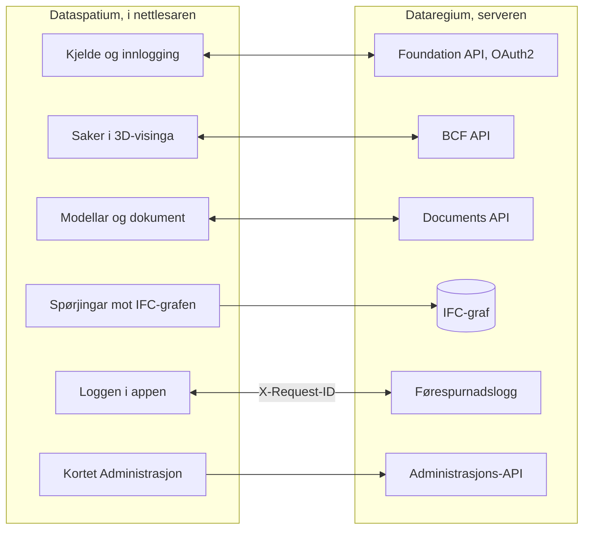

[Svenska](../../README.md) · [Dansk](../da/README.md) · [Norsk bokmål](../nb/README.md) · **Norsk nynorsk** · [Suomi](../fi/README.md) · [Íslenska](../is/README.md) · [English](../en/README.md)


# Dataregium OpenCDE-server

*Dataregium heitte Kontroll fram til 8. november 2026.*

Dataregium er ein server for **OpenCDE-API-ane** frå buildingSMART (Foundation
API 1.0, BCF API 3.0 og 2.1 og Documents API 1.0), bygd på ein grafdatabase, med
webadministrasjon og ein valfri IFC-LPG-modul som knyter BCF-komponentar til
bygningsdelane dei peikar på. Han voks fram av ein forskingsprototyp frå 2023
for digitale kontrollplanar i svenske byggjeløyve og vart skriven om frå
grunnen av med tryggleik som fyrste krav.
Klientar som følgjer spesifikasjonane, skal kunne kople seg til, så serveren
ikkje er bunden til eitt bestemt program.


**Innhald**

- [Last ned og kom i gang](#last-ned-og-kom-i-gang)
- [Kva som krevst](#kva-som-krevst)
- [Kva du kan gjere](#kva-du-kan-gjere)
- [OpenCDE-API-a og klientane deira](#opencde-api-a-og-klientane-deira)
- [Dataregium og Dataspatium](#dataregium-og-dataspatium)
- [Lær meir](#lær-meir)
- [Avgrensingar i korte trekk](#avgrensingar-i-korte-trekk)
- [Det neste i 3-serien](#det-neste-i-3-serien)
- [Feil og framlegg](#feil-og-framlegg)
- [Utvikling](#utvikling)
- [Lisens](#lisens)

## Last ned og kom i gang

### Snøggstart (lokalt, Docker)

1. **Last ned.** Klon repoet, eller hent det publiserte imaget
   `ghcr.io/marwiss/opencdeserver` (fleire arkitekturar, skanna og med SBOM
   ved kvar utgjeving):

   ```sh
   git clone https://github.com/marwiss/Dataregium.git
   cd Dataregium
   ```

2. **Konfigurer.** Kopier `.env.example` til `.env` og set
   `OPENCDE_GRAPH_PASSWORD` (minst 16 teikn). Kvar innstilling blir forklart i
   [.env.example](../../.env.example).
3. **Start.** `docker compose up -d --build`
   startar serveren på <http://127.0.0.1:8000> og ein Neo4j-database.
   `docker compose logs -f api` viser serverloggen.
4. **Sjå deg rundt.** <http://127.0.0.1:8000/docs> er den interaktive
   API-dokumentasjonen, <http://127.0.0.1:8000/readyz> beredskapskontrollen
   og <http://127.0.0.1:7484> Neo4j Browser (Bolt på `127.0.0.1:7697`;
   utviklingsoverlegget unngår standardportane til Neo4j, som ofte er opptekne
   av ein annan Neo4j på same maskin).
5. **Legg inn demodata og logg inn.**
   `docker compose exec api opencde seed`
   opprettar demobrukarar og prosjekt og skriv ut passorda deira éin gong.
   Logg inn på <http://127.0.0.1:8000/signin> som `admin` og opne `/admin`.
6. **Kople til ein klient.** Registrer appen din under *Klientar* (eller lat
   han registrere seg sjølv når `OPENCDE_DYNAMIC_CLIENT_REGISTRATION=true`) og
   peik han mot `http://127.0.0.1:8000`; [Dataspatium](#dataregium-og-dataspatium)
   og Python-biblioteket i [client/](../../client/) er ferdige klientar.
   Skal du logge inn frå Dataspatium, følg [snøggstarten](quickstart.md): han tek for
   seg alle innstillingane som trengst, og kva du gjer om noko går gale.

Utan Docker for sjølve serveren (ein database trengst framleis):

```sh
uv sync                          # installerer Python 3.13 og alle avhengnader
uv run opencde doctor            # kontrollerer konfigurasjon og database
uv run opencde serve             # http://127.0.0.1:8000
```

### Utrulling

Éi compose-fil pluss eitt overlegg per scenario:

| Scenario | Rettleiing |
|---|---|
| Lokal test på eiga maskin | [docs/nn/deploy/local.md](deploy/local.md) |
| Offentleg https-adresse for klienttestar utan eigen server (tunnel) | [docs/nn/deploy/tunnel.md](deploy/tunnel.md) |
| Produksjon på eigen server med Caddy (automatisk TLS) og nattlege tryggingskopiar | [docs/nn/deploy/vps-caddy.md](deploy/vps-caddy.md) |
| Coolify, Dokploy, Portainer | [docs/nn/deploy/paas.md](deploy/paas.md) |
| Containerteneste pluss administrert Neo4j AuraDB eller Memgraph Cloud | [docs/nn/deploy/cloud-aura.md](deploy/cloud-aura.md) |
| Tryggingskopiering og gjenoppretting (flyttbar mellom Neo4j og Memgraph) | [docs/nn/deploy/backup.md](deploy/backup.md) |

`uv run opencde init --public-url https://cde.example.org` skriv ei
produksjons-`.env` med nye løyndomar; `opencde doctor` kontrollerer
resultatet.

### Konfigurasjon

Alt blir lese frå miljøvariablar med prefikset `OPENCDE_`, frå `.env` eller
frå Docker-løyndomar i `/run/secrets/opencde_<namn>`. Den kommenterte lista
finst i [.env.example](../../.env.example). Standardverdiane er trygge:
produksjon nektar å starte utan ei offentleg `https`-adresse og eit
databasepassord, og ingenting er ope før det er konfigurert.

## Kva som krevst

- Windows, macOS eller Linux med Docker (Desktop på Windows/macOS, Engine på
  Linux), eller Python 3.11 eller nyare med [uv](https://docs.astral.sh/uv/)
  og ein eigen Neo4j 5.26- eller Memgraph 3.14-database.
- Omtrent 1 GB minne til databasecontaineren (`NEO4J_HEAP` og
  `NEO4J_PAGECACHE` i `.env`), meir med IFC-LPG-modulen.
- Lokalt: port 8000 for serveren og 7484/7697 for databasen, alle bundne til
  `127.0.0.1`. I produksjon: portane 80 og 443 nåelege frå internett og eit
  DNS-namn for serveren.
- Klientar treng ei `https`-adresse i produksjon; lokalt blir
  `http://127.0.0.1` godteke som redirect-URI, og `http://localhost` med `OPENCDE_ALLOW_LOCALHOST_REDIRECTS=true`.

## Kva du kan gjere

- **Foundation API 1.0**: oppdaging av tenester, OAuth2 authorization code med
  PKCE, noverande brukar, tilbakekalling av tokens og dynamisk
  klientregistrering med offentlege klientar (av som standard).
- **BCF API 3.0 og 2.1**: prosjekt, extensions, saker med OData-spørjingar,
  kommentarar, viewpoints med snapshots, bitmaps og komponentar, filer,
  dokumentreferansar, dokument og hendingsloggane, alt validert mot skjemaa
  frå buildingSMART.
- **Documents API 1.0**: val og nedlasting av dokument, opplasting i delar med
  websidene til serveren for metadata og val, versjonsspørjingar med ETag.
- **Administrasjon** i nettlesaren: logg inn på `/signin` med ein
  administratorkonto og opne `/admin` for å administrere brukarar og
  prosjektrollene deira, prosjekt og BCF-extension-verdiane deira,
  OAuth2-klientar, sesjonar, revisjonsloggen, den valfrie førespurnadsloggen
  og helsekontrollane til serveren. Kvar brukar har `/account` for eige
  passord, eigne appar og eigne sesjonar. Kommandolinja
  (`uv run opencde --help`) gjer det same frå ein terminal.
- **Tillegg utanfor spesifikasjonane**, kvart merkt som det: eit
  kapabilitetsdokument på `/.well-known/dataregium` som fortel klienten kva
  tillegg som er slått på, ein stabil `code` i kvar feilkropp, ein
  førespurnadslogg for feilsøking av klientar (`/admin/requests`,
  `GET /admin/api/requests` med scopet `admin`), og IFC-LPG-modulen som gjer
  opplasta IFC-modellar til grafdata knytte til BCF-komponentar. Sidan 3.0.0
  er grafen tapsfri og kan skrivast tilbake som fil, kvar opplasting blir
  kontrollert mot IFC-skjemaet, reglane frå buildingSMART og IDS-en til
  prosjektet, og medlemmer stiller han namngjevne spørjingar.
- **Eit klientbibliotek** i Python ([client/](../../client/), LGPL) med
  køyrbare døme, og dessutan Dockerfile, compose-overlegg og eit publisert
  image for kvart utrullingsscenario.
- **Status**: alle elleve etappane i planen er gjennomførte (dei tre API-ane,
  administrasjonen, klientbiblioteket, utrulling, IFC-LPG,
  akseptansesjekklista og tryggingsherdinga); bidraget til IfcOpenShell er
  enno ikkje føreslått (utkast i [docs/upstream/](../upstream/)).


## OpenCDE-API-a og klientane deira

OpenCDE er familien til buildingSMART International av opne web-API-ar for eit felles
datamiljø, staden der eit prosjekt deler modellar, dokument og saker. Ein klient og ein
server som følgjer dei same spesifikasjonane, kan arbeide saman, same kven som har bygd
dei. Dataregium implementerer alle tre:

| API | Kva det er til | Spesifikasjon |
|---|---|---|
| Foundation API 1.0 | Seier kva API-ar ein server tilbyr, korleis ein loggar inn, og kven brukaren er | [foundation-API](https://github.com/buildingSMART/foundation-API) |
| BCF API 3.0 og 2.1 | Saker om ein modell, med kommentarar og viewpointar med kamera, komponentar og bilete | [BCF-API](https://github.com/buildingSMART/BCF-API) |
| Documents API 1.0 | Å velje, hente og laste opp dokument og versjonane deira, via sider på serveren | [documents-API](https://github.com/buildingSMART/documents-API) |

**Dataspatium er éin klient, ikkje den einaste.** Kvar klient som følgjer desse
spesifikasjonane, skal kunne kople seg til: ingenting på serveren er avhengig av
Dataspatium, og utvidingane utanfor spesifikasjonane er valfrie, så ein klient som ikkje
kjenner dei, merkar dei ikkje. Ein klient treng tre ting:

- ei registrering på serveren, gjord av ein administrator under *Klientar* eller av klienten
  sjølv når `OPENCDE_DYNAMIC_CLIENT_REGISTRATION=true`;
- OAuth2 authorization code med PKCE `S256`, som serveren krev av kvar klient unnateke ein konfidensiell som ein administrator har merkt;
- BCF API 3.0, eller 2.1 for ein klient som berre kan den versjonen. `GET /foundation/versions` listar begge, og
  [klientguiden](client-guide.md) fortel kva som skil dei.

Så langt er det vist: svara frå serveren blir testa mot skjemaa til buildingSMART ved kvar
push, og Dataspatium og Python-biblioteket i [client/](../../client/) køyrer mot serveren.
Uavhengige klientar som Bonsai og ifc-lite har ei ferdig sjekkliste i
[docs/acceptance.md](../acceptance.md) som enno ikkje er køyrd. Om du prøver ein klient, fortel
korleis det gjekk under [Feil og framlegg](#feil-og-framlegg). Når ein klient og ein spesifikasjon ikkje
stemmer overeins, avgjer spesifikasjonen. [docs/nn/client-guide.md](client-guide.md) er for dei som byggjer
ein klient.

## Dataregium og Dataspatium

Dataregium (serveren) og [Dataspatium](https://github.com/marwiss/Dataspatium)
(ein dataapp som køyrer heilt i nettlesaren) er utvikla for å verke saman som
server og klient, og same utgjevingsnummer på begge tyder at dei verkar
saman: Dataspatium 3.0.0 verkar med Dataregium 3.0.0
([snøggstart](quickstart.md)). Dataspatium legg til ein
Dataregium-server som kjelde: appen oppdagar API-ane gjennom
`/foundation/versions`, loggar inn med OAuth2 authorization code og PKCE og
registrerer seg sjølv som offentleg klient når dynamisk registrering er slått
på, listar modellane og dokumenta i prosjektet, les og skriv BCF-saker med
kommentarar og viewpoints tekne frå 3D-visinga si, lastar opp datasett, filer
og arbeidsområdepakkar gjennom Documents API, spør IFC-grafen med Cypher over
Bolt når operatøren eksponerer han, og sender `X-Request-ID` på kvart kall
slik at førespurnadsloggen her og loggen i appen viser same samtale. Appen
les kapabilitetsdokumentet til serveren for å sjå kva tillegg som er slått
på, og reagerer på feilkodane serveren legg i feilkroppane sine.

Slik heng dei saman:



Bortsett frå dei merkte tillegga går alt Dataspatium gjer mot serveren
gjennom dei tre OpenCDE-API-ane, så appen brukar ingenting ein annan klient
ikkje kan bruke, sjå [OpenCDE-API-a og klientane deira](#opencde-api-a-og-klientane-deira). Dei to produkta blir installerte kvar for
seg: dette repoet buntar ikkje Dataspatium (lisensane er ulike, AGPL her og
PolyForm Strict der), og README-fila til Dataspatium fortel korleis appen
blir henta. Klientsida er skildra i README-fila til Dataspatium og
dokumentasjonen der; akseptansekøyringane til paret står i
[docs/acceptance.md](../acceptance.md) her, og kva dei to prosjekta samordnar
står i [docs/dataspatium-coordination.md](../dataspatium-coordination.md).

## Lær meir

- [docs/nn/quickstart.md](quickstart.md): Dataregium og Dataspatium saman på tjue
  minutt, frå ei tom maskin til ei sak oppretta i 3D-visinga.
- [docs/nn/client-guide.md](client-guide.md) og [docs/examples/](../examples/):
  korleis byggje ein klient, kapabilitetsdokumentet, feilkodane og køyrbare
  døme med Python-biblioteket i [client/](../../client/).
- [docs/nn/architecture.md](architecture.md): korleis delane heng saman, kva som skjer med ein førespurnad, og kvar alt finst i koden.
- [docs/nn/glossary.md](glossary.md): orda dokumentasjonen brukar.
- [docs/nn/flows/](flows/): sekvensdiagram for OAuth2-, Documents API- og BCF-viewpoint-flytane.
- [docs/nn/graph-schema.md](graph-schema.md): grafmodellen.
- [docs/nn/ifc-lpg.md](ifc-lpg.md): den valfrie IFC-LPG-modulen og døme på Cypher-spørjingar.
- [docs/acceptance.md](../acceptance.md): sjekkliste for visuell akseptanse
  med uavhengige klientar (Bonsai, ifc-lite, Dataspatium).
- [docs/dataspatium-coordination.md](../dataspatium-coordination.md): kva
  Dataregium og Dataspatium deler, og avgjerdene til eigaren.
- Arkitekturavgjerder som ligg fast: grafdatabase som einaste lager, opake token
  i staden for JWT, portabel Cypher for Neo4j og Memgraph, webgrensesnitt utan
  rammeverk, tryggingskopi på applikasjonsnivå, BCF API 2.1 ved sida av 3.0, ein
  tapsfri IFC-graf som sjølv les og skriv STEP og blir validert når han blir
  skriven, reglane til buildingSMART i eit eige miljø, IFC-LPG som bibliotek,
  kontroll mot IDS-en til prosjektet og namngjevne spørjingar for medlemmer.
- [docs/upstream/](../upstream/): utkast til sak og pull request for
  IfcOpenShell (ikkje sende).
- [spec/SOURCES.md](../../spec/SOURCES.md): dei nøyaktige
  spesifikasjonsversjonane serveren blir testa mot.

Dokumentasjonen finst på dei sju språka i denne README-fila, kvart språk under
`docs/<språk>/`; engelsk under `docs/en/` er kjelda. Prosjektloggane (akseptanse,
samordning), utkasta til IfcOpenShell og CONTRIBUTING blir haldne på engelsk.

### Vidare lesing

- [BCF API](https://github.com/buildingSMART/BCF-API), [Foundation API](https://github.com/buildingSMART/foundation-API) og [Documents API](https://github.com/buildingSMART/documents-API):
  spesifikasjonane serveren følgjer.
- [IFC](https://github.com/buildingSMART/IFC4.x-development): filformatet for bygningsmodellar.
- [RFC 9700](https://www.rfc-editor.org/rfc/rfc9700): dagens beste praksis for tryggleik i OAuth 2.0, og
  [OAuth 2.1](https://datatracker.ietf.org/doc/draft-ietf-oauth-v2-1/), utkastet som samlar han.
- [RFC 7636](https://www.rfc-editor.org/rfc/rfc7636) (PKCE), [RFC 8252](https://www.rfc-editor.org/rfc/rfc8252) (appar på datamaskin eller telefon) og
  [RFC 7591](https://www.rfc-editor.org/rfc/rfc7591) (registrering av klientar).
- [OWASP ASVS](https://owasp.org/www-project-application-security-verification-standard/): sjekklista for tryggingsarbeidet.

## Avgrensingar i korte trekk

- Serveren implementerer BCF API 3.0 og 2.1, ikkje 1.0, der ressursane ser annleis ut.
- Eksport av eit prosjekt som BCFzip blir overlaten til klientane; serveren
  lagrar saker, kommentarar og viewpoints slik API-et definerer dei.
- Community-utgåvene av Neo4j og Memgraph har ingen skriveverna
  databasebrukarar, så ein eksponert Bolt-port gjev full tilgang til den som
  har passordet. Porten held seg stengd med mindre administratoren medvite
  publiserer han; den lesande grafspørjinga i administrasjons-API-et
  (`OPENCDE_GRAPH_QUERY_ENABLED`) gjev Cypher utan porten.
- IFC-LPG-importen køyrer i ein eigen prosess med minne- og tidsgrenser
  (`OPENCDE_IFC_LPG_*`); svært store modellar blir avviste i staden for å
  bli liggjande halvt importerte.
- Websidene er for administratorar og for OAuth2- og Documents API-flytane;
  sluttbrukarar arbeider i ein klient som Dataspatium eller Bonsai.
- Sidene finst på dei sju språka i denne README-fila (byt nedst på kvar side);
  kommandolinja og feilmeldingane frå API-ane er på engelsk.
- Ingen ekstern revisjon enno. OAuch- og testssl-køyringane er stega
  operatøren tek før ei produksjonsutrulling.

## Personopplysningar

Den som driv Dataregium for andre, er behandlingsansvarleg for desse dataa.
Serveren lagrar brukarkontoar (brukarnamn, namn, valfri e-post, passordhash),
prosjektmedlemskap, saker og kommentarar med namna til forfattarane, opplasta
filer med opplastar, IFC-grafen med eigarhistorikken til fila og ein
revisjonslogg over kven som gjorde kva og frå kva adresse. Passord, token og
løyndommar blir berre lagra som hashar. Token, økter, opplastingsøkter og
ubrukte sjølvregistrerte klientar går ut og blir rydda av serveren;
revisjonsloggen blir skoren ned av operatøren. Ein administrator slettar ein
konto under `/admin/users`, og øktene og tokena følgjer med; namnet står att på
sakene personen skreiv til dei blir sletta. Revisjonsloggen blir eksportert som
CSV, BCF- og dokumentdata gjennom API-a og heile databasen med `opencde backup`.
Kva Dataspatium lagrar i nettlesaren, står i dokumentasjonen til appen.

## Det neste i 3-serien

3.0.0 er den første utgåva i 3-serien, laga saman med Dataspatium 3.0.0:
IFC-grafen som ein tapsfri modell, kontrollen av kvar opplasting og dei
namngjevne spørjingane, slik [Kva du kan gjere](#kva-du-kan-gjere) skildrar.
Som kvart hovudnummer har serien éi utgåve, som blir gjeven ut på nytt etter
kvart som ho veks. Det som følgjer, gjer grafen til ein modell som kan
redigerast og versjonshandterast i databasen, med Dataspatium som klienten som
redigerer han og viser versjonane. Dei offisielle OpenCDE-API-a blir verande
slik buildingSMART definerer dei; det serien legg til, er utvidingar av dei
under eigne namn. Denne delen seier kva som er avgjort, og kva som berre er
føreslått, for den, menneske eller AI-agent, som fører ein del av det vidare.
Avgjerdene står i korte trekk under [Lær meir](#lær-meir), arbeidsmåtane i
[CONTRIBUTING.md](../../CONTRIBUTING.md) og IFC-grafen i
[docs/nn/ifc-lpg.md](ifc-lpg.md).

### Avgjort

- **Redigering av modellar i Native IFC.** Create er opplastinga og Read dei
  namngjevne spørjingane, begge i 3.0.0. Update er ei endring som ein klient
  føreslår gjennom API-et, og som blir prøvd før ho blir ført inn. Delete
  fjernar valde delar av grafen: ein entitet, ein bygning eller eit prosjekt.
  Export skriv STEP tilbake, som no.
- **Versjonshistorikk i databasen, ikkje i git**, i same ånd som
  [ifcmerge](https://github.com/brunopostle/ifcmerge) av Bruno Postle: kva som
  vart endra, kven som føreslo det, og kven som godkjende det. Dataa må halde
  seg til IFC, ifc-gherkin-rules og IDS-en til prosjektet ved import og etter
  kvar endring.
- **BIM-snippets som ein fungerande demonstrasjon.** Ei føreslått endring reiser
  som `bim_snippet` i ei BCF 3.0-sak, med eit publisert skjema bak
  `reference_schema`, så endringa, diskusjonen og avgjerda er på éin stad.
  Ingen programvare bruker ein snippet i dag, og dei ikkje utgjevne
  utviklingsgreinene til buildingSMART har fjerna dei; Dataregium byggjer dei for
  å vise korleis dei kunne verke. Ein snippet peikar ut det han endrar med
  STEP-id, eller med GlobalId og ein sti derifrå. STEP-ida når alltid ein
  instans; GlobalId og sti nådde 98 til 100 prosent av instansane i 28
  prøvefiler, med steg tilbake gjennom inverse attributt.
- **Utvidingar, ikkje nye versjonar av API-a.** BCF-saker med `bim_snippet`,
  metadataa og versjonane i Documents API og kapabilitetsdokumentet ber det
  serien legg til, skildra av ein eigen OpenAPI.
- **Kollisjonskontroll begge stader**: på serveren med IfcClash frå IfcOpenShell
  og i Dataspatium med den eigne kjernen i JavaScript.
- **Administrasjon av eit prosjekt av prosjektleiaren**, som ikkje treng vere
  serveradministrator, og team med ansvar utover prosjektrollene.

### Føreslått, ikkje avgjort

- **Korleis ein versjon blir lagra.** Kvar godkjend versjon ein node med
  forelder, forfattar, godkjennar og endringar per STEP-id og attributt; grafen
  held hovudversjonen; ein versjon lagra som endringa si, med ei heil fil, som
  `.ifczip`, berre når ein versjon blir publisert, og kva versjon som helst
  skriven på førespurnad; to endringar slegne saman attributt for attributt,
  slik ifcmerge gjer; ei endring ført inn når fila som blir skriven frå ho, ikkje
  har nokon merknad som versjonen før ho mangla.
- **Kven som får endre kva.** Først prosjektrollene, der `editor` føreslår og
  `manager` godkjenner, sidan ansvarsreglar som peikar ut ein del av modellen
  med IDS-utval som klasse, eigenskap, klassifikasjon eller etasje, slik dei
  ansvarlege teama i ISO 19650 gjer.
- **Detaljane i snippeten.** Korleis ein sti blir skriven, og om ei endring av
  ein instans som fleire deler, endrar han for alle eller gjev den endra ein
  eigen kopi.

## Feil og framlegg

Rapporter feil og ønske som *Issues* her på GitHub. Oppgje kva serverversjon
du køyrer (`version` i `/.well-known/dataregium` eller `/healthz`), kva klient
du brukte og `X-Request-ID` for eit mislukka kall; førespurnadsloggen og
loggen til klienten deler han. Legg ikkje ved personopplysningar eller
løyndomar. Korleis endringar blir tekne imot står i
[CONTRIBUTING.md](../../CONTRIBUTING.md). Ved ein tryggingssårbarheit, følg
[SECURITY.md](../../SECURITY.md) i staden for å opne ei sak.

## Utvikling

```sh
uv run pytest                    # einings-, konformans- og tryggingstestar
uv run pytest -m integration     # startar Neo4j/Memgraph med testcontainers (krev Docker)
uv run pytest -m e2e             # klientbiblioteket mot ein køyrande server (krev Docker)
uv run pytest -m ui              # Playwright + axe-core (uv sync --group ui; playwright install chromium)
uv run ruff format . && uv run ruff check .
uv run ty check opencde client/opencde_client
```

Kode og kommentarar er på engelsk fordi serveren og klientbiblioteket skal
bidragast til IfcOpenShell, og stilen følgjer konvensjonane der (ruff, 120
kolonnar). README finst på engelsk, svensk, dansk, norsk (bokmål og nynorsk),
finsk og islandsk (`docs/<språk>/README.md`, same oppsett som Dataspatium);
dokumentasjonen og webgrensesnittet finst på dei same språka, med
engelsk alltid som eit val, og felles termar følgjer ordlista til
Dataspatium. Kvart push køyrer lint, typekontroll, testsuitene på tre
Python-versjonar, nettlesartestar med axe-core og statiske
tryggingskontrollar; nattlege jobbar køyrer OWASP ZAP, Schemathesis og Trivy.
Sjå [CONTRIBUTING.md](../../CONTRIBUTING.md).

## Lisens

Serveren er lisensiert under GNU Affero General Public License v3.0 eller
seinare ([LICENSE](../../LICENSE)): han er serverprogramvare, og
nettverksklausulen i AGPL held forbetringar av driftssette instansar opne.
Klientbiblioteket i [client/](../../client/) er LGPL-3.0-or-later.
Spesifikasjonsfilene under [spec/](../../spec/) er © buildingSMART
International og blir vidaredistribuerte uendra for testing. Sjå
[SECURITY.md](../../SECURITY.md) for korleis ein sårbarheit blir rapportert
og kva prosjektet gjer for å halde seg trygt.
