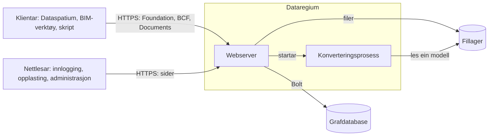

# Arkitektur

Dataregium er ein webserver framfor ein grafdatabase. Denne sida viser korleis delane
heng saman, kva som skjer med ein førespurnad, og kvar alt finst i koden. Les ho om
du vil drive serveren trygt, endre han eller byggje vidare på han. Orda blir forklarte
i [ordlista](glossary.md).

## Delane

| Del | Kva han gjer | Kode |
|---|---|---|
| Foundation API | Seier kva API-ar serveren tilbyr, korleis ein loggar inn, og kven du er | `opencde/foundation/` |
| Innlogging | OAuth2 med PKCE, token, klientar, innloggingssidene og ventetida etter mislukka forsøk | `opencde/auth/`, `opencde/web/` |
| BCF API | Saker, kommentarar, viewpointar, hendingar, relaterte saker og prosjektdokument | `opencde/bcf/` |
| Documents API | Opplasting og utval via sider i nettlesaren, versjonar og metadata | `opencde/documents/` |
| Kontoar | Brukarar, prosjekt, medlemskap og roller | `opencde/accounts/` |
| Lagringa | Dei eigne dataa til tenaren per område: kontoar, OAuth2, BCF, Documents og jobbar, kvar ein repository-klasse med si Cypher bak ein protokoll; skild frå IFC-grafen, som IFC-LPG held | `opencde/store/` |
| Administrasjon | Sider og eit API for administratorar, helsesjekkar og førespurnadsloggen | `opencde/admin/`, `opencde/requestlog.py` |
| IFC-LPG | Gjer opplasta modellar til nodar og lenkjer viewpoint-komponentar til dei | `opencde/ifcgraph/` |
| MCP-endepunktet | Verktøy som AI-program les modellane i prosjekta og gjer framlegg gjennom, medan ein person godkjenner | `opencde/mcp/` |
| Graflaget | Drivaren, dei to databasedialektane, skjemaet og det som går ut | `opencde/graph/` |
| Sider | Malar, stilar, skript og språkkatalogane | `opencde/ui/` |

## Vegen til ein førespurnad

1. uvicorn tek imot førespurnaden. Han trur på `X-Forwarded-For` berre frå proxyane i
   `OPENCDE_TRUSTED_PROXIES`, så adressa til klienten er den rette.
2. Middleware i `opencde/main.py` gjev førespurnaden ein id, loggar han utan innhald
   og token, avgrensar storleiken, svarar på CORS og vilkårsbundne førespurnader,
   legg til tryggingsheaderar og brukar grensa for tal på førespurnader.
3. Avhengnadene til ruta finn ut kven som spør: eit bearer-token for API-a
   (`opencde/auth/dependencies.py`), ei sesjonskake for sidene
   (`opencde/web/dependencies.py`).
4. Eit repository spør grafen, berre med parametrar. Kvar spørjing etter prosjektdata
   byrjar i noden til brukaren og går gjennom `MEMBER_OF`, så det ein brukar ikkje er
   medlem av, finst ikkje for vedkomande og svarar 404.
5. Svaret følgjer skjemaa i `spec/`, og alle feil har same form
   (`opencde/errors.py`).

## Kvar data finst

| Kva | Kvar | Les meir |
|---|---|---|
| Brukarar, prosjekt, saker, kommentarar, viewpointar, dokumentmetadata, klientar og revisjonsloggen | Grafdatabasen | [Grafskjema](graph-schema.md) |
| Token, kodar og klientløyndommar som SHA-256-hashar; passord som Argon2id-hashar | Grafdatabasen | `tests/security/` |
| Opplasta filer og viewpoint-bilete, under namn serveren vel | Fillageret i `OPENCDE_DATA_DIR` | [Documents API-flytar](flows/documents.md) |
| Modellar som nodar og relasjonar | Grafdatabasen | [IFC-LPG](ifc-lpg.md) |
| Dei eigne innstillingane og løyndommane til serveren | `.env` eller `/run/secrets` | [Lokal test](deploy/local.md) |

## Arbeid utanfor førespurnadene

- Kvart minutt (`OPENCDE_CLEANUP_INTERVAL_SECONDS`) slettar serveren det som har gått
  ut, som kodar, token, sesjonar og uferdige opplastingar, og tek opp konverteringar
  ein stoppa server har late etter seg.
- IFC-konverteringar køyrer éi om gongen i ein eigen prosess, med grenser for tid og
  minne, så ein øydelagd modell ikkje kan velte serveren.
- Når førespurnadsloggen er på (`OPENCDE_REQUEST_LOG_ENABLED`), lagrar ein skrivar
  førespurnadene i grafen i porsjonar og slettar dei gamle.

## Trygg frå start

- Ingenting er ope før nokon opnar det: sjølvregistrering av klientar, IFC-grafen,
  førespurnadsloggen og grafspørjingar er av frå start.
- I produksjon nektar serveren å starte utan https og databasepassord.
- Sidene har ingen innebygde skript eller stilar, kvart skjema har eit signert token,
  og kvar side verkar utan JavaScript.

Kvart tiltak her har ein test bak seg i `tests/security/`.

## To databasar

Serveren køyrer på Neo4j eller Memgraph med same Cypher. Berre skjemasetningane er
ulike, og dei finst i `opencde/graph/dialect.py` saman med lista over funksjonar
koden ikkje får bruke.

## Slik blir han testa

| Mappe | Kva ho viser | Når ho køyrer |
|---|---|---|
| `tests/unit` | Funksjonar og dokument, utan database | Ved kvar push |
| `tests/conformance` | Ruter og svar mot skjemaa i `spec/` | Ved kvar push |
| `tests/security` | Headerar, token, grenser, og at kvar operasjon krev token | Ved kvar push |
| `tests/integration` | Alt mot ein ekte database i Docker | Ved kvar push; òg på Memgraph kvar natt |
| `tests/ui` | Sidene i ein ekte nettlesar, med tilgjengesjekk | Ved kvar push |
| `tests/e2e` | Klientbiblioteket mot ein køyrande server, genererte førespurnader og ein omstart av heile stakken | Ved kvar push; dei lange køyringane kvar natt |

## Les vidare

- [Snøggstart](quickstart.md): serveren og Dataspatium på di eiga maskin.
- [Å byggje ein klient](client-guide.md): det ein klient treng.
- [MCP-endepunktet](mcp.md): kva AI-program når, og korleis.
- [Flytar](flows/oauth2.md): innlogging, [dokument](flows/documents.md) og
  [BCF-viewpointar](flows/bcf-viewpoint.md) som sekvensdiagram.
