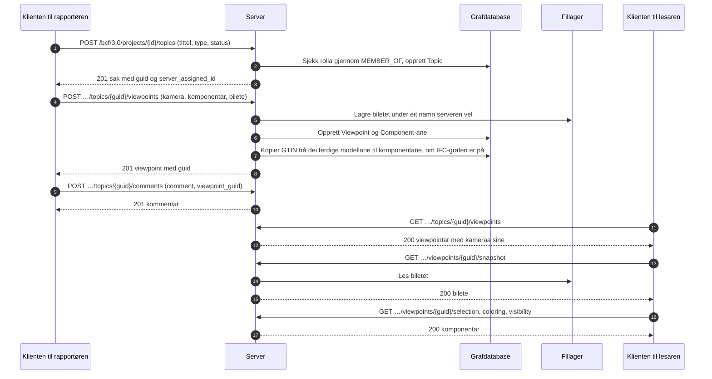

# BCF-viewpoint-flyten

Korleis ein klient opprettar ei sak med ei vising av modellen, og korleis nokon andre
opnar den same visinga. Dette er BCF API 3.0, avsnitt 3.2 (saker) og 3.5 (viewpointar).
Eksempelet [create_topic.py](../../examples/create_topic.py) gjer første halvdel med
klientbiblioteket.



Eit viewpoint kan ikkje endrast. Det blir oppretta heilt og sletta heilt, så ein
kommentar som peikar på det, framleis peikar på det same.

## Kva eit viewpoint inneheld

| Del | Kva han seier | Kvar ein klient les han |
|---|---|---|
| Kamera | Posisjon, retning og oppvektor, perspektiv eller ortogonal | I viewpointet |
| Linjer og snittplan | Kva som blir teikna i visinga, og kva som blir skore bort | I viewpointet |
| Markering | Komponentane som er markerte | `/selection` |
| Fargelegging | Komponentane som har ein farge | `/coloring` |
| Synlegheit | Kva som er synleg frå start, og unntaka | `/visibility` |
| Augneblinksbilete | Eit bilete av visinga, PNG eller JPEG | `/snapshot` |
| Bitmapar | Bilete plasserte i visinga | `/bitmaps/{id}` |

## Kven får gjere kva

| Handling | Krev |
|---|---|
| Lese saker, kommentarar og viewpointar | Medlemskap i prosjektet, i kva rolle som helst |
| Opprette ei sak | Handlinga `createTopic`: contributor, editor eller manager |
| Leggje til eit viewpoint eller ein kommentar | Handlinga `createViewpoint` eller `createComment`: contributor, editor eller manager |
| Slette eit viewpoint | Forfattaren som contributor; editor og manager slettar kva som helst |

Eit prosjekt brukaren ikkje er medlem av, finst ikkje for vedkomande (404).

## Frå eit viewpoint til modellen

Når [IFC-LPG](../ifc-lpg.md) er på, får kvar komponent som nemner ein `GlobalId`
som dei ferdige modellane i prosjektet har, GTIN til elementet som `gtin`, òg når
modellen blir lasta opp etterpå; sjølve elementet blir funne gjennom `GlobalId`:

```cypher
MATCH (:Viewpoint {guid: $viewpoint})-[:HAS_COMPONENT]->(c:Component)
MATCH (e:IfcProduct {GlobalId: c.ifc_guid})
RETURN c.ifc_guid, e.Name, c.gtin
```
