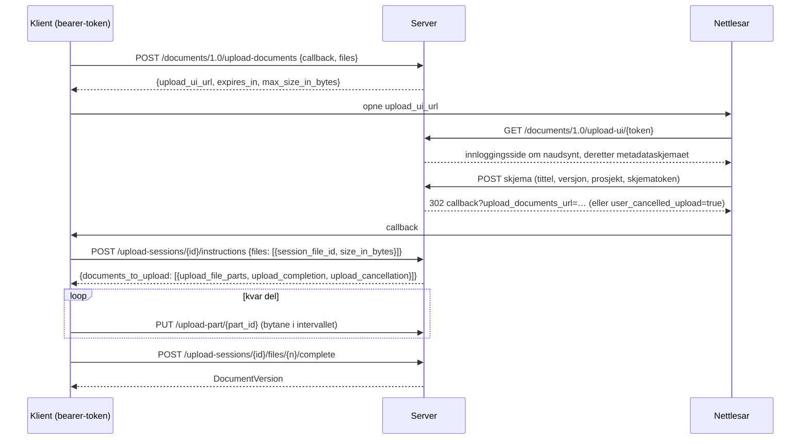
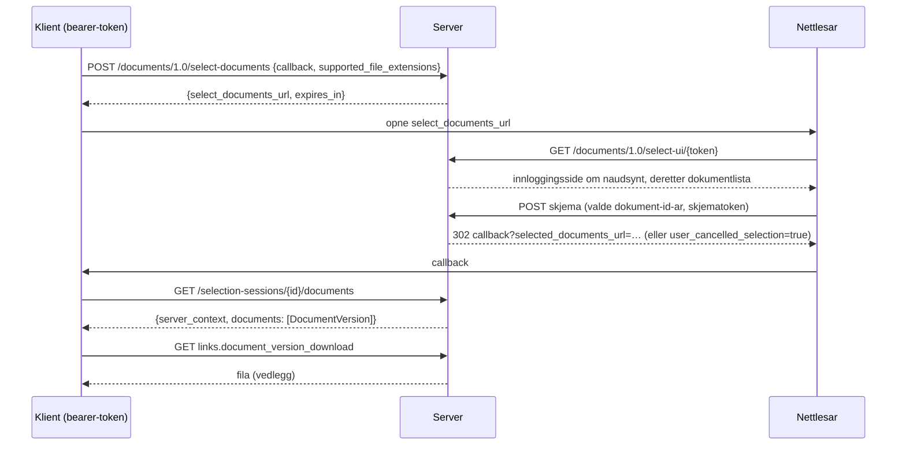

# Documents API-flytar

Documents API 1.0 er ein samtale mellom tre partar: klientapplikasjonen, denne
serveren og nettlesaren til brukaren. Klienten snakkar med API-et med eit
bearer-token; nettlesaren viser serveren sine eigne sider (innlogging,
inntasting av metadata, dokumentval); serveren kallar aldri klienten, han
omdirigerer berre nettlesaren til callback-URL-en til klienten.

## Opplasting

* UI-lenkja er gyldig i `OPENCDE_DOCUMENTS_SESSION_TTL_SECONDS` (10 minutt);
  når instruksjonar er utferda, lever sesjonen
  `OPENCDE_UPLOAD_SESSION_TTL_SECONDS` (24 timar) slik at store filer kan
  lastast opp.
* Delane er `OPENCDE_UPLOAD_PART_BYTES` (50 MiB) kvar, blir lasta opp i
  vilkårleg rekkjefølgje, parallelt om klienten vil. Ein del må vere nøyaktig
  det annonserte intervallet.
* Fullføringa set saman delane, verifiserer den totale storleiken, reknar ut
  SHA-256 og opprettar versjonen. Tek det meir enn 15 sekund, byrjar svaret
  med blankteikn for å halde sambandet ope.
* `document_id` i ein filpost gjer opplastinga til ein ny versjon av det
  dokumentet; tittelen blir halden på, versjonsindeksen aukar.
* `base_version_index` i ein filpost (ei utviding) seier kva versjon
  opplastinga byggjer på: fullføringa svarar `412 version_conflict` når
  dokumentet alt har ein nyare, og metadataa til versjonen oppgjev basen.

## Utval og nedlasting

* Lista viser den siste versjonen av kvart dokument i prosjekta til brukaren,
  filtrert på filendingane til klienten med ei lenkje "vis alle".
* Brukarar med rolla editor eller manager kan laste opp ei fil frå sida; ho
  dukkar opp i lista straks (dette er eit tillegg til spesifikasjonen).
* `POST /documents/1.0/document-versions` svarar med dei siste versjonane av
  ei liste dokument-id-ar med ein `ETag`; `If-None-Match` gjev `304`.

[Dataspatium](https://github.com/marwiss/Dataspatium) implementerer begge
flytane frå nettlesaren (`src/api/families/opencde.js`): han opnar utvalssida
til serveren i eit popup-vindauge og importerer dei valde filene, og lastar
opp datasett, filer og arbeidsområdepakkar i delar med opplastingssida til
serveren for metadata; live-suitene køyrer desse flytane mot
utviklingsstakken.

## Kven får gjere kva

| Handling | Krev |
|---|---|
| Starte ei opplasting eller eit utval | eit bearer-token med scopet `documents` |
| Bruke nettlesarsidene | ein nettlesarsesjon som same brukar (`/signin`) |
| Lagre metadata, fullføre ei opplasting, laste opp frå sida | prosjekthandlinga `createDocument` (editor, manager) |
| Sjå, velje og laste ned dokument | medlemskap i prosjektet (kva rolle som helst) |

Dokument i andre prosjekt finst ikkje for kallaren (404), så verken id-ane
eller eksistensen deira lek.
