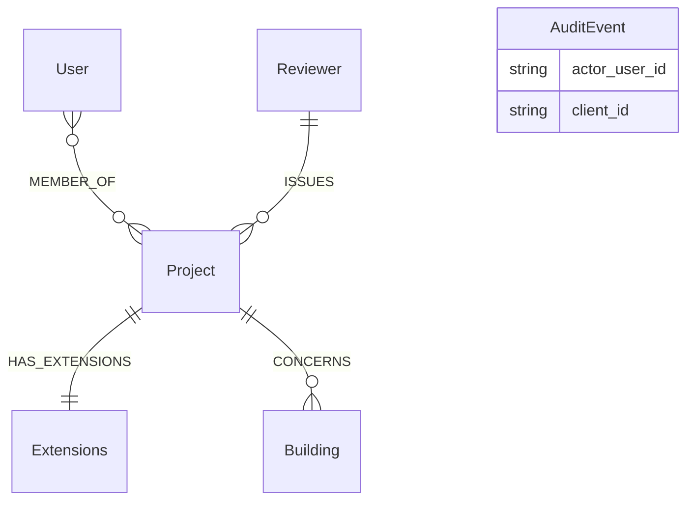
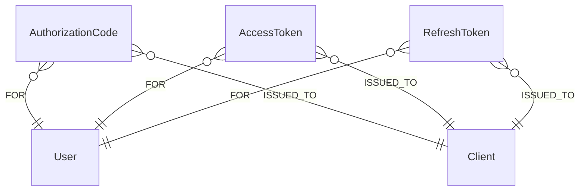
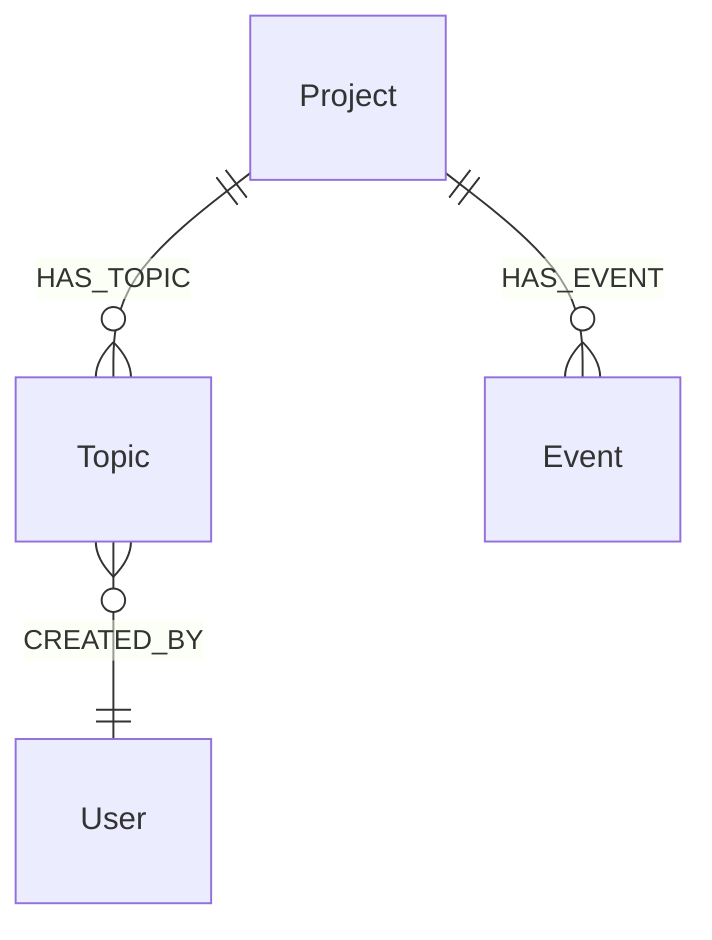
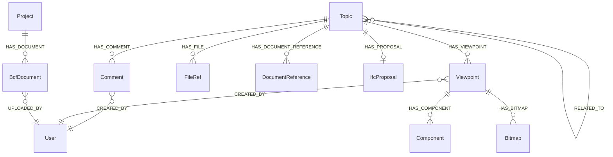
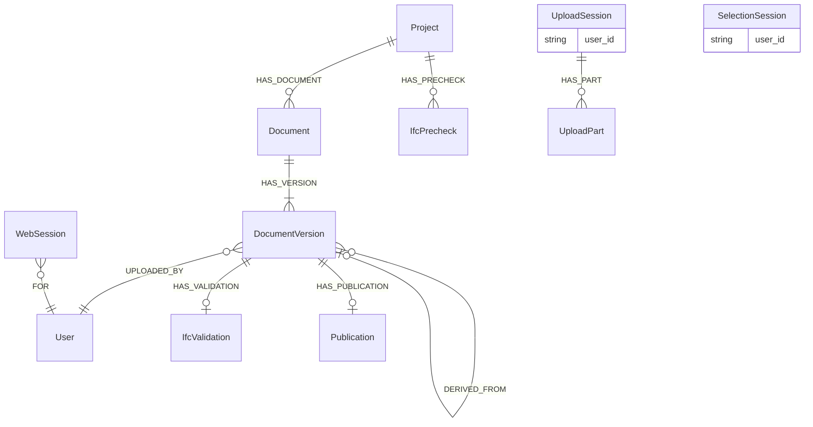
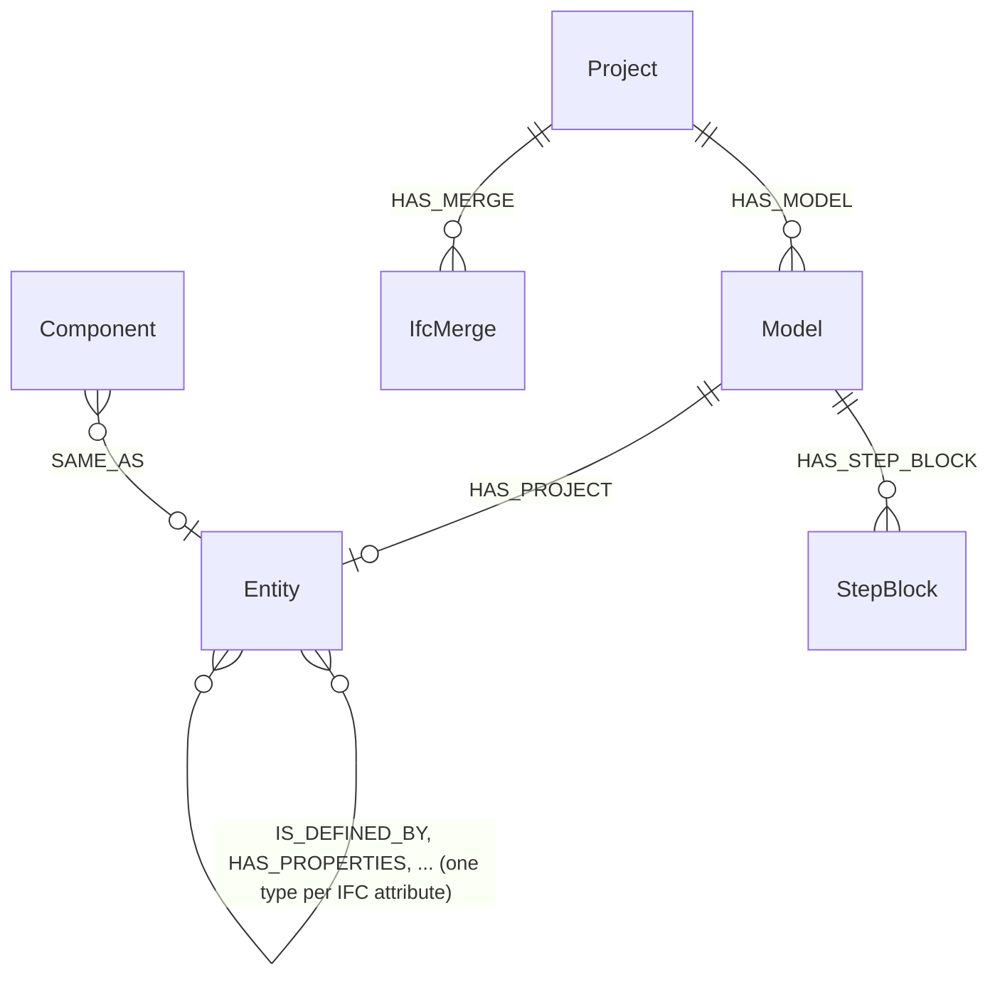

# Grafskjema

Databasen er skjemalaus; `opencde/graph/schema.py` er skjemaet. Denne sida
forklarar konvensjonane og etikettane, avsnitt for avsnitt i den
rekkjefølgja etappane i planen la dei til.

## Konvensjonar

- Kvar node har ein servergenerert UUID i `id` (eller namnet spesifikasjonen
  brukar: `project_id`, `guid`, `client_id`, `document_id`) med ein unik
  constraint. Ingenting ein klient sender, endar ukontrollert i ein filsti
  eller ein databasenøkkel.
- Tidsstempel er ISO 8601-strengar i UTC med millisekund og ein `Z`
  (`2026-11-05T12:34:56.789Z`). Strengrekkjefølgje er lik tidsrekkjefølgje.
- Koordinatar og vektorar er vanlege flyttal (`x`, `y`, `z`), aldri `point()`.
- Alt som går ut, ber `expires_at` (same format); serveren slettar utgåtte
  nodar på ein timer (`opencde/graph/cleanup.py`).
- Løyndomar (kodar, tokens, klientløyndomar) blir lagra berre som
  SHA-256-hashar.
- Cypher er dialektnøytral, så Neo4j og Memgraph oppfører seg likt (ADR 0003).
  Skjema-DDL er den einaste produktspesifikke teksten og ligg i
  `graph/dialect.py`.
- Namn: etikettar blir skrivne i PascalCase (`DocumentVersion`, `Model`),
  relasjonstypar med store bokstavar og understrekar (`HAS_TOPIC`,
  `CREATED_BY`, og `IS_DEFINED_BY` for IFC-attributtrelasjonane). Diagramma
  nedanfor teiknar berre verkelege nodar og relasjonar; ein referanse som blir
  halden som eigenskap (`AuditEvent.actor_user_id`, `UploadSession.user_id`),
  blir lista i boksen i staden for å teiknast som ei linje.

## Kontoar og tilgang (etappe 1)

| Etikett | Nøkkel | Eigenskapar | Merknader |
|---|---|---|---|
| `User` | `id`, unikt `username` | `email`, `full_name`, `password_hash` (Argon2id), `is_admin`, `disabled`, `created_at`, `must_change_password` | Brukarnamnet er brukar-id-en API-ane eksponerer |
| `MEMBER_OF` (relasjon User → Project) | | `role` (viewer, contributor, editor, manager), `since` | Rollene blir avbilda på `*_actions` i BCF, sjå `accounts/roles.py` |
| `Project` | `project_id` | `name`, `created_at`, `topic_counter`, `block_on_validation_errors` | `topic_counter` nummererer `server_assigned_id`; `block_on_validation_errors` avviser opplastingar med valideringsfeil (ADR 0021) |
| `Extensions` | `id` | `topic_type[]`, `topic_status[]`, `topic_label[]`, `snippet_type[]`, `priority[]`, `stage[]`, `custom_information[]` | `users[]` blir rekna ut frå medlemene |
| `Client` | `client_id` | `name`, `description`, `url`, `redirect_uris[]`, `is_public`, `secret_hash`, `disabled`, `pending_approval`, `created_at`, `created_by`, `dynamic`, `expires_at` (berre sjølvregistrerte) | OAuth2-klient; ein sjølvregistrert blir sletta når `expires_at` er passert utan at eit token er utferda |
| `AuditEvent` | `id` | `type`, `at`, `actor_user_id`, `client_id`, `ip`, `details` (JSON-streng) | Tryggingsrelevante hendingar |
| `Reviewer`, `Building` | `id` | `name`, `status` | Kontekst frå kontrollplan-bruksområdet (seed-data): den granskande organisasjonen (ein kommune i den opphavlege historia) og bygningen |

## OAuth2 (etappe 2)

`AuthorizationCode`, `AccessToken` og `RefreshToken` (med `family_id`) blir
nøkla på ein hash av løyndomen, ber `expires_at` og er knytte
`-[:FOR]->(:User)` og `-[:ISSUED_TO]->(:Client)`. `WebSession`
(nettlesarinnlogging, etappe 5) er berre knytt `-[:FOR]->(:User)`.

## BCF-saker og hendingar (etappe 3)

| Etikett | Nøkkel | Eigenskapar | Merknader |
|---|---|---|---|
| `Topic` | `guid` | `server_assigned_id`, `title`, `topic_type`, `topic_status`, `priority`, `stage`, `labels[]`, `reference_links[]`, `assigned_to`, `description`, `index`, `due_date`, `creation_date`, `creation_author`, `modified_date`, `modified_author`, `snippet_type`, `snippet_is_external`, `snippet_reference`, `snippet_reference_schema` | Feltnamna følgjer `topic_GET.json`; BIM snippet-objektet blir flata ut til fire eigenskapar. `server_assigned_id` er `<prefiks><teljar>` frå `Project.topic_counter` |
| `IfcProposal` | `id` | `state`, `created_at`, `checked_at`, `base_document_id`, `base_version_index`, `change_count`, `applied`, `issue_count`, `error_count`, `truncated`, `ruleset`, `checks`, `report`, `storage_key`, `snippet_key`, `author`, `error` | Prøven av endringssettet til ei sak mot basisversjonen (ADR 0021); `report` held merknadene basen manglar, `storage_key` den brukte fila, lagra for godkjenninga. Blir sletta med saka |
| `Event` | `id` | `kind` (`topic` eller `comment`), `topic_guid`, `comment_guid`, `author`, `date`, `action_types[]`, `action_values[]` | Éin node per førespurnad som endra noko; dei to parallelle listene er `actions`-arrayen i BCF 3.9/3.10. Knytt til prosjektet slik at hendingar overlever saka si |

Kvar saksspørjing startar i `User`-noden til kallaren og går via `MEMBER_OF`
til prosjektet før ho rører ei sak, så ei sak i eit prosjekt kallaren ikkje er
medlem av, finst ikkje så langt API-et veit (404).

## BCF-kommentarar, viewpoints og referansar (etappe 4)

| Etikett | Nøkkel | Eigenskapar | Merknader |
|---|---|---|---|
| `Comment` | `guid` | `topic_guid`, `date`, `author`, `comment`, `viewpoint_guid`, `modified_date`, `modified_author` | `viewpoint_guid` må namngje eit viewpoint i same sak |
| `Viewpoint` | `guid` | `index`, `author`, `creation_date`, `camera_kind`, `camera` (JSON), `lines` (JSON), `clipping_planes` (JSON), `snapshot_type`, `storage_key`, `has_components`, `default_visibility`, `has_hints`, `spaces_visible`, `space_boundaries_visible`, `openings_visible` | Uforanderleg. Geometri er JSON-tekst: opak, og identisk i begge databasane |
| `Component` | `id` | `role` (`selection`, `coloring`, `exception`), `group_index`, `position`, `color`, `ifc_guid`, `originating_system`, `authoring_tool_id` | Éin node per førekomst; IFC-grafen knyter `ifc_guid` til modellelement (etappe 9) |
| `Bitmap` | `guid` | `position`, `bitmap_type`, `storage_key`, `height`, `loc_*`, `nrm_*`, `up_*` | Biletbytes i lageret under `bitmaps/<guid>.<type>` |
| `FileRef` | `id` | `position`, `ifc_project`, `ifc_spatial_structure_element`, `filename`, `date`, `reference` | Filene i hovudet til saka (BCF 3.3) |
| `DocumentReference` | `guid` | `document_guid` eller `url`, `description`, `created_at` | Nøyaktig eitt av dei to måla |
| `BcfDocument` | `guid` | `filename`, `storage_key`, `size`, `created_at`, `author` | Ei fil lasta opp gjennom BCF 3.8; bytes under `bcf-documents/<guid>` |
| `RELATED_TO` (relasjon Topic → Topic) | | | Retta; PUT erstattar den utgåande lista til ei sak |

Saker held snippet-fila si i `snippet_storage_key` (bytes under
`snippets/<saks-guid>.bin`). Sletting av ei sak slettar alt under ho og
lagernøklane samla frå nodane; hendingane blir att.

## Dokument og nettlesarsesjonar (etappe 5)

| Etikett | Nøkkel | Eigenskapar | Merknader |
|---|---|---|---|
| `Document` | `document_id` | `title`, `created_at`, `latest_index` | `latest_index` nummererer versjonane |
| `DocumentVersion` | `id` | `version_index`, `version_number`, `creation_date`, `title`, `file_name`, `size_in_bytes`, `sha256`, `storage_key`, `author`, `metadata` (JSON), `parent_version_index`, `approved_by`, `change_set_id`, `change_set` | Bytes under `documents/<id>`; API-kroppen viser berre felta i spesifikasjonen; `parent_version_index`, `approved_by`, `change_set_id` og `change_set` (endringane, pakka) på ein versjon bygd på ein annan, lenkja til han med `DERIVED_FROM` (ADR 0021) |
| `IfcValidation` | `id` | `state`, `checked_at`, `issue_count`, `truncated`, `ruleset`, `report`, `storage_key`, `file_name`, `error` | Kontrollen av ei opplasta IFC-fil mot IFC-skjemaet (ADR 0011); `report` er opptil 10 000 merknader som komprimert JSON. Blir sletta med prosjektet til versjonen |
| `Publication` | `id` | `storage_key`, `file_name`, `size_in_bytes`, `sha256`, `published_at`, `published_by` | Arkivet til ein publisert versjon, `.ifczip` eller `.zip`, under `published/<id>`; eitt per versjon. Blir sletta med prosjektet til versjonen |
| `IfcPrecheck` | `id` | dei same som `IfcValidation`, `project_id`, `author`, `expires_at` | Ei fil kontrollert utan å bli ein versjon, eller ei opplasting prosjektet avviste (ADR 0021); har òg etiketten `IfcValidation`. Oppryddingsjobben slettar han og fila hans etter eit døgn |
| `UploadSession` | `id`, indeksert `token_hash` | `user_id`, `username`, `callback_url`, `callback_expires_at`, `expires_at`, `server_context`, `project_id`, `state`, `files_json` | `id` opptrer i API-URL-ar (bearer krevst); UI-URL-en ber tokenet som hashen blir lagra for |
| `UploadPart` | `id` | `file_index`, `part_index`, `range_start`, `range_end`, `received`, `storage_key`, `size`, `expires_at` | Bytes under `parts/<id>` til fila blir sett saman; oppryddingsjobben slettar utgåtte delar og filene deira |
| `SelectionSession` | `id`, indeksert `token_hash` | `user_id`, `callback_url`, `callback_expires_at`, `expires_at`, `server_context`, `extensions[]`, `state`, `selected[]` | `selected` held `document_id:version_index`-par valde i nettlesaren |
| `WebSession` | `id` (hash av cookien) | `created_at`, `expires_at`, `idle_expires_at`, `ip` | Nettlesarinnlogging; `expires_at` er den absolutte levetida |
| `SignInThrottle` | `key` (hash av brukarnamnet) | `failures`, `blocked_until`, `expires_at` | Mislukka innloggingar per brukarnamn; går ut eit døgn etter siste feil, og ei vellykka innlogging fjernar han |

## IFC-graf (etappe 9)

| Etikett | Nøkkel | Eigenskapar | Merknader |
|---|---|---|---|
| `Model` | `id`, indeksert `project_id` | `document_id`, `version_index` eller `bcf_document_guid`, `file_name`, `storage_key`, `state`, `schema`, `ifc_project_guid`, `entities`, `relationships`, `skipped`, `lossless`, `geometry`, `ifc_header`, `geometry_key`, `spatial_at`, `spatial_products`, `spatial_failed`, `spatial_error`, `error`, tidsstempel | Éin per importert fil; `state` er `queued`, `running`, `done` eller `failed` |
| `Entity` + klasseetikettar | `id` (`<modell-id>:<step-id>`), indeksert `GlobalId`, `model_id` | `ifc_class`, `step_id`, `bbox_min`, `bbox_max`, `bbox_centre` (punkt i prosjektkoordinatar, meter, på ein bygningsdel med form), kvart literalt IFC-attributt ved namn | Relasjonar mellom entitetar blir namngjevne etter IFC-attributtet (framover og inverst), skrivne som kvar relasjonstype med store bokstavar og understrekar: `IsDefinedBy` blir `IS_DEFINED_BY` |
| `StepBlock` | `id` (`<modell-id>:<første step-id>`) | `first_step`, `instances`, `text` | Instansar i ein modell konvertert med `OPENCDE_IFC_LPG_LOSSLESS` som ikkje er nodar: skrivne ut som STEP i id-rekkjefølgje og komprimerte. Ikkje returner noden heil i ei spørjing, på grunn av `text` |
| `IfcMerge` | `id` | `project_id`, `state`, `request`, `author`, `created_at`, `running_at`, `finished_at`, `model_id`, `version_index`, `report`, `error` | Ein bygning frå modell B ført inn i ein modell i prosjektet (`HAS_MERGE`); `request` oppgjev begge versjonane, og `version_index` er versjonen han vart. Den samanslåtte modellen blir teken ut av grafen når han er skriven ut. Blir sletta med prosjektet |

Sjå [ifc-lpg.md](ifc-lpg.md) for konverteringsreglane og dømespørjingar.
