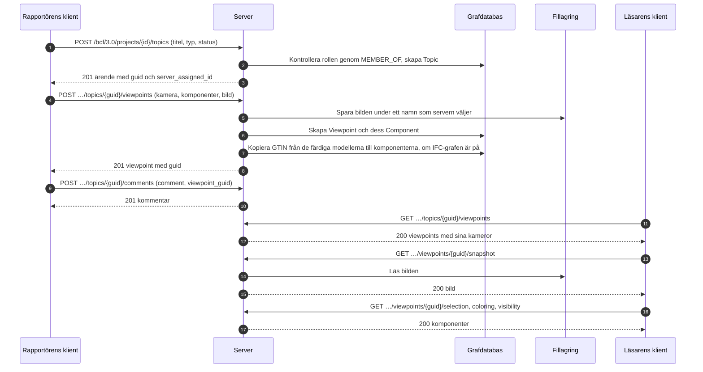

# BCF-viewpoint-flödet

Hur en klient lägger upp ett ärende med en vy av modellen, och hur någon annan öppnar
samma vy. Detta är BCF API 3.0, avsnitten 3.2 (ärenden) och 3.5 (viewpoints). Exemplet
[create_topic.py](../../examples/create_topic.py) gör första halvan med
klientbiblioteket.



En viewpoint går inte att ändra. Den skapas hel och tas bort hel, så att en kommentar
som pekar på den fortsätter att peka på samma sak.

## Vad en viewpoint innehåller

| Del | Vad den säger | Var en klient läser den |
|---|---|---|
| Kamera | Position, riktning och uppåtvektor, perspektiv eller ortogonal | I viewpointen |
| Linjer och snittplan | Vad som ritas i vyn och vad som skärs bort | I viewpointen |
| Markering | Komponenterna som är markerade | `/selection` |
| Färgläggning | Komponenterna som har en färg | `/coloring` |
| Synlighet | Vad som syns från början, och undantagen | `/visibility` |
| Ögonblicksbild | En bild av vyn, PNG eller JPEG | `/snapshot` |
| Bitmappar | Bilder placerade i vyn | `/bitmaps/{id}` |

## Vem får göra vad

| Åtgärd | Kräver |
|---|---|
| Läsa ärenden, kommentarer och viewpoints | Medlemskap i projektet, i vilken roll som helst |
| Skapa ett ärende | Åtgärden `createTopic`: contributor, editor eller manager |
| Lägga till en viewpoint eller en kommentar | Åtgärden `createViewpoint` eller `createComment`: contributor, editor eller manager |
| Lägga till ett dokument i projektet och hänvisa till det från ett ärende | Åtgärden `createDocument`: contributor, editor eller manager; en contributor hänvisar från sina egna ärenden |
| Ta bort en viewpoint | Dess författare som contributor; editor och manager tar bort vilken som helst |

Ett projekt som användaren inte är medlem i finns inte för hen (404).

## Från en viewpoint till modellen

När [IFC-LPG](../ifc-lpg.md) är på får varje komponent som nämner ett `GlobalId`
som projektets färdiga modeller har elementets GTIN som `gtin`, också när modellen
laddas upp efteråt; själva elementet hittas genom sitt `GlobalId`:

```cypher
MATCH (:Viewpoint {guid: $viewpoint})-[:HAS_COMPONENT]->(c:Component)
MATCH (e:IfcProduct {GlobalId: c.ifc_guid})
RETURN c.ifc_guid, e.Name, c.gtin
```
