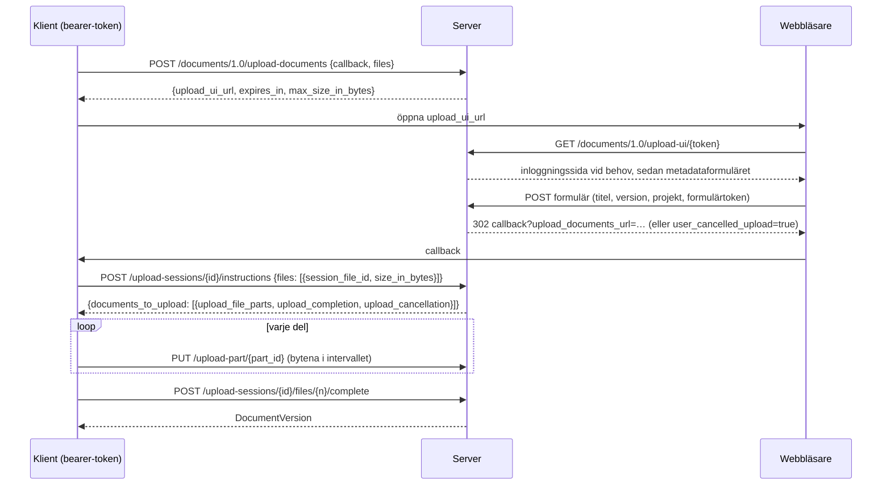
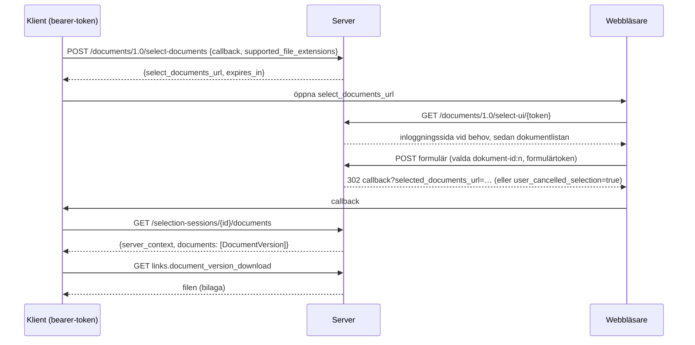

# Documents API-flöden

Documents API 1.0 är en konversation mellan tre parter: klientapplikationen,
den här servern och användarens webbläsare. Klienten talar med API:t med en
bearer-token; webbläsaren visar serverns egna sidor (inloggning,
metadatainmatning, dokumentval); servern anropar aldrig klienten, den
omdirigerar bara webbläsaren till klientens callback-URL.

## Uppladdning

* UI-länken är giltig i `OPENCDE_DOCUMENTS_SESSION_TTL_SECONDS` (10 minuter);
  när instruktioner har utfärdats lever sessionen
  `OPENCDE_UPLOAD_SESSION_TTL_SECONDS` (24 timmar) så att stora filer kan
  laddas upp.
* Delarna är `OPENCDE_UPLOAD_PART_BYTES` (50 MiB) var, laddas upp i valfri
  ordning, parallellt om klienten vill. En del måste vara exakt det
  annonserade intervallet.
* Slutförandet sätter samman delarna, verifierar den totala storleken,
  beräknar SHA-256 och skapar versionen. Om det tar mer än 15 sekunder börjar
  svaret med blanksteg för att hålla anslutningen öppen.
* `document_id` i en filpost gör uppladdningen till en ny version av det
  dokumentet; titeln behålls, versionsindexet ökar.
* `base_version_index` i en filpost (ett tillägg) säger vilken version
  uppladdningen bygger på: avslutet svarar `412 version_conflict` när dokumentet
  redan har en nyare, och versionens metadata anger basen.
* Ett projekt kan avvisa filer med valideringsfel: avslutet svarar då
  `422 ifc_validation_failed` med rapportens adress, och
  `POST …/projects/{id}/ifc-precheck` kontrollerar en fil utan att spara den.
* En konfidentiell klient som en administratör godkänt för det (*Får ladda upp
  dokument utan webbsidan* på klientens sida) laddar upp huvudlöst: `project_id`
  i begäran, med `title` och `version_number` per fil, hoppar över sidan, och
  instruktionerna finns genast på `upload-sessions/{id}/instructions`; varje
  sådan uppladdning står i granskningsloggen. 403 för varje annan klient.

## Urval och nedladdning

* Listan visar den senaste versionen av varje dokument i användarens projekt,
  filtrerad på klientens filändelser med en länk "visa alla".
* Användare med rollen editor eller manager kan ladda upp en fil från sidan;
  den dyker upp i listan direkt (detta är ett tillägg till specifikationen).
* `POST /documents/1.0/document-versions` svarar med de senaste versionerna
  av en lista dokument-id:n med en `ETag`; `If-None-Match` ger `304`.

[Dataspatium](https://github.com/marwiss/Dataspatium) implementerar båda
flödena från webbläsaren (`src/api/families/opencde.js`): den öppnar serverns
urvalssida i ett popup-fönster och importerar de valda filerna, och laddar
upp datamängder, filer och arbetsytepaket i delar med serverns
uppladdningssida för metadata; dess live-sviter kör dessa flöden mot
utvecklingsstacken.

## Vem får göra vad

| Handling | Kräver |
|---|---|
| Starta en uppladdning eller ett urval | en bearer-token med scopet `documents` |
| Använda webbläsarsidorna | en webbläsarsession som samma användare (`/signin`) |
| Spara metadata, slutföra en uppladdning, ladda upp från sidan | rollen editor eller manager |
| Se, välja och ladda ned dokument | medlemskap i projektet (vilken roll som helst) |
| Publicera en version | rollen `manager` |

Dokument i andra projekt finns inte för anroparen (404), så varken deras id:n
eller deras existens läcker.
