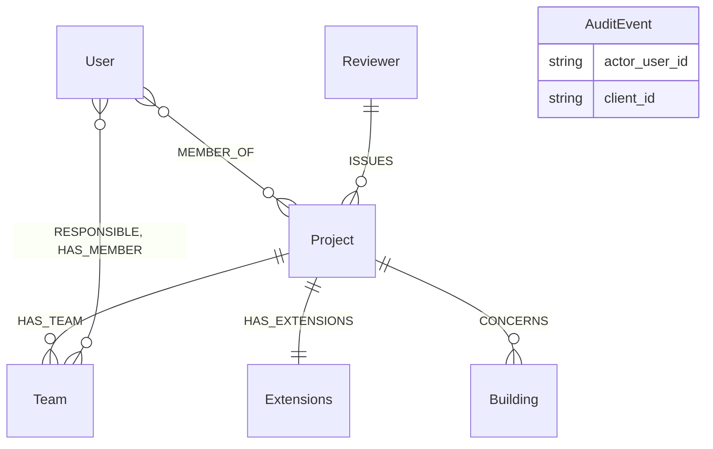
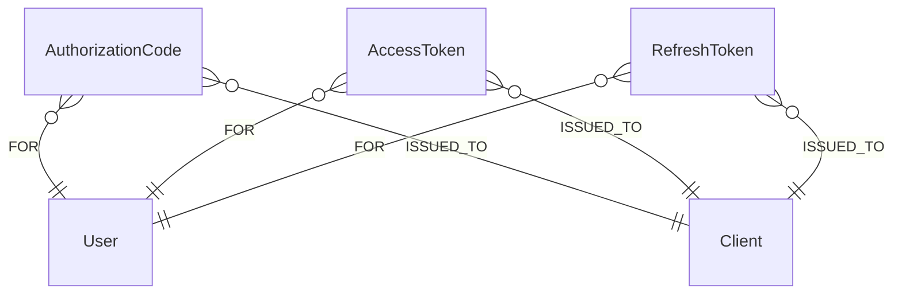
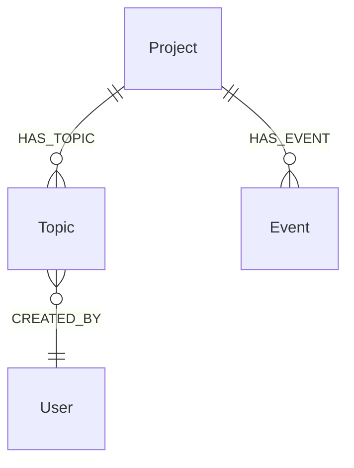
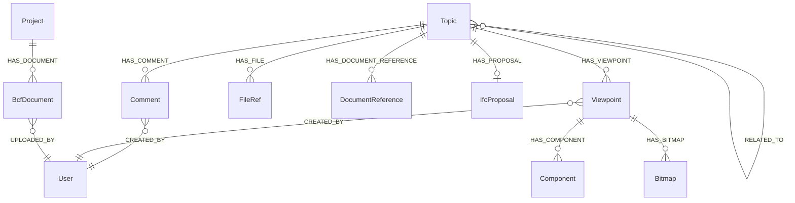
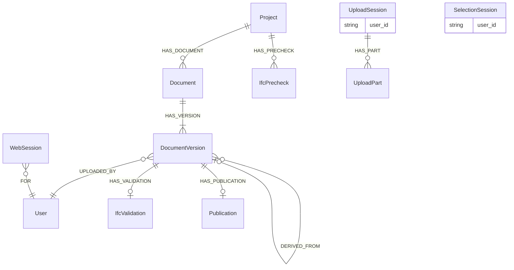
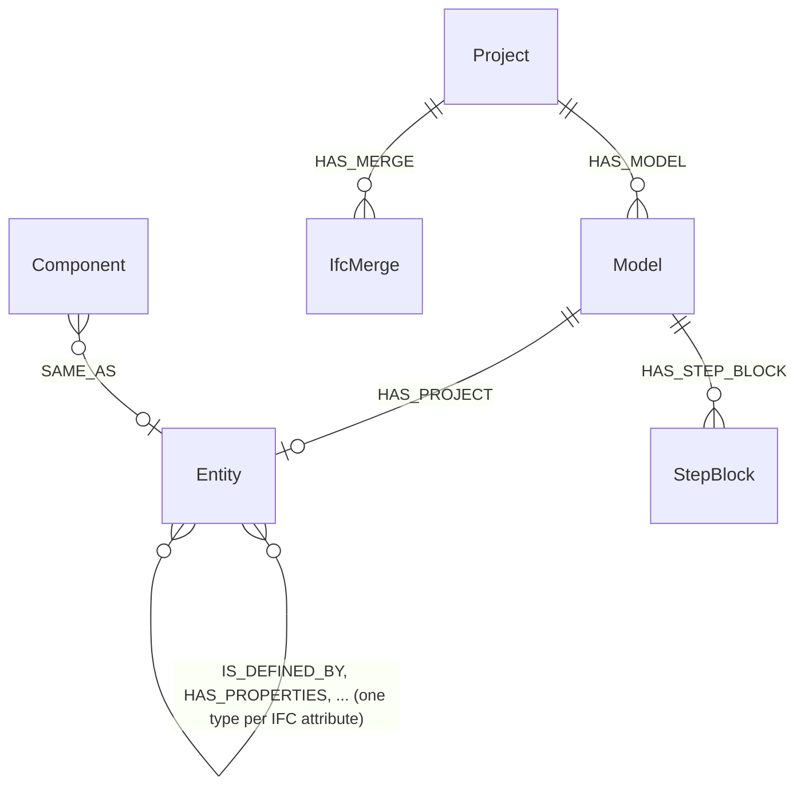

# Grafschema

Databasen är schemalös; `opencde/graph/schema.py` är schemat. Den här sidan
förklarar konventionerna och etiketterna, avsnitt för avsnitt i den ordning
planens etapper lade till dem.

## Konventioner

- Varje nod har ett servergenererat UUID i `id` (eller specens namn för det:
  `project_id`, `guid`, `client_id`, `document_id`) med en unik constraint.
  Ingenting en klient skickar hamnar okontrollerat i en filsökväg eller en
  databasnyckel.
- Tidsstämplar är ISO 8601-strängar i UTC med millisekunder och ett `Z`
  (`2026-11-05T12:34:56.789Z`). Strängordning är lika med tidsordning.
- Koordinater och vektorer är vanliga flyttal (`x`, `y`, `z`), aldrig `point()`.
- Allt som går ut bär `expires_at` (samma format); servern tar bort utgångna
  noder på en timer (`opencde/graph/cleanup.py`).
- Hemligheter (koder, tokens, klienthemligheter) lagras bara som
  SHA-256-hashar.
- Cypher är dialektneutral så att Neo4j och Memgraph beter sig lika (ADR 0003).
  Schema-DDL är den enda produktspecifika texten och ligger i `graph/dialect.py`.
- Namn: etiketter skrivs i PascalCase (`DocumentVersion`, `Model`),
  relationstyper med versaler och understreck (`HAS_TOPIC`, `CREATED_BY`, och
  `IS_DEFINED_BY` för IFC-attributrelationerna). Diagrammen nedan ritar bara
  riktiga noder och relationer; en referens som hålls som egenskap
  (`AuditEvent.actor_user_id`, `UploadSession.user_id`) listas i rutan i
  stället för att ritas som en linje.

## Konton och åtkomst (etapp 1)

| Etikett | Nyckel | Egenskaper | Anteckningar |
|---|---|---|---|
| `User` | `id`, unikt `username` | `email`, `full_name`, `password_hash` (Argon2id), `is_admin`, `disabled`, `created_at`, `must_change_password` | Användarnamnet är det användar-id API:erna exponerar |
| `MEMBER_OF` (relation User → Project) | | `role` (viewer, contributor, editor, manager), `since` | Rollerna avbildas på BCF:s `*_actions`, se `accounts/roles.py` |
| `Project` | `project_id` | `name`, `created_at`, `topic_counter`, `block_on_validation_errors` | `topic_counter` numrerar `server_assigned_id`; `block_on_validation_errors` avvisar uppladdningar med valideringsfel (ADR 0021) |
| `Extensions` | `id` | `topic_type[]`, `topic_status[]`, `topic_label[]`, `snippet_type[]`, `priority[]`, `stage[]`, `custom_information[]` | `users[]` beräknas ur medlemmarna |
| `Team` | `id` | `name`, `ids_document_id`, `created_at`, `updated_at` | Ett team i ett projekt (`HAS_TEAM`), med `RESPONSIBLE` och `HAS_MEMBER` till användare; dess del av modellen är det som specifikationerna i dess IDS-dokument gäller för. Raderas med projektet |
| `Client` | `client_id` | `name`, `description`, `url`, `redirect_uris[]`, `is_public`, `secret_hash`, `disabled`, `pending_approval`, `created_at`, `created_by`, `dynamic`, `expires_at` (bara självregistrerade) | OAuth2-klient; en självregistrerad tas bort när `expires_at` passerat utan att någon token utfärdats |
| `AuditEvent` | `id` | `type`, `at`, `actor_user_id`, `client_id`, `ip`, `details` (JSON-sträng) | Säkerhetsrelevanta händelser |
| `Reviewer`, `Building` | `id` | `name`, `status` | Kontext från kontrollplansfallet (seed-data): den granskande organisationen (en kommun i den ursprungliga berättelsen) och byggnaden |

## OAuth2 (etapp 2)

`AuthorizationCode`, `AccessToken` och `RefreshToken` (med `family_id`)
nycklas på en hash av hemligheten, bär `expires_at` och är länkade
`-[:FOR]->(:User)` och `-[:ISSUED_TO]->(:Client)`. `WebSession`
(webbläsarinloggning, etapp 5) är länkad bara `-[:FOR]->(:User)`.

## BCF-ärenden och händelser (etapp 3)

| Etikett | Nyckel | Egenskaper | Anteckningar |
|---|---|---|---|
| `Topic` | `guid` | `server_assigned_id`, `title`, `topic_type`, `topic_status`, `priority`, `stage`, `labels[]`, `reference_links[]`, `assigned_to`, `description`, `index`, `due_date`, `creation_date`, `creation_author`, `modified_date`, `modified_author`, `snippet_type`, `snippet_is_external`, `snippet_reference`, `snippet_reference_schema` | Fältnamnen följer `topic_GET.json`; BIM snippet-objektet plattas ut till fyra egenskaper. `server_assigned_id` är `<prefix><räknare>` från `Project.topic_counter` |
| `IfcProposal` | `id` | `state`, `created_at`, `checked_at`, `base_document_id`, `base_version_index`, `change_count`, `applied`, `issue_count`, `error_count`, `truncated`, `ruleset`, `checks`, `report`, `storage_key`, `snippet_key`, `author`, `error` | Prövningen av ett ärendes ändringsset mot dess basversion (ADR 0021); `report` håller de anmärkningar basen saknar, `storage_key` den tillämpade filen, sparad för godkännandet. Raderas med ärendet |
| `Event` | `id` | `kind` (`topic` eller `comment`), `topic_guid`, `comment_guid`, `author`, `date`, `action_types[]`, `action_values[]` | En nod per begäran som ändrade något; de två parallella listorna är `actions`-arrayen i BCF 3.9/3.10. Kopplad till projektet så att händelser överlever sitt ärende |

Varje ärendefråga startar i anroparens `User`-nod och går via `MEMBER_OF` till
projektet innan den rör ett ärende, så ett ärende i ett projekt anroparen inte
är medlem i finns inte så vitt API:t vet (404).

## BCF-kommentarer, viewpoints och referenser (etapp 4)

| Etikett | Nyckel | Egenskaper | Anteckningar |
|---|---|---|---|
| `Comment` | `guid` | `topic_guid`, `date`, `author`, `comment`, `viewpoint_guid`, `modified_date`, `modified_author` | `viewpoint_guid` måste namnge en viewpoint i samma ärende |
| `Viewpoint` | `guid` | `index`, `author`, `creation_date`, `camera_kind`, `camera` (JSON), `lines` (JSON), `clipping_planes` (JSON), `snapshot_type`, `storage_key`, `has_components`, `default_visibility`, `has_hints`, `spaces_visible`, `space_boundaries_visible`, `openings_visible` | Oföränderlig. Geometrin är JSON-text: opak, och identisk i båda databaserna |
| `Component` | `id` | `role` (`selection`, `coloring`, `exception`), `group_index`, `position`, `color`, `ifc_guid`, `originating_system`, `authoring_tool_id` | En nod per förekomst; IFC-grafen kopplar `ifc_guid` till modellelement (etapp 9) |
| `Bitmap` | `guid` | `position`, `bitmap_type`, `storage_key`, `height`, `loc_*`, `nrm_*`, `up_*` | Bildbytes i lagringen under `bitmaps/<guid>.<typ>` |
| `FileRef` | `id` | `position`, `ifc_project`, `ifc_spatial_structure_element`, `filename`, `date`, `reference` | Filerna i ärendets huvud (BCF 3.3) |
| `DocumentReference` | `guid` | `document_guid` eller `url`, `description`, `created_at` | Exakt ett av de två målen |
| `BcfDocument` | `guid` | `filename`, `storage_key`, `size`, `created_at`, `author` | En fil uppladdad genom BCF 3.8; bytes under `bcf-documents/<guid>` |
| `RELATED_TO` (relation Topic → Topic) | | | Riktad; PUT ersätter ett ärendes utgående lista |

Ärenden håller sin snippet-fil i `snippet_storage_key` (bytes under
`snippets/<ärende-guid>.bin`). Att ta bort ett ärende tar bort allt under det
och de lagringsnycklar som samlats från noderna; händelserna finns kvar.

## Dokument och webbläsarsessioner (etapp 5)

| Etikett | Nyckel | Egenskaper | Anteckningar |
|---|---|---|---|
| `Document` | `document_id` | `title`, `created_at`, `latest_index` | `latest_index` numrerar versionerna |
| `DocumentVersion` | `id` | `version_index`, `version_number`, `creation_date`, `title`, `file_name`, `size_in_bytes`, `sha256`, `storage_key`, `author`, `metadata` (JSON), `parent_version_index`, `approved_by`, `change_set_id`, `change_set` | Bytes under `documents/<id>`; API-kroppen visar bara specens fält; `parent_version_index`, `approved_by`, `change_set_id` och `change_set` (ändringarna, packade) på en version som bygger på en annan, länkad till den med `DERIVED_FROM` (ADR 0021) |
| `IfcValidation` | `id` | `state`, `checked_at`, `issue_count`, `truncated`, `ruleset`, `report`, `storage_key`, `file_name`, `error` | Kontrollen av en uppladdad IFC-fil mot IFC-schemat (ADR 0011); `report` är upp till 10 000 anmärkningar som komprimerad JSON. Raderas med versionens projekt |
| `Publication` | `id` | `storage_key`, `file_name`, `size_in_bytes`, `sha256`, `published_at`, `published_by` | En publicerad versions arkiv, `.ifczip` eller `.zip`, under `published/<id>`; ett per version. Raderas med versionens projekt |
| `IfcPrecheck` | `id` | samma som `IfcValidation`, `project_id`, `author`, `expires_at` | En fil som kontrollerats utan att bli en version, eller en uppladdning som projektet avvisade (ADR 0021); har också etiketten `IfcValidation`. Städjobbet raderar den och dess fil efter ett dygn |
| `UploadSession` | `id`, indexerad `token_hash` | `user_id`, `username`, `callback_url`, `callback_expires_at`, `expires_at`, `server_context`, `project_id`, `state`, `files_json` | `id` förekommer i API-URL:er (bearer krävs); UI-URL:en bär den token vars hash lagras |
| `UploadPart` | `id` | `file_index`, `part_index`, `range_start`, `range_end`, `received`, `storage_key`, `size`, `expires_at` | Bytes under `parts/<id>` tills filen sätts samman; städjobbet tar bort utgångna delar och deras filer |
| `SelectionSession` | `id`, indexerad `token_hash` | `user_id`, `callback_url`, `callback_expires_at`, `expires_at`, `server_context`, `extensions[]`, `state`, `selected[]` | `selected` håller `document_id:version_index`-par valda i webbläsaren |
| `WebSession` | `id` (hash av kakan) | `created_at`, `expires_at`, `idle_expires_at`, `ip` | Webbläsarinloggning; `expires_at` är den absoluta livslängden |
| `SignInThrottle` | `key` (hash av användarnamnet) | `failures`, `blocked_until`, `expires_at` | Misslyckade inloggningar per användarnamn; går ut ett dygn efter det senaste misslyckandet, och en lyckad inloggning tar bort den |

## IFC-graf (etapp 9)

| Etikett | Nyckel | Egenskaper | Anteckningar |
|---|---|---|---|
| `Model` | `id`, indexerad `project_id` | `document_id`, `version_index` eller `bcf_document_guid`, `file_name`, `storage_key`, `state`, `schema`, `ifc_project_guid`, `entities`, `relationships`, `skipped`, `lossless`, `geometry`, `ifc_header`, `geometry_key`, `spatial_at`, `spatial_products`, `spatial_failed`, `spatial_error`, `error`, tidsstämplar | En per importerad fil; `state` är `queued`, `running`, `done` eller `failed` |
| `Entity` + klassetiketter | `id` (`<modell-id>:<step-id>`), indexerad `GlobalId`, `model_id` | `ifc_class`, `step_id`, `bbox_min`, `bbox_max`, `bbox_centre` (punkter i projektkoordinater, meter, på en byggdel med form), varje literalt IFC-attribut med namn | Relationer mellan entiteter namnges efter IFC-attributet (framåt och inverst), skrivna som varje relationstyp med versaler och understreck: `IsDefinedBy` blir `IS_DEFINED_BY` |
| `StepBlock` | `id` (`<modell-id>:<första step-id>`) | `first_step`, `instances`, `text` | Instanser i en modell konverterad med `OPENCDE_IFC_LPG_LOSSLESS` som inte är noder: utskrivna som STEP i id-ordning och komprimerade. Returnera inte noden hel i en fråga, för `text` skull |
| `IfcMerge` | `id` | `project_id`, `kind` (`merge` eller `prepare`), `state`, `request`, `author`, `created_at`, `running_at`, `finished_at`, `model_id`, `version_index`, `expires_at`, `report`, `error` | En byggnad ur modell B förd in i en modell i projektet (`HAS_MERGE`); `request` anger båda versionerna, och `version_index` är versionen den blev. Den sammanfogade modellen tas bort ur grafen när den är utskriven. Raderas med projektet |

Se [ifc-lpg.md](ifc-lpg.md) för konverteringsreglerna och exempelfrågor.
